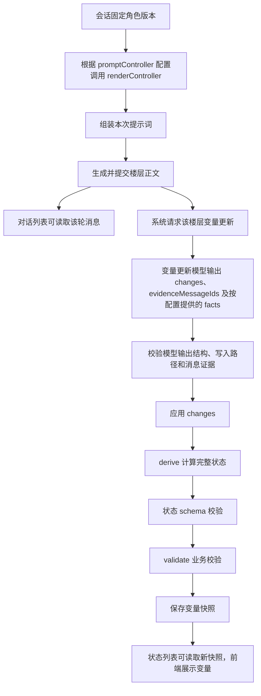

<!-- markdownlint-disable MD013 MD033 -->

# 角色卡后端 API

本文供原生角色包作者配置变量更新和世界书控制器，并编写 `derive`、`validate` 与 `renderController` 模块。包结构、导入和发布接口见[原生角色卡接口](native-card-api.md)；浏览器脚本可调用的方法见[角色 JavaScript API](script-api.md)；正文模型的系统随机采样、计算和同轮回传见[系统能力](model-capabilities.md)；其他模型工具见[Agent 工具 API](agent-tools-api.md)。

## 目录

- [1. 执行入口与数据流](#1-执行入口与数据流)
- [2. 公共数据类型](#2-公共数据类型)
- [3. stateUpdate：配置变量更新](#3-stateupdate配置变量更新)
- [4. 变量更新模型的输入与输出协议](#4-变量更新模型的输入与输出协议)
  - [4.1 模型输入](#41-模型输入)
  - [4.2 模型输出](#42-模型输出)
- [5. derive(context)：计算完整状态](#5-derivecontext计算完整状态)
- [6. validate(context)：校验业务规则](#6-validatecontext校验业务规则)
- [7. promptController：配置提示词控制器](#7-promptcontroller配置提示词控制器)
- [8. renderController(context)：生成世界书条目正文](#8-rendercontrollercontext生成世界书条目正文)
- [9. 模块使用、版本与校验](#9-模块使用版本与校验)
- [10. 错误定位](#10-错误定位)
- [11. 已保存变量的更新、重算与补全 API](#11-已保存变量的更新重算与补全-api)
  - [11.1 POST /sessions/:id/role-state/updates](#111-post-sessionsidrole-stateupdates)
  - [11.2 POST /sessions/:id/role-state/recalculate](#112-post-sessionsidrole-staterecalculate)
  - [11.3 POST /sessions/:id/role-state/restore-missing](#113-post-sessionsidrole-staterestore-missing)
  - [11.4 GET /sessions/:id/role-state/events](#114-get-sessionsidrole-stateevents)
  - [11.5 GET /sessions/:id/role-state/operations/:operationId](#115-get-sessionsidrole-stateoperationsoperationid)
  - [11.6 操作错误](#116-操作错误)
- [12. 配置与提示词结果验收](#12-配置与提示词结果验收)
  - [12.1 本地模块计算示例](#121-本地模块计算示例)
  - [12.2 变量更新与保存验收](#122-变量更新与保存验收)
  - [12.3 提示词与页面验收](#123-提示词与页面验收)

## 1. 执行入口与数据流

系统将导入的包配置固定到角色版本，使用该版本的会话按下表调用配置与模块。

| 原生包文件                         | 作者填写的内容                                                                 | 发布后的运行入口                 |
| ---------------------------------- | ------------------------------------------------------------------------------ | -------------------------------- |
| `agents/state-update/profile.json` | 独立状态预设、可写路径、规则和函数引用；状态定义引用固定的 `state/schema.json` | `stateUpdate.profile` 与所需文件 |
| `agents/state-update/*.json`       | 有序更新规则；来源条目以 `{bookId,entryId}` 引用                               | 更新模型请求中的规则内容         |
| `backend/variable-tools/*.js`      | 第 5 章的 `derive(context)`                                                    | 候选状态计算                     |
| `backend/validators/*.js`          | 第 6 章的 `validate(context)`                                                  | 业务规则检查                     |
| `backend/controllers/config.json`  | `modulePath`、`controllerEntries`、`updaterEntries`、变量宏和变量根路径        | 提示控制器配置                   |
| `backend/controllers/*.js`         | 第 8 章的 `renderController(context)`                                          | 指定世界书条目的正文生成         |

控制器条目引用的结构与选择规则见[提示控制器配置](#7-promptcontroller配置提示词控制器)。

系统使用 `state_updater` 槽位执行原生角色的变量更新。管理员为该槽位配置 LLM Profile；模型生成参数按第 3 章的优先顺序生效。

| 作者提供的入口              | 系统用途                                   | 作者获得的结果                 |
| --------------------------- | ------------------------------------------ | ------------------------------ |
| `stateUpdate`               | 配置变量更新模型、状态结构、计算和校验模块 | 楼层对应的变量快照             |
| `derive(context)`           | 根据候选状态和事实计算完整状态             | 计算后的完整候选状态           |
| `validate(context)`         | 对候选状态执行角色业务规则                 | 校验问题列表                   |
| `promptController`          | 选择世界书条目及其生成模块                 | 本次提示词组装使用的世界书副本 |
| `renderController(context)` | 用变量生成指定条目的正文                   | 世界书条目文本                 |

下图展示已配置 stateUpdate、derive、validate 和 promptController 的执行流程；各入口的启用条件见对应章节。



角色前端通过发送消息触发上述流程，读取与订阅结果的方法见[角色 JavaScript API](script-api.md)。

## 2. 公共数据类型

### 2.1 State 与 SourceMessage

```typescript
type State = Record<string, unknown>;
type SourceMessage = {
  messageId: string;
  revision: number;
  role: string;
  text: string;
};
```

`State` 是完整变量对象，其字段由角色的状态 JSON Schema 定义。`SourceMessage` 的 `messageId` 是证据标识，`revision` 是消息修订号，`role` 是说话者角色，`text` 是消息正文。当前变量更新服务取当前楼层选定消息页中未隐藏的 `user`、`assistant` 消息，按页面和消息顺序排列；助手文本使用消息接口提供的展示正文。

**数据示例**：更新前的状态和消息证据分别如下。

```javascript
const before = { score: 20, level: 2, location: "大厅" };
const sourceMessages = [
  {
    messageId: "message-1",
    revision: 1,
    role: "assistant",
    text: "完成检查，获得5点积分，随后抵达花园。",
  },
];
```

系统把 before 与 sourceMessages 传入下节的 ComputeContext；角色模块从 context 读取。

### 2.2 ComputeContext

```typescript
type ComputeContext = {
  before: State;
  candidate: State;
  sourceMessages: SourceMessage[];
  toolEvidence: RoleToolEvidence[];
  priorFacts: unknown[];
  floorBefore: State;
  facts: Record<string, unknown>;
};
```

| 字段             | 含义与当前取值                                                                                           |
| ---------------- | -------------------------------------------------------------------------------------------------------- |
| `before`         | 本次更新前值；配置 controllerOwnedPaths 时，已合并这些路径的控制器值                                     |
| `candidate`      | `derive` 收到应用 changes 后的状态；`validate` 收到 derive 后的状态                                      |
| `sourceMessages` | 本次更新使用的消息证据，见 2.1                                                                           |
| `toolEvidence`   | 最终正文关联的工具执行证据，字段及引用规则见[正文模型系统能力](model-capabilities.md#同轮结果和状态证据) |
| `priorFacts`     | 当前正式服务传入空数组；作者按空数组处理                                                                 |
| `floorBefore`    | 当前正式服务取与 `before` 相同的值                                                                       |
| `facts`          | 本次模型输出的事实；未声明事实 schema 时为 `{}`                                                          |

计算和校验函数收到的上下文是深层冻结的副本。需要修改状态时，作者先复制 `candidate`，再返回新对象。

**上下文数据示例**：完整上下文已保存为 [backend-input.json](examples/api-usage/backend-input.json)。在本地测试模块时，按第 5 章的实际调用方式把它传入 derive，再把返回状态设为 context.candidate，传给 validate。

```json
{
  "before": { "score": 20, "level": 2, "location": "大厅" },
  "candidate": { "score": 25, "level": 2, "location": "花园" },
  "sourceMessages": [
    {
      "messageId": "message-1",
      "revision": 1,
      "role": "assistant",
      "text": "完成检查，获得5点积分，随后抵达花园。"
    }
  ],
  "toolEvidence": [],
  "priorFacts": [],
  "floorBefore": { "score": 20, "level": 2, "location": "大厅" },
  "facts": {}
}
```

## 3. stateUpdate：配置变量更新

1. **配置位置**：作者将 profile 保存为原生包文件 `agents/state-update/profile.json`。该对象引用包内规则、状态 schema 和 JavaScript 模块；各引用文件按原生包目录和校验规则组织，见[原生角色卡接口](native-card-api.md)。字段如下。

   | 字段                      | 类型     | 必填／缺省行为                           | 用途                                                                                                                                   |
   | ------------------------- | -------- | ---------------------------------------- | -------------------------------------------------------------------------------------------------------------------------------------- |
   | `presetRef`               | object   | 可选；使用发布配置或角色版本默认值       | 独立状态预设引用；绑定字段及优先顺序见[状态提示词组装第2章](state-prompt-assembly.md#2-状态预设绑定与会话固定)                         |
   | `updaterPrompt`           | string   | 必填                                     | 原生包兼容字段；不参与正式状态模型请求                                                                                                 |
   | `writablePaths`           | string[] | 必填；允许空数组                         | 模型可以修改的精确 JSON Pointer 路径，每项以 `/` 开头                                                                                  |
   | `stateSchemaFile`         | string   | 可选；缺省时使用包内 `state/schema.json` | 完整状态 schema 文件路径                                                                                                               |
   | `ruleFiles`               | string[] | 可选；缺省时为空数组                     | 按数组顺序加入模型提示词的规则文件路径                                                                                                 |
   | `deriveScript`            | string   | 可选；缺省时跳过 `derive`                | 导出 `derive` 的模块路径                                                                                                               |
   | `validateScript`          | string   | 可选；缺省时跳过业务校验                 | 导出 `validate` 的模块路径                                                                                                             |
   | `moduleFiles`             | string[] | 可选；缺省时没有附加模块文件             | 其他 JavaScript 模块路径；原生包仅允许 `backend/variable-tools/*.js` 与 `backend/validators/*.js`，JSON 数据文件按模块中的相对导入声明 |
   | `factsSchema`             | object   | 可选；输出规则见第 4 章                  | 事实对象的 JSON Schema                                                                                                                 |
   | `derivedPaths`            | string[] | 可选；缺省时没有派生路径保护             | 由 derive 计算的字段或子树；模型写入约束见[第4章](#4-变量更新模型的输入与输出协议)                                                     |
   | `controllerOwnedPaths`    | string[] | 可选；缺省时为空数组                     | 从会话变量 `stat_data` 合入 `before` 的路径                                                                                            |
   | `initialDescriptionPaths` | string[] | 可选；缺省时为空数组                     | `restore-missing` 从初始状态刷新的描述路径；完整行为见第 11.3 节                                                                       |
   | `maxTokens`               | 正整数   | 可选；由活动 LLM Profile 决定            | 变量更新请求的输出 token 上限                                                                                                          |
   | `updaterReasoning`        | object   | 可选；由活动 LLM Profile 决定            | `effort` 可为 `none`、`low`、`medium` 或 `high`                                                                                        |
   | `extra`                   | object   | 可选                                     | 包内扩展数据                                                                                                                           |

2. 原生包的更新模型槽位由系统指定为 `state_updater`。活动 LLM Profile 中非空的生成参数覆盖 `maxTokens` 和 `updaterReasoning.effort`；系统使用 profile 与本次消息构造结构化输出 schema。

3. JavaScript 模块可以用相对路径导入包内已声明的 `.js` 模块或 `.json` 数据文件；JSON 导入使用默认导入并声明 `type: "json"`。

4. `controllerOwnedPaths` 与第 7 章的 `variableRoot` 分别配置。源状态和目标状态中的对应字段必须存在。

5. **可见结果**：成功更新后，前端可通过[变量状态历史 API](script-api.md#93-apihistorylistsnapshots--分页列出历史变量状态)读取新快照。

6. **执行时序**：缺少整个 stateUpdate 配置时，服务沿用前值生成快照；提供配置时按以下流程更新。系统在楼层已提交且生成运行完成后请求更新，再依次执行第 4–6 章协议。重复请求已经具有快照的楼层时返回现有快照。更新按同一分支的待更新楼层顺序执行。

7. **错误处理**：配置、模型输出或函数校验失败时，本次更新返回失败，保留此前已提交状态；按第 10 章定位。作者修订模块后发布新角色版本，并用绑定新版本的会话验证。

### 3.1 原生 ZIP 配置示例

1. 作者将下列对象写入 `agents/state-update/profile.json`，并在 `state/schema.json` 中定义字符串字段 `location`。
2. `presetRef` 指向状态预设 `state-preset-location` 的固定版本；该版本的主提示词包含地点更新指令“根据本轮消息更新地点；只有正文明确写出抵达新地点时才修改 `location`，并按输出契约提交消息证据”。
3. 作者填写的角色状态 profile 如下：

   ```json
   {
     "presetRef": {
       "presetId": "state-preset-location",
       "presetVersionId": "state-preset-location-v1"
     },
     "updaterPrompt": "保留原生包格式所需的兼容字段。",
     "writablePaths": ["/location"],
     "stateSchemaFile": "state/schema.json"
   }
   ```

## 4. 变量更新模型的输入与输出协议

**用途**：描述变量更新模型收到的规则、状态和证据，以及必须返回的数据。角色作者通过提示词和 schema 约束更新结果。

**输出签名**：

```typescript
type UpdateOutput = {
  changes: Array<
    { op: "set"; path: string; value: unknown } | { op: "remove"; path: string }
  >;
  evidenceMessageIds: string[];
  evidenceExecutionIds?: string[];
  facts?: Record<string, unknown>;
};
```

### 4.1 模型输入

1. 正式状态请求使用独立状态预设和共享提示词组装器；上下文来源、marker、变量历史和正式 dry-run 见[状态提示词组装第3至6章](state-prompt-assembly.md#3-请求上下文与状态变量历史)。

### 4.2 模型输出

`changes` 和 `evidenceMessageIds` 必填。配置 `factsSchema` 后 `facts` 必填且至少提供一个证据 ID；未配置时输出应省略 `facts`。有修改时至少提供一个消息证据 ID，`evidenceMessageIds` 中的所有 ID 必须来自本次 `sources`。

| 输出字段               | 用途                                                                        |
| ---------------------- | --------------------------------------------------------------------------- |
| `changes[].op`         | set 表示替换已有字段值，remove 表示删除已有字段                             |
| `changes[].path`       | 定位完整状态对象中的字段，使用 JSON Pointer 格式                            |
| `changes[].value`      | set 使用的新值，类型由对应状态字段 schema 约束；remove 省略此字段           |
| `evidenceMessageIds`   | 引用支持本次更新的消息，用于确认依据来自本次 sources                        |
| `evidenceExecutionIds` | 可省略；提供时引用本次 toolEvidence 中的执行 ID，省略表示提案未引用工具执行 |
| `facts`                | 给 derive、validate 使用的结构化事件事实；需保存的值由 derive 写入返回状态  |

每条写入路径必须精确匹配 `writablePaths`。同一输出中的路径必须互不重复且没有祖先／后代重叠，并与 `derivedPaths` 互不重叠。修改目标和父级必须已经存在。数组用一次 `set` 替换完整数组。`remove` 也须通过最终完整状态 schema；删除必填字段会失败。

当前输出 schema 从 `stateSchema.properties` 沿路径查找字段类型。作者须在该位置直接声明可写字段的结构。

**数据与存储**：模型输出首先成为内存中的变量更新提案；通过路径、证据、计算和校验后，才按第 3 章保存完整状态。

**执行时序**：系统解析完整模型响应，验证输出和证据，再应用修改并调用 `derive`。

**错误处理**：响应未正常结束、JSON 不合法、事实、证据或路径违规均中止本次更新；错误见第 10 章。

**输入与输出示例**：更新前 before 为 {"location":"大厅"}，sources 中 messageId 为 message-1 的正文为“你抵达花园。”。模型返回：

```json
{
  "changes": [{ "op": "set", "path": "/location", "value": "花园" }],
  "evidenceMessageIds": ["message-1"]
}
```

**示例结果**：通过第 1 章的计算和校验后，保存的状态为 {"location":"花园"}。

## 5. derive(context)：计算完整状态

**用途**：根据模型事实或候选状态执行确定性计算，例如从积分计算等级。

**调用签名**：

```typescript
export function derive(context: ComputeContext): State;
```

**配置入口**：profile.deriveScript 指向导出本函数的模块。

**输入参数**：唯一必填参数 context，字段及只读约束见第 2.2 节。

**输出结果**：同步返回完整变量对象，包含修改后的值和全部需要保留的字段。

**回调与时序**：本函数由系统直接调用。系统应用 changes 后调用一次；随后校验返回值的状态 schema。通过全部校验后，状态更新服务按第 3 章保存返回状态。

**错误处理**：抛出异常会使更新失败；返回对象不符合状态 schema 时产生 `STATE_SCHEMA_INVALID`。

**使用示例**：状态包含 `score` 与 `level`；配置 `writablePaths: ["/score"]`、`derivedPaths: ["/level"]`，并将本模块路径填入 `deriveScript`。状态 schema 同时声明两个整数。

```javascript
export function derive({ candidate }) {
  const next = { ...candidate };
  next.level = Math.floor(next.score / 10);
  return next;
}
```

**实际调用示例**：把上方导出函数保存在 backend-hooks.mjs；以下为 Node 本地验算调用。配套模块见[backend-hooks.mjs](examples/api-usage/backend-hooks.mjs)。

```javascript
import { derive } from "./backend-hooks.mjs";
const context = {
  before: { score: 15, level: 1 },
  candidate: { score: 25, level: 1 },
  sourceMessages: [
    {
      messageId: "message-1",
      revision: 1,
      role: "assistant",
      text: "获得10点积分。",
    },
  ],
  priorFacts: [],
  toolEvidence: [],
  floorBefore: { score: 15, level: 1 },
  facts: {},
};
const next = derive(context);
console.log(next); // { score: 25, level: 2 }
console.log(context.candidate); // { score: 25, level: 1 }，输入保留
```

## 6. validate(context)：校验业务规则

**用途**：检查 JSON Schema 之外的角色业务关系，例如积分变化方向。

**调用签名**：

```typescript
export function validate(context: ComputeContext): { issues: unknown[] };
```

**配置入口**：profile.validateScript 指向导出本函数的模块。

**输入参数**：唯一必填参数 context，字段及只读约束见第 2.2 节。

**输出结果**：返回 `{issues: []}` 表示通过。非空数组表示失败。服务校验 `issues` 的数组类型；每项内容由角色模块定义。

**回调与时序**：本函数由系统直接调用。完整状态通过 schema 后同步调用，成功后才保存快照。

**错误处理**：缺少 issues 数组产生 `STATE_VALIDATOR_INVALID`；非空 issues 产生 `STATE_RULE_INVALID` 并携带问题列表；抛出的异常使本次更新失败。

**使用示例**：此例允许积分增加或保持原值，下降时返回问题。示例问题对象用 path 定位字段，code 标识规则，message 说明问题与处理方法。

```javascript
export function validate({ before, candidate }) {
  return {
    issues:
      candidate.score < before.score
        ? [
            {
              path: "/score",
              code: "SCORE_DECREASED",
              message: "积分低于更新前值，请检查本轮积分变化规则。",
            },
          ]
        : [],
  };
}
```

**实际调用示例**：

```javascript
import { validate } from "./backend-hooks.mjs";
const context = {
  before: { score: 20 },
  candidate: { score: 25 },
  sourceMessages: [],
  priorFacts: [],
  toolEvidence: [],
  floorBefore: { score: 20 },
  facts: {},
};
console.log(validate(context)); // { issues: [] }
const rejected = validate({ ...context, candidate: { score: 15 } });
for (const issue of rejected.issues) {
  console.log(issue.path, issue.code, issue.message);
}
// /score SCORE_DECREASED 积分低于更新前值，请检查本轮积分变化规则。
```

**示例结果**：积分从 20 增加到 25 时 issues 为空；降到 15 时返回 SCORE_DECREASED 问题。

## 7. promptController：配置提示词控制器

**用途**：在提示词组装时，由角色函数生成世界书条目正文，并停用指定条目。

**原生包配置**：作者在 `character.json` 的 `promptController` 字段填写 `backend/controllers/config.json`。字段约束见下表：

| 字段                | 约束与用途                                                                                                               |
| ------------------- | ------------------------------------------------------------------------------------------------------------------------ |
| `modulePath`        | `backend/controllers/` 下导出 `renderController` 的 `.js` 文件路径                                                       |
| `controllerEntries` | `{bookId, entryId}` 数组；`bookId` 为包内世界书 ID，`entryId` 为该书非负整数 uid；系统生成这些条目的正文                 |
| `updaterEntries`    | 与 `controllerEntries` 相同的引用结构；系统在当前组装副本中停用这些条目                                                  |
| `variableRoot`      | 非空变量根键；控制器收到该键对应值的副本，键缺失时收到 `undefined`。作者在初始状态中提供该根值，或在控制器中处理缺失输入 |
| `variableMacros`    | `{source, target}` 数组，`source` 非空，按数组顺序作字面文本替换                                                         |

```json
{
  "modulePath": "backend/controllers/prompt.js",
  "controllerEntries": [{ "bookId": "harbor", "entryId": 110 }],
  "updaterEntries": [{ "bookId": "people", "entryId": 110 }],
  "variableRoot": "stat_data",
  "variableMacros": []
}
```

`bookId` 对应 `character.json` 的世界书绑定 ID；两本书可分别具有同一个条目 ID，控制器只处理被完整引用选中的条目。

配置对象和宏映射对象使用严格字段校验。`controllerEntries` 与 `updaterEntries` 可包含相同的 `{bookId, entryId}` 引用；该条目会停用，并由 `renderController` 生成正文。

**数据与存储**：配置保存在角色版本。

**条目生成条件**：角色作者在包内世界书条目的 `extra.extensions` 中配置 `triggers`、`delay`、`group`、`group_override`、`group_weight`、`useProbability` 和 `probability`。后端在控制器生成正文后执行这些条件，字段、顺序和示例见 [Worldbooks HTTP API：条目激活与筛选条件](http/worldbooks.md#条目激活与筛选条件)。

**运行结果**：系统使用 `promptController` 配置生成供本次组装使用的世界书副本。源角色卡和持久化世界书保持原值。是否进入最终消息仍由后续世界书激活和提示词组装决定。

**回调与时序**：系统依条目顺序调用第 8 章函数，再对条目内容应用宏映射。正式生成和使用同一组装器的 dry-run 都会执行这些计算。

**错误处理**：世界书、模块导出或返回值校验失败时组装失败；按第 10 章修正条目结构、模块导出或返回对象。

**配置结果**：按第 12.3 节的 dry-run 示例检查正文和条目是否进入请求。

## 8. renderController(context)：生成世界书条目正文

**用途**：根据当前变量生成指定世界书条目的提示词文本。

**调用签名**：

```typescript
type ControllerContext = {
  bookId: string;
  entryId: number;
  variables: unknown;
  characterBook: {
    entries: Array<{
      id: number;
      enabled: boolean;
      content: string;
      [key: string]: unknown;
    }>;
    [key: string]: unknown;
  };
};
type ControllerResult = { text: string; referencedEntryIds?: number[] };
export function renderController(
  context: ControllerContext,
): ControllerResult | Promise<ControllerResult>;
```

**输入参数**：唯一必填参数 `context`，字段如下。系统以 `bookId` 和 `entryId` 共同定位当前条目，`characterBook` 只包含该本书。`referencedEntryIds` 表示当前书中的条目 ID；跨书目标通过配置中的 `{bookId, entryId}` 声明。对于会话另行绑定的世界书，系统将 `uid` 映射为 `id`，将 `disable` 的反值映射为 `enabled`。

| context 字段            | 实际用途与条件                                                |
| ----------------------- | ------------------------------------------------------------- |
| `bookId`                | 原生包当前书的包内 ID，与 entryId 共同定位条目                |
| `entryId`               | 当前正文条目的 ID，由 `controllerEntries` 中匹配的引用确定    |
| `variables`             | 从第 7 章 variableRoot 指定根键复制的值；缺失行为见该字段定义 |
| `characterBook.entries` | 控制器处理前的条目列表；可用于读取作者其他条目的原始内容      |
| `entries[].id`          | 条目唯一定位标识，用来找到需要引用的条目                      |
| `entries[].enabled`     | 输入世界书中该条目的启用标记；取自控制器处理前的世界书副本    |
| `entries[].content`     | 输入世界书中该条目的原始正文，供角色函数选择或组合            |
| 扩展字段                | 原世界书对象及条目上的其他属性，按该世界书实际字段读取        |

**数据与存储**：函数返回文本由调用方写入本次请求使用的世界书副本。

**输出结果**：必填 `text` 替换当前条目正文，允许空字符串。可选 `referencedEntryIds` 是不重复整数数组；当前调用方对该字段进行结构校验。

**回调与时序**：本函数由系统直接调用。支持同步返回及 Promise，调用方等待完成后处理下一条目。

**错误处理**：缺少导出函数产生 `ROLE_PROMPT_CONTROLLER_EXPORT_MISSING`；缺少 text 或字段类型不合法产生 `ROLE_PROMPT_CONTROLLER_RESULT_INVALID`。函数抛出的异常或 Promise 拒绝使组装失败。

**使用示例**：示例约定根变量含字符串 location。

```javascript
export function renderController({ variables }) {
  return { text: `当前地点：${variables.location}。` };
}
```

**实际调用示例**：

```javascript
import { renderController } from "./backend-hooks.mjs";
const result = await renderController({
  bookId: "harbor",
  entryId: 10,
  variables: { location: "花园" },
  characterBook: {
    entries: [{ id: 10, enabled: true, content: "待生成的地点说明" }],
  },
});
console.log(result); // { text: "当前地点：花园。" }
```

## 9. 模块使用、版本与校验

1. 后端模块通过具名 `export` 提供 `derive`、`validate` 和 `renderController`。原生包的 `moduleFiles`、JavaScript 相对导入和 JSON 数据导入规则见[第3章](#3-stateupdate配置变量更新)；包目录与导入入口见[原生角色卡接口](native-card-api.md)。
2. 系统从固定角色版本中的本次入口开始，沿静态相对导入递归收集已声明的 JavaScript 模块和 JSON 数据文件，并只把该依赖集合交给 worker。重复导入和循环引用涉及的每个依赖文件仅计入一次；未导入的世界书文件不占模块文件数和模块字节额度。
3. 模块校验器和 worker 继续执行包内相对路径、文件用途和扩展名约束。JavaScript 导入目标必须是 `server_script` 文件，JSON 导入目标必须是 `data` 文件并使用 `type=json` 属性；外部模块、动态导入和主机文件访问仍被拒绝。
4. `maxModuleFiles` 和 `maxModuleBytes` 按本次入口的实际依赖集合计数。`maxInputBytes`、执行期限和并发额度继续按现有配置执行。

5. 会话使用固定角色版本中的模块。更新模块后，作者使用包含新模块的角色版本创建或切换测试会话，再通过本页的正式接口核对结果。浏览器入口和页面调用方式见[角色 JavaScript API](script-api.md)。

6. 前端模块的导入检查与修正方法见[前端入口契约](script-template-api.md#作者检查)。

## 10. 错误定位

下表列出变量更新和提示词控制器接口返回的错误标识、发生情况及修复操作。调用方读取 HTTP 错误中的 `code`、`message` 和 `details`，按错误详情中的角色版本、路径或字段定位问题。

| 标识                                       | 情况                                                       | 作者操作                                                                                             |
| ------------------------------------------ | ---------------------------------------------------------- | ---------------------------------------------------------------------------------------------------- |
| `ROLE_STATE_CONFIG_MISSING`                | 原生包缺少变量更新 profile 或完整状态 schema               | 在原生包补齐 `agents/state-update/profile.json` 和 `state/schema.json`，发布新版本后用新版本会话验证 |
| `ROLE_SESSION_VERSION_MISSING`             | 会话缺少固定角色版本                                       | 使用绑定已发布版本的会话                                                                             |
| `ROLE_STATE_UNINITIALIZED`                 | 尚无初始状态快照                                           | 完成会话初始状态创建                                                                                 |
| `ROLE_STATE_BUSY`                          | 会话正执行变量更新                                         | 等待当前更新结束                                                                                     |
| `ROLE_FLOOR_NOT_FOUND`                     | 指定会话中查不到该楼层                                     | 从当前会话选择已有楼层                                                                               |
| `ROLE_FLOOR_NOT_COMMITTED`                 | 楼层状态尚未变为 `committed`（已提交）                     | 等待正文提交完成                                                                                     |
| `ROLE_FLOOR_RUN_INCOMPLETE`                | 楼层缺少运行记录，或运行状态尚未变为 `completed`（已完成） | 检查该楼层生成运行，完成后再更新变量                                                                 |
| `ROLE_STATE_BRANCH_MISMATCH`               | 楼层分支与前一份状态的分支不同                             | 使用当前变量状态所属分支的楼层                                                                       |
| `ROLE_STATE_OUT_OF_ORDER`                  | 请求楼层与当前待更新楼层不同                               | 按 `details.expected_floor_id` 指向的楼层先执行变量更新，再重试当前楼层                              |
| `ROLE_CONTROLLER_STATE_INVALID`            | stat_data 不是对象                                         | 修正对应会话变量初始化                                                                               |
| `ROLE_UPDATER_PROFILE_MISSING`             | 选定模型槽位没有配置                                       | 在系统中配置该槽位的 LLM Profile                                                                     |
| `ROLE_STATE_OUTPUT_INCOMPLETE`             | 变量更新模型未完整生成结果                                 | 联系管理员检查 `state_updater` 的模型输出长度设置；作者可精简提示词后重试                            |
| `ROLE_STATE_OUTPUT_INVALID`                | 响应正文无法解析为 JSON，或基础输出结构校验失败            | 对照第 4 章修正提示词与输出结构                                                                      |
| `STATE_OUTPUT_INVALID`                     | 更新提案结构不合法                                         | 对照第 4 章修正输出                                                                                  |
| `STATE_FACTS_INVALID`                      | facts 未通过 factsSchema 校验                              | 按校验详情修正事实字段                                                                               |
| `STATE_FACTS_UNDECLARED`                   | 输出包含 facts，但配置未声明 factsSchema                   | 声明事实 schema 或从输出中省略 facts                                                                 |
| `STATE_EVIDENCE_REQUIRED`                  | 存在修改或已配置 factsSchema，但证据 ID 数组为空           | 提供本次 sources 中支持修改的 messageId                                                              |
| `STATE_EVIDENCE_INVALID`                   | 证据 ID 包含本次 sources 之外的值                          | 使用本次 sources 中的 messageId                                                                      |
| `STATE_PATH_OVERLAP`                       | 同次修改存在重复路径或祖先后代路径重叠                     | 合并为一次完整字段修改                                                                               |
| `STATE_DERIVED_WRITE`                      | 修改路径与 derivedPaths 重叠                               | 由 derive 计算该字段                                                                                 |
| `STATE_PATH_FORBIDDEN`                     | 修改路径未精确匹配 writablePaths                           | 使用配置允许的完整路径                                                                               |
| `STATE_PATH_MISSING`                       | 修改目标或其父级在原状态中缺失                             | 在初始状态中提供目标字段及父级对象                                                                   |
| `STATE_SCHEMA_INVALID`                     | 完整候选状态不符合 schema                                  | 检查 changes 和 derive 返回值                                                                        |
| `STATE_VALIDATOR_INVALID`                  | validate 返回对象缺少 issues 数组                          | 返回 {issues: []} 或包含问题项的数组                                                                 |
| `STATE_RULE_INVALID`                       | validate 返回非空 issues                                   | 按问题列表修正候选状态或业务规则                                                                     |
| `ROLE_ASSET_PACKAGE_INVALID`               | 角色包结构、引用用途或文件完整性校验失败                   | 按错误详情的 path 和 purpose 修正包内文件并重新发布                                                  |
| `ROLE_ASSET_NOT_FOUND`                     | 角色版本或指定包内文件无法读取                             | 核对会话固定的角色版本 ID 和错误详情中的包内路径；修正引用后发布新版本                               |
| `ROLE_ASSET_FILE_MISSING`                  | 已发布角色包缺少错误详情中的文件                           | 将该路径文件补回原生包，重新校验并发布新版本，再使用新版本会话                                       |
| `ROLE_PROMPT_CONTROLLER_WORLDBOOK_MISSING` | 缺少世界书                                                 | 为角色提供包含 entries 的世界书                                                                      |
| `ROLE_PROMPT_CONTROLLER_WORLDBOOK_INVALID` | 世界书结构不符                                             | 修正 entries 中条目的 id、enabled、content                                                           |
| `ROLE_PROMPT_CONTROLLER_LOADER_MISSING`    | 当前服务无法加载角色包中的控制器模块                       | 将错误码和角色版本 ID 提交给服务维护者；加载能力恢复后重新运行 dry-run                               |
| `ROLE_PROMPT_CONTROLLER_EXPORT_MISSING`    | 控制器模块缺少 renderController 导出                       | 按第 8 章导出函数                                                                                    |
| `ROLE_PROMPT_CONTROLLER_RESULT_INVALID`    | 控制器返回值缺少 text 或字段类型错误                       | 按第 8 章返回 ControllerResult                                                                       |

包检查或模块错误会指出角色包路径，并在可定位时提供行列和缺少的导出名称；作者按错误详情修正文件并发布新版本。供应商拒绝、超时或输出中断时，作者检查本次更新接口返回的错误说明以及槽位使用的模型服务设置，再修正提示词、输出限制或服务配置后重试。

## 11. 已保存变量的更新、重算与补全 API

本章说明会话变量更新及其修复接口。请求沿用会话 API 的认证方式；`id` 是 URL 中的会话 ID。角色脚本调用 `recalculateLatest` 和 `restoreMissing` 的参数与结果见[角色 JavaScript API](script-api.md#55-apivariablesrecalculatelatest--重新计算最新楼层变量)。本章的 HTTP 字段、返回值和事件以正式接口为准。

### 11.1 POST `/sessions/:id/role-state/updates`

**用途**：为已提交楼层执行变量更新，并返回该楼层保存的变量快照。

**请求体**：`floor_id` 是非空字符串，填写当前分支按顺序待更新的楼层 ID。

```http
POST /sessions/session-1/role-state/updates
Content-Type: application/json

{"floor_id":"floor-3"}
```

**时序**：后端在该楼层正文和生成运行完成后执行第 3–8 章中的变量更新流程。相同楼层已经有快照时，接口返回该快照；其他楼层必须先完成当前分支更早的待更新楼层。

**成功响应**：HTTP 200 返回 `{data: Snapshot}`。`Snapshot` 的完整字段见[角色 JavaScript API 的 Snapshot 定义](script-api.md#31-snapshot会话初始或某轮回复后的角色变量记录)；示例和保存验收见第 12.2 节。配置、顺序、模型及校验错误见第 10 章。

### 11.2 POST `/sessions/:id/role-state/recalculate`

**用途**：用最新已提交楼层的正文重新运行变量更新模型、`derive` 和 `validate`。连续重算同一楼层时，后端始终以该楼层第一次计算前的状态为输入。

| 参数                   | 类型       | 用途                                         |
| ---------------------- | ---------- | -------------------------------------------- |
| URL `id`               | 非空字符串 | 所属会话 ID                                  |
| `branch_id`            | 非空字符串 | 目标会话分支                                 |
| `floor_id`             | 非空字符串 | 当前分支最新已提交楼层 ID                    |
| `expected_snapshot_id` | 非空字符串 | 发起操作时看到的当前快照 ID，用于并发检查    |
| `operation_id`         | 非空字符串 | 本次操作编号；重试必须复用相同编号和相同参数 |

```http
POST /sessions/session-1/role-state/recalculate
Content-Type: application/json

{"branch_id":"main","floor_id":"floor-3","expected_snapshot_id":"snapshot-3","operation_id":"repair-1"}
```

**成功响应**：HTTP 200 返回 `{data: {operationId, before, after}}`。`before` 和 `after` 均为完整 Snapshot，分别表示提交前和重算后的当前状态；`operationId` 等于请求的 `operation_id`。字段定义见[角色 JavaScript API 的 Snapshot 定义](script-api.md#31-snapshot会话初始或某轮回复后的角色变量记录)。

```json
{
  "data": {
    "operationId": "repair-1",
    "before": {
      "sessionId": "session-1",
      "branchId": "main",
      "floorId": "floor-3",
      "attemptId": "run-1:1",
      "versionId": "version-1",
      "snapshotId": "snapshot-3",
      "parentSnapshotId": "snapshot-2",
      "variables": { "location": "大厅" },
      "source": { "kind": "floor", "runId": "run-1", "jobId": null }
    },
    "after": {
      "sessionId": "session-1",
      "branchId": "main",
      "floorId": "floor-3",
      "attemptId": "run-1:1",
      "versionId": "version-1",
      "snapshotId": "snapshot-4",
      "parentSnapshotId": "snapshot-3",
      "variables": { "location": "花园" },
      "source": { "kind": "manual", "runId": null, "jobId": null }
    }
  }
}
```

后端执行模型、派生和校验后提交 `after`；成功后发送第 11.4 节定义的 `state_repair` 事件。相同编号和参数的重试返回同一操作结果；操作仍在执行时返回忙碌错误；相同编号搭配不同参数时返回冲突错误。

### 11.3 POST `/sessions/:id/role-state/restore-missing`

**用途**：从会话初始状态递归补入当前状态缺少的对象字段，并调用该角色版本的 `derive` 和 `validate`。现有值（包括 `0`、`false`、空字符串、`null` 和数组）继续保留。

请求字段与第 11.2 节相同，省略 `floor_id`；`branch_id`、`expected_snapshot_id` 和 `operation_id` 均为非空字符串。重试使用相同编号和请求参数。

```http
POST /sessions/session-1/role-state/restore-missing
Content-Type: application/json

{"branch_id":"main","expected_snapshot_id":"snapshot-3","operation_id":"repair-2"}
```

**描述刷新路径**：作者可在 `agents/state-update/profile.json` 的可选字段 `initialDescriptionPaths` 中声明描述字段的 JSON Pointer。补全时，后端从初始状态复制这些路径的值，同时保留同一数组中其他字段；例如 `/energy/1` 更新描述值，`/energy/0` 的剧情值保持原样。

```json
{ "initialDescriptionPaths": ["/energy/1", "/location/description"] }
```

**成功响应和时序**：HTTP 200 返回 `{data: {operationId, before, after}}`，字段结构见第 11.2 节。如果变量发生变化，后端保存新快照并发送 `state_repair`；结果与当前值相同时，`before` 和 `after` 使用同一快照，后端完成操作记录且不发送变更事件。此接口只运行确定性计算，不调用变量更新模型。

### 11.4 GET `/sessions/:id/role-state/events`

**用途**：让同一会话的页面接收初始当前状态和后续重算、补全操作的提交结果。调用方提交非空 `branch_id` 查询参数，并设置 `Accept: text/event-stream`。

```http
GET /sessions/session-1/role-state/events?branch_id=main
Accept: text/event-stream
```

HTTP 200 流首先发送 `state_current`，之后发送变量修复提交产生的 `state_repair`。连接每 15 秒发送一次 SSE 心跳注释；断线后按客户端的重连策略建立新连接，新连接再次接收 `state_current`。

```text
event: state_current
data: {"sessionId":"session-1","branchId":"main","floorId":"floor-3","attemptId":"run-1:1","versionId":"version-1","snapshotId":"snapshot-3","parentSnapshotId":"snapshot-2","variables":{"location":"大厅"},"source":{"kind":"floor","runId":"run-1","jobId":null}}

event: state_repair
data: {"operationId":"repair-1","after":{"sessionId":"session-1","branchId":"main","floorId":"floor-3","attemptId":"run-1:1","versionId":"version-1","snapshotId":"snapshot-4","parentSnapshotId":"snapshot-3","variables":{"location":"花园"},"source":{"kind":"manual","runId":null,"jobId":null}}}
```

`state_current` 的 `data` 是完整 Snapshot；`state_repair` 的 `data` 包含 `operationId` 和完整 `after` Snapshot。会话没有当前快照时，服务器返回 `ROLE_STATE_UNINITIALIZED`；其他接口错误见第 11.6 节。

### 11.5 GET `/sessions/:id/role-state/operations/:operationId`

**用途**：按会话和操作编号查询重算或补全的状态及失败原因。

```http
GET /sessions/session-1/role-state/operations/repair-1
```

**成功响应**：HTTP 200 返回以下结构：

```json
{
  "data": {
    "operationId": "repair-1",
    "sessionId": "session-1",
    "branchId": "main",
    "kind": "recalculate",
    "floorId": "floor-3",
    "beforeSnapshotId": "snapshot-3",
    "sourceSnapshotId": "snapshot-2",
    "afterSnapshotId": "snapshot-4",
    "status": "succeeded",
    "error": null
  }
}
```

上述字段始终返回，快照与操作类型按下表解释。

| 字段                                   | 类型与取值                         | 用途及为空条件                                                                        |
| -------------------------------------- | ---------------------------------- | ------------------------------------------------------------------------------------- |
| `operationId`、`sessionId`、`branchId` | 非空字符串                         | 操作、会话和分支标识                                                                  |
| `kind`                                 | `recalculate` 或 `restore_missing` | 重新计算最近楼层，或补全缺失字段                                                      |
| `floorId`                              | 字符串或 `null`                    | 重算的目标楼层；补全为 `null`                                                         |
| `beforeSnapshotId`                     | 字符串或 `null`                    | 成功提交前的当前快照；执行中或失败时为 `null`                                         |
| `sourceSnapshotId`                     | 字符串或 `null`                    | 重算使用该楼层第一次计算前的快照；补全使用当前会话的初始快照；执行中或失败时为 `null` |
| `afterSnapshotId`                      | 字符串或 `null`                    | 成功后的快照；执行中或失败时为 `null`。补全未改变变量时与 `beforeSnapshotId` 相同     |
| `status`                               | `running`、`succeeded` 或 `failed` | 操作执行中、成功或失败                                                                |
| `error`                                | 对象或 `null`                      | 失败对象含 `code`、`message` 和可选 `details`；执行中或成功时为 `null`                |

重复重算始终使用同一份 `sourceSnapshotId` 对应的计算前值，`beforeSnapshotId` 则对应此次提交前的当前状态，两者分别用于核对计算依据和保存结果。

### 11.6 操作错误

错误响应使用 `error.code`、`error.message` 和可选的 `error.details`。模型、派生和业务校验错误另见第 10 章。

| 错误码                                  | HTTP 状态 | 情况及处理                                                                                                 |
| --------------------------------------- | --------- | ---------------------------------------------------------------------------------------------------------- |
| `ROLE_STATE_REPAIR_STALE`               | 409       | 当前快照已变化；重新读取 current 状态，并用新快照 ID 发起操作                                              |
| `ROLE_STATE_REPAIR_FLOOR_CHANGED`       | 409       | 指定楼层不再是分支最新楼层；读取最新楼层 ID 后重新发起重算                                                 |
| `ROLE_STATE_REPAIR_BUSY`                | 409       | 会话正在生成正文或更新变量；等待当前操作结束后重试                                                         |
| `ROLE_STATE_REPAIR_OPERATION_CONFLICT`  | 409       | 操作编号已用于不同请求；为新操作生成新的编号，并保持该操作重试参数一致                                     |
| `ROLE_STATE_REPAIR_VALIDATION_FAILED`   | 422       | 补全结果不符合 schema 或业务规则；按 `details.path` 和 `details.constraint` 修正角色包，再用新版本会话复验 |
| `ROLE_STATE_REPAIR_SOURCE_MISSING`      | 409       | 找不到重算所需的楼层前值；联系维护者修复该楼层的历史状态后重试                                             |
| `ROLE_STATE_REPAIR_OPERATION_NOT_FOUND` | 404       | 会话中没有该编号的操作；核对会话和操作 ID，或回到原会话重新操作                                            |
| `ROLE_STATE_REPAIR_FAILED`              | 500       | 操作未能完成；查询第 11.5 节的操作记录读取失败原因，修正原因后再重试                                       |
| `ROLE_STATE_UNINITIALIZED`              | 409       | 会话没有初始状态；选择带初始变量的开场并重新创建会话                                                       |
| `ROLE_STATE_CONFIG_MISSING`             | 404       | 固定角色版本没有变量更新配置；为角色包补齐 profile 和状态 schema 后使用新版本会话                          |
| `ROLE_UPDATER_PROFILE_MISSING`          | 409       | `state_updater` 槽位没有可用模型配置；请管理员为该槽位配置 LLM Profile                                     |

变量操作失败时，当前快照保持原值。`ROLE_STATE_REPAIR_FAILED` 的错误详情可通过第 11.5 节查询；客户端应按具体错误操作后再发起新请求。

## 12. 配置与提示词结果验收

### 12.1 本地模块计算示例

作者可用固定输入分别调用 `derive`、`validate` 和 `renderController`，核对返回状态、问题列表和条目文本。安装 Node.js 后，可在本页所在目录运行可访问的[完整示例](examples/api-usage/run-backend.mjs)：

```sh
node examples/api-usage/run-backend.mjs
```

预期输出：

```json
{
  "candidate": { "score": 25, "level": 2, "location": "花园" },
  "validation": { "issues": [] },
  "rendered": { "text": "当前地点：花园。" }
}
```

### 12.2 变量更新与保存验收

作者通过正式变量更新流程提交测试消息，检查模型输出是否符合第 4 章的状态、路径和证据约束。作者分别核对已保存正文和已提交变量状态：

| 验收对象       | 前端调用与正式后端接口                                                                                                                                         | 通过条件                                                                         |
| -------------- | -------------------------------------------------------------------------------------------------------------------------------------------------------------- | -------------------------------------------------------------------------------- |
| 已保存对话     | `api.messages.listFloors` 对应 `GET /sessions/:id/role-messages/floors`；`api.messages.getFloor` 对应 `GET /sessions/:id/role-messages`                        | 正文保存后可读取该轮消息；变量更新失败时仍可读取同一正文                         |
| 已提交变量状态 | `api.history.listSnapshots` 对应 `GET /sessions/:id/role-view/snapshots`；`api.variables.getSnapshot` 对应 `GET /sessions/:id/role-view/snapshots/:snapshotId` | 列表包含初始状态与成功提交的状态；更新失败时保留此前状态，重试成功后可读取新状态 |

接口请求参数、返回字段、错误与示例见[对话查询](script-api.md#6-已保存的楼层消息)、[变量状态列表](script-api.md#93-apihistorylistsnapshots--分页列出历史变量状态)和[变量状态详情](script-api.md#54-apivariablesgetsnapshot--读取指定快照)。作者使用返回的 `floorId` 或 `snapshotId` 读取对应消息或状态记录；分页时按 `nextCursor` 继续读取。

### 12.3 提示词与页面验收

作者通过正式 `POST /sessions/:id/respond/dry-run` 检查提示词组装。服务启用 `ENABLE_PROMPT_DRY_RUN` 并配置该接口所需的聊天服务后，请求沿用会话 API 的认证方式。将 URL 中的 `:id` 替换为测试会话 ID，并按该会话已经固定的人设、开场和历史编写 `message`。以下请求体适用于历史中已经出现信封、角色继续检查信封的场景：

```json
{
  "message": "继续检查手中的信封。",
  "debug_options": { "include_worldbook_matches": true }
}
```

作者检查响应 `data.messages` 中的人设、预设人称、历史、当前输入和控制器文本，结合 `data.prompt_snapshot` 确认固定资源，并通过 `data.assembly.worldbook_matches` 与 `data.runtime_trace` 核对世界书激活和展开来源。开启 `include_worldbook_matches` 后，`data.runtime_trace.worldbook.decision_traces` 还会显示生成动作、消息数量、同组选择和概率筛选。完整请求及响应见[Prompt Dry-run](https://fzfz.github.io/TavernHeadless-docs/reference/api/chat#prompt-dry-run)；世界书条件见[Worldbooks HTTP API：条目激活与筛选条件](http/worldbooks.md#条目激活与筛选条件)。

变量更新成功后，作者通过前端变量读取和订阅 API 检查快照，并在页面核对绑定字段。对话正文按流式事件的实际顺序检查页面显示。
