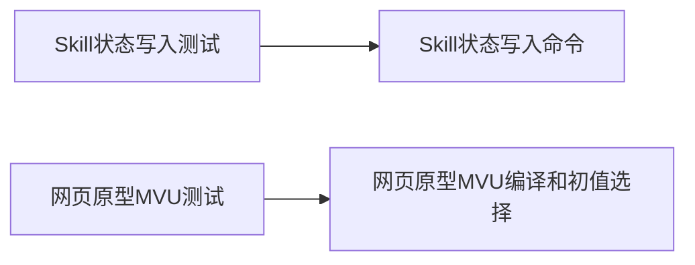

# MVU 回归测试归属调整

## 1. 名词定义

1. Skill 测试指转换 Skill 的状态写入接口测试。
2. 原型测试指网页原型的 MVU 编译与初值选择测试。

## 2. 总目标

1. 原型测试随网页原型保存；Skill 测试验证当前转换命令，执行者可使用 Git 提交中的文件运行 Skill 测试。

## 3. 现状调研

1. 基准提交为40601ef。源卡转换原工作区位于`/srv/tavern/TavernHeadless-remove-preview-credentials`；交付工作区位于`/Users/developer/.codex/worktrees/native-card-review-fixes/TavernHeadless`。
2. 调查证据与覆盖对应关系见[findings.md](findings.md)。

## 4. 面临的问题

1. mvu-regressions.test.ts位于Skill目录，却依赖原工作区中尚未提交的网页原型。原工作区的完整测试结果无法证明Git提交具备这些依赖。

## 5. 问题的解决和实施方案

### 5.1 实施方案要遵守的架构流程图

### 5.2 实施方案步骤

1. 在交付工作区复现测试加载失败，核对原型用例与Skill已有测试。
2. 在原工作区将原型测试移至原型目录并调整导入；交付工作区移除Skill中误放的副本。
3. 对Skill确有能力而缺少覆盖的行为补充接口测试。
4. 分别运行原型测试、Skill测试和交付工作区全量测试，记录结果并独立审查。

## 6. 方案待决策项清单

1. 当前无待决策事项。

## 7. 计划验收清单

1. 原型用例迁移后保持原有断言并通过。
2. Skill测试仅引用已交付实现，状态约束的有效值和错误值获得接口验证。
3. 交付工作区全量测试完成，逐项记录失败或通过的结果。

## 8. 非本次目标

1. 网页原型整套实现的发布由原型交付任务处理。
2. CLI的CI构建依赖与测试超时由对应问题处理。

## 9. 已获得的授权

1. 用户已确认将测试归回网页原型、核对Skill覆盖并独立验收的方案。
