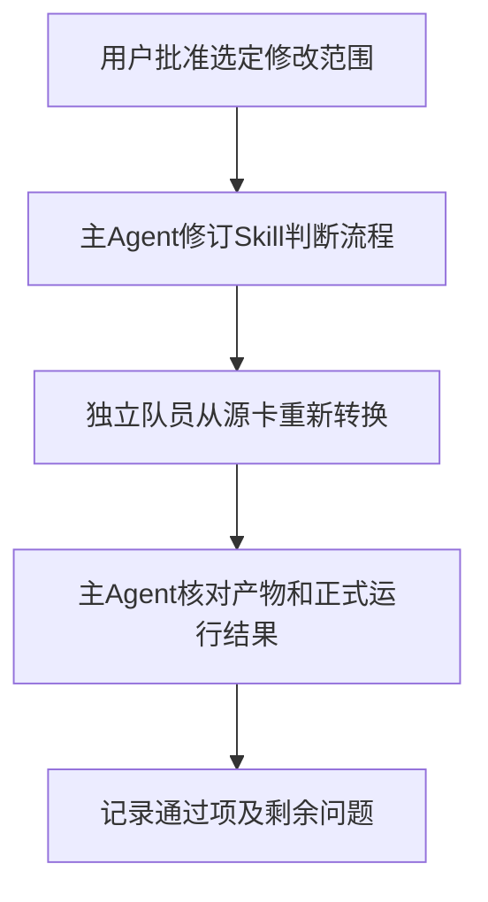

# 后续维护方案

## 1. 总目标

1. 转换Agent按实际功能选择已有接口，按当前Skill规则处理源卡的显示行为、姓名绑定和状态含义，并以新的独立转换验证修改。

## 2. 现状调研

1. 本轮迁移和测试记录见[执行进度](progress.md)；各卡原始结果、产物和正式运行证据位于同名子目录。
2. 显示标签改名已获用户授权并写入Skill；直接调用正式摘要提取函数的前后对照见tag-extraction-comparison.json。
3. C011/acceptance.json记录已有姓名读取和初值宏展开入口；USER002/result.json记录动态画廊停止依据；C034/execution.json记录初值处理决定。

## 3. 面临的问题

1. C011转换队员遗漏已有接口，错误地停止转换。
2. USER002转换队员将源页面动态创建节点的实现方式视为目标能力要求；尚需判断固定画廊数据能否通过静态元素和公开布局接口保持相同功能。
3. C034源卡同时给出具体初值和初始化占位要求，转换队员选择具体值；该选择对默认开场的影响尚未验收。

## 4. 问题的解决和实施方案

### 4.1. 实施流程

### 4.2. 实施步骤

1. 主Agent在能力缺口判断中要求转换Agent先按所需输入、输出和时序查阅对应API章节及只读实现，再作出停止决定；以C011重新转换验证姓名入口的选择。
2. 主Agent要求转换Agent分别识别源功能与源实现方式。源数据数量固定时，转换Agent评估静态元素能否保留筛选、解锁、查看和导航行为；以USER002重新转换验证判断结果。
3. 主Agent为相互冲突的初值要求补充依据核对流程，要求转换Agent明确各规则的作用时点，并保存无法判定的冲突；以C034默认开场及候选开场验证实际初始化结果。

## 5. 方案待决策项清单

1. 是否批准第4.2节第1至3项Skill判断流程修改。

## 6. 计划验收清单

1. 新转换均由干净上下文队员独立执行，主Agent保留原失败产物。
2. C011实际页面显示绑定姓名，初值及提示中的姓名宏展开正确。
3. USER002画廊的解锁、查看和导航按源条件工作。
4. C034各开场的实际初值与选定依据一致。

## 7. 非本次目标

1. 改写角色剧情、补写源卡缺失的外置脚本，以及变更未获授权的系统接口。

## 8. 已获得的授权

1. 用户授权迁移转换专用文件、使用原三张指定卡和原五张随机卡测试，并保存问题及进度。
2. 用户已授权将与宿主摘要提取冲突的源显示标签改名，并同步适配关联引用。
3. 用户已授权默认忽略display正则功能。
