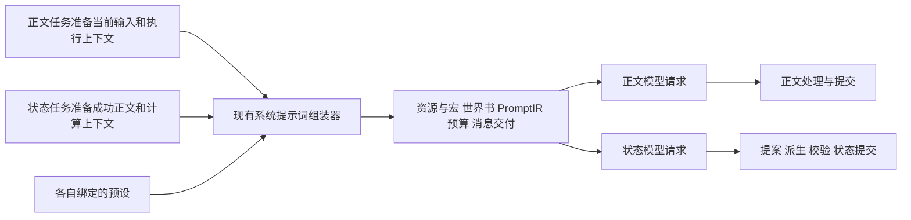

<!-- markdownlint-disable MD013 -->

# 状态 Agent 复用系统提示词组装的架构方案

## 1. 总目标

1. 管理员分别为正文 Agent 与状态 Agent 选择预设和模型，通过现有预设编辑器安排任务内容，并自行调试实际请求。组装方式见第4.3节。
2. 开发者为状态任务接入角色资料、人物身份、剧情资料、变量及更新依据。第4.2节规定拟供预设引用的数据及其用途；现有 contributor 和注入机制继续承载管理员配置的附加内容。
3. 后端按第4.4节分别处理正文结果和状态提案。
4. 转换 Agent 按[转换最高原则](../../../.agents/skills/native-card-conversion/SKILL.md#转换最高原则原文承接)保存角色内容和更新规则，按正式 API 转写源代码。
5. 本次交付包括现状调研、改动对照、架构方案及第4.5.3节的计划执行用预设文件和来源材料。

## 2. 现状调研

1. 正文的数据来源与处理见[现状调研](prompt-assembly-research.md)第2、3节。
2. 组装模式、节点、预算和消息处理见《现状调研》第4至8节。
3. 状态任务的数据消费及结果处理见《现状调研》第9节，核对范围见第10节。

## 3. 面临的问题

1. [改动对照](prompt-assembly-change-comparison.md)第3节列出 P1 至 P7，并逐项引用现状依据。
2. 组装入口、本轮消息和变量上下文对应 P1 至 P3；状态数据来源、变量历史、任务预设及规则资源对应 P4 至 P7。

## 4. 解决和实施方案

### 4.1 两类任务的职责

1. 两类任务的职责对照：

   | 设计项 | 拟定的正文任务处理 | 拟定的状态任务处理 |
   | --- | --- | --- |
   | 执行目的 | 根据当前输入生成后续演绎正文 | 根据已发生的正文提出变量变化 |
   | 执行时点 | 用户输入已确定，当前回复尚未生成 | 正文楼层及其有效回复已经成功保存 |
   | 预设 | 管理员配置演绎任务与输出要求 | 管理员配置变量判断任务与提案要求 |
   | 组装策略 | 使用已有提示词模式及组装流程 | 使用同一组模式及流程，通过所选预设配置内容 |
   | 模型绑定 | 使用管理员绑定的正文模型 | 使用管理员绑定的变量更新模型 |
   | 本轮消息 | 当前用户输入 | 已保存的用户输入及成功助手正文 |
   | 状态读值 | 正文执行上下文可见的变量 | 本次计算前值及其对应变量上下文 |
   | 输出 | 模型正文及已接受的工具执行结果 | 现有 `changes`、消息证据、工具证据和配置要求的 `facts` |
   | 结果处理 | 正文输出处理及正文提交 | 应用提案、派生、完整状态校验、业务校验及快照提交 |

### 4.2 拟供预设引用的数据及其用途

1. 下表的文件路径以 ZIP 包根目录为基准。`*` 表示作者自定的文件名，`{bookId}` 表示 `character.json` 中登记的世界书 ID；实际文件按对应引用字段读取。
2. 各数据源拟读取的包内文件和包外记录分别列在来源栏。现有文件契约和发布配置来源见《现状调研》第9.5节。

#### 4.2.1 角色、剧情与提示词内容

1. 角色、剧情与提示词的数据来源及用途：

   | 拟引用的数据 | 拟读取的 ZIP 文件、字段或包外来源 | 正文预设中的用途 | 状态预设中的用途 |
   | --- | --- | --- | --- |
   | 预设文本与节点配置 | 包外：系统预设资源及固定版本；源角色任务指令取 `agents/state-update/profile.json` 的 `updaterPrompt`，处理方式见第4.5.1节 | 规定演绎、叙述和正文输出 | 规定变量判断、规则应用和提案输出 |
   | 角色姓名、描述、性格与场景 | `character.json` 的 `name`、`description`、`personality`、`scenario` | 提供人物设定及演绎背景 | 解释人物身份、行为含义和状态规则的适用对象 |
   | 用户人设姓名及完整描述 | 包外：发布或会话配置所选的系统人设及会话固定的 `userSnapshotJson` | 明确用户扮演的人物 | 绑定已保存消息的说话者、行动主体和规则对象 |
   | 角色系统提示、后置说明与作者说明 | `character.json` 的 `systemPrompt`、`postHistoryInstructions`、`creatorNotes` | 按既有预设位置参与演绎 | 由管理员在状态预设中安排与变量判断有关的内容 |
   | 示例对话 | `character.json` 的 `exampleDialogue` | 提供角色表达和演绎示例 | 可作为人物行为资料；提案输出要求由状态预设提供 |
   | 会话绑定及角色包内世界书 | `character.json` 的 `worldbooks[].file` 指向 `worldbooks/{bookId}/book.json`，该文件的 `entryFiles[]` 指向 `worldbooks/{bookId}/entries/*.json`；包外来源为会话固定的系统世界书，读取范围沿用《现状调研》第3节“会话世界书与角色内置世界书”行的既有规则 | 按现有扫描、条件、排序和位置提供资料 | 使用同一世界书机制，为事件判断及规则理解提供资料 |
   | 本轮正文采用的世界书条目与选取记录 | 包内条目原文取上一行的条目文件，包外条目原文取系统世界书的固定版本记录；本轮激活结果、控制器渲染文本及选取记录取正文组装产物 | 记录本轮生成采用的资料 | 提供本轮剧情背景及资料来源，辅助模型解释成功正文 |
   | 记忆摘要及已有记忆注入 | 包外：MemoryStore 检索结果及正文任务的记忆注入上下文 | 补充窗口之外的剧情上下文 | 在管理员配置启用时补充事件背景，沿用现有记忆来源和组装处理 |
   | 第一方 scene/world 状态投影 | 包外：FirstPartyStateContextService 读取的会话、分支或来源楼层状态及其 contributor | 按所选模式提供系统管理的状态文本 | 补充已提交剧情状态，并与角色变量数据分别提供来源 |
   | 历史消息及消息可见性配置 | 包外：ChatHistoryLoader 读取的楼层、活动页面及消息记录，结合会话历史窗口配置 | 建立当前演绎的对话上下文 | 为变量判断提供目标楼层之前的剧情及人物关系 |
   | 已保存的开场 | `openings.json` 的 `items[].textFile` 指向 `openings/*.txt`；选定正文保存后取会话历史 | 作为已发生的开场参与演绎历史 | 作为已发生的背景参与变量判断历史 |
   | 本轮消息 | 包外：正文任务的当前用户输入，或状态任务目标楼层的有效 `messages`、`messagePages` 记录 | 提供当前用户的行动或台词 | 提供已经成功保存的行动、台词及助手叙述 |
   | 宏及执行上下文变量 | 宏的角色字段取 `character.json`；变量、最近消息、模型名和日期等取本次执行上下文，状态前值见第4.2.2节 | 展开姓名、人物资料、变量和最近消息等内容 | 使用相同宏机制，展开状态任务对应的消息及变量值 |
   | 角色提示控制器产物 | `character.json` 的 `promptController` 指向 `backend/controllers/config.json`，其 `modulePath` 指向 `backend/controllers/*.js`；产物由后端执行模块取得 | 提供控制器生成的世界书文本及提示内容 | 按第4.3.3节接入状态资料，保留控制器写入字段的已有职责 |
   | 作者注释、contributor 与客户端注入 | 作者说明见本表角色说明行；其他内容取包外的 request/session/branch 注入配置及 contributor 执行结果 | 按所选预设及注入位置提供附加内容 | 沿用同一数据源机制，管理员选择状态任务需要的附加内容 |
   | 已有前置 Agent 的输出 | 包外：前置 Agent 的执行结果 | 引用启用的前置 Agent 所提供的附加资料 | 拟通过相同入口引用已有结果；结果取得方式见第5节 D2 |
   | 正则配置及输出投影 | `character.json` 的 `regexProfiles[]` 指向 `regex/*.json`；完成阶段投影规则取包外正文预设的 `outputProcessing.rules` | 配置正文输入和保存文本的处理 | 组装文本沿用现有处理位置；正文投影见第4.3.3节第4项 |

#### 4.2.2 变量判断与提案数据

1. 变量判断与提案的数据来源及用途：

   | 数据 | 拟读取的 ZIP 文件、字段或包外来源 | 状态任务中的用途 | 取得方式 |
   | --- | --- | --- | --- |
   | 完整变量 schema | `agents/state-update/profile.json` 的 `stateSchemaFile` 指向 `state/schema.json` | 告诉模型变量结构、类型、范围及枚举 | 读取固定角色版本的状态 schema |
   | 可写路径及派生路径声明 | `agents/state-update/profile.json` 的 `writablePaths`、`derivedPaths` | 告诉模型写入范围和后端计算负责的字段 | 读取状态 profile，后端仍按现有路径规则检查提案 |
   | 变量更新规则原文 | `agents/state-update/profile.json` 的 `ruleFiles[]` 指向 `agents/state-update/*.json` 或 `agents/state-update/*.txt`；JSON 规则的 `rules[].instruction` 保存规则原文，`rules[].sourceEntries` 记录世界书出处 | 提供触发条件、数值、例外、完成判据及变量关联 | 按 profile 顺序读取 `ruleFiles` 全文；世界书规则由第4.2.1节的数据源提供 |
   | 上一轮已提交变量 | 包外：`role_display_snapshot` 中的前置显示快照；首次更新的初值由 `openings.json` 的 `items[].initialStateFile` 指向 `state/initial/*.json` | 提供状态继承依据 | 读取当前任务的有效前置显示快照；首次更新读取所选开场的初始快照 |
   | 本次计算前值 | 包外：本次 `before` 及对应变量存储；字段合并范围取 `agents/state-update/profile.json` 的 `controllerOwnedPaths` | 作为模型判断及后端应用提案的起点 | 沿用现有 `before` 计算，并合并 `controllerOwnedPaths` 指定的控制器值 |
   | 前 n 轮变量历史 | 包外：有效轮次对应的 `role_display_snapshot`、楼层及状态提交记录 | 说明过去各轮的状态变化 | 按第4.2.3节读取有效轮次和已提交快照 |
   | 本轮来源身份 | 包外：目标楼层的消息、页面版本、运行、生成尝试和调用记录 | 关联消息、页版本、楼层、运行和尝试 | 读取本轮成功结果的正式记录 |
   | 已接受的工具执行证据 | 包外：目标助手输出页关联的 `toolExecutionRecords` 中已完成且已提交的记录 | 提供正文实际采用的随机或计算结果 | 沿用 `toolEvidence` 读取及证据引用校验 |
   | `priorFacts`、`consumedSources` | 包外：状态服务本次准备的提案上下文 | 保留现有状态提案上下文字段 | 主更新继续传入空数组，沿用《现状调研》第9.1节所列契约 |
   | 输出契约与事实 schema | 事实结构取 `agents/state-update/profile.json` 的 `factsSchema`；输出契约由系统 `state-contract.ts` 按状态配置及本轮证据构造 | 规定 `changes`、证据及 `facts` 的结构 | 复用现有动态状态输出 schema 和角色 `factsSchema` |

2. `agents/state-update/profile.json` 的 `deriveScript` 指向 `backend/variable-tools/*.js`，`validateScript` 指向 `backend/validators/*.js`，`moduleFiles[]` 登记这两个目录中的附加模块；模块的相对导入可以引用 `data/*.json`。这些脚本和导入模块继续由后端执行。状态预设引用模型需要理解的自然语言规则，后端按现有顺序消费计算和校验模块。
3. 模型参数、供应商配置、凭据和可调用工具定义由现有模型调用层处理。状态任务沿用现有模型调用参数，并通过 `toolEvidence` 读取正文已经接受的工具执行结果。
4. 楼层状态、页版本、来源归属和快照标识由后端准备。模型所引用的证据与后端所校验的证据使用同一组正式来源。

#### 4.2.3 前 n 轮变量历史

1. n 控制当前目标楼层之前最近 n 个已完成状态更新的有效轮次。后端为每轮读取更新前后变量、已提交变化、楼层和快照标识；同轮修复及后置状态提交归入所属轮次。
2. 快照分页用于分批读取。历史不足 n 轮时，后端提供实际存在的轮次；首次更新提供空历史；n 为 0 时，后端仍提供前值和本轮来源。
3. 聊天历史使用现有历史窗口和提示词组装流程。变量历史作为独立数据源准备，再按预设参与第4.3节的组装。

### 4.3 共享组装流程与输入扩展

#### 4.3.1 同一组装机制

1. 开发者将第4.2节的数据接入现有资源加载、contributor 和 PromptIR 数据源入口。管理员按状态预设安排其位置、顺序、消息角色及启用条件。
2. 系统按现有节点启用、触发条件、宏展开、固定内容与可裁剪内容判定、预算、裁剪和消息交付逻辑生成请求。提示词模式的现有行为见《现状调研》第4节，预算及裁剪行为见第6.1节。
3. 正文和状态分别传入所选预设引用，调用同一个 `assemblePrompt`。状态服务继续负责来源准备、模型调用和提案提交。

#### 4.3.2 本轮消息与变量上下文

1. 开发者扩展共享输入，使历史消息与本轮消息序列分别传入，并将这组消息提供给历史节点、最近消息宏、世界书扫描和注入位置计算。
2. 正文调用者提供当前用户消息，状态调用者提供已保存的本轮消息序列。组装器据此生成历史数据源、扫描输入和最近消息宏，再按现有流程生成 PromptIR；新增状态数据源引用这组来源身份。
3. 本次计算前值作为状态数据源，同时通过共享变量上下文入口提供状态宏所使用的 `stat_data`。其他变量层继续使用现有解析规则；重算传入原计算前值。
4. 共享输入字段由 `packages/shared/src/schemas/` 的单一契约定义，节点标识及默认参数由共享配置文件定义。各调用者和组装器读取对应来源。

#### 4.3.3 世界书、控制器与正文投影

1. 后端加载固定角色版本、所选预设和世界书资源，复用现有世界书扫描与渲染机制。正文资料和状态规则按预设及各资源的配置参与组装。
2. 转换 Agent 区分停用条目中的有效变量更新规则与已退出的输出协议，并将有效规则原文保存为 `ruleFiles` 引用的资源。状态预设通过规则数据源读取这些内容，世界书控制器沿用现有条目处理。
3. 状态任务读取正文资料、世界书资料和工具证据后，依据成功正文判断事件是否发生；世界书选取记录用于定位生成时采用的资料。
4. 本轮助手来源沿用正文预设的完成阶段投影。状态预设负责状态请求及提案输出，来源文本仍由正文任务对应的配置处理。

### 4.4 两类任务的执行与结果处理

1. 各执行阶段的共同处理及任务差异：

   | 阶段 | 共同处理 | 正文任务的处理 | 状态任务的处理 |
   | --- | --- | --- | --- |
   | 资源读取 | 读取会话固定资源、账号归属及配置引用 | 取得正文预设及角色资料 | 取得状态预设、角色更新配置及本次状态来源 |
   | 历史准备 | 使用现有正式历史读取、可见性及消息归属 | 准备当前回复之前的演绎历史 | 准备目标楼层之前的历史及第4.2.3节数据 |
   | 提示词组装 | 执行第4.3节共享流程 | 生成演绎请求消息 | 生成变量更新请求消息 |
   | 模型调用 | 沿用 LLM Profile、调用记录保存及供应商请求机制 | 按已有正文生成、已启用的工具续步及提交链执行 | 按既有状态模型槽发送请求，并沿用状态 `responseFormat` |
   | 输出处理 | 保存原始调用结果及归属 | 按正文配置处理文本、正文投影和页面交付 | 解析现有提案，检查事实、消息及工具证据、可写路径和派生路径 |
   | 正式提交 | 沿用对应服务的前值和有效性检查 | 保存成功正文及其接受的工具记录 | 应用 changes，执行 derive、完整状态 schema、validate，再保存显示快照 |
   | 失败与恢复 | 沿用现有错误和恢复入口 | 从既有失败阶段恢复正文任务 | 保留成功正文，单独重试状态更新；重算沿用最新楼层限制及快照追加规则 |

2. 共享组装器继续返回宏展开结果及追踪。正文提交沿用已有宏变量暂存消费；状态任务沿用现有提案与计算模块提交正式变量的方式。
3. 管理员通过实际请求和组装追踪调试预设。后端按既有状态提案契约验收模型输出。

### 4.5 配置、文件与调试接入

#### 4.5.1 预设绑定和数据源

1. 开发者在发布、试聊及会话固定配置中增加状态预设 ID、版本 ID 和变量历史轮数，复用现有预设资源与版本选择。状态预设绑定位置及覆盖顺序见第5节 D1；n 的取值属于运行配置。
2. `PromptResourceLoader` 继续读取预设和资源。预设适配器及节点注册增加变量定义、规则、前值、变量历史和执行证据等数据源，复用现有节点字段与编辑机制；开发者分别核对已有 compat_strict、compat_plus 和 native 分支的数据源引用入口。
3. 状态任务指令由管理员配置的状态预设承接。转换 Agent 将源 `updaterPrompt` 的任务指令及角色规则分别放入预设或规则原文资源；包内 `ruleFiles`、状态 schema 和计算模块继续服务第4.2节的消费者。

#### 4.5.2 服务与公开接口

1. 开发者扩展 `assemblePrompt` 的第4.3.2节输入，调整现有调用者，并让 `StateUpdateService.generate` 调用该入口。状态配置加载、工具证据、计算及提交服务继续承担现有职责。
2. 状态预览和正式执行复用同一数据准备及组装入口，返回最终消息、预设引用、来源、宏及预算追踪。管理员继续在现有预设和角色调试页面查看结果。
3. 本方案拟通过 `POST /sessions/:id/role-state/updates/dry-run` 提供状态任务预览，请求定位成功楼层及预期前值，沿用正式状态任务的已有参数校验和错误处理。公开接口选择见第5节 D3。
4. 实施者按公开改动同步 OpenAPI、官方 SDK 和角色编写文档，并执行 `docs/agents/development-checks.json` 中适用的检查。

#### 4.5.3 计划执行用预设

1. 方案编写者提前保存主预设，计划执行者先使用 [primary-state-update.json](/Users/developer/.codex/worktrees/state-assembly-design/TavernHeadless/.planning/native-card-maintenance/verbatim-state-assembly/presets/primary-state-update.json)。该文件从仓库当前绑定的天琴座预设裁剪而成，原文件保存在 [tianqin-beta-3.9.original.json](presets/sources/tianqin-beta-3.9.original.json)。裁剪后的预设保留人物、世界书、场景、示例及历史入口，并以状态判断和正式提案输出指令替换正文写作指令。
2. 备用预设为 [backup-mvu-state-update.json](/Users/developer/.codex/worktrees/state-assembly-design/TavernHeadless/.planning/native-card-maintenance/verbatim-state-assembly/presets/backup-mvu-state-update.json)，来源为本地 SillyTavern 脚本引用的 [MagVarUpdate](https://github.com/MagicalAstrogy/MagVarUpdate) 内置“额外模型解析”结构，源码固定到提交 `438f9ffcba95e6c54497fa8d4223f0f48506d35a`。编码原文、解码原文及 Gemini、Claude 原始导出保存在 `presets/sources/mvu-builtin/`，具体来源和适配项见 [preset-preparation.json](presets/preset-preparation.json)。
3. 计划执行者在开始开发状态组装接入时，必须从上述已保存路径导入两份预设，在隔离的开发、测试和验收环境中固定其资源版本，并以两份预设的实际组装结果调试实现。主预设作为默认选择；管理员在主预设验收失败时选择备用预设，计划执行者保存更换前后的实际请求和验收结果。
4. 计划执行者导入两份预设前，必须核对其 JSON 结构、条目标识及顺序引用。计划执行者在第4.2节的数据源接入后，必须分别使用主预设和备用预设执行同一组测试与验收用例，覆盖第6.2节的适用分支，核对数据源组装、宏展开、成功消息身份、输出契约及完整状态提交。组装行为使用 dry-run 验证，计算与提交使用确定性测试验证，模型输出按已有模型、供应商和预算授权验证。每份测试及验收记录必须包含预设文件路径、导入后的资源 ID 和版本 ID、请求参数、组装结果及逐项结论。模型参数沿用所绑定状态模型的现有解析规则，正文来源投影继续使用正文预设。

## 5. 方案待决策项清单

1. 待决策事项、选项、建议及其影响位置：

   | 编号 | 待确定事项 | 可选处理 | 建议及理由 | 影响位置 |
   | --- | --- | --- | --- | --- |
   | D1 | 状态预设引用保存在哪里，管理员如何覆盖默认值 | 角色包声明默认预设并在会话中固定引用；或沿用模型槽的预设覆盖入口 | 建议角色包提供默认引用，管理员在会话配置中选择版本，模型槽继续承担模型绑定。这样可以分别编辑任务预设和模型 | 第4.5.1节 |
   | D2 | 状态任务如何取得已有前置 Agent 的输出 | 读取正文任务已经生成并保存的结果；或为状态任务配置独立的前置 Agent 执行 | 建议先读取正文任务的已保存结果，使状态判断与成功正文使用相同资料；实施者须核对结果保存位置及读取契约 | 第4.2.1节 |
   | D3 | 管理员通过哪个公开接口预览状态请求 | 新增第4.5.2节提出的状态 dry-run 接口；或扩展正文 dry-run 接口以选择任务 | 建议新增状态 dry-run 接口，直接按成功楼层和状态前值准备请求，并复用正式状态服务的组装入口 | 第4.5.2节 |

## 6. 计划验收清单

### 6.1 方案文档验收

1. [ ] 现状调研中的事实附有源码依据，改动建议由《改动对照》第4节说明。
2. [ ] 第5节逐项列出待确定事项、选项、建议及其影响位置。
3. [ ] 第4.5.3节列出主预设与备用预设的已保存路径，并规定两份预设在开发、测试和验收中的使用要求；预设来源及裁剪范围可定位。
4. [ ] 独立语义审计确认现状、问题及方案分别位于对应文档和章节。

### 6.2 实施后的验收

1. [ ] 正文原有组装结果及提示词模式行为通过回归验收，状态任务实际调用同一个组装入口。
2. [ ] 管理员能配置两个任务各自的预设和模型，现有节点启用、触发条件和位置处理保持一致。
3. [ ] 第4.2节数据的正式来源及消费者可定位；验收预设选择的数据源实际出现在对应节点，规则原文保持完整。
4. [ ] 正文当前输入与状态成功消息分别通过第4.3.2节进入请求，消息顺序、身份、最近消息宏和世界书扫描文本正确。
5. [ ] 分别验证首次更新、n 为 0、历史少于 n、恰好 n 和超过 n；变量历史数据准备与聊天历史窗口分别验收。
6. [ ] 初始状态、普通更新、控制器字段及最新楼层重算使用对应计算前值；状态宏读取本次 `stat_data`。
7. [ ] 正文采用的世界书资料、状态规则、成功正文及工具证据分别可追踪；模型输出的事件判断由验收 Agent 阅读正文和规则确认。
8. [ ] 状态输出继续使用正式提案 schema，派生、完整变量校验、业务校验、幂等提交和失败恢复通过现有链路验收。
9. [ ] dry-run 与正式调用使用相同数据准备和组装入口，实际请求、调用记录、显示快照及页面结果分别验收。
10. [ ] 适用的静态检查、类型检查、相关测试、生成检查和文档检查通过；独立语义审计问题已修正。
11. [ ] 第4.5.3节规定的两份预设均已完成测试与验收，记录分别对应其已保存文件和固定资源版本，并逐项列出通过、失败或尚未验证的结果。

## 7. 非本次目标

1. 后端、共享契约、数据库、管理端和正式 API 的改动属于方案确认后的实施工作。
2. 其他后端 Agent 的全面接入、角色页面重新设计、角色包自定义服务端工具、独立手机会话及剧情与变量原子读档属于其他任务。
3. 现有提示词模式的独立缺陷修复、后置任务累计机制和状态工具调用扩展属于各自的专项工作。

## 8. 已获得的授权

1. 用户已授权创建独立 worktree、复制并完善本方案，调研正文和状态任务的现有架构及全部相关数据来源。
2. 用户已明确管理员自行编辑和调试预设，状态任务沿用现有提示词组装逻辑，变量历史与聊天历史分别按其数据来源处理。
3. 用户已授权提前裁剪现有预设并保存计划执行用文件，同时准备指定 SillyTavern 中 MVU 框架的内置备用预设。
4. 用户已授权解码并保存备用预设来源的提示词文本。
