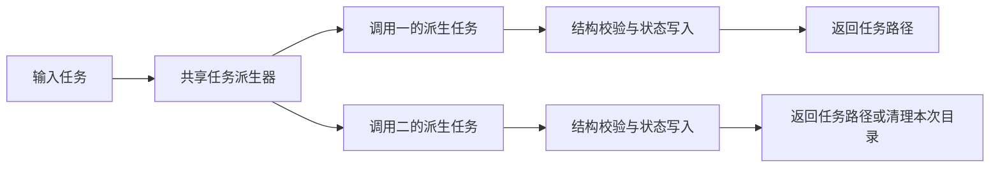

<!-- markdownlint-disable MD013 -->

# 转换任务状态写入并发修复计划

## 1. 名词定义

1. 输入任务：命令参数 `taskFile` 指向的转换任务，包含源快照、角色交付包及持久状态记录。
2. 派生任务：脚本从输入任务创建的独立任务目录，承载本次命令生成的完整产物。
3. 持久状态记录：`state-write-config.json` 的 `files` 定义的权限、源字段清单和覆盖记录。

## 2. 总目标

1. 状态写入命令成功时返回完整派生任务；并发命令分别保存完整结果，失败命令仅清理自己的派生任务。
2. 转换 Agent 沿成功结果中的 `taskFile` 和 `packageDirectory` 继续转换。

## 3. 修复前实现调研

1. `state-write.ts` 的 `submit()` 校验状态定义、权限、初值及配置后调用 `commit()`；`state-source` 也调用 `commit()`。
2. `atomic-write.ts` 的 `replaceFileGroup()` 在输入任务目录保存共享恢复标记，逐个替换文件，失败时恢复调用开始前读取的内容。
3. `write.ts` 的 copy、parse 状态目标通过 `writeStateCandidate()` 进入相同写入链；修复前调用者仅接收布尔结果。
4. `cli.ts` 已保留命令结果提供的 `taskFile`，可承接派生任务。

## 4. 面临的问题与根因

1. `.tmp/review-four-plans-2026-10-12/results.json` 的五组并发实验均出现一个命令成功、另一个命令失败、成功内容被恢复为原内容的结果。
2. 两个调用读取同一组原内容并替换同一恢复标记。一个调用删除标记后，另一个调用再次删除标记触发 `ENOENT`，随后用此前原内容覆盖已成功的写入。
3. 修复前单次状态提交通过已有回归，并发五次均复现覆盖；相同状态定义与权限内容可以单次成功，因此根因不在字段校验，而在多个调用共享的写入归属。
4. 并发调用共同修改输入任务目录中的文件，失败调用恢复内容时可能覆盖其他调用已保存的结果。既有页面宏绑定已经使用独立任务承载结果，本次将该任务派生职责补全并供状态命令共用。

## 5. 问题的解决和实施方案

### 5.1. 实施架构

1. 脚本负责目录派生、持久状态记录复制、结构校验、文件写入及失败清理；转换 Agent 负责源内容用途和权限选择。

### 5.2. 实施步骤

1. 执行者先通过 `runStateCommand()` 编写并发回归，验证两个成功结果的完整状态和输入任务保持原内容。
2. 执行者建立共享任务派生器，统一复制源快照、角色交付包及持久状态记录。
3. 执行者将所有状态写入和 copy、parse 的状态目标接入派生任务，返回派生任务路径及实际写入文件路径。
4. 执行者移除共享恢复标记、原内容恢复路径及其包检查分支，保留单文件写入能力。
5. 执行者更新相关调用者、回归测试和转换工具说明，验证失败清理、连续写入和 CLI 管道消费。
6. 执行者沿用仓库现有依赖版本，并保留其他执行者的工作树修改。

## 6. 方案待决策项清单

1. 当前待决策项为空。

## 7. 计划验收清单

1. 同一输入任务并发提交两组状态时，两个结果具有不同任务路径，各自初值和权限完整，输入任务内容保持原样。
2. 一个并发调用在文件写入期间失败时，其目录被清理，另一成功任务仍可检查和打包。
3. state-source、state-schema、state-initial、state-permissions、state-paths 及 copy、parse 的状态目标均返回可继续消费的任务。
4. 同一成功任务的后续调用读取此前权限、源字段清单和覆盖记录。
5. 定向测试通过后，交付验收沿返回任务完成 index、validate、pack；`verifyFormalPackage()` 调用 `POST /native-cards/imports` 和 `POST /native-cards/imports/:id/confirm`，核对检查响应和导入成功响应。

## 8. 非本次目标

1. 本次修改范围限于转换 Skill 的任务派生与状态写入；API 模块检查器由另一执行者负责。

## 9. 已获得的授权

1. 用户已授权编写修复计划、实施修复并再次审查。
2. 主 Agent 已授权本计划执行者修改 `.agents/skills/native-card-conversion/` 中的任务派生、状态写入及相关测试和说明，以及本计划。
