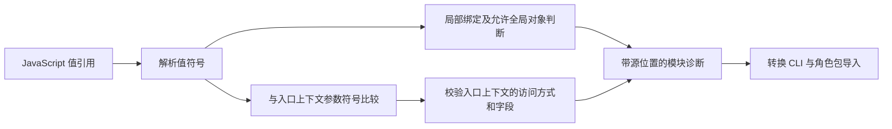

# 后端模块变量绑定修复计划

## 1. 名词定义

1. 值引用：JavaScript 表达式中读取变量值的标识符，包括对象简写属性中的标识符。
2. 值符号：TypeScript 类型检查器为值引用解析的变量绑定。
3. 入口上下文：后端模块导出函数的唯一参数；允许字段由 `nativeCardFileRules.backendModuleApi` 提供。
4. 共享检查入口：`validateNativeCardModules()`；转换 CLI 与 `NativeCardService` 通过该函数获得模块诊断。

## 2. 总目标

1. 共享检查入口依据值符号识别局部变量与入口上下文，使合法对象简写、解构变量、闭包引用和嵌套同名变量通过校验。
2. 共享检查入口继续拒绝未声明变量、作用域外变量、禁止的全局对象、入口上下文整体传递及未公开字段访问，并保留文件路径和源位置。

## 3. 现状调研与调查证据

1. 当前工作目录为 `TavernHeadless-remove-preview-credentials`，当前提交为
   `74b7f910683035bbb6ce3f983e11219a2fd99b18`；实施依据为当前代码与
   [原调查计划](../native-card-maintenance/root-cause-research-2026-10-08/module-reference-resolution-plan.md)。
2. 修复前 `moduleIssues()` 使用 TypeScript 语法树及类型检查器，模块契约和允许全局对象来自共享配置。
   转换 CLI 的 `scripts/tool.ts` 与角色包导入服务 `native-card-service.ts` 均调用共享检查入口。
3. 修复前隔离复现中，`const issues=[]; return {issues};` 返回
   `Global issues is not part of the role module API.`；
   只将返回表达式改为显式键值属性 `{issues: issues}` 后，诊断为空。
4. 修复前隔离复现中，`validate(context)` 内部的 `function f(context) { return context; }` 返回入口上下文访问诊断；该内部参数只接收调用者传入的数组。
5. 原调查的
   [变量对照](../native-card-maintenance/root-cause-research-2026-10-08/architecture-recheck/module-binding.json)与
   [上下文对照](../native-card-maintenance/root-cause-research-2026-10-08/architecture-recheck/module-context-binding.json)
   提供同机制正例及负例；实施测试将通过共享检查入口验证这些结果。
6. 当前 `CONTEXT-MAP.md` 尚未登记后端模块静态检查术语；
   `docs/adr/0002-role-script-runtime.md` 规定角色脚本的宿主职责，
   后端模块签名见 `docs/character-authoring/backend-api.md` 第5、6、8章。

## 4. 面临的问题与根因

1. `getSymbolAtLocation()` 对对象简写名称返回属性符号；`hasLocalBinding()` 需要变量声明，因此已声明的局部变量被误判为全局对象。
2. `moduleIssues()` 按参数名称判断入口上下文引用；嵌套参数可以使用同名标识符，因此内部参数被错误施加入口上下文约束。
3. 解构元素中的静态属性名属于字段选择，修复前的标识符分类仅排除了绑定变量名，导致重命名解构的属性名进入值引用判断。
4. 两个分支分别判断引用身份，采用的依据也不同。TypeScript 已提供变量绑定解析能力；修复职责属于共享检查器内部的引用解析。
5. 写方案前的对照确认：仅将 `{issues}` 改为 `{issues: issues}` 后模块通过；
   嵌套参数具有独立声明，原调查的符号比较对照使其通过。
   两类输入均成功生成语法树，排除了 JavaScript 语法错误；现有 TypeScript 能够解析值符号，
   修复前检查器的两个分支分别使用不同依据，因此内部封装即可修复。

## 5. 问题的解决和实施方案

### 5.1. 架构流程图

1. 检查器增加内部值符号解析函数；对象简写的属性名称节点采用
   `getShorthandAssignmentValueSymbol()`，默认值表达式及其他标识符采用 `getSymbolAtLocation()`。
2. 检查器取得入口上下文参数符号，并将每次值引用的符号与该参数符号比较；局部绑定检查复用同次解析结果。
3. 检查器区分解构的静态属性名与计算属性表达式；静态属性名用于选择字段，计算属性表达式中的变量继续执行值引用校验。
4. 检查器继续从共享配置读取 API 范围，并复用既有诊断结构。此次实施复用已安装的 TypeScript 5.9.3。

### 5.2. 实施步骤

1. 执行者通过 `module-static-checker.test.ts` 的共享检查入口加入对象简写测试，
   先运行并确认误判，再实施值符号解析。
2. 执行者加入嵌套同名参数测试，先确认入口上下文误判，再实施参数符号比较。
3. 执行者补充变量声明和函数参数中的重命名解构、计算属性、闭包、同名局部变量及非法引用对照，核对诊断路径、行号和列号。
4. 执行者通过角色包导入服务导入分别使用 `{issues}` 和 `{issues: issues}` 的隔离 ZIP，
   再通过宿主模块执行入口比较返回值，并确认非法引用 ZIP 被拒绝。
5. 执行者运行改动范围的测试、类型检查与静态检查并提交结果；主 Agent 组织运行仓库交付检查并汇总。

## 6. 方案待决策项清单

1. 当前待决策项为空；若修复需要调整模块 API 范围或新增依赖，执行者须将具体内容与原因提交给主 Agent。

## 7. 计划验收清单

1. 对象简写与显式键值属性、解构值引用、闭包引用和嵌套同名变量均获得空诊断。
2. 未声明变量、作用域外变量和禁止全局对象获得对应诊断，诊断保留准确的文件路径及源位置。
3. 真实入口上下文的整体传递、私有字段和动态字段访问仍获得对应诊断；公开字段访问获得空诊断。
4. 分别使用 `{issues}` 和 `{issues: issues}` 的隔离 ZIP 均可导入；宿主执行已导入的模块后，二者均返回预期的问题数组。
5. 非法引用 ZIP 在导入校验时被拒绝；改动范围的测试与静态检查通过。

## 8. 非本次目标

1. 本次范围外的任务包括模块 API 范围调整、前端模块检查器改造、源卡转换规范修改及 Skill 任务状态文件修复。

## 9. 已获得的授权

1. 用户已授权设计修复计划、实施修复并执行 review。
2. 主 Agent 已授权本计划执行者修改本计划、`module-static-checker.ts` 及相关测试。
