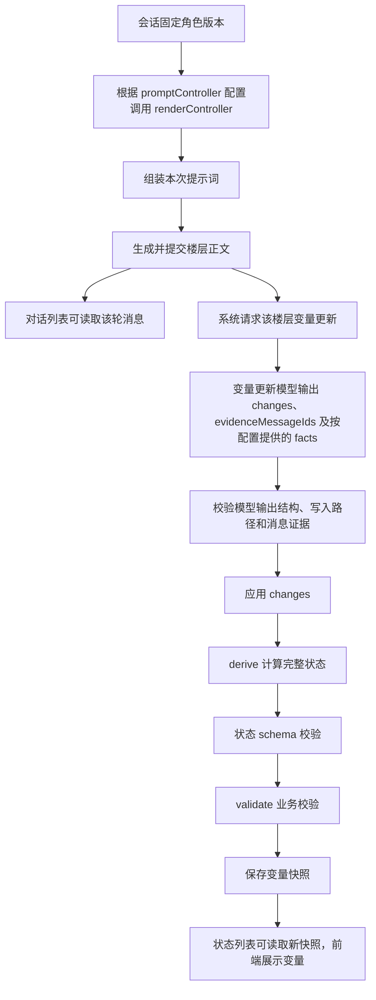

<!-- markdownlint-disable MD013 MD033 -->

# 角色卡后端 API

本文供角色卡作者配置后端功能和编写后端模块使用。各条目描述当前正式代码已接入的能力；浏览器中的 `api` 对象另见[角色 JavaScript API](script-api.md)。本文中的后端 API 包括声明式配置和系统调用的角色函数。正式角色的随机采样、数值计算和同轮结果回传见[正文模型系统能力](model-capabilities.md)。其他模型工具、调用协议及执行记录见 [Agent 工具 API](agent-tools-api.md)。

## 0. 目录

1. [1. 执行入口与数据流](#section-1)
2. [2. 公共数据类型](#section-2)
3. [3. stateUpdate：配置变量更新](#section-3)
4. [4. 变量更新模型的输出协议](#section-4)
5. [5. derive(context)：计算完整状态](#section-5)
6. [6. validate(context)：校验业务规则](#section-6)
7. [7. promptController：配置提示词控制器](#section-7)
8. [8. renderController(context)：生成世界书条目正文](#section-8)
9. [9. 文件、版本与执行环境](#section-9)
10. [10. 错误定位](#section-10)
11. [11. 模块、组装与更新结果验收](#section-11)
    1. [11.1 本地模块计算验收](#section-11-1)
    2. [11.2 变量更新与保存验收](#section-11-2)
    3. [11.3 提示词与页面验收](#section-11-3)
12. [12. 实现依据](#section-12)
13. [13. 已保存变量的重算与初值补全](#section-13)

<a id="section-1"></a>

## 1. 执行入口与数据流

完整角色的文件、生成命令及正式运行入口见[雾港来信示例](../plans/role-runtime-core/native-card-io.md#完整角色示例)。该包使用本页的变量更新、计算、校验和控制器契约；下文短例分别说明单个接口。

后端从会话固定的角色版本读取配置和文件。原生 ZIP 作者把配置写入下表指定的包文件；发布服务将其转换为角色版本中的 `extensions.tavern_headless`。本文后续列出的该字段结构描述运行快照，原生包作者使用包文件结构。

| 原生包文件                         | 作者填写的内容                                                          | 发布后的运行入口                 |
| ---------------------------------- | ----------------------------------------------------------------------- | -------------------------------- |
| `agents/state-update/profile.json` | 状态 schema、更新规则和函数引用；状态定义引用固定的 `state/schema.json` | `stateUpdate.profile` 与所需文件 |
| `agents/state-update/*.json`       | 有序更新规则；来源条目以 `{bookId,entryId}` 引用                        | 更新模型请求中的规则内容         |
| `backend/variable-tools/*.js`      | 第 5 章的 `derive(context)`                                             | 候选状态计算                     |
| `backend/validators/*.js`          | 第 6 章的 `validate(context)`                                           | 业务规则检查                     |
| `backend/controllers/config.json`  | `modulePath`、`controllerEntries`、`updaterEntries`、变量宏和变量根路径 | 提示控制器配置                   |
| `backend/controllers/*.js`         | 第 8 章的 `renderController(context)`                                   | 指定世界书条目的正文生成         |

原生控制器的 `controllerEntries` 和 `updaterEntries` 使用 `{bookId,entryId}` 数组。`bookId` 对应 `character.json` 的世界书绑定 ID；两本书可分别具有同一个条目 ID。控制器只处理被完整引用选中的条目。

原生角色的变量更新模型由系统 `state_updater` 槽位选择，管理员在发布或预览时绑定可用 LLM Profile。包内 profile 保存角色内容和更新行为。原生文件 schema、导入接口及包到运行资源的映射见[原生角色卡接口](../plans/role-runtime-core/native-card-io.md)。原生包的变量更新和控制器已接入发布版本与会话，作者可按本文配置并通过正式接口运行；确定性验收使用本机受控模型响应；OpenRouter 免费模型已完成真实调用，技术链路与模型语义的通过项、失败样本分别记录在[外部模型验收](../plans/role-runtime-core/native-card-openrouter-acceptance.md)。完整联调项目见[联调计划](../plans/role-runtime-core/native-card-production-integration.md)。

| 作者提供的入口              | 系统用途                                   | 作者获得的结果                 |
| --------------------------- | ------------------------------------------ | ------------------------------ |
| `stateUpdate`               | 配置变量更新模型、状态结构、计算和校验模块 | 楼层对应的变量快照             |
| `derive(context)`           | 根据候选状态和事实计算完整状态             | 计算后的完整候选状态           |
| `validate(context)`         | 对候选状态执行角色业务规则                 | 校验问题列表                   |
| `promptController`          | 选择世界书条目及其生成模块                 | 本次提示词组装使用的世界书副本 |
| `renderController(context)` | 用变量生成指定条目的正文                   | 世界书条目文本                 |

下图展示已配置 stateUpdate、derive、validate 和 promptController 的执行流程；各入口的启用条件见对应章节。



角色前端通过发送消息触发上述流程，读取与订阅结果的方法见[角色 JavaScript API](script-api.md)。

<a id="section-2"></a>

## 2. 公共数据类型

### 2.1 State 与 SourceMessage

```typescript
type State = Record<string, unknown>;
type SourceMessage = {
  messageId: string;
  revision: number;
  role: string;
  text: string;
};
```

`State` 是完整变量对象，其字段由角色的状态 JSON Schema 定义。`SourceMessage` 的 `messageId` 是证据标识，`revision` 是消息修订号，`role` 是说话者角色，`text` 是消息正文。当前变量更新服务取当前楼层选定消息页中未隐藏的 `user`、`assistant` 消息，按页面和消息顺序排列；助手文本使用消息接口提供的展示正文。

**实际数据示例**：更新前的状态和消息证据分别如下。

```javascript
const before = { score: 20, level: 2, location: "大厅" };
const sourceMessages = [
  {
    messageId: "message-1",
    revision: 1,
    role: "assistant",
    text: "完成检查，获得5点积分，随后抵达花园。",
  },
];
console.log(before.score); // 20
console.log(sourceMessages[0].messageId); // message-1
```

系统把 before 与 sourceMessages 传入下节的 ComputeContext；角色模块从 context 读取。

<a id="section-2-2"></a>

### 2.2 ComputeContext

```typescript
type ComputeContext = {
  before: State;
  candidate: State;
  sourceMessages: SourceMessage[];
  toolEvidence: RoleToolEvidence[];
  priorFacts: unknown[];
  floorBefore: State;
  facts: Record<string, unknown>;
};
```

| 字段             | 含义与当前取值                                                                                           |
| ---------------- | -------------------------------------------------------------------------------------------------------- |
| `before`         | 本次更新前值；配置 controllerOwnedPaths 时，已合并这些路径的控制器值                                     |
| `candidate`      | `derive` 收到应用 changes 后的状态；`validate` 收到 derive 后的状态                                      |
| `sourceMessages` | 本次更新使用的消息证据，见 2.1                                                                           |
| `toolEvidence`   | 最终正文关联的工具执行证据，字段及引用规则见[正文模型系统能力](model-capabilities.md#同轮结果和状态证据) |
| `priorFacts`     | 当前正式服务传入空数组；作者按空数组处理                                                                 |
| `floorBefore`    | 当前正式服务取与 `before` 相同的值                                                                       |
| `facts`          | 本次模型输出的事实；未声明事实 schema 时为 `{}`                                                          |

计算和校验函数收到的上下文是深层冻结的副本。需要修改状态时，作者先复制 `candidate`，再返回新对象。

**上下文数据示例**：完整上下文已保存为 [backend-input.json](examples/api-usage/backend-input.json)。在本地测试模块时，按第 5 章的实际调用方式把它传入 derive，再把返回状态设为 context.candidate，传给 validate。正式运行由 StateUpdateService 按第 1 章流程传入这些值。

```json
{
  "before": { "score": 20, "level": 2, "location": "大厅" },
  "candidate": { "score": 25, "level": 2, "location": "花园" },
  "sourceMessages": [
    {
      "messageId": "message-1",
      "revision": 1,
      "role": "assistant",
      "text": "完成检查，获得5点积分，随后抵达花园。"
    }
  ],
  "toolEvidence": [],
  "priorFacts": [],
  "floorBefore": { "score": 20, "level": 2, "location": "大厅" },
  "facts": {}
}
```

<a id="section-3"></a>

## 3. stateUpdate：配置变量更新

1. 本章说明变量更新模型的任务、可写字段、状态结构和后端函数的配置方法。

### 3.1 配置声明与字段

1. 角色运行快照保存以下配置：

   ```typescript
   extensions.tavern_headless.stateUpdate = {
     profile: StateUpdateProfile,
     files: Record<string, string>,
   };
   ```

2. `profile` 与 `files` 均必填。`files` 以包内路径为键、文件文本为值。`profile` 字段如下。

   | 字段                   | 类型     | 必填／省略行为                                                          | 用途                                                                                                   |
   | ---------------------- | -------- | ----------------------------------------------------------------------- | ------------------------------------------------------------------------------------------------------ |
   | `id`                   | string   | 否；保留为 undefined                                                    | 配置标识                                                                                               |
   | `presetRef`            | object   | 否；使用发布配置或角色版本默认值                                        | 独立状态预设引用；绑定规则见[状态提示词组装第 2 章](state-prompt-assembly.md#2-状态预设绑定与会话固定) |
   | `updaterPrompt`        | string   | 是                                                                      | 原生卡包兼容字段；保留包格式及角色版本契约，不参与正式状态模型请求                                     |
   | `writablePaths`        | string[] | 是；允许空数组                                                          | 模型可以修改的精确 JSON Pointer 路径，每项以 `/` 开头                                                  |
   | `stateSchema`          | object   | 与 schema 文件至少提供一项                                              | 完整状态的内联 JSON Schema                                                                             |
   | `stateSchemaFile`      | string   | 否；提供时优先于内联 schema                                             | 完整状态 schema 文件路径                                                                               |
   | `ruleFiles`            | string[] | 否；默认空列表                                                          | 按数组顺序加入模型提示词的文件路径                                                                     |
   | `deriveScript`         | string   | 否；跳过 derive                                                         | 导出 `derive` 的模块路径                                                                               |
   | `validateScript`       | string   | 否；跳过业务校验                                                        | 导出 `validate` 的模块路径                                                                             |
   | `moduleFiles`          | string[] | 否；无附加模块文件                                                      | 模块依赖的数据或服务端脚本文件路径                                                                     |
   | `factsSchema`          | object   | 否；输出规则见第 4 章                                                   | 事实对象的 JSON Schema                                                                                 |
   | `derivedPaths`         | string[] | 否；无派生路径保护                                                      | 拒绝模型改写的计算字段或子树                                                                           |
   | `controllerOwnedPaths` | string[] | 否；默认空路径列表                                                      | 从会话变量 `stat_data` 合入 before 的路径                                                              |
   | `modelSlot`            | enum     | 既有运行快照可省略，默认 `verifier`；原生发布由系统填入 `state_updater` | 选择模型配置；原生包文件字段见第 1 章                                                                  |
   | `maxTokens`            | 正整数   | 否；由模型配置决定                                                      | 请求输出 token 上限                                                                                    |
   | `updaterReasoning`     | object   | 否；由模型配置决定                                                      | 提供必填 `effort`：`none`、`low`、`medium`、`high`                                                     |

### 3.2 参数解析与更新执行

1. 系统读取所选槽位的现有 LLM Profile。该 Profile 中非空的生成参数覆盖本配置的 `maxTokens` 和 updaterReasoning 设置；结构化响应格式最后由变量更新服务指定。默认槽位的配置来源是 `packages/shared/src/config/role-state.json`。

2. `controllerOwnedPaths` 当前固定从 `stat_data` 取值，与第 7 章的 `variableRoot` 分别配置。源状态和目标状态中的对应字段必须存在。`derivedPaths` 保护模型写入路径，实际计算仍由 `derive` 完成。

3. 配置和模块固定在角色版本；服务使用会话绑定版本。成功状态写入 `role_display_snapshot.record_json`，并在同一事务中同步到对应分支变量 `stat_data`。变量更新模型的请求与结果进入 `model_call_records`。

4. 缺少整个 stateUpdate 配置时，服务沿用前值生成快照；提供配置时按以下流程更新。系统在楼层已提交且生成运行完成后请求更新，再依次执行第 4–6 章协议。重复请求已经具有快照的楼层时返回现有快照。更新按同一分支的待更新楼层顺序执行。

5. 配置、模型输出或函数校验失败时，本次更新返回失败，保留此前已提交状态；按第 10 章定位。作者修订模块后发布新角色版本，并用绑定新版本的会话验证。

### 3.3 原生 ZIP 配置示例

1. 作者将下列对象写入 `agents/state-update/profile.json`，并在 `state/schema.json` 中定义字符串字段 `location`。
2. `presetRef` 指向状态预设 `state-preset-location` 的固定版本；该版本的主提示词包含地点更新指令“根据本轮消息更新地点；只有正文明确写出抵达新地点时才修改 `location`，并按输出契约提交消息证据”。
3. 作者填写的角色状态 profile 如下：

   ```json
   {
     "presetRef": {
       "presetId": "state-preset-location",
       "presetVersionId": "state-preset-location-v1"
     },
     "updaterPrompt": "根据本轮消息更新地点，使用消息标识作为证据。只有明确抵达新地点时才修改 location。",
     "writablePaths": ["/location"],
     "stateSchemaFile": "state/schema.json"
   }
   ```

### 3.4 已有角色快照示例

1. 以下对象用于已有角色快照中的 `extensions.tavern_headless`，供维护该运行结构的开发者参考。本例采用内联状态 schema 和既有 `verifier` 模型槽，`files` 为空。
2. 本例使用与上一示例相同的状态预设引用；该预设中的地点任务指令见第 3.3 节第 2 项。
3. 角色快照对象如下：

   ```json
   {
     "stateUpdate": {
       "profile": {
         "presetRef": {
           "presetId": "state-preset-location",
           "presetVersionId": "state-preset-location-v1"
         },
         "updaterPrompt": "根据本轮消息更新地点，使用消息标识作为证据。只有明确抵达新地点时才修改 location。",
         "writablePaths": ["/location"],
         "stateSchema": {
           "type": "object",
           "properties": { "location": { "type": "string" } },
           "required": ["location"],
           "additionalProperties": false
         },
         "modelSlot": "verifier"
       },
       "files": {}
     }
   }
   ```

4. 初始变量为 `{"location":"大厅"}`，正文发生抵达花园的事件并通过更新后，前端变量读取结果中的 `location` 变为 `花园`。

<a id="section-4"></a>

## 4. 变量更新模型的输出协议

**用途**：描述系统要求变量更新模型返回的数据；角色作者通过提示词和 schema 约束这些数据。

**输出签名**：

```typescript
type UpdateOutput = {
  changes: Array<
    { op: "set"; path: string; value: unknown } | { op: "remove"; path: string }
  >;
  evidenceMessageIds: string[];
  evidenceExecutionIds?: string[];
  facts?: Record<string, unknown>;
};
```

**模型输入**：

1. 正式状态请求的上下文来源及组装流程见[状态提示词组装第 3–6 章](state-prompt-assembly.md#3-请求上下文与状态变量历史)；`updaterPrompt` 的卡包兼容字段见本页第 3 章。

**输出结果**：`changes` 和 `evidenceMessageIds` 必填。配置 `factsSchema` 后 `facts` 必填且至少提供一个证据 ID；未配置时输出应省略 `facts`。有修改时至少提供一个消息证据 ID，`evidenceMessageIds` 中的所有 ID 必须来自本次 `sources`。

| 输出字段               | 用途                                                                        |
| ---------------------- | --------------------------------------------------------------------------- |
| `changes[].op`         | set 表示替换已有字段值，remove 表示删除已有字段                             |
| `changes[].path`       | 定位完整状态对象中的字段，使用 JSON Pointer 格式                            |
| `changes[].value`      | set 使用的新值，类型由对应状态字段 schema 约束；remove 省略此字段           |
| `evidenceMessageIds`   | 引用支持本次更新的消息，用于确认依据来自本次 sources                        |
| `evidenceExecutionIds` | 可省略；提供时引用本次 toolEvidence 中的执行 ID，省略表示提案未引用工具执行 |
| `facts`                | 给 derive、validate 使用的结构化事件事实；需保存的值由 derive 写入返回状态  |

每条写入路径必须精确匹配 `writablePaths`。同一输出中的路径必须互不重复且没有祖先／后代重叠，并与 `derivedPaths` 互不重叠。修改目标和父级必须已经存在。数组用一次 `set` 替换完整数组。`remove` 也须通过最终完整状态 schema；删除必填字段会失败。

当前输出 schema 从 `stateSchema.properties` 沿路径查找字段类型。作者须在该位置直接声明可写字段的结构。

**数据与存储**：模型输出首先成为内存中的变量更新提案；通过路径、证据、计算和校验后，才按第 3 章保存完整状态。

**执行时序**：系统解析完整模型响应，验证输出和证据，再应用修改并调用 `derive`。

**错误处理**：响应未正常结束、JSON 不合法、事实、证据或路径违规均中止本次更新；错误见第 10 章。

**输入与输出示例**：更新前 before 为 {"location":"大厅"}，sources 中 messageId 为 message-1 的正文为“你抵达花园。”。模型返回：

```json
{
  "changes": [{ "op": "set", "path": "/location", "value": "花园" }],
  "evidenceMessageIds": ["message-1"]
}
```

**示例结果**：通过第 1 章的计算和校验后，保存的状态为 {"location":"花园"}。

<a id="section-5"></a>

## 5. derive(context)：计算完整状态

**用途**：根据模型事实或候选状态执行确定性计算，例如从积分计算等级。

**调用签名**：

```typescript
export function derive(context: ComputeContext): State;
```

**配置入口**：profile.deriveScript 指向导出本函数的模块。

**输入参数**：唯一必填参数 context，字段及只读约束见第 2.2 节。

**输出结果**：同步返回完整变量对象，包含修改后的值和全部需要保留的字段。

**回调与时序**：本函数由系统直接调用。系统应用 changes 后调用一次；随后校验返回值的状态 schema。通过全部校验后，状态更新服务按第 3 章保存返回状态。

**错误处理**：抛出异常会使更新失败；返回对象不符合状态 schema 时产生 `STATE_SCHEMA_INVALID`。

**使用示例**：状态包含 `score` 与 `level`；配置 `writablePaths: ["/score"]`、`derivedPaths: ["/level"]`，并将本模块路径填入 `deriveScript`。状态 schema 同时声明两个整数。

```javascript
export function derive({ candidate }) {
  const next = { ...candidate };
  next.level = Math.floor(next.score / 10);
  return next;
}
```

**实际调用示例**：把上方导出函数保存在 backend-hooks.mjs；以下为 Node 本地验算调用。可使用本仓库同名[示例模块](examples/api-usage/backend-hooks.mjs)。

```javascript
import { derive } from "./backend-hooks.mjs";
const context = {
  before: { score: 15, level: 1 },
  candidate: { score: 25, level: 1 },
  sourceMessages: [
    {
      messageId: "message-1",
      revision: 1,
      role: "assistant",
      text: "获得10点积分。",
    },
  ],
  priorFacts: [],
  toolEvidence: [],
  floorBefore: { score: 15, level: 1 },
  facts: {},
};
const next = derive(context);
console.log(next); // { score: 25, level: 2 }
console.log(context.candidate); // { score: 25, level: 1 }，输入保留
```

**示例结果**：next.level 为 2，输入 context.candidate.level 保持 1。

<a id="section-6"></a>

## 6. validate(context)：校验业务规则

**用途**：检查 JSON Schema 之外的角色业务关系，例如积分变化方向。

**调用签名**：

```typescript
export function validate(context: ComputeContext): { issues: unknown[] };
```

**配置入口**：profile.validateScript 指向导出本函数的模块。

**输入参数**：唯一必填参数 context，字段及只读约束见第 2.2 节。

**输出结果**：返回 `{issues: []}` 表示通过。非空数组表示失败。服务校验 `issues` 的数组类型；每项内容由角色模块定义。

**回调与时序**：本函数由系统直接调用。完整状态通过 schema 后同步调用，成功后才保存快照。

**错误处理**：缺少 issues 数组产生 `STATE_VALIDATOR_INVALID`；非空 issues 产生 `STATE_RULE_INVALID` 并携带问题列表；抛出的异常使本次更新失败。

**使用示例**：此例允许积分增加或保持原值，下降时返回问题。示例问题对象用 path 定位字段，code 标识规则，message 说明问题与处理方法。

```javascript
export function validate({ before, candidate }) {
  return {
    issues:
      candidate.score < before.score
        ? [
            {
              path: "/score",
              code: "SCORE_DECREASED",
              message: "积分低于更新前值，请检查本轮积分变化规则。",
            },
          ]
        : [],
  };
}
```

**实际调用示例**：

```javascript
import { validate } from "./backend-hooks.mjs";
const context = {
  before: { score: 20 },
  candidate: { score: 25 },
  sourceMessages: [],
  priorFacts: [],
  toolEvidence: [],
  floorBefore: { score: 20 },
  facts: {},
};
console.log(validate(context)); // { issues: [] }
const rejected = validate({ ...context, candidate: { score: 15 } });
for (const issue of rejected.issues) {
  console.log(issue.path, issue.code, issue.message);
}
// /score SCORE_DECREASED 积分低于更新前值，请检查本轮积分变化规则。
```

**示例结果**：积分从 20 增加到 25 时 issues 为空；降到 15 时返回 SCORE_DECREASED 问题。

<a id="section-7"></a>

## 7. promptController：配置提示词控制器

**用途**：在提示词组装时，由角色函数生成世界书条目正文，并停用指定条目。

**原生 ZIP 配置**：作者在 `character.json` 的 `promptController` 字段填写 `backend/controllers/config.json`。该文件的五个字段均必填，三个数组允许为空：

| 字段                | 约束与用途                                                                                               |
| ------------------- | -------------------------------------------------------------------------------------------------------- |
| `modulePath`        | `backend/controllers/` 下导出 `renderController` 的 `.js` 文件路径                                       |
| `controllerEntries` | `{bookId, entryId}` 数组；`bookId` 为包内世界书 ID，`entryId` 为该书非负整数 uid；系统生成这些条目的正文 |
| `updaterEntries`    | 与 `controllerEntries` 相同的引用结构；系统在当前组装副本中停用这些条目                                  |
| `variableRoot`      | 非空变量根键，指定传给控制器的变量范围                                                                   |
| `variableMacros`    | `{source, target}` 数组，`source` 非空，按数组顺序作字面文本替换                                         |

```json
{
  "modulePath": "backend/controllers/prompt.js",
  "controllerEntries": [{ "bookId": "harbor", "entryId": 110 }],
  "updaterEntries": [{ "bookId": "people", "entryId": 110 }],
  "variableRoot": "stat_data",
  "variableMacros": []
}
```

该示例生成 `harbor` 的 110 号条目，并停用 `people` 的 110 号条目。发布服务将这些带书标识的引用固定到角色版本。

**已有角色快照的声明位置与签名**：

```typescript
extensions.tavern_headless.promptController = {
  modulePath: string,
  controllerEntryIds: number[],
  updaterEntryIds: number[],
  variableRoot: string,
  variableMacros: Array<{source: string; target: string}>
};
```

**输入参数**：以下五个字段均必填；三个数组允许为空。

| 字段                 | 约束                         | 含义                                                                   |
| -------------------- | ---------------------------- | ---------------------------------------------------------------------- |
| `modulePath`         | 非空字符串                   | 导出 renderController 的模块路径                                       |
| `controllerEntryIds` | 不重复的整数数组             | 对匹配 ID 的条目调用生成函数                                           |
| `updaterEntryIds`    | 不重复的整数数组             | 在组装副本中设为 disabled 的条目                                       |
| `variableRoot`       | 非空字符串                   | 从会话变量对象取值的根键，例如 stat_data；根键缺失时函数收到 undefined |
| `variableMacros`     | source 非空；target 为字符串 | 对所有条目内容按数组顺序执行字面文本替换                               |

配置对象及宏映射对象采用严格字段校验。controllerEntryIds 与 updaterEntryIds 可以包含同一 ID；该条目同时执行停用和文本生成。

**数据与存储**：配置保存在角色版本；生成后的条目仅用于当前请求组装。

**条目生成条件**：角色作者在包内世界书条目的 `extra.extensions` 中配置 `triggers`、`delay`、`group`、`group_override`、`group_weight`、`useProbability` 和 `probability`。后端在控制器生成正文后执行这些条件，字段、顺序和示例见 [世界书条目的生成条件](../../vitepress/reference/api/worldbooks.md#条目的生成条件)。

**运行结果**：系统使用 `promptController` 配置生成供本次组装使用的世界书副本。源角色卡和持久化世界书保持原值。是否进入最终消息仍由后续世界书激活和提示词组装决定。

**回调与时序**：系统依条目顺序调用第 8 章函数，再对条目内容应用宏映射。正式生成和使用同一组装器的 dry-run 都会执行这些计算。

**错误处理**：世界书、模块导出或返回值校验失败时组装失败；按第 10 章修正条目结构、模块导出或返回对象。

**已有角色快照示例**：将下列对象置于角色卡的 extensions.tavern_headless。

```json
{
  "promptController": {
    "modulePath": "backend-hooks.mjs",
    "controllerEntryIds": [10],
    "updaterEntryIds": [20],
    "variableRoot": "stat_data",
    "variableMacros": [{ "source": "旧地点标记", "target": "当前位置" }]
  }
}
```

**配置生效结果**：组装时为条目 10 调用 renderController，并停用条目 20。按第 11.3 节运行 dry-run，核对条目追踪；条目 10 激活后，其生成正文进入 messages。

<a id="section-8"></a>

## 8. renderController(context)：生成世界书条目正文

**用途**：根据当前变量生成指定世界书条目的提示词文本。

**调用签名**：

```typescript
type ControllerContext = {
  bookId?: string; // 原生角色包调用必有此字段；旧快照未提供书标识。
  entryId: number;
  variables: unknown;
  characterBook: {
    entries: Array<{
      id: number;
      enabled: boolean;
      content: string;
      [key: string]: unknown;
    }>;
    [key: string]: unknown;
  };
};
type ControllerResult = { text: string; referencedEntryIds?: number[] };
export function renderController(
  context: ControllerContext,
): ControllerResult | Promise<ControllerResult>;
```

**输入参数**：唯一必填参数 context，字段如下。原生角色包以 `context.bookId` 和 `context.entryId` 共同定位当前条目，`characterBook` 只包含该本书。返回值 `referencedEntryIds` 表示当前书中的条目 ID；该字段不声明跨书引用。跨书控制器目标通过配置中的 `{bookId, entryId}` 声明。会话另行绑定的世界书传入时，uid 映射为 id，disable 的反值映射为 enabled。

| context 字段            | 实际用途与条件                                                                      |
| ----------------------- | ----------------------------------------------------------------------------------- |
| `bookId`                | 原生包当前书的包内 ID，与 entryId 共同定位条目                                      |
| `entryId`               | 当前正文条目的 ID；原生包来自 controllerEntries 匹配，旧快照来自 controllerEntryIds |
| `variables`             | 从第 7 章 variableRoot 指定根键复制的值；缺失行为见该字段定义                       |
| `characterBook.entries` | 控制器处理前的条目列表；可用于读取作者其他条目的原始内容                            |
| `entries[].id`          | 条目唯一定位标识，用来找到需要引用的条目                                            |
| `entries[].enabled`     | 输入世界书中该条目的启用标记；取自控制器处理前的世界书副本                          |
| `entries[].content`     | 输入世界书中该条目的原始正文，供角色函数选择或组合                                  |
| 扩展字段                | 原世界书对象及条目上的其他属性，按该世界书实际字段读取                              |

**数据与存储**：函数返回文本由调用方写入本次请求使用的世界书副本。

**输出结果**：必填 `text` 替换当前条目正文，允许空字符串。可选 `referencedEntryIds` 是不重复整数数组；当前调用方对该字段进行结构校验。

**回调与时序**：本函数由系统直接调用。支持同步返回及 Promise，调用方等待完成后处理下一条目。

**错误处理**：缺少导出函数产生 `ROLE_PROMPT_CONTROLLER_EXPORT_MISSING`；缺少 text 或字段类型不合法产生 `ROLE_PROMPT_CONTROLLER_RESULT_INVALID`。函数抛出的异常或 Promise 拒绝使组装失败。

**使用示例**：示例约定根变量含字符串 location。

```javascript
export function renderController({ variables }) {
  return { text: `当前地点：${variables.location}。` };
}
```

**实际调用示例**：

```javascript
import { renderController } from "./backend-hooks.mjs";
const result = await renderController({
  bookId: "harbor",
  entryId: 10,
  variables: { location: "花园" },
  characterBook: {
    entries: [{ id: 10, enabled: true, content: "待生成的地点说明" }],
  },
});
console.log(result); // { text: "当前地点：花园。" }
```

**示例结果**：result.text 为“当前地点：花园。”。

<a id="section-9"></a>

## 9. 文件、版本与执行环境

1. 后端入口使用具名 export 导出的 JavaScript 函数。原生 ZIP 作者按[原生包入口](#section-1)提供文件和配置，发布服务负责将包内文件登记为固定版本资产。已有角色快照的作者按下表登记配置引用的文件。
2. 系统从固定角色版本中的本次入口开始，沿静态相对导入递归收集已声明的 JavaScript 模块和 JSON 数据文件，并只把该依赖集合交给 worker。重复导入和循环引用涉及的每个依赖文件仅计入一次；未导入的世界书文件不占模块文件数和模块字节额度。
3. 模块校验器和 worker 继续执行包内相对路径、文件用途和扩展名约束。JavaScript 导入目标必须是 `server_script` 文件，JSON 导入目标必须是 `data` 文件并使用 `type=json` 属性；外部模块、动态导入和主机文件访问仍被拒绝。
4. `maxModuleFiles` 和 `maxModuleBytes` 按本次入口的实际依赖集合计数。`maxInputBytes`、执行期限和并发额度继续按现有配置执行。

| 引用位置                                              | 角色版本资产用途          |
| ----------------------------------------------------- | ------------------------- |
| `stateSchemaFile`、`ruleFiles`                        | `data`                    |
| `deriveScript`、`validateScript`、控制器 `modulePath` | `server_script`           |
| `moduleFiles`                                         | `data` 或 `server_script` |

运行时从会话绑定版本的资产读取文件。已有角色快照的作者须同时提供文件内容、包内路径和上表规定的资产用途，使发布流程完成登记和落盘。模块用包内相对路径引用同包依赖。例如 profile.deriveScript 为 backend-hooks.mjs 时，stateUpdate.files["backend-hooks.mjs"] 保存模块文本；发布角色资产时，同时提供 name 为 backend-hooks.mjs、purpose 为 server_script、content 为相同模块文本的文件项。运行时按 profile 中的路径读取该版本已登记的资产。

作者通过发布新版本更新模块，再将测试会话绑定到该版本；验证时核对会话绑定的版本 ID。

原生 ZIP 中的 `frontend/*.js` 由导入服务进行语法、包内引用和 API 调用检查。`api.ui.register()` 返回的布局对象及保持绑定不变的局部引用，按照 `native-card-file-rules.json` 的 `frontendModuleApi.layoutMethods` 校验方法名称和参数数量，其中包含 `animateVisibility(elementId, options)`。未知方法、动态方法名及错误参数数量产生 `NATIVE_CARD_FRONTEND_MODULE_INVALID`，错误列出文件、行列与修正要求。fill 元素和动画参数在浏览器执行时由共享 `role-runtime.schema.json` 校验；具体用法见[角色页面 API 第10章](script-api.md#section-10)。

<a id="section-10"></a>

## 10. 错误定位

下表列出后端错误标识及作者处理方式。控制器的 `ROLE_PROMPT_CONTROLLER_WORLDBOOK_MISSING`、`ROLE_PROMPT_CONTROLLER_WORLDBOOK_INVALID`、`ROLE_PROMPT_CONTROLLER_EXPORT_MISSING` 和 `ROLE_PROMPT_CONTROLLER_RESULT_INVALID` 在后端日志中按完整标识定位；前端展示按系统错误映射处理。

| 标识                                       | 情况                                                       | 作者操作                                            |
| ------------------------------------------ | ---------------------------------------------------------- | --------------------------------------------------- |
| `ROLE_STATE_CONFIG_MISSING`                | 缺少可用完整状态 schema                                    | 补齐内联 schema 或 schema 文件                      |
| `ROLE_SESSION_VERSION_MISSING`             | 会话缺少固定角色版本                                       | 使用绑定已发布版本的会话                            |
| `ROLE_STATE_UNINITIALIZED`                 | 尚无初始状态快照                                           | 完成会话初始状态创建                                |
| `ROLE_STATE_BUSY`                          | 会话正执行变量更新                                         | 等待当前更新结束                                    |
| `ROLE_FLOOR_NOT_FOUND`                     | 指定会话中查不到该楼层                                     | 从当前会话选择已有楼层                              |
| `ROLE_FLOOR_NOT_COMMITTED`                 | 楼层状态尚未变为 `committed`（已提交）                     | 等待正文提交完成                                    |
| `ROLE_FLOOR_RUN_INCOMPLETE`                | 楼层缺少运行记录，或运行状态尚未变为 `completed`（已完成） | 检查该楼层生成运行，完成后再更新变量                |
| `ROLE_STATE_BRANCH_MISMATCH`               | 楼层分支与前一份状态的分支不同                             | 使用当前变量状态所属分支的楼层                      |
| `ROLE_STATE_OUT_OF_ORDER`                  | 请求楼层与当前待更新楼层不同                               | 先处理错误详情 expected_floor_id 指定的楼层         |
| `ROLE_CONTROLLER_STATE_INVALID`            | stat_data 不是对象                                         | 修正对应会话变量初始化                              |
| `ROLE_UPDATER_PROFILE_MISSING`             | 选定模型槽位没有配置                                       | 在系统中配置该槽位的 LLM Profile                    |
| `ROLE_STATE_OUTPUT_INCOMPLETE`             | 模型 finishReason 为 stop 之外的值                         | 检查模型调用记录中的结束原因与输出限制              |
| `ROLE_STATE_OUTPUT_INVALID`                | 响应正文无法解析为 JSON，或基础输出结构校验失败            | 对照第 4 章修正提示词与输出结构                     |
| `STATE_OUTPUT_INVALID`                     | 更新提案结构不合法                                         | 对照第 4 章修正输出                                 |
| `STATE_FACTS_INVALID`                      | facts 未通过 factsSchema 校验                              | 按校验详情修正事实字段                              |
| `STATE_FACTS_UNDECLARED`                   | 输出包含 facts，但配置未声明 factsSchema                   | 声明事实 schema 或从输出中省略 facts                |
| `STATE_EVIDENCE_REQUIRED`                  | 存在修改或已配置 factsSchema，但证据 ID 数组为空           | 提供本次 sources 中支持修改的 messageId             |
| `STATE_EVIDENCE_INVALID`                   | 证据 ID 包含本次 sources 之外的值                          | 使用本次 sources 中的 messageId                     |
| `STATE_PATH_OVERLAP`                       | 同次修改存在重复路径或祖先后代路径重叠                     | 合并为一次完整字段修改                              |
| `STATE_DERIVED_WRITE`                      | 修改路径与 derivedPaths 重叠                               | 由 derive 计算该字段                                |
| `STATE_PATH_FORBIDDEN`                     | 修改路径未精确匹配 writablePaths                           | 使用配置允许的完整路径                              |
| `STATE_PATH_MISSING`                       | 修改目标或其父级在原状态中缺失                             | 在初始状态中提供目标字段及父级对象                  |
| `STATE_SCHEMA_INVALID`                     | 完整候选状态不符合 schema                                  | 检查 changes 和 derive 返回值                       |
| `STATE_VALIDATOR_INVALID`                  | validate 返回对象缺少 issues 数组                          | 返回 {issues: []} 或包含问题项的数组                |
| `STATE_RULE_INVALID`                       | validate 返回非空 issues                                   | 按问题列表修正候选状态或业务规则                    |
| `ROLE_ASSET_PACKAGE_INVALID`               | 角色包结构、引用用途或文件完整性校验失败                   | 按错误详情的 path 和 purpose 修正包内文件并重新发布 |
| `ROLE_ASSET_NOT_FOUND`                     | 版本、资产包或指定文件登记缺失                             | 核对绑定版本及资产登记                              |
| `ROLE_ASSET_FILE_MISSING`                  | 已登记文件在存储目录中缺失                                 | 补齐文件并重新发布角色版本                          |
| `ROLE_PROMPT_CONTROLLER_WORLDBOOK_MISSING` | 缺少世界书                                                 | 为角色提供包含 entries 的世界书                     |
| `ROLE_PROMPT_CONTROLLER_WORLDBOOK_INVALID` | 世界书结构不符                                             | 修正 entries 中条目的 id、enabled、content          |
| `ROLE_PROMPT_CONTROLLER_LOADER_MISSING`    | 系统缺少模块加载入口                                       | 将错误交给后端维护者，由其检查运行时接线            |
| `ROLE_PROMPT_CONTROLLER_EXPORT_MISSING`    | 控制器模块缺少 renderController 导出                       | 按第 8 章导出函数                                   |
| `ROLE_PROMPT_CONTROLLER_RESULT_INVALID`    | 控制器返回值缺少 text 或字段类型错误                       | 按第 8 章返回 ControllerResult                      |

derive 或 validate 导出缺失时，加载器报错文本包含版本、路径及缺少的函数名。文件解析或模块异常时，按日志中的版本 ID、路径和函数名检查对应角色资产；供应商错误时，读取本轮 model_call_records 中保存的请求、响应和错误说明。

<a id="section-11"></a>

## 11. 模块、组装与更新结果验收

<a id="section-11-1"></a>

### 11.1 本地模块计算验收

作者用固定输入调用 derive、validate 和 renderController，核对返回状态、校验问题和条目文本。

**本地模块调用示例**：[run-backend.mjs](examples/api-usage/run-backend.mjs) 读取固定 JSON 输入，依次调用 derive、validate 和 renderController。以下命令从仓库根目录执行，使用固定输入在本地验算模块。

```sh
node docs/character-authoring/examples/api-usage/run-backend.mjs
```

预期输出：

```json
{
  "candidate": { "score": 25, "level": 2, "location": "花园" },
  "validation": { "issues": [] },
  "rendered": { "text": "当前地点：花园。" }
}
```

<a id="section-11-2"></a>

### 11.2 变量更新与保存验收

作者通过正式变量更新流程提交测试消息，检查模型输出是否符合第 4 章的状态、路径和证据约束。读取保存后的变量，与消息中的实际事件逐项对照，确认变化的字段和值。涉及实际模型的事实判断时，阅读请求与原始响应，判断其是否正确理解本轮消息。

作者分别核对正文保存和变量提交两个结果：

| 验收对象       | 前端调用与正式后端接口                                                                                                                                         | 通过条件                                                                         |
| -------------- | -------------------------------------------------------------------------------------------------------------------------------------------------------------- | -------------------------------------------------------------------------------- |
| 已保存对话     | `api.messages.listFloors` 对应 `GET /sessions/:id/role-messages/floors`；`api.messages.getFloor` 对应 `GET /sessions/:id/role-messages`                        | 正文保存后可读取该轮消息；变量更新失败时仍可读取同一正文                         |
| 已提交变量状态 | `api.history.listSnapshots` 对应 `GET /sessions/:id/role-view/snapshots`；`api.variables.getSnapshot` 对应 `GET /sessions/:id/role-view/snapshots/:snapshotId` | 列表包含初始状态与成功提交的状态；更新失败时保留此前状态，重试成功后可读取新状态 |

两个列表由正式后端在数据库中按游标分页，前端按需请求下一页。请求参数、返回字段、错误与调用示例统一见[对话查询](script-api.md#section-6)、[变量状态列表](script-api.md#section-9-3)和[变量状态详情](script-api.md#section-5-4)。验收时用各列表返回的 `floorId` 或 `snapshotId` 读取对应对象，逐页检查结果顺序和结束游标。

<a id="section-11-3"></a>

### 11.3 提示词与页面验收

作者通过正式 `POST /sessions/:id/respond/dry-run` 检查组装结果。服务须启用 `ENABLE_PROMPT_DRY_RUN` 并配置该接口依赖的聊天服务；请求沿用当前环境的认证请求头。将 URL 中的 `:id` 替换为测试会话 ID，按该会话已固定的人设、开场和历史填写 `message`。以下请求体适用于历史中已出现信封、用户角色准备继续检查的场景：

```json
{
  "message": "继续检查手中的信封。",
  "debug_options": { "include_worldbook_matches": true }
}
```

作者阅读响应 `data.messages` 中的人设、预设人称、历史、当前输入和控制器实际文本，结合 `data.prompt_snapshot` 核对固定资源，并通过 `data.assembly.worldbook_matches` 与 `data.runtime_trace` 核对世界书激活和展开来源。开启 `include_worldbook_matches` 后，还可读取 `data.runtime_trace.worldbook.decision_traces`，核对生成动作、消息数量、同组选择和概率筛选的结果，字段说明见 [世界书条目的生成条件](../../vitepress/reference/api/worldbooks.md#条目的生成条件)。完整请求及响应契约见 [Prompt Dry-run](../../vitepress/reference/api/chat.md#prompt-dry-run)。该路径只验收提示词组装；变量更新结果按下一段验收。

变量更新成功后，作者用前端变量读取／订阅接口检查快照，并在页面核对绑定字段。流式显示按实际收到的文本更新顺序核对页面变化。

<a id="section-12"></a>

## 12. 实现依据

| 定义或行为                       | 仓库文件                                                                                                               |
| -------------------------------- | ---------------------------------------------------------------------------------------------------------------------- |
| 状态配置和 ComputeContext        | `packages/shared/src/schemas/role-state.ts`                                                                            |
| 默认模型槽位及系统提示说明       | `packages/shared/src/config/role-state.json`                                                                           |
| 控制器配置和返回值               | `packages/shared/src/schemas/role-prompt-controller.ts`                                                                |
| 模型请求、楼层约束和快照保存     | `apps/api/src/services/role-runtime/state-update-service.ts`                                                           |
| 提案应用及 derive、validate 顺序 | `apps/api/src/services/role-runtime/state-proposal.ts`                                                                 |
| 输出 schema 与控制器状态合并     | `apps/api/src/services/role-runtime/state-contract.ts`                                                                 |
| 对话与变量状态分页查询           | `apps/api/src/routes/role-view.ts`、`apps/api/src/services/role-runtime/display-snapshot-service.ts`                   |
| 控制器调用和世界书副本处理       | `apps/api/src/services/role-prompt-controller.ts`                                                                      |
| 模块和版本资产读取               | `apps/api/src/services/role-runtime/role-module-loader.ts`、`apps/api/src/services/role-runtime/role-asset-service.ts` |

<a id="section-13"></a>

## 13. 已保存变量的重算与初值补全

本章供客户端调用后端变量操作。角色包内的浏览器脚本通过[前端方法](script-api.md#section-5-5)调用，宿主自动填写会话 ID 和操作编号。

### 13.1 POST /sessions/:id/role-state/recalculate

**用途**：对当前分支最新已提交楼层重新运行变量更新流程。后端读取该楼层第一次计算前的状态、已保存正文，以及会话固定角色版本的规则，执行变量更新 Agent、`derive` 和 `validate`。

| 请求字段               | 类型       | 用途                                                     |
| ---------------------- | ---------- | -------------------------------------------------------- |
| URL `id`               | 非空字符串 | 所属会话 ID                                              |
| `branch_id`            | 非空字符串 | 要更新的会话分支                                         |
| `floor_id`             | 非空字符串 | 最新已提交楼层 ID                                        |
| `expected_snapshot_id` | 非空字符串 | 客户端点击时看到的当前快照，用于并发检查                 |
| `operation_id`         | 非空字符串 | 宿主为本次操作生成的编号；网络重试使用同一编号和相同参数 |

```http
POST /sessions/session-1/role-state/recalculate
Content-Type: application/json

{"branch_id":"main","floor_id":"floor-3","expected_snapshot_id":"snapshot-3","operation_id":"repair-1"}
```

**输出**：HTTP 200 返回 `{data: {operationId, before, after}}`。`before`、`after` 使用[前端 Snapshot](script-api.md#section-3-1)的完整结构，分别表示提交前和提交后的状态；`operationId` 等于请求的 `operation_id`。每次重算从原楼层前值开始，即使 `before` 已是上一次重算结果，也保持该计算起点。

**时序与回调**：后端在计算开始前及提交事务内检查当前快照，提交成功后发送第13.3节事件。相同操作编号及参数重复请求返回该操作的已保存结果。正在生成或更新变量时请求返回忙碌错误。

**存储**：`role_display_snapshot` 追加新状态，`parentSnapshotId` 指向提交前的当前快照；分支 `stat_data` 在同一事务同步。`role_state_operations` 保存请求参数、计算前值、提交前后快照、状态和错误。变量模型调用保存在现有模型调用记录中；原生角色使用系统 `state_updater` 槽。

### 13.2 POST /sessions/:id/role-state/restore-missing

**用途**：使用会话初始快照补入当前缺失的对象字段，调用该会话固定版本的派生模块，并按状态 schema 校验补全结果。已存在的空值和数组保留为已有值。

请求字段与第13.1节相同，省略 `floor_id`。返回结构、并发检查和重复请求处理按第13.1节执行。变量变化时按第13.1节追加快照并发送 `state_repair`；结果相同时返回原快照、保存操作结果，当前状态订阅保持原记录。该接口只运行确定性计算。

```http
POST /sessions/session-1/role-state/restore-missing
Content-Type: application/json

{"branch_id":"main","expected_snapshot_id":"snapshot-3","operation_id":"repair-2"}
```

角色作者在 `agents/state-update/profile.json` 的 `initialDescriptionPaths` 中声明需要从初值刷新描述的 JSON Pointer。每一项指向描述字段，例如 `[值, 描述]` 中的 `/energy/1`；后端刷新此位置时保留 `/energy/0` 的剧情值。

```json
{ "initialDescriptionPaths": ["/energy/1", "/location/description"] }
```

该字段是已有变量更新 profile 的可选属性，默认不指定描述刷新位置。补全或描述更新后的结果仍须通过整个状态 schema 与业务校验。

### 13.3 GET /sessions/:id/role-state/events

**用途**：让同一会话的多个已打开页面收到变量操作提交结果。请求携带 `branch_id` 查询参数，并使用 `Accept: text/event-stream`。

| 事件            | `data`                 | 客户端处理                        |
| --------------- | ---------------------- | --------------------------------- |
| `state_current` | 完整 Snapshot          | 建立连接后同步该分支的当前状态    |
| `state_repair`  | `{operationId, after}` | 按操作提交的 `after` 刷新当前状态 |

服务端先注册订阅再读取当前状态。客户端断线后按配置重连，新连接通过 `state_current` 获取最新状态。前端当前状态订阅者收到更新；历史回看仍引用用户选择的快照 ID。

### 13.4 操作错误

| 错误码                                  | HTTP 状态 | 情况及处理                                                   |
| --------------------------------------- | --------- | ------------------------------------------------------------ |
| `ROLE_STATE_REPAIR_STALE`               | 409       | 当前状态已变化；重新读取当前状态后再操作                     |
| `ROLE_STATE_REPAIR_FLOOR_CHANGED`       | 409       | 目标已不是最新楼层；切换到最新楼层                           |
| `ROLE_STATE_REPAIR_BUSY`                | 409       | 会话正在生成或更新；完成后重试                               |
| `ROLE_STATE_REPAIR_OPERATION_CONFLICT`  | 409       | 同一编号使用不同参数；新的点击由宿主生成新编号               |
| `ROLE_STATE_REPAIR_VALIDATION_FAILED`   | 422       | 结果不符合约束；按错误路径修正角色卡，发布后用新版本会话复验 |
| `ROLE_STATE_REPAIR_SOURCE_MISSING`      | 409       | 缺少原计算前值；由维护者修复该楼层历史记录                   |
| `ROLE_STATE_REPAIR_OPERATION_NOT_FOUND` | 404       | 未找到操作记录；返回原会话重新操作                           |
| `ROLE_STATE_REPAIR_FAILED`              | 500       | 操作执行失败；页面显示失败原因并提供重试                     |

变量模型、派生和校验失败时，当前快照及分支变量保留提交前状态；Promise/HTTP 错误携带失败原因，页面提供重试操作。

### 13.5 GET /sessions/:id/role-state/operations/:operationId

**用途**：客户端按操作编号查询执行状态和失败原因。URL 的 `id` 是会话 ID，`operationId` 来自操作请求或成功响应。SDK 调用为 `client.roleRuntime.getStateOperation({sessionId, operationId})`。

**输出**：HTTP 200 返回 `{data: record}`，记录字段如下。

| 字段                                   | 用途                                                           |
| -------------------------------------- | -------------------------------------------------------------- |
| `operationId`、`sessionId`、`branchId` | 操作及所属会话、分支                                           |
| `kind`                                 | `recalculate` 表示重算，`restore_missing` 表示补全             |
| `floorId`                              | 重算目标楼层；补全请求为 null                                  |
| `beforeSnapshotId`                     | 提交前的当前快照 ID；尚未确定时为 null                         |
| `sourceSnapshotId`                     | 重算使用的原前值或补全使用的初始快照；尚未确定时为 null        |
| `afterSnapshotId`                      | 成功提交的快照 ID；尚未提交时为 null                           |
| `status`                               | `running`、`succeeded` 或 `failed`                             |
| `error`                                | 失败时包含 `code`、`message` 及可选 `details`；其他状态为 null |

**调用示例**：客户端保存本次 `operationId` 后，用它检查一次执行结果。

```javascript
const record = await client.roleRuntime.getStateOperation({
  sessionId: "session-1",
  operationId: "repair-1",
});
if (record.status === "failed") console.error(record.error.message);
```

**时序与错误**：查询直接读取 `role_state_operations`，返回当前保存结果；未找到该会话内的操作时返回 HTTP 404 及 `ROLE_STATE_REPAIR_OPERATION_NOT_FOUND`。
