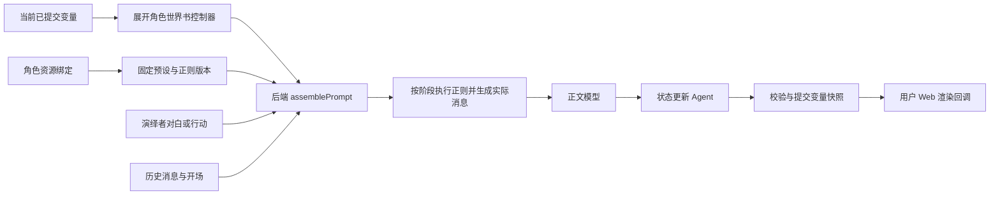

<!-- markdownlint-disable MD013 -->

# 林茜演绎资源绑定与预设检查

## 绑定对象

本章的角色资源短文件名均相对于 `apps/web/prototypes/characters/linqian/`。事实 schema 位于 `live-model.json.factsSchema`，状态 schema 位于 `state.schema.json`。服务端通过 `OPENROUTER_CONFIG` 环境变量定位模型及凭证配置；本次联调配置为 `/Users/developer/.config/tavern-headless/openrouter-linqian-test.json`。

本次先按用户指定检查「梦鲸思客V4-0902」，再按用户新增授权选择依赖更少的「夏瑾 天琴座 Beta 3.9（泛国模）」联调。`preset-tianqin-beta-3.9.json` 保存当前预设完整副本，`preset-mengjing-v4-0902.json` 保留梦鲸原文件；`prompt-bundle.json` 声明角色演绎所用的资源；其结构由 `apps/web/prototypes/checks/bound-prompt.schema.json` 校验。

| 内容 | 来源 | 使用阶段 |
| --- | --- | --- |
| 预设提示词、顺序与采样参数 | `preset-tianqin-beta-3.9.json` | 后端正文请求组装 |
| 角色设定、场景与世界书 | `snapshot.json.characterBook` | 后端按触发条件与插入位置组装 |
| 动态世界书控制器 | `prompt-controllers.js`；来源映射见 `prompt-controllers.json` | 后端根据当前已提交变量展开 109、111、127 条目 |
| 当前变量 | 会话已提交快照 | 作为 `stat_data` 写入隔离后端的变量服务；56 个 `format_message_variable` 宏通过显式映射使用 `getvar` |
| 正则 | 角色的 8 条规则、当前预设的 11 条规则 | 依次导入同一正则版本，由正式后端按通道和深度执行 |
| 演绎者 | `prompt-bundle.json.performer` | 当前名称为“你”，描述为空；尚未绑定额外人设 |
| 更新规则与结构约束 | `live-model.json`、`update-rules.json`、状态及事实 schema | 状态更新 Agent；原世界书 113、114、115 从正文组装中排除 |
| 模型与凭证 | 现有服务端 OpenRouter 配置文件 | 正文和更新模型分别使用对应槽位；凭证留在服务端 |

正文模型使用所绑定预设的采样参数和输出上限，当前天琴座的 `openai_max_tokens` 为 65535。`live-model.json.maxTokens` 为状态更新 Agent 的 4096 输出上限；两者分开传递。正式后端还须在管理 Web 展示 Profile、实例覆盖及模型上限的最终结果。

`apps/web/prototypes/checks/preset-import.mjs` 按 `prompt-bundle.json.presetImport` 执行明确的源格式转换：四个未被当前顺序引用的 `model` 身份映射为 `assistant`；`trim` 移除标记及相邻换行；当前使用的普通注释宏输出空字符串。这些转换保留原预设文件，在 `presetConversions` 记录条目与字段。它们对应 SillyTavern 的宏行为，不增加角色指令。

## 请求边界

`apps/web/prototypes/checks/bound-prompt.mjs` 调用正式后端的 `assemblePrompt` 和 `materializePromptRuntimeMessages`。OpenRouter 使用正式后端为 `openai-compatible` 定义的 assistant 消息预填充策略。用户输入仅提供演绎者的对白和行动；字段解释、输出协议与来源规则由角色配置和状态更新 Agent 提供。

原先要求推进到门口、街口的两条后续 Agent 配置已移除；原卡没有对应绑定。多次 Agent 更新能力须使用明确声明的测试配置验收，林茜的正常演绎验收按其实际绑定列表运行。

## 已验证的范围

启动隔离原型服务后，运行 `node apps/web/prototypes/checks/bound-prompt-unit.mjs <服务地址>`。检查结果写入 `docs/plans/evidence/linqian-live/prompt-bundle-check.json`。

检查覆盖预设版本和正则版本固定、两组正则加载、动态世界书激活、更新器条目排除、用户消息进入实际请求，以及无效请求和不存在会话。该检查只证明资源绑定与组装路径，不证明完整预设兼容或真实演绎质量。

当前天琴座预设通过正式 `POST /import/preset` 创建预设与固定版本。梦鲸原文件约 1.3 MB，公共接口受 1 MiB 限制；早先梦鲸离线检查通过 `AssetVersionService` 在隔离数据库存入完整预设，仅用于诊断。当前代码已使用公共导入接口，梦鲸的大文件导入仍是实施计划中的缺项。

原卡与预设正则中的 `minDepth: null`、`maxDepth: null` 表示未设边界；迁移时将这两个字段省略，保持后端可选字段的相同含义。每项转换写入请求检查记录的 `regexConversions`。

## 梦鲸脚本的能力归属

附带脚本的必要性按当前配置与触发条件判断，完整结论及架构图见[作者源码审计](preset-helper-source-audit.md)。本次天琴座预设没有附带执行脚本，梦鲸脚本不作为天琴座联调的前置条件。

梦鲸当前需要保留历史包装、停止匹配和已启用正文 Patch 的语义。预设设置交给管理 Web；Kimi 功能按原配置关闭；手动格式补全和空正文恢复分别记录，不作为每轮必需步骤。梦鲸的 `entry_processing.mode=none`，所以保存的世界书重定位选项当前不执行。

本系统的 `apps/api/src/services/prompt-assembler.ts` 已有相邻同身份消息合并与 `flattened` 模式；其中固定的 `User:`、`Assistant:` 格式不等于梦鲸的自定义历史标签。迁移须补齐差异，逐项记录实际参与本轮的行为。

## 当前验收状态

天琴座已通过公共导入、固定版本、世界书组装和宏残留检查。梦鲸离线请求中的 `trim`、自定义压缩占位符和嵌套 `setvar` 解析问题保留在[源码审计](preset-helper-source-audit.md)及实施计划中，属于另一套配置的兼容事项。

真实模型的第一组测试保存在 `docs/plans/evidence/linqian-live/normal-roleplay-output-limit-4096/`：首轮流式正文、变量提交与状态栏联动通过；人工检查发现正文开头出现模型自身说明，角色演绎语义未通过；续轮返回 `OPENROUTER_INCOMPLETE`，没有提交变量。这组测试仍使用旧的 4096 正文限制。

预算检查随后将正文与更新器的 `reasoning.effort` 明确设为 `none`，正文总上限仍为 65535，更新器上限为 4096。43875 服务按新配置重启后，连续两轮的流式正文、变量提交、历史查看与状态栏联动通过，均未返回 `length`。证据位于 `docs/plans/evidence/linqian-live/normal-roleplay/`；原失败记录保存在 `normal-roleplay-default-reasoning-1789818868/`。技术检查与完整角色语义验收分开记录，详见[联调记录](../plans/linqian-live-results.md)。
