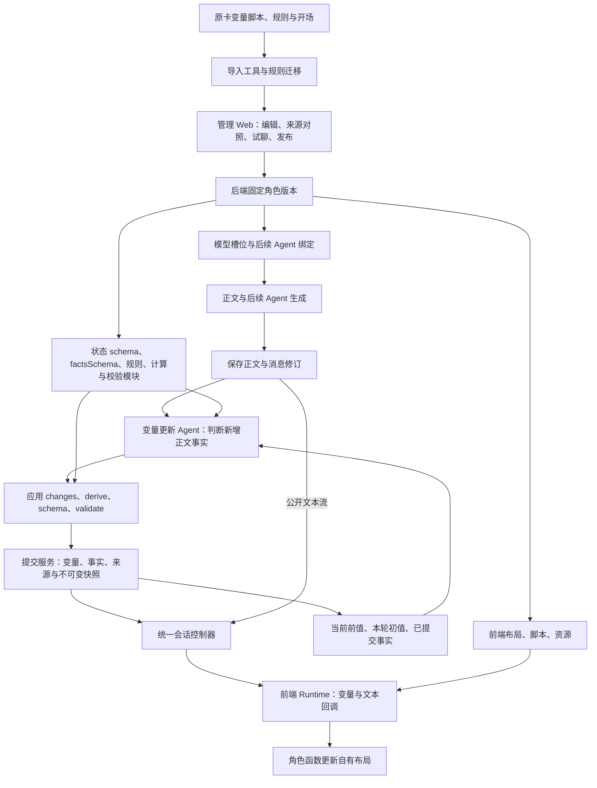
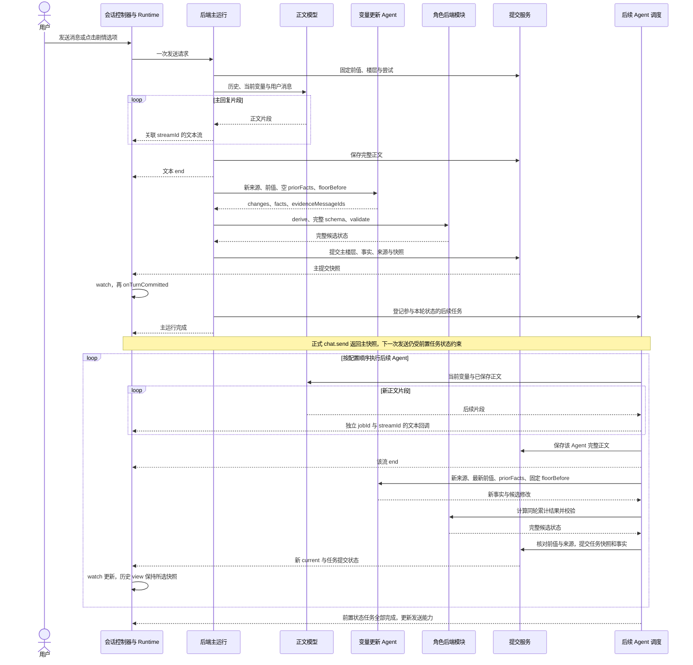
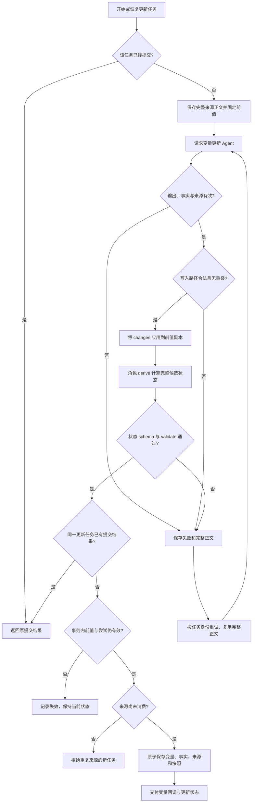
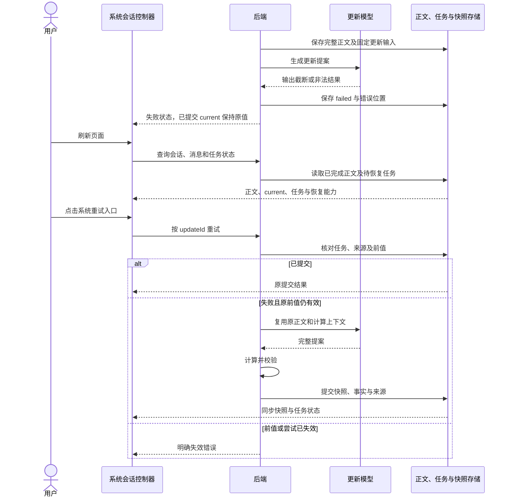

<!-- markdownlint-disable MD013 -->

# MVU 转换与角色变量更新 Agent

## 必须要实现的目标

本方案把 MVU 的变量结构、初始化和更新规则转换为系统角色版本中的变量更新配置。后端在多轮演绎中执行更新 Agent，校验并提交变量；角色前端通过已有 Runtime 读取和订阅接口渲染结果。本文件定义完整目标架构。隔离原型现已通过顾声慢的真实正文流、独立变量更新和状态提交链路，见[真实模型联调记录](../plans/openrouter-live-results.md)。林茜规则转换和后续 Agent 执行链已接入隔离原型；验收结果见[林茜联调记录](../plans/linqian-live-results.md)。正式后端的 RuntimeWorker 与数据库事务仍按双端实施计划接入。

## 现有基础与缺口

| 对象 | 已有实现 | 本方案补充 |
| --- | --- | --- |
| 林茜原卡 | `apps/web/prototypes/characters/linqian/source-card.json` 中的变量结构脚本、世界书条目 110、112–115、开场初始化块 | 将结构、更新规则、提示词输出要求分开转换，保留来源定位 |
| 变量暂存与提交 | `variables/commit/variable-commit-service.ts` 提供暂存与提升，`variable-mutation-applier.ts` 支持 `variable.set`、删除与 page 到 floor 提升 | 提案校验、嵌套路径到存储写入的转换、显示快照及来源关联 |
| 后台 Agent | `agent-runtime/background-agent-types.ts` 的执行上下文为 project/workspace；`agent-runtime/agent-output-dispatcher.ts` 提供可注入的状态提案目标 | 楼层更新器的执行上下文与事务接入；项目级后台 handler 保持原有职责 |
| 前端 Runtime | `variables.watch`、`onTurnCommitted`、`getFloor`、`getSnapshot` 与文本流接口 | 更新任务状态查询与订阅；前端读取完整已提交状态 |

上表中的后端服务路径均相对于 `apps/api/src/services/`。前端已有 API 的签名和回调顺序以[脚本 API](script-api.md)为准。

## 角色版本中的转换产物

角色版本增加 `extensions.tavern_headless.stateUpdate`，通过文件引用关联以下产物。结构定义见 [state-update.schema.json](state-update.schema.json)，其 `profile` 为更新配置，`agentOutput` 为模型输出，`proposal` 为宿主附加来源后的提案。

| 产物 | 来源与用途 |
| --- | --- |
| `state.schema.json` | 变量类型、必填字段、枚举、数组长度与数值范围；由后端验证完整候选状态 |
| 已有开场配置 | 保留各开场初始化结果；创建会话时选定，后续轮次读取已提交快照 |
| `update-rules.json` | 需要模型判断的原卡更新规则；按来源条目保存原文与索引，后端将文件内容加入更新提示词 |
| `derive.js` | 角色作者定义的确定性计算，导出 `derive(context)`，由后端执行 |
| `validate.js` | 角色作者定义的跨字段校验，导出 `validate(context)`，由后端执行 |
| `conversion-map.json` | 原脚本、世界书条目和规则到目标文件／字段的对应关系，以及待处理项 |

转换工具处理有确定语义的字段和数据结构，转换 Agent 阅读并迁移自然语言规则，管理员在管理 Web 核对差异。发布校验要求每条源规则有明确归属。脚本中的未知函数、外部调用或未支持的 MVU 操作进入待处理项，补齐对应实现并完成对照验收后发布。

### 林茜的具体转换

1. 变量结构中的 number、enum、tuple、boolean 映射为 JSON Schema；`prefault` 转成初始化值。每个开场的覆盖关系沿用[系统开场选择](session-openings.md)。
2. `z.coerce.number()` 与 clamp 是转换／归一化行为，必须落实到后端函数；JSON Schema 的范围校验本身不会执行这些行为。转换时记录原行为，使用数值、数值字符串、越界值、缺失值分别对照。后续更新中的缺失值由校验报告，初始化默认值只在创建会话时应用。
3. 世界书条目 115 的地点、经过时间、事件是否完成等语义规则交给更新 Agent。条目 110 的终局路线条件和有关事件正文作为关联规则一并迁移。涉及事件完成的判断读取本轮实际正文，世界书条目被加载本身只代表提示词来源。
4. 星期、时间段、分钟进位及确定的数值归一化交给 `derive.js`。A1 计数由 Agent 提交本轮实际完成事件的判断，再由后端函数按旧日期、结束日期和完成数量计算；重放同一提案仍只提交一次。
5. 条目 112 的变量宏由后端注入的结构化快照替代。条目 113–114 中“在回复末尾输出 UpdateVariable”的传输格式要求由系统结构化输出契约替代，其中行动选项数量、路径及更新条件仍保留为规则。
6. 普通演绎模型接收角色、世界书和当前状态；更新 Agent 接收更新规则并返回变量提案。两个模型的提示词组合由后端区分，迁移后的世界书记录各条目的用途，避免同一要求同时驱动两条变量写入链路。

原 MVU 的 `replace` 转为候选值写入；`delta` 基于固定前值计算候选值；`insert`、`remove`、`move` 按源操作的数组／对象语义计算受影响的完整子树，再产生系统 `set` 或 `remove`。每种源操作必须有对应测试；这项转换是后端导入／执行适配能力，当前开场导入器只实现了源卡实际使用的 `replace`。

后端新增 `apps/api/src/services/role-state-update-job.ts` 注册 `role.state_update` 任务处理器，通过现有 RuntimeWorker 执行；处理器构造会话／楼层上下文。`role-state-update-proposal-service.ts` 负责候选状态验证、前值核对和向现有提交服务转换写入。任务记录关联现有任务 ID、角色版本、更新配置与本文件定义的来源，管理端通过该关联查询运行轨迹。

## 更新 API 与职责

[角色变量更新 API](state-update-api.md)统一定义 profile 字段、模型输入输出、derive/validate 上下文、同轮累计、任务状态、恢复接口及原型与正式接口差异。前端布局、文本流和变量回调继续由[角色 JavaScript API](script-api.md)定义。

角色作者编写自然语言规则、factsSchema 和确定性函数。后端保存来源身份、调用模型、计算校验、执行提交并交付快照；前端角色函数根据已提交变量计算图片、状态栏和选项。林茜的专用数值公式保留在角色模块，通用系统负责调用这些模块。

## 架构图

图中的持久化提交服务是正式接入目标；隔离原型使用内存状态验证相同输入输出和计算顺序。管理端试聊复用用户 Web 的 Runtime，管理端保留配置和逐轮调试入口。

## 一轮主回复与后续多次更新时序图

该图定义正式完成边界；原型差异见[脚本 API](script-api.md#林茜-live-原型的完成边界差异)。一次后续任务的正文生成和变量更新是两次模型调用；本图的循环数量由角色绑定决定。

## 更新校验流程图

完整输入、校验顺序及失效重算条件以[更新 API](state-update-api.md#模型输入输出与校验顺序)为准。记忆整理、索引等内部 Agent 产物保持各自职责；只有配置中登记的演绎正文来源参与变量更新。

## 失败后重试与刷新时序图

重试、重算和页面恢复的完整行为由[恢复 API](state-update-api.md#正式宿主-http-接口)定义。原型已验证页面刷新恢复；正式服务重启后恢复要求持久化存储。

## 管理 Web 与实施步骤

1. 后端负责人增加 profile、输入、提案与状态 schema，并将角色更新器接入现有变量暂存和提交模块。产物为新契约、事务测试与两轮更新证据。
2. 管理端负责人增加“变量结构”“更新规则”“确定性计算”“校验”“模型槽位”配置，保留各规则的原卡来源；提供输入快照、固定正文、候选 changes、派生结果、校验错误和提交结果的逐项比较。
3. 用户端负责人接入更新状态查询和订阅，复用现有提交回调。管理端试聊继续使用同一用户 Web。
4. 转换 Agent 逐条迁移林茜规则，验收 Agent 对照原规则与实际轨迹验收。顾声慢与其他角色使用同一配置契约，按各自结构及规则生成产物。

## 验收清单

- 林茜两个开场使用各自初始状态；后续普通轮次继承已提交状态。
- 用实际正文验证地点、日期推进、跨日 A1 计数和事件完成判断；仅加载事件规则的轮次保持完成标记原值。
- 变量取值覆盖范围边界、类型错误、缺失值、数组长度、非法路径和派生字段冲突。
- 同一来源重复投递只提交一次；更新失败后重试沿用原正文；stale、重新生成失效尝试和分支切换保持当前有效状态。
- 流式正文可先显示，状态栏在提交后改变；后续 Agent 的第二次提交更新 current，查看旧楼层时 view 保持所选历史快照。
- 管理端能追溯原卡规则、输入、Agent 输出、计算结果、失败原因及最终写入；角色前端只读取该会话的显示记录与更新状态。

## 非本次目标

隔离原型已实现角色配置加载、林茜规则转换和多次更新链。正式更新 Agent、通用 MVU 导入转换器和管理 Web 编辑界面按照以上步骤实施。任意第三方 MVU JavaScript 的自动语义转换、通用游戏实体系统及新的一套变量数据库属于后续独立范围。

## 已获得的授权

用户要求设计 MVU 到系统 Agent 更新格式的转换架构，以及面向角色卡的能力边界；此前已授权维护架构、API 文档与实施计划，并授权配置免费模型完成隔离原型联调。
