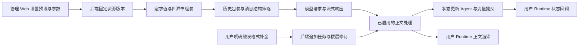

<!-- markdownlint-disable MD013 -->

# 梦鲸预设附带脚本的职责审计

## 来源与判断方法

本地配置为 `apps/web/prototypes/characters/linqian/preset-mengjing-v4-0902.json` 的 `extensions.tavern_helper.scripts`。源码采用作者仓库提交 [`d10345202a8f9b194a58713defa4384f6fceddd0`](https://github.com/deepsleep-claw/SleepTavernHome/commit/d10345202a8f9b194a58713defa4384f6fceddd0)。本次只读可读源码与预设结构化配置，没有执行原脚本，也没有还原压缩内容。该提交与本地导出版本可能不同，结论用于划分职责，尚不代表逐字等价验证。

是否需要某项行为，由当前配置、触发条件和生成结果共同决定。脚本外壳与行为分别判断：SillyTavern 的事件注册、DOM 修改和消息存储调用由本系统对应模块接替；实际改变请求或输出的行为单独验收。

## 逐项结论

| 脚本 | 当前作用与触发条件 | 本系统是否需要及承接位置 |
| --- | --- | --- |
| 消息处理 | 发送前将历史按自定义标签包装并合并为 user 消息；按停止匹配处理流式或已接收正文。本地 `entry_processing.mode` 为 `none`，因此世界书提取、深度搬移和绿灯缓存分支未启用 | 当前梦鲸配置需要历史包装与停止匹配。后端组装器和输出处理承接；现有相邻同身份合并可复用。世界书搬移和缓存不列为当前必要缺项 |
| 预设助手 | 用户操作面板时修改提示词启停、会话变量和全局变量；注册摘要完成事件 | 管理 Web 承接配置编辑；后端保存预设版本及变量。已导出的条目状态可以直接读取，常驻助手不是每轮生成前提。摘要行为按是否启用单独验收 |
| 格式补全 | 用户点击按钮并确认后，再请求一次模型，从 `dream_append_format` 中提取补充结果并插入已有正文 | 初次正文不依赖它。若提供补全功能，复用后端追加任务与楼层修订；它和状态更新 Agent 的职责不同；验收负责人必须单独验证格式补全的请求、结果提取与正文插入，并记录对应证据 |
| 思维链提取到正文 | 推断对应“空正文梦境提取”：收到空的 assistant 正文后，从 reasoning 元数据提取匹配 `dream_plot` 的部分 | 正常正文不依赖它。属于特定响应格式的恢复能力；目前不列入主链路必需功能。若后续明确启用，由后端响应解析处理，不由角色前端修改消息 |
| Kimi 前缀预填充 | 本地 `data.enabled=false`；启用时为末尾 assistant 消息增加 `partial`，并跳过结构化输出与工具上下文 | 本次保持关闭。以后由后端模型适配层按模型与配置提供，不属于角色 Runtime |
| 梦境自修复 | 收到包含 Patch 的 `dream_self_check` 后，修订 `dream_body` 与平行事件正文并记录可撤销修改；本地当前启用的“梦境自检修复 - 反八股”条目要求这一协议 | 梦鲸输出包含有效 Patch 时需要对应处理。后端在状态提取前处理并保留原始输出及修订记录，用户 Runtime 展示最终正文；现有变量更新不能代替正文 Patch |

## 源码证据

### 消息处理

[压缩相邻消息/squash.ts](https://github.com/deepsleep-claw/SleepTavernHome/blob/d10345202a8f9b194a58713defa4384f6fceddd0/src/酒馆助手/压缩相邻消息/squash.ts) 的 329–383 行处理 `squash_into_one`；3045–3050、3104–3108 行按模式控制条目处理；3384–3430 行处理停止匹配。当前配置虽保存了世界书与深度选项，但外层模式关闭这些分支。

### 预设助手与 Kimi

[预设适配器/store.ts](https://github.com/deepsleep-claw/SleepTavernHome/blob/d10345202a8f9b194a58713defa4384f6fceddd0/src/酒馆助手/预设适配器/store.ts) 的 `applyOption` 和 `updateVariableInput` 分别修改预设与变量；[index.ts](https://github.com/deepsleep-claw/SleepTavernHome/blob/d10345202a8f9b194a58713defa4384f6fceddd0/src/酒馆助手/预设适配器/index.ts) 注册设置入口和摘要完成事件。[Kimi前缀填充/partial_mode.ts](https://github.com/deepsleep-claw/SleepTavernHome/blob/d10345202a8f9b194a58713defa4384f6fceddd0/src/酒馆助手/Kimi前缀填充/partial_mode.ts) 的 `initializeKimiPartialMode` 定义启用条件与消息修改。

### 格式补全

[格式补全/index.ts](https://github.com/deepsleep-claw/SleepTavernHome/blob/d10345202a8f9b194a58713defa4384f6fceddd0/src/酒馆助手/格式补全/index.ts) 注册按钮；[format_completion.ts](https://github.com/deepsleep-claw/SleepTavernHome/blob/d10345202a8f9b194a58713defa4384f6fceddd0/src/酒馆助手/格式补全/format_completion.ts) 的 250–313 行构建补充请求，369–463 行检查最新消息、确认操作并启动生成。该请求是后台补全指令，与用户正常聊天输入分属不同用途。

### 空正文提取

[空正文梦境提取/index.ts](https://github.com/deepsleep-claw/SleepTavernHome/blob/d10345202a8f9b194a58713defa4384f6fceddd0/src/酒馆助手/空正文梦境提取/index.ts) 的 101–129 行限制到空正文的 assistant 消息。本地名称不同，默认正则与源码相同；路径映射仍需对应导出版本的历史源码确认。

### 自修复

[梦境自修复/index.ts](https://github.com/deepsleep-claw/SleepTavernHome/blob/d10345202a8f9b194a58713defa4384f6fceddd0/src/酒馆助手/梦境自修复/index.ts) 处理消息接收和修订；[core.ts](https://github.com/deepsleep-claw/SleepTavernHome/blob/d10345202a8f9b194a58713defa4384f6fceddd0/src/酒馆助手/梦境自修复/core.ts) 的 `extractLastSelfCheck`、`parsePatchText`、`applyPatchText`、`reversePatchRecords` 定义提取、应用与撤销。

## 架构落点

角色 Runtime 接收正文流、已提交快照和交互结果。后端持有预设指令、请求组装、模型调用及正文修订。后端需要读取实际启用配置，记录哪些行为参与本轮；管理 Web 显示这些配置和执行记录。
