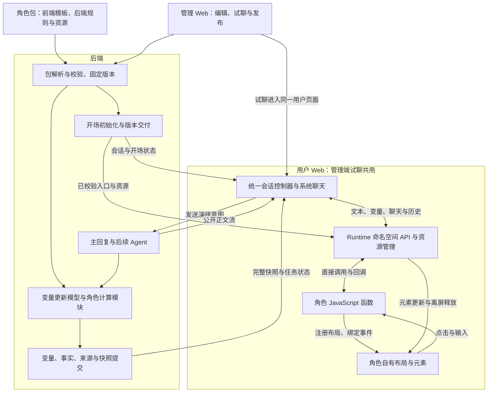
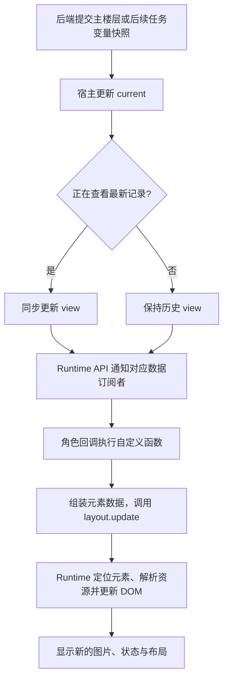
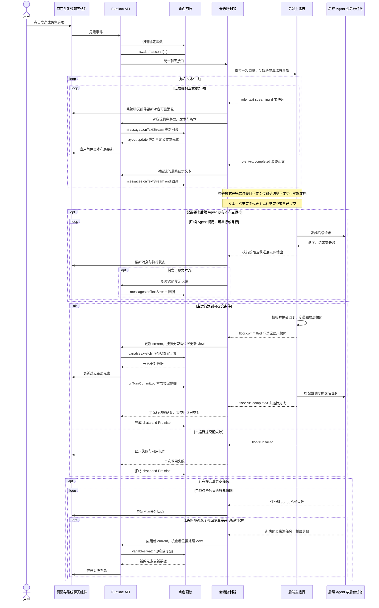
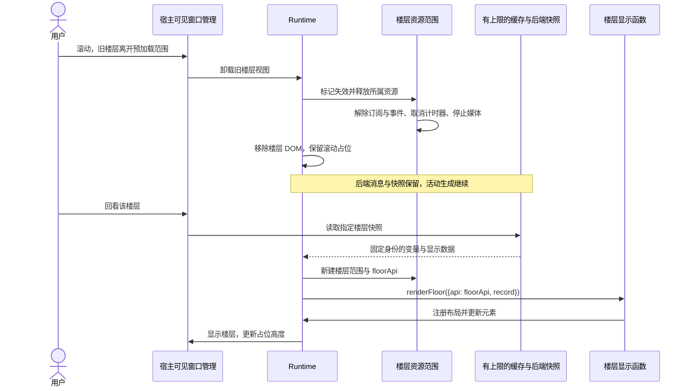
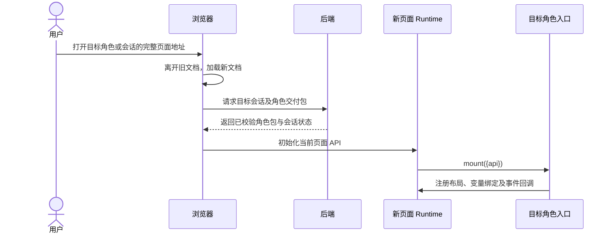
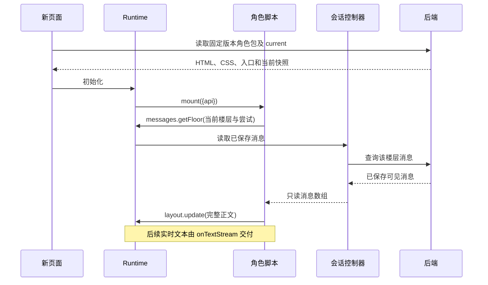

<!-- markdownlint-disable MD013 -->

# 角色前端 Runtime：代码执行、渲染与宿主接口

当前正式后端接线与已验收范围见[角色发布与正式后端重新接线](../plans/published-backend-reconnection.md)。本文中 `/script-api` 的接口对照属于旧隔离原型；当前用户端通过正式会话、SSE 和变量接口运行，新增扩展及待实施项以该记录为准。

正文交付与渲染职责按[实施计划首节](../plans/role-app-dual-web-plan.md)执行；后端输出配置及当前事件接线见[正文交付实现](../plans/preset-output-responsibilities.md)。

## 必须要实现的目标

1. 用户 Web 的页面布局与账号职责遵循[用户 Web 需求规格](../ixd/user-web/user-web-requirements.md)第 3 节和第 4 节。

角色前端 Runtime 执行角色包提供的 HTML、CSS 和 JavaScript。角色作者可以定义函数、计算派生值，并通过命名空间 API 注册布局、绑定事件、订阅楼层变量和使用预置资源。Runtime 封装常用更新方法并自动管理实例资源。模板只是页面结构；脚本负责角色自己的显示和交互逻辑。

本架构取代此前“有限节点树加动作声明”的目标设计。规范分别见[模板与入口](script-template-api.md)和[脚本 API](script-api.md)。既有 v1 原型及其核对记录保留为旧实现证据；新版脚本原型、运行入口和验证范围见[脚本原型验收](script-prototype-acceptance.md)。

开场选择属于系统会话层。完整数据契约与创建时序见[系统开场选择](session-openings.md)；角色 Runtime 接收已选正文及初始变量并渲染。

## 模块架构图

后端负责角色包解析、结构与入口引用校验、版本固定、资源地址解析、权限及业务数据提交。后端校验代码文件及入口格式；实际执行中的逻辑异常由 Runtime 报告，包校验通过不等于所有脚本逻辑正确。

前端使用浏览器 JavaScript 引擎执行角色函数。角色定义条件计算、资源选择和交互结果；系统 API 处理布局注册、批量元素更新、事件绑定、媒体播放、计时器及生命周期。接口按能力命名空间组织，直接函数调用；常用功能的契约见[脚本 API](script-api.md#常用能力的命名空间)。

## 系统必须提供的能力与实现位置

| 能力 | 系统边界 | 角色使用方式 | 当前验证与正式缺口 |
| --- | --- | --- | --- |
| 包加载、版本与引用校验 | 后端解析入口、规则、模块、资源及模型绑定 | 在包内声明文件与槽位 | 角色版本和文件交付已有原型；正式包编辑、发布校验待接入 |
| 多轮事实与状态计算 | 后端向角色计算模块提供固定前值、本轮初值和已提交事实 | 定义 factsSchema、derive、validate | 林茜真实多次更新已验证；持久化任务与事务待接入 |
| 文本流与变量交付 | 后端保存来源，宿主关联消息、流、任务和快照 | messages 与 variables 回调 | 后端正文事件与历史正文接口已接入，验收范围见正文交付实现 |
| 自有布局与交互 | 前端 Runtime 执行角色函数并管理布局、事件和资源 | ui、events、assets、data、media、timers | 多布局和单正文容器已有原型；正式用户 Web 待接入 |
| 历史阅读与资源释放 | 宿主分离 current/view，Runtime 释放离屏楼层资源 | 读 view 展示历史，读 current 构造当前选项 | 历史隔离及窗口上限已有原型验证 |
| 失败诊断与恢复 | 系统控制器提供重试，后端保存完整正文与固定输入 | 角色读取任务状态，继续使用统一发送入口 | 页面恢复已有原型；正式 stateUpdates 与管理调试待接入 |

前端 API 的定义归[脚本 API](script-api.md)，后端角色模块与更新任务 API 的定义归[变量更新 API](state-update-api.md)。两种 JavaScript 执行位置分别服务界面显示和持久状态计算；后端凭证与模型调用由服务端管理。

## 执行环境与直接调用

角色卡与脚本由项目自己编写和维护，同页面执行。Runtime 加载后端交付的固定版本入口，创建实例及资源登记表，调用 `mount({api})`。Shadow DOM 用于角色样式封装；角色通过 ui 注册并更新布局。

所有命名空间共享当前角色实例。API 创建资源时自动登记；角色切换与楼层释放分别遵循[生命周期契约](script-api.md#生命周期与错误)。角色只编写业务显示与交互函数。

## 数据与代码边界

| 对象               | 来源                         | 使用与写入                                   |
| ------------------ | ---------------------------- | -------------------------------------------- |
| current            | 后端最新提交的公开变量与快照 | 角色代码读取；后端提交业务变化               |
| view               | 宿主选中的历史快照           | 角色代码读取，用于历史画面                   |
| 派生值             | 角色自定义函数计算           | 角色本地保存，例如表情、进度百分比、图片选择 |
| UI 状态            | 角色脚本                     | 控制展开、选择、缩放、动画等本地交互         |
| 布局与 CSS         | 角色包                       | 角色函数提供更新数据，Runtime 更新元素       |
| 聊天消息及逐条头像 | 宿主聊天组件                 | 同一聊天实现负责历史、输入与操作权限         |

逐轮变量回调的触发条件与记录身份由下述多轮契约定义。variables.watch 订阅负责当前与历史画面的同步；逐轮回调负责本轮提交反应。读取任意获准楼层变量、前置快照和指定尝试的接口由[脚本 API 的多轮契约](script-api.md#多轮变量读取与提交回调)定义。回调可以执行任意正常 JavaScript 计算。角色可根据多个数值选择图片，也可以改变布局、生成列表、绘制 Canvas 或播放动画。计算结果用于显示时保存在本地；需要改变后端业务数据时调用系统已提供的业务接口。

## 变量驱动渲染流程图

## 一次提交、多次返回与变量更新时序图

图中的主运行与提交后任务分别结束。提交后任务的返回可与主运行完成通知交错；图中下方集中展示这些任务的处理，表示其独立生命周期，不表示必须等 chat.send 返回后才开始。回调时机、chat.send 完成条件、历史快照和后台任务更新的语义由[脚本 API 的多次返回契约](script-api.md#一次提交的多次返回与完成边界)统一定义。后续 Agent 的内部文字仅按后端标记进入对应消息或执行详情。自定义流式页面采用[文本流渲染回调](script-api.md#文本流渲染回调)，与变量提交回调分别驱动不同数据的呈现。

### 后端证据与目标接口的差异

- `packages/core/src/orchestration/turn-orchestrator.ts` 发出 generation.chunk 和 generation.completed；后者之后仍更新待提交输出，不能据此推断楼层提交完成。
- `packages/core/src/events/event-types.ts` 分别定义 Generation 事件和 FloorRunSnapshot；运行记录包含 runId、phase、attemptNo 等字段，生成事件的身份字段并不等同于完整运行身份。
- `apps/api/src/services/turn-commit-service.ts` 在事务提交后发布变量及项目事件，再推进 post_commit_scheduled 并标记主运行完成。
- `apps/api/src/services/runtime-job-scheduler.ts` 将后续任务入队并发出 runtime.job_enqueued；任务状态与主运行状态分别记录。

上述为正式后端结构。角色显示快照交付和 Runtime 回调已在隔离原型实现；与上述正式服务的关联适配仍是目标接入契约。宿主必须按后端身份关联主运行、生成及任务；身份不足的事件需要后端补充关联数据，前端必须依据后端提供的关联身份确定消息归属。现有 floor.run.completed 不提供“所有后续 Agent 全部完成”的保证。

## 历史楼层离屏与回看时序图

资源释放范围、缓存上限及恢复行为统一见[楼层显示范围与资源释放](script-api.md#楼层显示范围与资源释放)。当前场景与全局 BGM 属于角色范围，历史行资源属于楼层范围；资源不随浏览过的全部楼层常驻。

## 切换角色与整页加载时序图

页面导航与后端任务的关系见[生命周期契约](script-api.md#生命周期与错误)。同一页面内历史楼层的离屏清理仍按上一节执行。

## 刷新后恢复正文时序图

正文读取及流式更新之间的结果适用性按[已保存楼层消息契约](script-api.md#已保存的楼层消息)判断。

## 扩展能力与本版范围

新增角色逻辑通常只修改角色 JavaScript、HTML 和 CSS。例如多条件表情选择、点击地图预览背景、背包排序、状态面板计算和多人物显示，都可以由作者函数表达。系统提供新的后端业务能力时增加对应 API；现有函数与布局更新接口继续复用。

地图点击引起剧情变化时，角色通过 chat.send 提交意图，背景在后端提交地点变量后更新；本地展开、翻页和音乐控制由角色函数直接调用前端 API。

地下城战斗、旅行结算和随机业务规则仍是未来需求。本版提供运行前端代码与访问宿主能力的通用接口，保留具体玩法的实现空间。

## 验收清单

1. 角色包提供自定义函数，订阅至少两个变量并计算图片选择；连续快照变化后，页面显示对应图片。
2. 角色脚本通过命名空间 API 绑定回调，实现点击地图、面板展开及本地计算，Runtime 保持同一实现。
3. 角色脚本用 await 调用发送消息，用 try/catch 处理失败；系统组件和角色按钮使用同一个聊天控制器。
4. 切换历史时只更新 view 订阅；当前选项仍读取 current。切换角色时加载新文档并显示目标会话。
5. 角色脚本报错时，调试记录包含角色版本、脚本位置与关联快照；后端校验记录与前端执行错误分别展示。

## 非本次目标

本次交付执行架构与作者契约修订。新版脚本 Runtime、API 及角色包的实现证据见脚本原型验收；正式后端生成链路仍须按其中列出的边界接入。v1 通过结果仅证明旧原型。完整游戏业务模型、自建 JavaScript 内核及第三方插件加载不属于本版。

## 已获得的授权

用户明确角色卡由项目自己编写，使用同页面执行与直接 API 调用。用户要求 Runtime 能执行前端方法和自定义函数，响应 AI 返回变量进行计算、图片切换与交互，并要求抽取通用能力。用户已明确后端负责角色包解析、校验与交付，未来游戏业务不属于本版要求。

## MVU 规则进入系统变量提交链路

原卡变量脚本、更新规则、后端计算与楼层更新 Agent 的职责、架构图及多次提交时序统一见[MVU 转换与变量更新 Agent](mvu-agent-state.md)。林茜已在隔离原型完成真实模型主回复、后续两次 Agent 更新及跨轮继承验证，见[验收记录](../plans/linqian-live-results.md)。正式数据库事务、RuntimeWorker、管理编辑页和 stateUpdates API 仍按[实施计划](../plans/role-app-dual-web-plan.md)接入。
