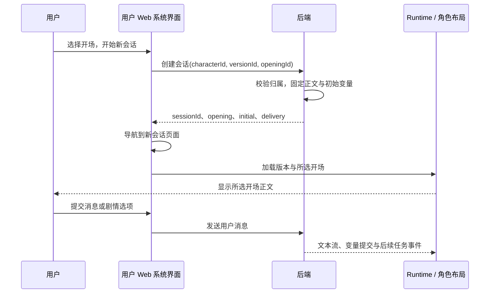

<!-- markdownlint-disable MD013 -->

# 系统开场选择

## 必须要实现的目标

后端保存角色版本中的开场列表。管理 Web 配置列表，用户 Web 提供统一选择界面并创建会话，Runtime 将所选正文交给角色布局渲染。角色脚本负责正文显示，系统负责开场选择和会话创建。

## 数据与接口

原型的唯一结构定义位于 [`script-transport.schema.json`](../../apps/web/prototypes/shared/script-transport.schema.json) 的 `opening`、`openings`、`sessionCreate` 和 `session`。后端通过 [`import-openings.js`](../../apps/web/prototypes/shared/import-openings.js) 完整导入角色快照的 `greeting` 和全部 `alternateGreetings`，分别对应原卡 `first_mes` 与 `alternate_greetings`。主开场 ID 为 `first`，备用开场按原顺序生成 `alternate-1`、`alternate-2` 等 ID。每个角色目录的 `openings.json` 仅保存默认 ID 和条目元数据，其结构由 `openingImport` 定义；元数据可以设置标题、摘要、类型和初始变量，正文始终读取原卡字段。缺少条目元数据时，系统仍导入该开场并按顺序显示“主开场”或“备用开场 N”，并按下述导入规则计算初始变量。隔离后端校验完整列表后写入角色版本快照的 `extensions.tavern_headless.openings`。正式实现沿用此结构，在后端共享 schema 中维护。

| 字段 | 含义 |
| --- | --- |
| `defaultOpeningId` | 默认开场 ID，必须指向列表中的条目 |
| `items[].id` | 角色版本内唯一且稳定的开场 ID |
| `title`、`summary` | 系统选择界面的标题与摘要 |
| `kind` | `story` 为剧情开场，`introduction` 为作品介绍 |
| `text` | 原卡字段的完整正文，保留初始化块与格式语法 |
| `displayText` | 后端完成开场初始化数据提取及用户称呼替换后，交付角色布局的正文 |
| `variables` | 选择该开场后，由后端保存的完整初始变量 |

SillyTavern 导入器读取正文中的 `<initvar>` YAML 与 `<JSONPatch>` 数据，生成该开场的初始变量；当前原型执行原卡使用的 `replace` 操作，遇到其他操作或不存在的路径时报告导入错误。导入器从显示正文中移除 `<UpdateVariable>` 与 `<StatusPlaceHolderImpl/>`，并按角色交付配置替换 `{{user}}`。角色脚本接收处理后的 `displayText`；原始 `text` 保留在后端版本中。

管理员导入原卡后，必须明确指定介绍、剧情开场和默认项。`first_mes` 与 `alternate_greetings` 都是导入来源，字段位置本身不决定用途。顾声慢的 `first_mes` 为介绍，`alternate_greetings[0]` 为剧情开场。

原型 `POST /script-api/sessions` 接收 `{ characterId, versionId, openingId }`，返回新会话。后端核对角色版本及开场归属，保存所选开场、初始快照和角色版本；不存在的开场返回 `OPENING_NOT_FOUND`。介绍和剧情条目均可选择，`kind` 仅用于说明内容类型。`GET /script-api/sessions/:id` 返回固定的 `opening` 与 `openings`。系统将所选 `opening.displayText` 交付为 Runtime 的 `data.opening`，角色代码无需查询或选择列表。

正式后端必须将这组创建参数合并进现有用户会话创建接口，并在生成上下文中加入所选开场正文。已有会话继续使用创建时固定的开场和初始变量。用户重新选择开场时，系统创建独立会话，原会话历史保持可读取。

## 系统分工与流程

## 验收清单

- 管理员可新增、编辑、删除、排序开场，设置类型及默认项，编辑每个开场的初始变量，并预览其角色布局。删除默认项时先选择新的默认项；发布后旧会话继续使用旧版本。
- 系统选择界面展示标题、摘要和默认项。介绍独立标识，创建按钮接受列表中的任一开场。正式界面提供介绍与剧情正文的只读预览。
- 创建结果固定开场 ID、版本、正文及变量；刷新重新读取相同结果。重新选择创建独立会话。
- 导入后的条目数量必须等于主开场加全部备用开场，正文与原字段逐项相等；覆盖零个、一个及多个备用开场，以及只有部分条目配置元数据的情况。
- 后端拒绝不存在的版本、开场及非法请求；用户 Web 使用统一错误码文案。
- 顾声慢进入走廊剧情，连续提交两次均得到续演正文，用户通过系统选择界面切换开场。

原型已实现系统选择、后端创建、版本保存、初始变量与刷新读取。管理端开场编辑、只读全文预览、正式会话数据库字段和真实生成上下文接入按[实施计划](../plans/role-app-dual-web-plan.md#系统开场选择的补充交付项)完成。隔离后端的续演使用固定数据；选项语义与生成结果的对应关系由正式模型联调验收。

## 非本次目标

本次不实现真实模型生成或角色脚本自定义的会话创建界面。

## 已获得的授权

用户要求将开场选择作为系统功能改造，并已授权调整原型、后端隔离联调与实施计划。
