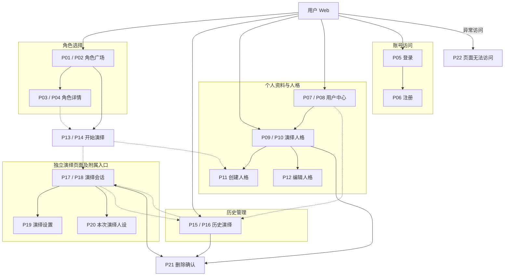

# 阶段 2：用户 Web 信息架构

## 1. 设计依据与编号规则

1. 产品定位与设备范围采用[阶段 1](phase1-context.md)；产品行为采用[需求规格](user-web-requirements.md)；功能与接口的接入状态采用[功能依据第 2 节](feature-basis.md#2-页面元素与交互覆盖)。本文描述待实现的页面结构。
2. 页面编号是后续页面规格和原型验收的索引。桌面与手机导航或布局差异显著的页面分别编号；内容和组织方式一致的表单、弹层共用编号，并在两端分别交付和验收。
3. **L1** 为主导航直达页；**L2** 为其子页；**L3** 为子页中的任务页面。**宿主页**指打开弹层的页面；弹层沿用宿主页的层级，并在关闭后返回宿主页。全局入口及异常页面单独标记。
4. 页面表共 22 项：14 项组成 7 组桌面／手机页面，8 项为跨平台页面或弹层。每端覆盖 15 项。页内搜索、筛选、编辑和反馈状态归入所属页面的规格。

## 2. 页面清单

1. 下表的“桌面 Web”和“手机 Web”均指浏览器页面；“跨平台”指两端均需覆盖。页面名称用于识别页面，编号用于交付追踪。

| 编号 | 页面名称     | 所属模块 | 层级    | 平台类型 | 页面类型           | 入口来源                             | 简要说明                                           |
| ---- | ------------ | -------- | ------- | -------- | ------------------ | ------------------------------------ | -------------------------------------------------- |
| P01  | 角色广场     | 角色选择 | L1      | 桌面 Web | 列表页             | 站点首页、桌面主导航                 | 浏览角色，页内搜索与筛选，查看详情或开始演绎       |
| P02  | 角色广场     | 角色选择 | L1      | 手机 Web | 列表页             | 站点首页、手机主导航                 | 承载与 P01 相同的角色选择任务，使用手机导航        |
| P03  | 角色详情     | 角色选择 | L2      | 桌面 Web | 详情页             | P01 的角色条目                       | 查看角色资料、故事介绍与开始演绎入口               |
| P04  | 角色详情     | 角色选择 | L2      | 手机 Web | 详情页             | P02 的角色条目                       | 承载与 P03 相同的角色信息与入口                    |
| P05  | 登录         | 账号访问 | 全局    | 跨平台   | 登录／注册页       | 访客账号入口、受保护页面、P06        | 登录账号，保留登录前的站内目标                     |
| P06  | 注册         | 账号访问 | 全局    | 跨平台   | 登录／注册页       | P05                                  | 创建账号，并提供返回登录入口                       |
| P07  | 用户中心     | 用户中心 | L1      | 桌面 Web | 个人中心           | 桌面主导航                           | 查看账号资料、页内编辑昵称、进入个人资源、退出登录 |
| P08  | 用户中心     | 用户中心 | L1      | 手机 Web | 个人中心           | 手机主导航                           | 承载与 P07 相同的账号和个人资源入口                |
| P09  | 演绎人格     | 演绎人格 | L1      | 桌面 Web | 列表页             | 桌面主导航、P07                      | 管理本人的人格集合与默认选择                       |
| P10  | 演绎人格     | 演绎人格 | L1      | 手机 Web | 列表页             | 手机主导航、P08                      | 承载与 P09 相同的人格管理任务                      |
| P11  | 创建人格     | 演绎人格 | L2／L3  | 跨平台   | 表单页             | P09／P10、P13／P14                   | 填写人格姓名与完整描述；返回发起创建的页面         |
| P12  | 编辑人格     | 演绎人格 | L2      | 跨平台   | 表单页             | P09／P10 的人格条目                  | 查看并编辑指定人格的完整资料                       |
| P13  | 开始演绎     | 角色演绎 | L2      | 桌面 Web | 选择器页           | P01 或 P03                           | 在同一页选择人格和角色开场，建立会话               |
| P14  | 开始演绎     | 角色演绎 | L2      | 手机 Web | 选择器页           | P02 或 P04                           | 承载与 P13 相同的选择任务，适配手机页面组织        |
| P15  | 历史演绎     | 历史管理 | L1      | 桌面 Web | 列表页             | 桌面主导航、P07、P17                 | 搜索和继续会话，页内重命名，单项或批量删除         |
| P16  | 历史演绎     | 历史管理 | L1      | 手机 Web | 列表页             | 手机主导航、P08、P18                 | 承载与 P15 相同的历史管理任务                      |
| P17  | 演绎会话     | 角色演绎 | 独立 L2 | 桌面 Web | 工作区             | P13、P15、会话地址                   | 独立承载角色 Runtime 与通用聊天能力                |
| P18  | 演绎会话     | 角色演绎 | 独立 L2 | 手机 Web | 工作区             | P14、P16、会话地址                   | 承载与 P17 相同的会话，使用手机专用布局            |
| P19  | 演绎设置     | 角色演绎 | 宿主页  | 跨平台   | 设置页、弹窗／浮层 | P17／P18                             | 查看当前角色与人格姓名，编辑演绎标题               |
| P20  | 本次演绎人设 | 角色演绎 | 宿主页  | 跨平台   | 详情页、弹窗／浮层 | P17／P18                             | 阅读当前会话的完整人格快照                         |
| P21  | 删除确认     | 通用反馈 | 宿主页  | 跨平台   | 弹窗／浮层         | P09／P10、P15／P16、P17／P18         | 承载人格、会话和消息删除的确认信息                 |
| P22  | 页面无法访问 | 通用反馈 | 全局    | 跨平台   | 结果页             | 未知地址、目标资源不存在或无访问权限 | 提供返回所属列表或角色广场的入口                   |

## 3. 站点结构

1. 图中实线表示主要入口与所属页面，虚线表示跨模块访问。带两个编号的节点代表同一任务的桌面和手机页面；对应关系见第 2 节。图中共 15 个页面节点，与每端交付项一致。

## 4. 导航结构

### 4.1 主导航与双端映射

1. 桌面主导航采用侧栏，手机主导航采用底部导航。两端均提供以下四个入口；站点首页为角色广场。导航选中状态由当前页面所属模块确定。

| 顺序 | 导航名称 | 桌面目标 | 手机目标 | 访问范围       |
| ---- | -------- | -------- | -------- | -------------- |
| 1    | 角色广场 | P01      | P02      | 访客与登录用户 |
| 2    | 历史演绎 | P15      | P16      | 当前登录用户   |
| 3    | 演绎人格 | P09      | P10      | 当前登录用户   |
| 4    | 用户中心 | P07      | P08      | 当前登录用户   |

2. 桌面站点顶栏承载当前页面名称与账号入口。手机顶栏承载页面名称与子页返回入口；访客可从角色广场的账号入口进入 P05。
3. 详情、表单与开始演绎页面通过返回入口连接来源页。手机子页使用顶层返回导航，底部主导航用于 L1 页面。桌面子页保留所属模块的侧栏入口。
4. P05、P06 使用独立账号页面，可返回原站内来源；直接访问账号页时，返回目标为角色广场。
5. P17、P18 采用[需求规格第 4 节](user-web-requirements.md#4-独立演绎页面与渲染职责)的独立页面结构。两端均以返回历史、演绎设置和查看完整人设作为通用导航入口。角色 Runtime 内的场景入口由角色交付内容决定。

### 4.2 访问与返回关系

1. P01—P06 面向访客开放。个人资料、人格、历史、开始演绎和会话页面按登录身份访问；访客访问这些目标时进入 P05，登录后回到原目标。认证服务的接入状态采用功能依据中的“注册、邮箱密码登录、退出”条目。
2. P11 从人格列表进入时属于 L2；从开始演绎页进入时属于 L3。P13、P14 作为角色广场的 L2 子页，角色详情通过跨页入口访问它们。创建人格是开始演绎任务的附属页面，返回目标保留角色选择上下文。
3. P17、P18 作为会话的独立访问目标，归于历史演绎的 L2；从开始演绎进入后，其返回历史入口仍指向 P15、P16。
4. P19—P21 关闭后返回各自宿主页。P22 按目标资源归属连接角色广场、人格列表或历史演绎；未知地址连接角色广场。
5. 同一资源的桌面与手机页面共用资源标识。浏览器直接打开地址、刷新及前进后退均需能确定当前页面与所属资源；路由语法由页面实现确定。

### 4.3 核心入口可达性

1. 下表以角色广场为起点计算入口操作次数。账号任务采用访客身份，其余任务采用已登录身份；计算范围为导航、选择目标和进入任务，表单填写、认证及删除确认属于任务本身。“开始一段演绎”的计数适用于人格与开场已选中的情况；需要创建人格时按对应任务单独计算。

| 核心任务           | 桌面／手机入口                                      | 最多入口操作次数 |
| ------------------ | --------------------------------------------------- | ---------------- |
| 注册或登录         | 访客账号入口进入 P05，P05 进入 P06                  | 2                |
| 查看与编辑账号资料 | 主导航进入 P07／P08                                 | 1                |
| 查看角色详情       | 角色条目进入 P03／P04                               | 1                |
| 选择人格与开场     | 角色广场直接进入 P13／P14；也可经角色详情进入       | 2                |
| 开始一段演绎       | 经角色详情进入 P13／P14，使用已选人格与开场创建会话 | 3                |
| 创建或编辑人格     | 主导航进入 P09／P10，再进入 P11 或 P12              | 2                |
| 继续历史演绎       | 主导航进入 P15／P16，再进入目标会话                 | 2                |
| 整理历史记录       | 主导航进入 P15／P16                                 | 1                |

## 5. 共用界面职责

1. 下表记录跨页面复用的界面职责。各项的内部组成与交互细节由对应页面规格定义。

| 界面职责               | 使用位置                 | 信息来源                     |
| ---------------------- | ------------------------ | ---------------------------- |
| 页面导航与账号入口     | 第 4 节指定页面          | 当前页面及登录身份           |
| 角色条目               | P01—P04                  | 角色资料与发布可见范围       |
| 人格摘要与选择         | P09—P14、P19             | 当前账号的人格集合或会话身份 |
| 会话摘要               | P07／P08、P15／P16       | 当前账号的会话资料           |
| 通用聊天操作           | P17／P18                 | 需求规格第 2 节第 6 项       |
| 删除确认               | P21                      | 发起删除的资源与影响范围     |
| 加载、空内容和失败反馈 | 获取数据或提交操作的页面 | 当前请求、集合和操作结果     |

2. P17、P18 的通用聊天操作与角色内容渲染按需求规格第 4 节分工。场景、地点、时间、线索和剧情按钮由角色内容提供，页面清单以演绎会话为交付单位。

## 6. 页面类型覆盖

1. 以下 22 类逐项登记为独立页面、页内内容或范围外项目。分类用于发现遗漏，具体功能范围采用功能依据。

| 类型编号 | 页面类型     | 覆盖位置或范围依据                                                    |
| -------- | ------------ | --------------------------------------------------------------------- |
| 1        | 聚合页       | P07／P08 汇集账号资料与个人资源入口                                   |
| 2        | 列表页       | P01／P02、P09／P10、P15／P16                                          |
| 3        | 详情页       | P03／P04、P20；人格完整资料在 P12                                     |
| 4        | 搜索页       | 搜索与结果同页，归入角色广场和历史演绎                                |
| 5        | 筛选／排序页 | 角色筛选归入 P01／P02；历史列表采用功能依据规定的时间顺序             |
| 6        | 表单页       | P11、P12；昵称、历史标题与消息编辑归入各自所属页面                    |
| 7        | 多步表单     | 当前任务采用单页表单与选择器；范围外                                  |
| 8        | 选择器页     | P13／P14 包含人格和开场选择                                           |
| 9        | 结果页       | P22；提交成功与失败归入发起操作的页面                                 |
| 10       | 空态页       | 第 7 节指定的列表或选择页面状态                                       |
| 11       | 登录／注册页 | P05、P06                                                              |
| 12       | 个人中心     | P07／P08                                                              |
| 13       | 设置页       | P19；默认人格归入 P09／P10                                            |
| 14       | 关于／协议页 | 当前功能范围外，相关内容与需求由产品方另行提供                        |
| 15       | 启动页       | 浏览器首页直接进入角色广场；范围外                                    |
| 16       | 引导页       | 创建人格引导归入 P09／P10 和 P13／P14 的空内容状态                    |
| 17       | 过渡／加载页 | 页面数据加载、会话打开与生成等待归入对应页面                          |
| 18       | 弹窗／浮层   | P19—P21                                                               |
| 19       | 工作区       | P17／P18 承载持续演绎任务，角色 Runtime 决定内容组织                  |
| 20       | 侧边面板     | 桌面主导航归入第 4.1 节，按所属页面验收                               |
| 21       | 偏好设置窗口 | 当前浏览器产品以 P19 和默认人格选择覆盖已有设置需求；独立窗口在范围外 |
| 22       | 托盘／菜单栏 | 当前交付对象为浏览器页面；操作系统托盘和原生菜单在范围外              |

## 7. 生命周期与异常覆盖

### 7.1 页面内状态归属

1. 以下状态随所属页面交付，并在两端分别验收。页面状态的触发条件与反馈行为由阶段 4 细化。

| 状态                       | 所属页面                              | 内容范围                     |
| -------------------------- | ------------------------------------- | ---------------------------- |
| 数据加载与刷新失败         | 角色、人格、账号和历史页面            | 对应资源的读取状态           |
| 角色集合为空、筛选无结果   | P01／P02                              | 角色数据与筛选结果           |
| 人格集合为空               | P09／P10、P13／P14                    | 创建人格入口                 |
| 历史为空、历史搜索无结果   | P15／P16                              | 会话集合与搜索结果           |
| 开场不可用或角色暂不可开始 | P03／P04、P13／P14                    | 当前发布资源的可用状态       |
| 输入校验、提交中、提交失败 | P05—P08、P11—P14、P19、页内编辑及 P21 | 对应表单或操作的结果         |
| 登录身份失效               | 需要登录的页面                        | P05 登录入口与原目标         |
| 资源不存在或无访问权限     | P22                                   | 当前目标的访问结果           |
| Runtime 加载或渲染失败     | P17／P18                              | 角色内容区与会话通用导航     |
| 生成等待、停止、失败       | P17／P18                              | 本次生成与已经保存的对话记录 |
| 服务暂不可用               | 发生请求失败的页面                    | 实际请求返回的可用性信息     |

### 7.2 生命周期核对

1. 生命周期覆盖按当前用户任务判断；内容归属和接口状态沿用需求规格与功能依据。

| 核对维度           | 当前覆盖                                       | 需求边界                                             |
| ------------------ | ---------------------------------------------- | ---------------------------------------------------- |
| 用户生命周期       | P05／P06、人格创建引导、日常演绎、用户中心退出 | 账号注销与休眠待独立需求                             |
| 人格生命周期       | P09—P12、P21                                   | 快照与默认选择按需求规格第 3 节验收                  |
| 会话与消息生命周期 | P13—P21                                        | 创建、读取、编辑、删除及分支入口属于现有演绎任务     |
| 角色内容生命周期   | P01—P04 与开始演绎入口                         | 角色创作和发布归管理 Web                             |
| 账号管理           | P05—P08                                        | 凭据找回、安全设置、绑定和验证管理待独立需求         |
| 交易生命周期       | 当前范围外                                     | 商品、订单和支付需求待提供                           |
| 通知生命周期       | 当前范围外                                     | 通知资源与通知需求待提供                             |
| 异常访问           | P22 与第 7.1 节                                | 以实际路由、身份和请求结果为依据                     |
| 协议及数据导出     | 当前范围外                                     | 相关内容与需求待提供                                 |
| 桌面客户端生命周期 | 浏览器负责窗口、安装与更新                     | 原生客户端安装、托盘、自动更新和系统集成在当前范围外 |
