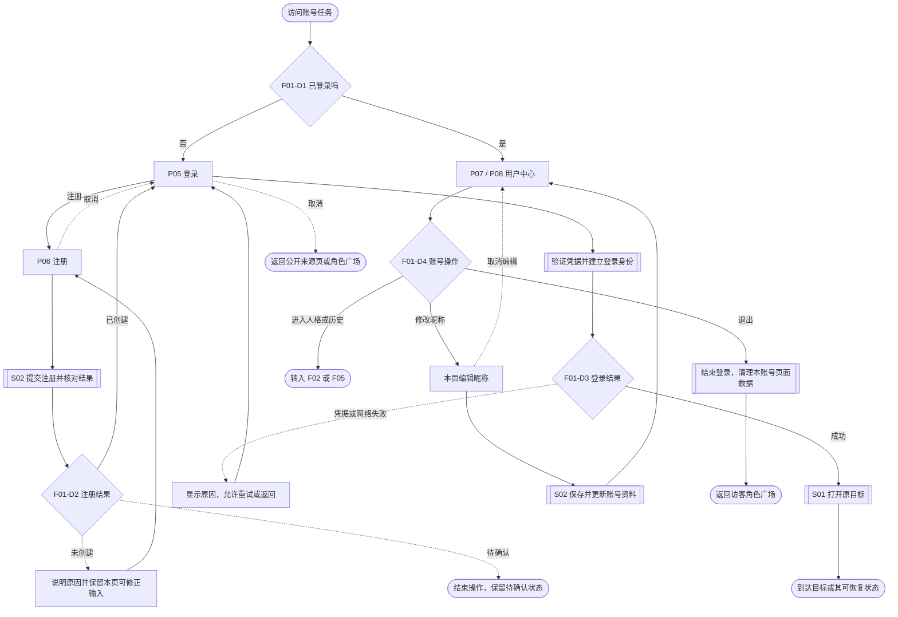
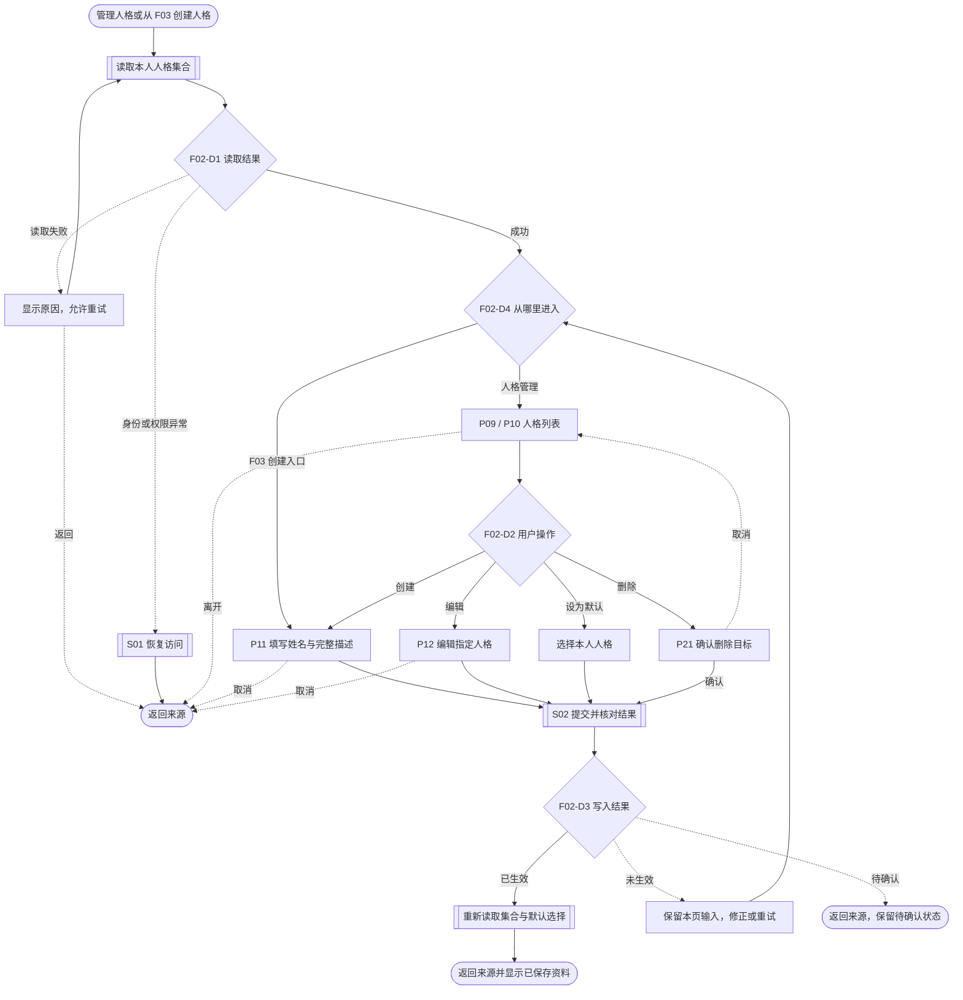
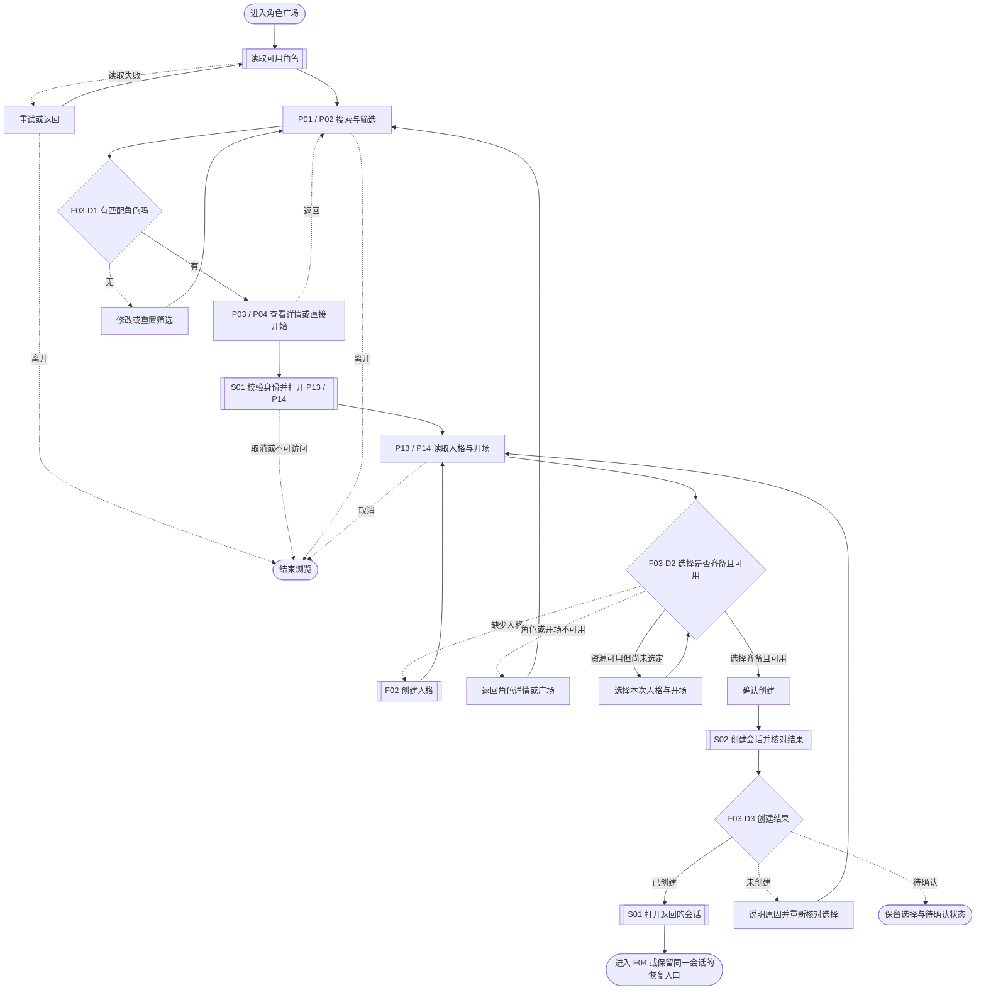
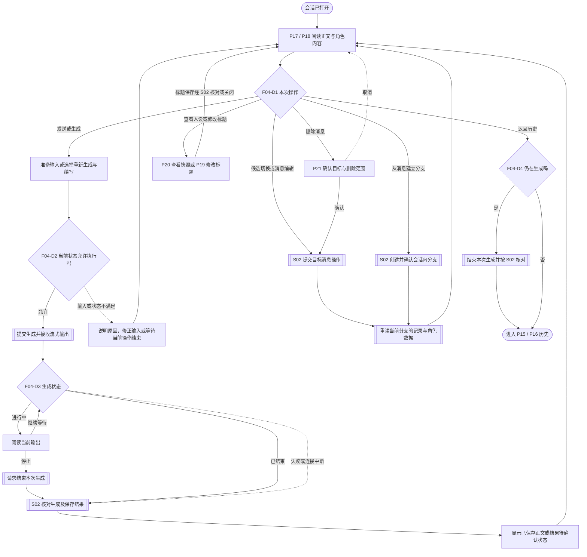
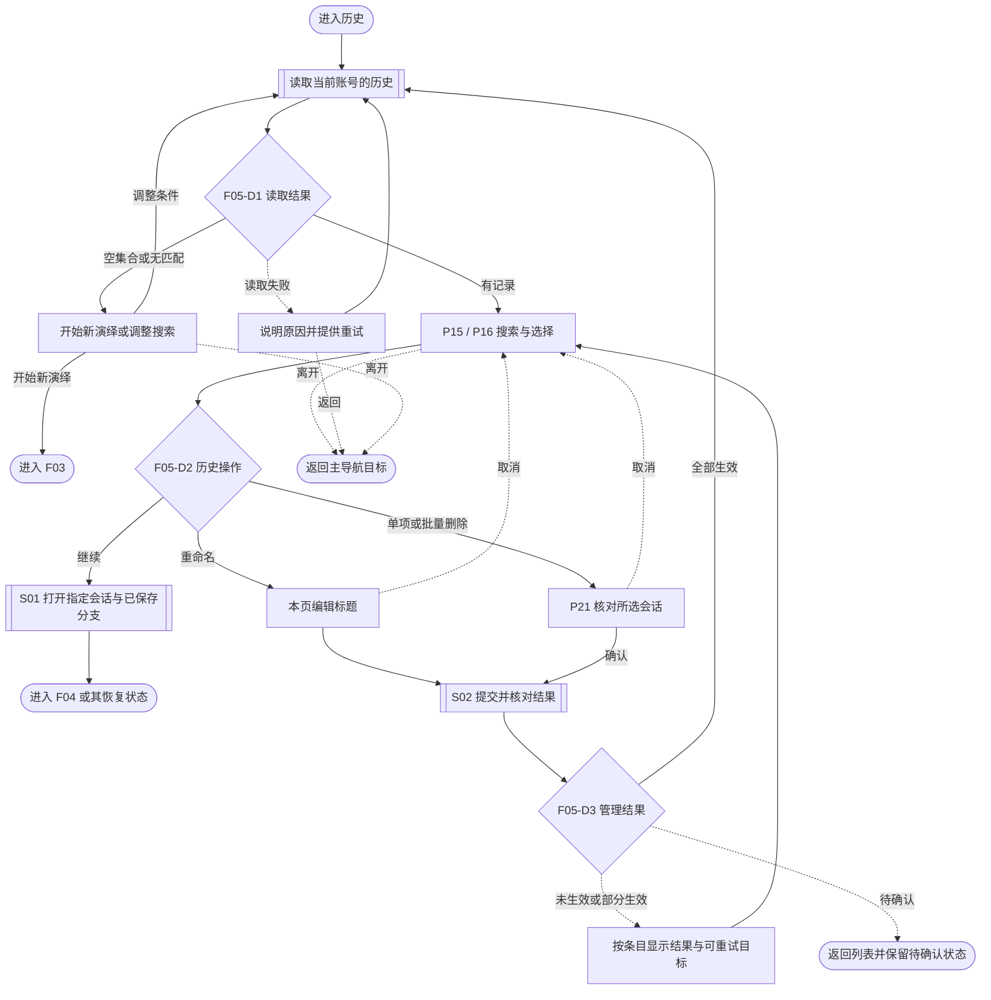
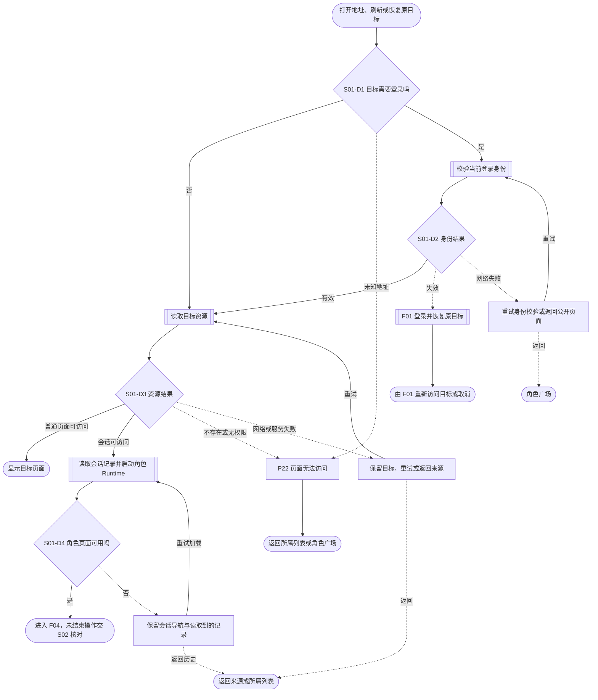
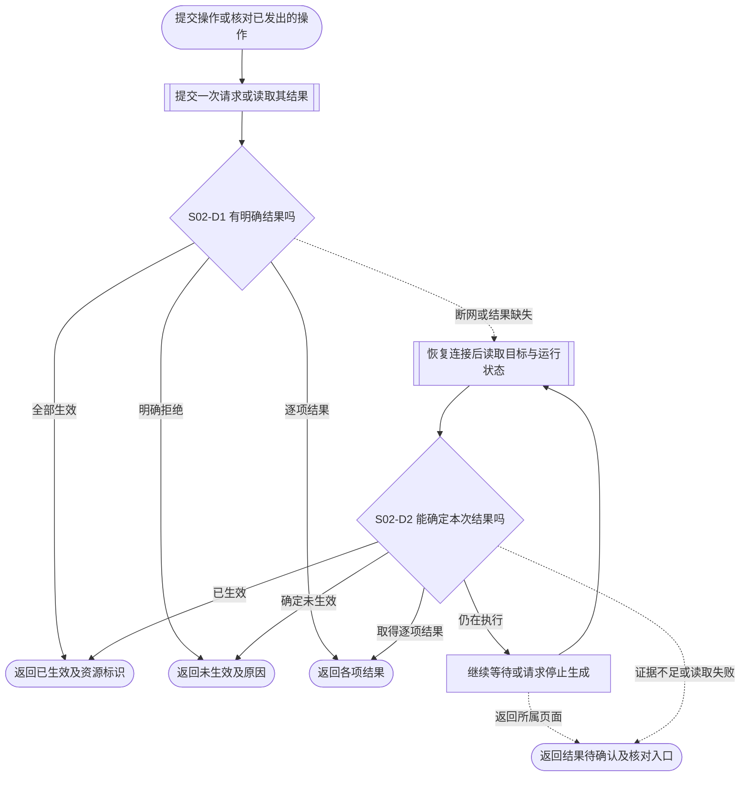

# 阶段 3：用户 Web 任务流程

## 1. 依据与阅读约定

1. 本文描述目标流程。产品方向采用[阶段 1](phase1-context.md)，页面编号与导航采用[阶段 2](phase2-architecture.md)。业务术语采用[用户演绎领域](../../../apps/user-web/CONTEXT.md)，人格和渲染规则采用[需求规格](user-web-requirements.md)。
2. 桌面与手机共用任务顺序、资源归属和成功条件；成对页面编号按阶段 2 对应各端。用户通过桌面侧栏或手机底部导航进入任务，演绎页采用独立页面布局。
3. 图中圆角节点为开始或结束，矩形为页面或用户动作，双框为读取、提交或共用流程，菱形为决策。实线表示正常路径，虚线表示异常或取消路径。图中 F01—F05 和 S01—S02 的调用返回结果后，调用方继续自己的流程。
4. **原目标**指进入登录前请求访问的站内页面及其资源标识。**结果待确认**指请求已经发出，但当前证据不足以判断是否生效；其处理统一见 S02。
5. 步骤表的耗时为定性预估：本地动作通常即时完成，普通资源请求预计短等待，模型生成预计长等待；具体时长在真实接口与角色资源联调时测量。用户输入和阅读由用户决定。
6. 当前原型与真实接口的差异集中记录在[功能依据第 2 节](feature-basis.md#2-页面元素与交互覆盖)。流程中的成功表示接口结果已确认；模拟演示的结果按该表区分。

## 2. 流程索引

1. 五个核心流程覆盖用户的业务任务；两个共用流程处理页面恢复和请求结果。

| 编号 | 任务                     | 主要页面          | 成功结果                                         |
| ---- | ------------------------ | ----------------- | ------------------------------------------------ |
| F01  | 注册、登录与管理账号资料 | P05—P08           | 取得登录身份并回到原目标；资料修改生效或完成退出 |
| F02  | 创建和管理多个演绎人格   | P09—P12、P21      | 本人人格集合与默认选择更新，返回发起任务的页面   |
| F03  | 筛选角色并开始演绎       | P01—P04、P13／P14 | 创建会话并打开对应的独立演绎页                   |
| F04  | 推进单个演绎会话         | P17—P21           | 本次操作保存结果可确认，正文与角色内容同步呈现   |
| F05  | 加载、继续和整理历史     | P15／P16、P21     | 打开原会话，或完成所选历史记录的管理             |
| S01  | 打开、刷新与恢复页面     | 全部页面、P22     | 按身份和资源结果恢复目标页面                     |
| S02  | 提交结果核对与恢复       | 有写入操作的页面  | 区分已生效、未生效、部分生效和结果待确认         |

## 3. F01：账号访问与资料管理

### 3.1 起点、终点与流程图

1. 起点为访客账号入口或需要登录的原目标；已登录用户可从 P07／P08 开始资料管理。注册完成后进入 P05 登录；取得登录身份后按 S01 访问原目标，直接访问账号页时以角色广场为目标。

### 3.2 步骤与决策

| 步骤 | 页面／流程 | 用户操作           | 用户 Web 响应                                    | 异常处理                                                     | 耗时预估             |
| ---- | ---------- | ------------------ | ------------------------------------------------ | ------------------------------------------------------------ | -------------------- |
| 1    | P05／P06   | 登录或注册         | 保留原目标；提交当前表单                         | 校验未通过时留在表单；取消注册回登录                         | 输入由用户决定       |
| 2    | P06、S02   | 提交注册           | 确认账号创建后回 P05                             | 未创建可修正；结果待确认按 S02 核对账号状态                  | 短等待，待实测       |
| 3    | P05        | 提交登录           | 验证凭据，获得身份后调用 S01                     | 凭据失败可重填；网络失败可重试；取消返回公开页面             | 短等待，待实测       |
| 4    | P07／P08   | 查看资料、修改昵称 | 读取本人资料，提交修改并按 S02 更新显示          | 未保存时本页保留修改内容；取消编辑恢复已保存资料             | 短等待，待实测       |
| 5    | P07／P08   | 退出登录           | 撤下个人页面数据，结束当前登录，返回访客角色广场 | 服务端退出结果不明时本地仍结束登录，服务端凭据撤销状态待核对 | 本地即时；远端待实测 |

1. **F01-D1**：登录状态依据当前身份校验结果；已登录用户进入本人资料，访客进入 P05。身份失效后的返回按 S01 处理。
2. **F01-D2**：账号服务确认已创建时进入登录；明确拒绝时留在注册；请求结果不明时采用 S02。登录成功也可作为该账号可用的证据。
3. **F01-D3**：仅在取得有效登录身份后恢复原目标。凭据失败与网络失败分别说明原因；原目标已失效时由 S01 转入 P22。
4. **F01-D4**：昵称修改属于本人账号；退出结束本次登录；人格与历史入口分别调用 F02、F05。切换账号后，个人资料与任务上下文按新登录账号重新读取。

## 4. F02：演绎人格管理

### 4.1 起点、终点与流程图

1. 起点为 P09／P10，或 F03 中的创建人格入口。成功后更新本人人格集合并返回来源；取消创建或编辑时返回来源。人格归属、默认选择和快照规则统一采用需求规格第 3 节。

### 4.2 步骤与决策

| 步骤 | 页面／流程      | 用户操作               | 用户 Web 响应                                              | 异常处理                                        | 耗时预估                   |
| ---- | --------------- | ---------------------- | ---------------------------------------------------------- | ----------------------------------------------- | -------------------------- |
| 1    | P09／P10 或 F03 | 打开人格集合           | 读取当前账号的人格和默认选择                               | 读取失败留在来源；空集合提供 P11 入口           | 短等待，待实测             |
| 2    | P11／P12        | 创建或编辑             | 提交姓名与完整描述，按 S02 确认保存                        | 表单错误可修正；目标消失后回列表；取消回来源    | 输入由用户决定，提交短等待 |
| 3    | P09／P10        | 设置默认人格           | 确认归属并保存选择                                         | 保存失败显示已保存的默认选择；待确认按 S02 处理 | 短等待，待实测             |
| 4    | P21             | 确认或取消删除         | 确认后提交删除；成功后按需求规格第 3 节第 8 项读取默认选择 | 取消回列表；拒绝或冲突保留目标并说明原因        | 用户决定，提交短等待       |
| 5    | 来源页面        | 继续管理或返回开始演绎 | 从 F03 创建成功后，将该人格列为本次可选项并返回选择页      | 删除最后一个人格后显示空集合与创建入口          | 本地即时                   |

1. **F02-D1**：读取成功包括空集合；网络失败允许重试；身份失效或访问受限转入 S01。
2. **F02-D2**：创建始终可进入 P11；编辑、默认选择和删除以本人已存在的人格为目标。
3. **F02-D3**：S02 返回已生效后刷新集合；明确未生效时允许修正或重试；待确认时保留状态。编辑、删除后已存在会话的身份按需求规格第 3 节第 7—8 项验收。
4. **F02-D4**：从人格管理入口进入时展示列表；从 F03 创建入口进入时直接展示 P11，完成或取消后返回来源。

## 5. F03：选择角色并开始演绎

### 5.1 起点、终点与流程图

1. 起点为 P01／P02。成功终点为新会话的 P17／P18；会话已创建但角色页面加载失败时，恢复同一会话的打开过程。

### 5.2 步骤与决策

| 步骤 | 页面／流程          | 用户操作             | 用户 Web 响应                                    | 异常处理                                                       | 耗时预估                   |
| ---- | ------------------- | -------------------- | ------------------------------------------------ | -------------------------------------------------------------- | -------------------------- |
| 1    | P01／P02            | 浏览、搜索、筛选角色 | 展示当前条件下的角色集合                         | 空结果可改条件；请求失败可重试；取消浏览结束任务               | 阅读由用户决定，请求短等待 |
| 2    | P03／P04 或角色条目 | 开始演绎             | 调用 S01 进入选择页，登录恢复保留所选角色        | 登录取消回公开来源；角色失效按访问结果处理                     | 短等待，待实测             |
| 3    | P13／P14            | 选择人格与开场       | 按需求规格的默认人格规则提供选择，并读取可用开场 | 无人格调用 F02；取消创建返回选择页；角色或开场不可用可返回重选 | 用户决定，请求短等待       |
| 4    | P13／P14、S02       | 确认创建             | 后端验证选择、创建会话并返回会话标识             | 选择失效回选择页；失败与待确认按 S02 区分                      | 短等待，待实测             |
| 5    | S01、P17／P18       | 进入故事             | 读取已创建会话并启动角色 Runtime                 | 加载失败重试读取该会话，或返回历史                             | 资源加载耗时待实测         |

1. **F03-D1**：空结果依据实际筛选结果判断。服务端筛选与分页的消费入口见[功能依据第 2 节](feature-basis.md#2-功能与数据来源)。
2. **F03-D2**：人格属于当前账号且仍可用，所选开场属于当前可开始的角色发布内容。缺少人格进入创建；选择尚未完成时继续选择并重新核对；资源已失效时重新读取或返回角色选择。
3. **F03-D3**：收到确定的会话标识后调用 S01；明确创建失败时重新核对选择；结果待确认时先按 S02 查明是否已创建。人格快照的保存规则采用需求规格第 3 节第 6 项。

## 6. F04：单个会话的演绎过程

### 6.1 起点、终点与流程图

1. 起点为 S01 已打开的 P17／P18。每次操作结束后回到可继续阅读和演绎的会话；离开时返回历史。渲染职责采用需求规格第 4 节。

### 6.2 步骤与决策

| 步骤 | 页面／流程    | 用户操作             | 用户 Web 响应                                | 异常处理                                                 | 耗时预估                   |
| ---- | ------------- | -------------------- | -------------------------------------------- | -------------------------------------------------------- | -------------------------- |
| 1    | P17／P18      | 阅读并输入行动或台词 | 以当前会话身份和所选分支承接输入             | Runtime 失败按 S01 恢复；本页保留尚未提交的输入          | 用户决定                   |
| 2    | P17／P18      | 发送、重新生成或续写 | 按第 6.3 节选择目标，提交一次生成并接收输出  | 输入不合法或状态冲突时说明原因；请求结果不明按 S02 处理  | 长等待，待实测             |
| 3    | P17／P18      | 等待或停止           | 展示过程输出；结束后核对生成状态及已保存记录 | 中断后依据保存结果恢复；核对期间可阅读已有正文           | 长等待；停止确认耗时待实测 |
| 4    | P17／P18、P21 | 修改记录或创建分支   | 按第 6.3 节执行，并重读对应分支数据          | 明确拒绝保留原记录；结果待确认先核对，取消编辑回阅读状态 | 短等待，待实测             |
| 5    | P19／P20      | 改标题、查看本次人设 | 标题经 S02 确认保存；人设读取会话快照        | 标题保存失败可修正；关闭返回同一会话                     | 用户决定，请求短等待       |
| 6    | P17／P18      | 返回历史             | 生成中先结束本次生成并核对，随后进入 F05     | 核对失败可返回历史并保留待确认状态；再次进入按 S01 重读  | 本地即时或等待结束确认     |

1. **F04-D1**：按用户选择进入生成、记录管理、会话资料或离开分支；每项操作的对象和成功结果见第 6.3 节。
2. **F04-D2**：发送使用有效输入；重新生成和续写使用符合接口要求的当前记录。当前生成或写入尚未结束时，后续修改等待其结果；后端拒绝时以返回原因说明可恢复方向。
3. **F04-D3**：生成状态取自实际运行结果。输出片段表示正在接收内容，完成、停止或失败后通过 S02 核对已保存内容，再决定继续操作的目标。
4. **F04-D4**：用户主动返回历史时，生成进行中则先发起结束并核对；已结束则直接返回。浏览器刷新、关闭或网络中断后的恢复采用 S01 与 S02。

### 6.3 会话内操作的对象与结果

1. 以下操作均以当前会话与分支为范围；接口状态与原型差异见功能依据的对应条目。

| 操作           | 操作对象                   | 成功结果与后续任务                                                       |
| -------------- | -------------------------- | ------------------------------------------------------------------------ |
| 发送           | 本次输入                   | 已保存的用户输入及对应生成结果进入当前记录，继续阅读                     |
| 停止           | 当前生成                   | 读取实际停止状态及已保存内容，用户据此继续演绎                           |
| 重新生成       | 当前可重新生成的回复       | 生成候选回复；按服务端返回的当前候选重读正文                             |
| 切换候选回复   | 目标回复的现有候选         | 确认目标候选已激活，再以其记录继续演绎                                   |
| 续写           | 当前可续写的回复           | 按接口返回的保存结果更新正文并继续阅读                                   |
| 编辑消息       | 当前可编辑的消息           | 保存后重读消息与关联角色数据；取消编辑恢复已保存内容                     |
| 删除消息       | P21 中已确认的目标         | 仅按已确认的删除范围提交，成功后重读记录；实际支持范围见第 9 节          |
| 从消息建立分支 | 所选消息对应的分支起点     | 使用返回的会话与分支标识打开分支记录，身份继承采用需求规格第 3 节第 7 项 |
| 修改标题       | 当前会话                   | 成功后会话页与历史条目使用已保存标题                                     |
| 查看本次人设   | 当前会话的人格快照         | 读完返回原会话                                                           |
| 角色剧情操作   | Runtime 提供的实际剧情入口 | 按角色定义填写输入或发起其允许的操作，生成结果仍按本流程核对             |

## 7. F05：历史加载、继续与管理

### 7.1 起点、终点与流程图

1. 起点为主导航、用户中心或演绎页的历史入口。继续演绎打开已存在会话；管理操作完成后回到更新后的历史列表。

### 7.2 步骤与决策

| 步骤 | 页面／流程    | 用户操作               | 用户 Web 响应                              | 异常处理                                                     | 耗时预估                   |
| ---- | ------------- | ---------------------- | ------------------------------------------ | ------------------------------------------------------------ | -------------------------- |
| 1    | P15／P16      | 打开历史、输入搜索条件 | 读取本人会话与匹配结果                     | 空集合可开始新演绎；无匹配可改条件；失败可重试               | 短等待，待实测             |
| 2    | S01、P17／P18 | 继续指定会话           | 读取该会话的记录、分支、人格快照与角色内容 | 身份失效转 F01；资源不可访问转 P22；Runtime 失败保留恢复入口 | 资源加载耗时待实测         |
| 3    | P15／P16      | 编辑标题               | 按 S02 确认修改并更新条目                  | 取消恢复原标题；写入失败可修正                               | 输入由用户决定，提交短等待 |
| 4    | P21           | 删除一个或多个会话     | 核对目标后提交，逐项处理返回结果           | 取消回列表；运行冲突或权限失败保留相应条目及原因             | 短等待，待实测             |
| 5    | P15／P16      | 继续管理或离开         | 重新读取列表与搜索结果，呈现剩余记录       | 部分成功只移除已确认删除项，其余按结果处理                   | 短等待，待实测             |

1. **F05-D1**：有记录时展示列表；空集合与搜索无匹配分别保留适合的入口；读取失败保留搜索条件并允许重试。
2. **F05-D2**：继续读取已有会话；重命名修改标题；删除按单项或当前勾选范围进入 P21。历史恢复使用会话保存的身份和分支上下文。
3. **F05-D3**：按服务端逐项结果区分删除成功、目标已不存在、冲突与访问拒绝。批量操作全部生效后刷新；部分生效保留剩余目标；结果不明采用 S02。已不存在的目标刷新后退出列表，仍在生成的会话可待运行结束后重新处理。

## 8. 共用访问与恢复流程

### 8.1 S01：打开、刷新与恢复页面

1. 本流程接收站内目标，并返回目标页、可恢复的加载状态或 P22。资源读取按当前登录账号执行；会话读取成功后，再启动对应角色 Runtime。

1. **S01-D1**：页面访问范围按阶段 2 第 4.2 节判断。未知地址直接进入 P22；已知目标按其资源归属处理。
2. **S01-D2**：身份有效才读取个人资源；身份失效进入 F01；校验请求失败保留原目标并允许重试。再次登录不同账号时，个人数据与未提交输入按账号隔离，原目标重新接受归属校验。
3. **S01-D3**：资源可访问时显示普通页面或打开会话；不存在及无权限进入 P22，其返回目标按阶段 2 第 4.2 节确定；网络及服务失败保留重试入口。
4. **S01-D4**：角色 Runtime 完成必要资源读取并可呈现内容时进入演绎。失败时保留通用返回与重试入口；正文已读取时保留可读取部分。刷新或手机浏览器恢复后，通过 S02 核对尚未结束的操作。

### 8.2 S02：提交结果核对与恢复

1. 本流程接收本次操作、目标资源与接口返回结果。它向调用方返回已生效、未生效、部分生效或结果待确认；调用方按各自流程更新页面。

1. **S02-D1**：成功响应及其资源标识确定本次结果；明确拒绝返回原因；批量结果逐项判断。请求超时、连接断开或响应缺失进入读取核对。
2. **S02-D2**：目标记录与运行结果能够关联本次操作时，返回已生效、确定未生效、逐项结果或仍在执行；证据不足时保留待确认。用户可继续核对或返回所属列表；重试写入以确认未生效为前提。
3. 同一操作结果待确认期间，页面保留本页输入、操作目标及核对入口。生成输出按已保存记录恢复；结果确认前，后续依赖该结果的操作保持等待。离开页面后再次进入时，由 S01 重新读取。
4. 普通读取预计短等待；仍在生成时预计长等待。具体轮询、超时和重试参数由接口接入确定；页面只展示可观测的运行或读取状态。

## 9. 后端接入对流程的约束

1. 以下条目连接任务流程与[功能依据](feature-basis.md)中的实现入口；执行结果见[实现验收](implementation-acceptance.md)。

| 影响流程        | 功能依据条目                         | 流程验收需要确认的结果                                                               |
| --------------- | ------------------------------------ | ------------------------------------------------------------------------------------ |
| F01、S01        | 注册、邮箱密码登录、退出             | 身份服务、账号映射、登录恢复与退出后的凭据处理                                       |
| F02、F03        | 默认人格；人格列表、创建、编辑、删除 | 默认选择的保存位置、重新登录及跨设备读取结果                                         |
| F03、F05        | 角色筛选；历史列表和搜索             | 服务端分页下筛选与搜索的完整性                                                       |
| F03、S02        | 选择人格与开场、开始演绎             | 创建成功但响应丢失时，能够可靠确认本次会话的接口证据                                 |
| F04、S02        | 消息列表、输入、发送、停止；续写     | 生成结束、停止及中断后实际保存的正文和运行结果                                       |
| F04             | 编辑和删除消息                       | 目标消息的可修改状态、单条删除结果与历史恢复 |
| F04、F05        | 从消息建立分支                       | 在同一会话内建立分支后，继续演绎与重新打开均恢复对应分支及角色数据                   |
| 各写入流程、S02 | 对应写入操作                         | 请求结果不明时可关联本次操作的读取证据；证据不足时保留待确认状态                     |

2. 桌面与手机分别执行五个核心流程及两个共用流程；页面范围沿用阶段 2。手机浏览器后台恢复、刷新和软键盘输入对任务的影响随对应页面验收，数据归属与保存结果采用同一标准。
