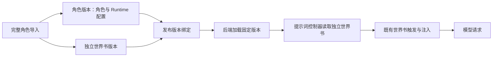

# 独立世界书绑定修复

## 必须要实现的目标

新角色由 `serve-published-prototype.mjs` 通过正式角色导入流程生成角色和独立世界书，并直接使用导入返回的版本。已有角色由 `migrate-bound-worldbooks.mjs` 保留角色 ID，单独导入世界书并创建角色新版本。两条路径都必须在发布配置中固定角色版本和世界书版本。Runtime 配置保存在角色的 `extensions.tavern_headless` 中，包括 `runtimeDelivery`、`openings`、`stateUpdate` 和已配置的 `promptController`。

## 已完成的改动

`apps/web/prototypes/checks/serve-published-prototype.mjs` 使用现有 `snapshotToStCharacterCard` 序列化完整角色数据，调用 `/import/character` 后直接采用响应中的 `character_version_id`、`worldbook.id` 和 `worldbook.version_id`。已删除导入后再次写入完整 snapshot 的步骤。

`apps/web/prototypes/checks/migrate-bound-worldbooks.mjs` 修复已有发布：通过 `/import/worldbook` 保存原角色快照里的世界书，通过角色版本接口保存移除 `characterBook` 后的新版本，再通过 `/role-releases` 绑定两者。该修复保留原角色 ID，因此角色列表没有新增同名卡。新版本引用旧版本的不可变媒体地址。

提示词控制器之前只支持内嵌书。`apps/api/src/services/role-prompt-controller.ts` 新增 `renderBoundWorldbookController`，接收后端已经加载的独立世界书，在内存中转换条目字段供角色控制器读取，并返回本轮的条目内容与启用状态。这个转换结果不写回角色或世界书资源。`prompt-assembler.ts` 将返回结果继续交给既有世界书匹配和注入流程。旧角色快照仍按原内嵌入口读取。

## 验收清单

- 已通过：控制器 10 项测试，包括独立书条目更新、变量替换、控制器停用 `updaterEntryIds` 指定的世界书条目、输入不变、普通书直接返回和异常输出拒绝。
- 已通过：以完整角色调用正式导入接口，只产生一个角色版本，138 条内嵌条目抽成独立书，Runtime 配置保留；临时角色及世界书已清理。
- 已通过：林茜 138 条、顾声慢 21 条世界书通过正式接口保存，新发布角色快照均无 `characterBook`，发布配置均有独立世界书 ID 与版本 ID。
- 已通过：使用相同开场、人设和消息，对两个角色迁移前后分别调用正式 Prompt dry-run；最终 messages 数组逐项相等。
- 已通过：新提示词快照记录独立世界书绑定，角色脚本及全部声明媒体 URL 均可读取。
- 已通过：用于对比的临时会话已删除，历史发布和历史会话保留原绑定。

验收命令为 `node apps/web/prototypes/checks/bound-worldbook-live-check.mjs`。结果保存于 `docs/plans/evidence/published-backend/bound-worldbook-check.json`；资源版本记录位于同目录的 `bound-worldbook-migration.json`。

本次验收覆盖正式接口、提示词组装和资源读取，未新增模型生成请求。

## 非本次目标

本次迁移范围仅包含指定角色的新资源版本及发布绑定；历史会话配置、角色内容和世界书触发规则保持原状。

## 已获得的授权

用户要求删除迁移中的重复保存，沿用正式导入产生的角色和独立世界书，并通过发布配置绑定。已有隔离服务中的迁移、测试和发布沿用此前授权。
