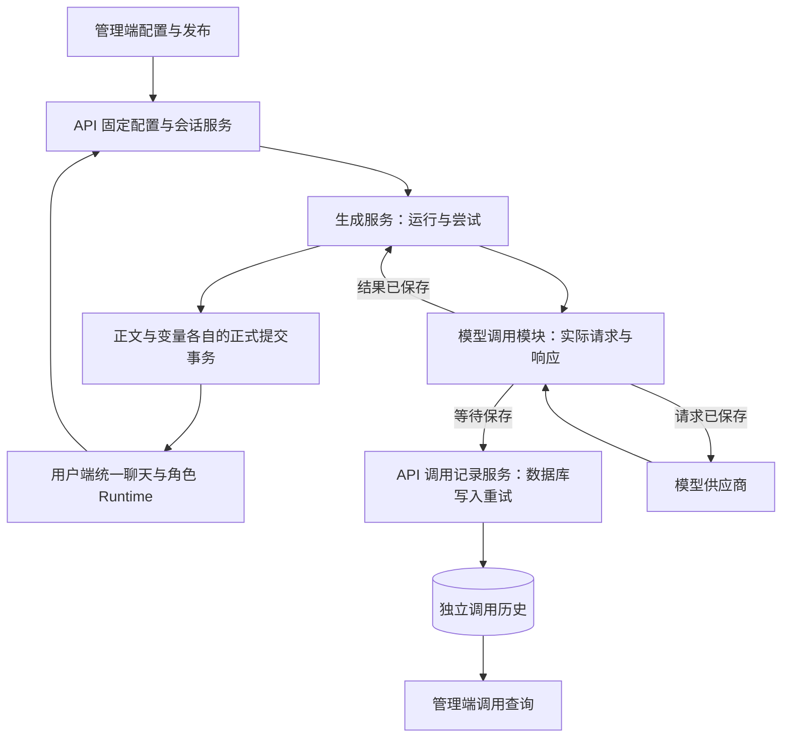

<!-- markdownlint-disable MD013 -->

# 生成过程追溯：第一批实施计划

## 必须要实现的目标

**第一批总目标：执行 Agent 将林茜、顾声慢两套完整角色配置及所需原型代码迁入正式产品，跑通“管理端发布与试聊 → 用户端真实演绎 → 管理端回溯模型调用”的完整闭环。**

第一批必须同时达到以下三项结果，逐项证据按[首批专项完成条件](#首批专项完成条件)验收：

1. **配置完整生效。** 两张卡各自绑定世界书、正则、脚本、媒体及其他运行资源，共同使用“夏瑾 天琴座 Beta 3.9（泛国模）”预设；具体资源与绑定规则见[首批角色与绑定](#首批角色与绑定)。
2. **正式产品能够使用。** 执行 Agent 使用两张卡分别完成正式演绎和管理员试聊，正文生成、必要变量更新与角色界面均正常工作，刷新和重启后能够读取历史并继续；交付以正式代码、构建产物和持久数据的联合验收为准。
3. **模型调用能够回溯。** 后端在请求发送前保存实际请求，并保存成功响应或失败原因；管理员能够查询当时实际发送和收到的内容。数据库写入重试与最终错误上抛按[保存顺序与失败传播](#保存顺序与失败传播)执行。

目录结构、文件存储和 Runtime 迁移服务于上述闭环。原型已有代码必须经过[原型到正式代码迁移表](#原型到正式代码迁移表)规定的复制、改造、接入与验收，才能计入首批交付。

本计划中的“执行 Agent”负责开发、测试和验收取证；用户端系统、管理端系统及后端系统执行各自的程序运行行为。本文件按目标文件和模块定义第一批的接入范围、职责、数据与接口、实施顺序和专项验收。

本批属于[生成过程追溯分批总计划](generation-trace-foundation.md)。执行者阅读本文件开展首批工作；核对共同约束时，按需查阅总计划的[完整目标](generation-trace-foundation.md#已确认的完整目标)、[两端验收与原型对照标准](generation-trace-foundation.md#每批两端验收标准)和[每批共同完成条件](generation-trace-foundation.md#每批共同完成条件)。后续批次安排由总计划维护。

工作树为 `/srv/tavern/TavernHeadless-role-app-prototype`。

## 首批实施细则

### 交付分类与接入范围

本批以正式 API 启动入口 `apps/api/src/app.ts`、两个 Web 的正式构建入口和对应测试判定交付。执行 Agent 必须按下表记录各项工作的状态，并保留工作树已有改动。文件位于 `src`、原型页面可运行或原型测试通过，分别只说明代码位置和原型验证情况。

| 分类                             | 核对结果                                                                                                                                                                                      | 本批工作                                                                                                                                                   |
| -------------------------------- | --------------------------------------------------------------------------------------------------------------------------------------------------------------------------------------------- | ---------------------------------------------------------------------------------------------------------------------------------------------------------- |
| 正式基础，复用并改造             | 标准 `app.ts` 已接入 `FloorRunService`、`ChatService`、提交服务及聊天、楼层路由；`preset-output.ts`、`role-prompt-controller.ts` 和正则执行器已进入正式正文链，模型调用经过 `packages/core`。 | 在这些正式模块上接入调用记录及迁入的角色服务，继续使用现有预设输出、动态世界书控制和正则执行逻辑。`FloorRunService` 提供当前运行查询，历史调用由 N1 保存。 |
| 原型成果，复制迁入或完成正式接线 | `apps/web/prototypes/`、`apps/user-web/prototypes/` 包含界面、Runtime、控制器和迁移程序；部分角色后端文件虽已放在 `apps/api/src`，仍由原型启动器挂载。                                        | 按“原型到正式代码迁移表”逐项复制、拆分和改造，补齐正式入口、数据迁移、契约与测试。每一项初始交付状态均为待完成。                                           |
| 本批新增                         | 独立调用历史、供应商请求记录边界、正式用户应用入口及试聊交接仍需正式实现。                                                                                                                    | 按“新增功能清单”建立模块，并与迁入的代码共同通过正式验收。                                                                                                 |

首批交付两张卡必要的正文生成、变量更新、显示快照和角色渲染。用户端系统接收当前连接的正文流；管理端系统提供手动刷新入口，管理员点击后读取最新详情；后续批次范围见“非本次目标”。

### 正式目录结构

以下列出本批涉及的目标目录。源码目录存放开发和构建输入，构建产物承担产品运行，运行数据目录承接服务写入；实施状态由迁移表和新增功能清单判定。

**后端源码。** `apps/api` 是 HTTP API 应用。目录树说明各目录的完整用途；本批改动文件由迁移表和新增功能清单列明。

```text
apps/api/                              # 后端应用工程，维护 API 的源码、配置、构建和测试
├── config/                            # 随后端交付的 JSON 配置，由配置加载器在启动时读取
│   ├── model-call-recording.json       # 调用记录的写入重试参数和流式保存间隔
│   └── storage.json                    # 数据根目录和各类文件的相对存储位置
├── src/                               # 编译为后端 JavaScript 的 TypeScript 源码
│   ├── index.ts                       # 读取配置、创建应用并启动 HTTP 监听
│   ├── app.ts                         # 组装服务依赖、注册插件和路由
│   ├── config.ts                      # 加载配置文件与环境覆盖，生成应用配置
│   ├── storage-config.schema.ts       # 定义后端存储配置的字段与约束
│   ├── db/                            # 数据表定义、数据库连接及结构升级的执行代码
│   ├── routes/                        # HTTP 处理器：校验请求、调用服务、返回响应
│   └── services/                      # 后端业务服务，协调数据库、模型和文件操作
│       ├── role-runtime/              # 显示快照、变量更新、资源版本读取与脚本加载服务
│       ├── storage/                   # 角色包文件的文件系统读写实现，处理路径与文件操作
│       ├── role-release-service.ts    # 校验发布绑定，并按固定配置创建角色会话
│       └── model-call-record-service.ts # 保存和查询模型请求、响应及失败历史
└── drizzle/                           # 随后端交付的数据库结构升级文件
    ├── NNNN_*.sql                     # 按版本执行的建表、字段及索引变更 SQL
    └── meta/_journal.json             # 记录数据库迁移文件的执行顺序
```

`drizzle/` 是现有数据库工具使用的目录名。`src/db/schema.ts` 定义当前表结构；`src/db/client.ts` 的 `createDatabase()` 读取迁移文件并升级数据库；`src/db/migrate.ts` 提供显式执行入口。执行 Agent 必须把新表纳入这些入口，随构建产物携带迁移文件，并验证空库初始化和已有库升级。

**两端源码与浏览器配置。** `apps/web` 是管理端工程，`apps/user-web` 是用户端工程。两端通过 SDK 调用后端，角色包文件通过正式资源接口读取。

```text
apps/web/src/                          # 管理端 Vue 应用源码，构建后交给浏览器执行
├── components/workspace/              # 工作区 Vue 组件，负责显示界面和发出操作事件
├── composables/workspace/             # 工作区组合式函数，管理页面状态和业务动作
├── lib/workspace-api/                 # 将 SDK 方法与返回数据适配为工作区使用的接口
└── config/generation-inspection.json  # 构建时读取的详情分类、字段标签及查询映射
apps/user-web/                         # 正式演绎与管理员试聊共用的用户端工程
├── src/                               # 用户端 Vue 应用源码
│   ├── main.ts                        # 加载运行配置、创建并挂载 Vue 应用
│   ├── App.vue                        # 应用根组件，承载页面导航与公共布局
│   ├── pages/                         # 路由页面：角色选择、会话聊天
│   ├── components/                    # 页面复用组件：开场选择、角色内容挂载容器
│   ├── features/chat/                 # 聊天会话控制器和正文事件传输适配
│   └── runtime/                       # 角色脚本执行器及其回调、订阅和资源释放代码
└── public/config/runtime-policy.json  # 页面启动时加载的历史保留数量和资源使用上限
```

用户端系统启动时，`apps/user-web/src/main.ts` 必须从 `public/config/runtime-policy.json` 对应的发布 URL 加载配置，按共享 schema 校验后，将配置传入 Runtime 并完成初始化。管理端的详情映射随前端构建更新；用户端运行参数通过发布目录中的 JSON 调整。后端启动参数按下一节的配置顺序加载。

**共用代码。** `packages` 保存由应用通过包导入的共用模块，各包通过自身入口导出本批能力。

```text
packages/                              # 工作区共用包，各包维护自身构建与导出
├── core/src/llm/                      # 模型调用、供应商适配与调用记录接口的实现
├── shared/src/                        # 两端、SDK 与后端共用的数据定义和生成文件
│   ├── schemas/                       # 共享数据及接口的结构与校验约束
│   ├── config/api-error-messages.json # 错误码、提示文案及可执行操作的唯一对照表
│   └── generated/                     # 从契约生成的校验器、OpenAPI 文档和类型
├── adapters-sillytavern/src/role-migrations/ # 将角色原始数据转换为正式导入结构的函数
└── official-integration-kit/sdk/src/resources/ # 按资源封装的 API 请求方法及响应处理
```

**构建、开发与验收。** 下表说明工程辅助文件和实际交付物的关系。

| 目录或文件                                                                               | 存放内容、使用者与用途                                                     |
| ---------------------------------------------------------------------------------------- | -------------------------------------------------------------------------- |
| `apps/api/drizzle.config.ts`                                                             | 数据库类型、表定义来源和迁移输出路径；执行 Agent 生成 SQL 时使用。         |
| 各应用与包的 `package.json`、`tsconfig.json`，两个 Web 的 `vite.config.ts`、`index.html` | 依赖声明、编译规则和前端页面构建入口；构建工具读取后生成对应产物。         |
| `apps/api/dist/`、各共用包的 `dist/`                                                     | 编译后的 JavaScript 与类型文件；后端进程及包使用者加载这些产物。           |
| `apps/web/dist/`、`apps/user-web/dist/`                                                  | 可发布的 HTML、JavaScript、样式和静态文件；Web 服务向浏览器交付这些文件。  |
| `scripts/generate-role-runtime-validators.mjs`                                           | 从共享 schema 生成角色运行校验器的构建程序；共享包构建使用其输出。         |
| `fixtures/role-apps/`                                                                    | 林茜、顾声慢及预设的可导入样本文件；验收准备通过正式导入接口创建资源版本。 |
| 各模块的 `__tests__/` 与 API 的 `test/`                                                  | 自动化测试代码和测试样例；测试工具执行正常、异常及边界验证。               |
| `docs/plans/evidence/generation-trace/batch-1/`                                          | 本批截图、接口样本、检查结果及验收结论；执行 Agent 提交和核对。            |
| `apps/web/prototypes/`、`apps/user-web/prototypes/`                                      | 原型源码与页面；执行 Agent 提取待迁代码，执行 Agent 对照交互及视觉基线。   |

### 后端运行数据与文件存储

执行 Agent 必须按 [ADR-0005](../adr/0005-role-resource-file-storage.md) 的目标方案实现数据库与本地文件的分工。现有正式代码已经通过 `chat-transfer-artifacts.ts`、`backup-artifacts.ts` 保存导入导出任务文件；原型 `role-assets.mjs` 将角色文件保存在 SQLite BLOB，`role-view.mjs` 又将变量计算脚本写到 `moduleDirectory` 执行。本批通过 M3、M4 和 N5 将角色文件迁入下列正式存储结构。

**运行数据目录。** `<dataRoot>` 表示后端配置解析后的绝对数据根目录。下列内容由服务运行产生或通过正式导入写入，执行 Agent 必须将其放在持久可写位置；更新应用构建产物时必须保留该目录。

```text
<dataRoot>/                            # 后端持久运行数据；默认解析为启动工作目录下的 data/
├── tavern-headless.db                 # SQLite 业务数据库，由数据库连接模块读写
├── tavern-headless.db-wal             # SQLite 运行期间管理的事务日志文件
├── tavern-headless.db-shm             # SQLite 运行期间管理的共享内存协调文件
├── role-assets/                       # 已导入的角色包文件，由资源服务保存和按版本读取
│   └── <accountId>/<versionId>/       # 某账号某角色版本的完整文件集，保留包内相对路径
├── role-asset-staging/                # 导入期间尚未提交的文件集，由导入服务写入并清理
│   └── <importId>/                   # 一次导入的独立暂存目录
├── chat-transfer-artifacts/           # 聊天导入输入、处理中间文件及可下载的导出文件
└── backup-artifacts/                  # 备份任务的中间快照和可下载的备份文件
```

`role-assets/` 中的文件包括 manifest、显示模板、前后端脚本、图片、音频以及包内的 JSON 数据和规则文件。文件集按角色版本固定；`role-module-loader.ts` 从该版本目录加载后端计算脚本，用户端由资源 API 获取允许交付给浏览器的文件。两者读取同一导入版本。

| 数据对象                                   | 正式保存位置与读取方                                                                                                                                                         |
| ------------------------------------------ | ---------------------------------------------------------------------------------------------------------------------------------------------------------------------------- |
| 角色卡、世界书、预设、正则、人设和模型设置 | 现有资源表及版本表保存结构化内容和引用；发布及提示词组装服务读取固定版本。                                                                                                   |
| 角色包的文件归属与索引                     | `db/role-asset-schema.ts` 定义 `role_asset_bundle` 与 `role_asset`：前者保存账号、角色版本和存储目录键，后者保存包内路径、MIME、字节数和文件用途；资源服务依据索引定位文件。 |
| 角色包原始文件                             | `role-assets/<accountId>/<versionId>/` 保存文件字节；资源接口交付前端文件，模块加载器读取后端脚本。                                                                          |
| 发布配置、会话、楼层、消息、变量和显示快照 | 对应业务表保存版本引用和历史值；生成服务与查询接口读取。                                                                                                                     |
| 模型调用请求、响应及错误                   | N1 的 `model_call_records` 保存完整业务内容和执行身份；调用记录服务直接查询数据库。                                                                                          |
| 聊天导入导出与备份任务                     | 现有任务表保存状态、归属和产物相对路径；对应 artifacts 目录保存文件，现有任务服务负责生成与下载，TTL 控制下载有效期。                                                        |

现有异步任务的下载过期检查只限制下载，文件仍保留在 artifacts 目录。另有已接入的调试文件目录 `<启动工作目录>/logs/`：`src/debug/file-debug-sink.ts` 在启用 `TAVERN_DEBUG` 时追加 `debug-<domain>.log`，供开发与运维排查；正式调用历史由 N1 保存。

**路径配置。** N5 必须新增 `apps/api/config/storage.json`，集中定义 `dataRoot`、`databaseFile`、`roleAssetsDir`、`roleAssetStagingDir`、`chatTransferArtifactDir`、`backupArtifactDir`，默认值与上面的目录树一致；`src/storage-config.schema.ts` 定义约束。`src/config.ts` 先读取该文件，再应用环境覆盖：新增 `DATA_DIR` 覆盖根目录；现有 `DATABASE_URL` 优先于 `DB_PATH` 覆盖数据库位置；现有 `CHAT_TRANSFER_ARTIFACT_DIR`、`BACKUP_ARTIFACT_DIR` 分别覆盖任务文件目录。配置文件中的子路径相对数据根目录解析，已有环境路径继续按现有工作目录规则解析，绝对路径直接使用。API、显式迁移命令和独立任务进程必须使用同一解析结果。启动代码必须创建所需目录并检查访问权限；失败时返回具体路径、失败原因和修复权限或路径配置的操作提示。

**文件提交与版本读取。** M3 负责账号和版本权限、资源清单与文件用途校验及数据库事务；N5 的 `services/storage/role-file-store.ts` 负责文件写入、目录提交和读取。导入服务先将完整文件集写入同一数据卷的暂存目录，校验 manifest 的必需引用，再将目录移动到固定版本位置，最后在一个数据库事务中写入资源包及文件索引。发布服务必须以已提交的完整索引作为可发布条件。资源接口必须从认证账号和版本索引定位文件，并校验包内路径仍位于该版本目录；后端计算脚本按文件用途交给模块加载器。

文件写入或数据库提交失败时，导入服务必须按错误类别处理重试并向上返回最终失败，清理本次导入创建的未提交文件；清理失败时必须保留原始错误、清理错误和残留路径。进程中断留下的未登记目录必须保持不可发布、不可通过资源 API 读取，执行 Agent 处理此类故障时，必须按导入标识核对数据库后处理残留。新文件内容必须创建新角色版本，历史会话继续读取原版本；删除会话只清理其会话数据，角色文件保留供其他会话和发布配置引用。资源文件缺失时，读取服务必须返回具体缺失版本和包内路径，提示管理员恢复该版本资源。

**持久化交付与恢复。** 执行 Agent 必须用指定数据根目录完成重启与应用构建更新验证；停止 API 和任务进程后，将数据库与角色文件作为同一份恢复集合保存，再恢复到另一数据根目录验证四条流程的历史读取。显式配置在根目录之外的数据库也必须纳入该集合。现有 `backup-artifacts/` 保存的 `.thbackup` 只覆盖既有结构化资源与会话，其备份和恢复程序尚未处理角色包文件；完整角色包导入导出与备份功能仍按两端总计划 R8 扩展，本批由上述停机恢复验收证明数据完整性。

### 原型到正式代码迁移表

执行 Agent 必须按各行要求保留原型已实现的本批行为，将其代码复制到目标位置后完成所列改造。来源已经位于目标路径的模块必须原地完成正式化。完成条件统一为：目标模块由正式入口调用、依赖解析到正式目录、对应分支测试通过，并在本批联合验收中提供证据。

| 工作项            | 原型或待正式化来源                                                                                                                                                                                                            | 正式目标文件                                                                                                                                                                                                                                                                                       | 必须完成的迁移工作                                                                                                                                             |
| ----------------- | ----------------------------------------------------------------------------------------------------------------------------------------------------------------------------------------------------------------------------- | -------------------------------------------------------------------------------------------------------------------------------------------------------------------------------------------------------------------------------------------------------------------------------------------------- | -------------------------------------------------------------------------------------------------------------------------------------------------------------- |
| M1 共享契约       | `docs/character-authoring/script-runtime.schema.json`、`state-update.schema.json`，`apps/web/prototypes/shared/script-transport.schema.json`、`card-errors.json`，`apps/web/prototypes/checks/generate-script-validators.mjs` | `packages/shared/src/schemas/role-runtime.schema.json`、`state-update.schema.json`、`role-transport.schema.json`、`runtime-policy.schema.json`；`src/config/api-error-messages.json`；`scripts/generate-role-runtime-validators.mjs` 与 `packages/shared/src/generated/role-runtime-validators.ts` | 复制契约和错误映射，新增运行配置 schema；将生成器的绝对依赖路径改为已声明包引用，纳入共享包构建和导出；两端及 API 使用同一来源。                               |
| M2 发布与会话     | `apps/api/src/routes/role-releases.ts`、`services/role-release-service.ts`、`db/role-release-schema.ts` 及已有发布迁移                                                                                                        | 保留上述正式目标路径；共享契约迁至 `packages/shared/src/schemas/role-release.ts`                                                                                                                                                                                                                   | 核对发布和固定版本创建逻辑，补齐必需绑定；在 `app.ts` 注册并注入正式服务，纳入迁移链、OpenAPI 与 SDK。                                                         |
| M3 角色资源接口   | `apps/api/src/routes/role-assets.mjs`、`routes/schemas/role-assets.mjs`                                                                                                                                                       | `apps/api/src/routes/role-assets.ts`、`services/role-runtime/role-asset-service.ts`；`packages/shared/src/schemas/role-assets.ts`                                                                                                                                                                  | 保留原型资源接口行为，将 BLOB 读写改接 N5 文件存储；新增 `db/role-asset-schema.ts` 和正式迁移，按“后端运行数据与文件存储”提交索引、校验归属并读取资源。        |
| M4 显示与变量服务 | `apps/api/src/routes/role-view.mjs`、`services/role-state-proposal.mjs`、`services/role-mvu-migration.mjs`                                                                                                                    | `apps/api/src/routes/role-view.ts`；`services/role-runtime/display-snapshot-service.ts`、`state-update-service.ts`、`state-proposal.ts`、`state-contract.ts`、`role-module-loader.ts`                                                                                                              | 拆出显示查询、变量模型调用、提案校验和模块加载；显示快照表进入正式迁移；模块通过 N5 从会话固定资源版本目录加载，变量模型使用统一调用记录依赖。                 |
| M5 角色导入转换   | `apps/web/prototypes/checks/regex-migration.mjs`、`mvu-agent-migration.mjs`、`mvu-controller-migration.mjs`、`preset-output-migration.mjs`、`preset-import.mjs` 及相应 JSON；`apps/web/prototypes/shared/import-openings.js`  | `packages/adapters-sillytavern/src/role-migrations/` 下对应的 `regex.ts`、`mvu-agent.ts`、`mvu-controller.ts`、`preset-output.ts`、`preset-import.ts`、`openings.ts`；规则 JSON 归入 M10 对应资源包；`apps/api/src/services/role-import-service.ts`                                                | 复制转换函数并导出正式适配器接口；已审定规则 JSON 随 M10 资源包导入，角色导入及发布调用该服务完成资源转换和绑定。原型初始化脚本中的组装流程改由正式 API 驱动。 |
| M6 用户端 Runtime | `apps/web/prototypes/shared/script-runtime.prototype.js`、`script-host.prototype.js`，`docs/character-authoring/runtime-resource-policy.json`                                                                                 | `apps/user-web/src/runtime/script-runtime.ts`、`src/features/chat/session-controller.ts`、`apps/user-web/public/config/runtime-policy.json`                                                                                                                                                        | 复制运行器和会话控制逻辑，改为类型化模块，接入 M1 校验器、页面启动时加载的运行配置与正式传输；保留两张卡所用回调、状态与资源释放行为。                         |
| M7 SDK 与用户页面 | `apps/web/prototypes/shared/formal-transport.prototype.js`、`script-page.prototype.js`，`apps/user-web/prototypes/script-roleplay.prototype.html`                                                                             | SDK 的 `resources/role-releases.ts`、`role-runtime.ts`；用户端 `features/chat/transport.ts`、`pages/RoleCatalogPage.vue`、`RoleplayPage.vue`、`components/OpeningSelector.vue`、`RoleRuntimeHost.vue`                                                                                              | 将 HTTP 方法迁入 SDK，正文事件适配迁入聊天传输；把页面加载及 DOM 动作迁成 Vue 页面和组件。正式地址与会话交接由应用配置及路由处理。                             |
| M8 发布与试聊界面 | `apps/web/prototypes/shared/published-admin.prototype.js`、`formal-admin-workspace.prototype.js`，`apps/web/prototypes/admin-workspace.prototype.html`                                                                        | `apps/web/src/components/workspace/RoleReleasePanel.vue`、`TrialSessionPanel.vue`；`composables/workspace/role-app.ts`；`lib/workspace-api/role-releases.ts`                                                                                                                                       | 复制资源选择、发布请求组装与试聊管理逻辑，迁为 Vue 状态与组件，接入现有 `App.vue`、`WorkspaceCanvas.vue`、`WorkspaceInspector.vue`。                           |
| M9 生成详情界面   | `apps/web/prototypes/shared/formal-generation-details.prototype.js`、`generation-inspection.prototype.js`、`generation-inspection.config.json`，`apps/web/prototypes/generation-details.prototype.html`                       | `apps/web/src/components/workspace/GenerationDetailView.vue`；`composables/workspace/generation-details.ts`；`lib/workspace-api/model-calls.ts`；`config/generation-inspection.json`                                                                                                               | 复制分类面板与记录展开逻辑，页面改为正式 Vue 组件；查询改用正式 SDK，新增实际调用历史列表，详情 URL 定位正式页面。                                             |
| M10 验收资源      | `apps/web/prototypes/characters/linqian/`、`gushengman/` 的角色、世界书、预设、manifest 及其引用文件                                                                                                                          | `fixtures/role-apps/linqian/`、`gushengman/`、`presets/`；导入后的数据库索引和 `role-assets/` 固定版本文件集                                                                                                                                                                                       | 按“首批角色与绑定”复制完整可导入资源，修正包内相对引用，通过 M3、N5 的正式导入与发布流程创建记录及文件；生产运行按资源版本读取，验收记录实际返回的 ID。        |
| M11 正式模块测试  | `apps/web/prototypes/checks/` 中对应的 Runtime、host、transport、published-admin、generation-details、资源转换用例                                                                                                            | 用户端 `src/runtime/__tests__/`、`src/features/chat/__tests__/`，管理端对应测试目录，API 与适配器现有测试目录                                                                                                                                                                                      | 迁移确定性断言和样例，将加载对象替换为正式模块；另执行标准 API 与两端构建产物的联合验收。                                                                      |

原型启动器 `serve-published-prototype.mjs` 和 `serve-script-prototype.mjs` 提供接线参考；正式服务由 `apps/api/src/index.ts` 启动，Web 由各自构建入口启动。执行 Agent 必须将启动器中的发布初始化、路由挂载及配置注入分别落实到 M2–M5 和正式启动配置中。

### 新增功能清单

| 工作项          | 正式目标                                                                                                                                                                          | 本批新增工作及完成条件                                                                                           |
| --------------- | --------------------------------------------------------------------------------------------------------------------------------------------------------------------------------- | ---------------------------------------------------------------------------------------------------------------- |
| N1 调用记录存储 | `packages/shared/src/schemas/model-call.ts`；`apps/api/src/services/model-call-record-service.ts`、`db/model-call-schema.ts`、`config/model-call-recording.json` 及正式数据库迁移 | 实现独立调用历史的保存、查询和数据库写入重试；结构与分支验收按“调用记录与查询契约”和“保存顺序与失败传播”执行。   |
| N2 模型请求记录 | `packages/core/src/llm/model-call-recorder.ts`、`recording-fetch.ts`；现有 `provider-registry.ts`、`llm-service.ts` 和 API 编排工厂                                               | 实现实际供应商请求的记录边界，并接入正文及 M4 变量模型；请求先持久化，结果与失败均可追溯。                       |
| N3 试聊交接     | `apps/api/src/routes/trial-handoffs.ts`、`services/trial-handoff-service.ts`、对应数据库迁移；共享 `schemas/trial-handoff.ts` 与 SDK `resources/trial-handoffs.ts`                | 实现固定草稿试聊创建和短期单次交接；普通使用者与管理员试聊权限分别通过接口验收。                                 |
| N4 用户应用入口 | `apps/user-web/package.json`、`index.html`、`vite.config.ts`、`tsconfig.json`、`src/main.ts`、`App.vue`                                                                           | 建立正式 Vue 应用和页面导航，加载 M6、M7 模块，独立构建并通过正式身份入口运行两套角色。                          |
| N5 文件存储     | `apps/api/src/services/storage/role-file-store.ts`、`src/storage-config.schema.ts`、`config/storage.json`；现有配置、迁移与任务进程入口                                           | 按“后端运行数据与文件存储”建立路径配置和角色文件读写，供 M3、M4 使用；完成文件提交失败、版本读取及重启恢复验收。 |

### 首批角色与绑定

执行 Agent 必须为下表两套配置分别准备可发布资源。来源路径相对于 `apps/web/prototypes/characters/`；角色卡全名来自 `source-card.json`，世界书全名来自 `snapshot.json.characterBook.name`。

| 角色卡全名              | 世界书全名                 | 角色来源目录  | 首批预设                       |
| ----------------------- | -------------------------- | ------------- | ------------------------------ |
| 林茜\_妻心如刀\_v1.3.32 | 林茜\_世界书\_v1.3.32      | `linqian/`    | 夏瑾 天琴座 Beta 3.9（泛国模） |
| 顾声慢                  | 一同见证、属于白羽祭的花火 | `gushengman/` | 夏瑾 天琴座 Beta 3.9（泛国模） |

预设完整来源为 `linqian/preset-tianqin-beta-3.9.json`。两张卡必须各自绑定这份预设对应的正式固定版本。历史隔离联调中的发布 ID、模型名和成功记录仅用于核对来源；执行 Agent 必须登记本次正式环境实际返回的资源与发布版本。

| 绑定对象             | 实施动作与验收证据                                                                                                                                                                                                                                  |
| -------------------- | --------------------------------------------------------------------------------------------------------------------------------------------------------------------------------------------------------------------------------------------------- |
| 角色卡、世界书与预设 | 后端资源服务保存完整版本和原始扩展数据；管理端展示各资源名称、ID、版本及启用状态；执行 Agent 核对预设顺序、世界书实际激活与最终请求中的内容。动态世界书控制及已用宏按[资源绑定检查](../character-authoring/linqian-prompt-binding.md)接入正式组装。 |
| 角色正则与预设正则   | 执行 Agent 按[演绎正则迁移审查](regex-migration-review.md)的逐条决定编译固定执行版本，保留来源、原始规则 ID、顺序、阶段、深度和停用状态。两组规则的原始资源与迁移后的执行集合分别保存；已转交 Runtime 或变量 Agent 的职责按该审查继续执行。         |
| 模型与参数           | 后端发布服务固定正文及必要变量更新槽位的 Profile 引用、provider、模型、端点、预设参数与实例覆盖结果；凭据按[两端总计划的发布规则](role-app-dual-web-plan.md#发布与会话规则)采用可轮换引用。执行 Agent 从实际调用记录核对各槽位的生效值。            |
| 人设、开场与初始变量 | 执行 Agent 接通现有人设资源和[系统开场契约](../character-authoring/session-openings.md)。创建会话固定所选人设快照、开场及初始变量；顾声慢必须区分作品介绍与剧情开场，选择剧情后能够连续演绎。                                                       |
| 显示模板、脚本与媒体 | 执行 Agent 按 M10 复制 `manifest.json` 及其引用的模板、脚本、图片、音频和预置数据并完成导入；用户端 Runtime 通过正式角色资源接口加载固定交付包。林茜状态栏与顾声慢背景、立绘、对白分页和行动选项分别在正式用户 Web 验收。                           |
| 变量更新配置         | 执行 Agent 将 M10 导入的 `live-model.json`、规则、状态与事实 schema、派生及校验模块固定到角色资源版本，由 M4 正式服务执行更新并保存显示快照。模型判断与确定性计算分别执行，用户端读取已提交值，管理端可定位来源轮次及对应模型调用。                 |

管理端必须在发布前显示完整绑定及具体缺项，后端必须校验必需资源和启用槽位后形成发布配置。正式会话使用发布配置，试聊使用保存后的固定草稿修订；两者共用解析器和生成服务。验收必须证明资源草稿修改后，已有正式会话继续读取创建时固定的版本。

### 模块职责与提交边界

执行术语采用[生成执行领域](../../packages/core/CONTEXT.md)，调用历史的保存决策采用 [ADR-0004](../adr/0004-model-call-history-persistence.md)。执行 Agent 必须按下列接口方向组织改动。



`packages/core` 必须接收执行身份和可等待的记录接口；`apps/api` 必须注入保存实现，持有数据库、归属校验与查询服务。正文模型和两张卡必要的变量更新模型必须使用同一记录契约。角色模板继续承担角色显示，生成详情通过查询服务展示历史。

`packages/core/src/llm/recording-fetch.ts` 必须在供应商发送边界捕获适配后的业务请求体，覆盖同一生成尝试内的工具步骤及供应商重试。已安装的 OpenAI、Anthropic 适配器支持注入 `fetch`，现有 `ProviderRegistry` 向其透传选项；执行 Agent 必须以此构造带记录能力的供应商传输，并由每次模型调用传入独立上下文。客户端 SDK 的 Tavern API 传输继续承担浏览器请求职责。

每次实际供应商请求使用独立 `callId`；同一逻辑调用的供应商重试通过 `invocationId` 与 `requestAttemptNo` 关联。保存动作必须明确完成后才允许该次网络发送。模型请求中的认证信息按总计划[完整目标](generation-trace-foundation.md#已确认的完整目标)第 2 条处理。执行 Agent 必须验证当前安装的 AI SDK 6 与 `LLMService` 的工具多步停止条件映射，使逻辑步骤、供应商请求重试和数据库写入重试分别可核对。

### 调用记录与查询契约

执行 Agent 必须新增 `packages/shared/src/schemas/model-call.ts` 作为共享记录与查询结构的唯一来源，由 API 路由 schema 引用并导出 OpenAPI 和 SDK。执行 Agent 必须在 `apps/api/src/db/model-call-schema.ts` 定义独立的 `model_call_records` 表，由 `db/schema.ts` 导出并纳入正式迁移；记录服务位于 `apps/api/src/services/model-call-record-service.ts`，记录接口位于 `packages/core/src/llm/model-call-recorder.ts`。上述路径和表为本批拟新增产物。

| 字段组         | schema 必须表达的内容与约束                                                                                                                                                                                                                                                |
| -------------- | -------------------------------------------------------------------------------------------------------------------------------------------------------------------------------------------------------------------------------------------------------------------------- |
| 归属与身份     | `callId`、`invocationId`、`requestAttemptNo`、`accountId`、`sessionId`、`branchId`、`floorId`、`runId`、`attemptNo`、`stepIndex`、模型槽位及调用用途。`invocationId` 标识一次逻辑模型请求，`stepIndex` 标识所属工具步骤；同一逻辑请求的供应商重试递增 `requestAttemptNo`。 |
| 配置与来源     | 对应发布 ID 或草稿修订、资源版本引用；输入或输出 `pageId`、`messageId` 在存在时关联。后端在调用开始时保存运行身份，结果提交后补充产物关联。                                                                                                                                |
| 请求           | 适配后的业务请求体、模型参数、工具定义、provider、模型和业务端点；查询可同时提供从该请求解析的可读视图。历史原始请求以保存时内容为准。                                                                                                                                     |
| 响应与错误     | 原始业务响应或流式累计响应、正文与 reasoning/tool 数据、供应商返回的用量及结束原因、HTTP 状态、错误码与原因。缺失用量必须表达为未知。                                                                                                                                      |
| 时间与完成情况 | 请求保存时间、发送开始时间、首个响应片段时间、结束时间；未发生的时间使用空值。`prepared`、`in_flight`、`succeeded`、`failed`、`interrupted` 分别表示请求已保存、已进入发送阶段及三类结束结果。                                                                             |
| 提交关联       | 模型调用结果与轮次提交状态分别返回。模型成功而正文提交失败时，调用仍显示模型成功，关联轮次显示提交失败；读取缺少结束结果的记录时显示证据缺失。                                                                                                                             |

`prepared` 和 `in_flight` 是本地记录状态；进程中断后仅凭这些状态只能确认最后保存的位置。查询必须结合运行状态标明完成证据是否齐全，保存时间和供应商实际接收时间分别处理。

`model-call-record-service.ts` 必须以原 `callId` 重试同一条记录的写入，终态保存必须在重复执行时保持同一结果。新运行和新的供应商请求分别新增记录。查询必须直接读取独立历史，通过完整归属关系验证筛选项；列表使用稳定顺序及分页，详情返回该调用的完整已保存内容。

### 保存顺序与失败传播

执行 Agent 必须按以下顺序实现生成与记录服务，并复用 `apps/api/src/lib/retry.ts` 的错误判定、重试执行器与原因链。

1. 生成服务建立本次运行和生成尝试的身份，记录服务保存实际请求及 `prepared` 状态。请求保存重试成功后，模型调用模块才进入发送步骤；重试耗尽的错误沿生成调用链上抛。
2. 模型调用模块更新发送阶段并发送请求，累计接收响应与时间信息；完成或正常处理的中断必须等待记录服务保存相应结果。流式累计保存频率由结构化配置定义，结束保存必须包含最后收到的内容。
3. 记录服务对数据库忙、锁竞争等现有可重试错误先执行重试。执行 Agent 必须新增 `apps/api/config/model-call-recording.json` 及配置 schema，保存重试次数、退避参数和累计响应保存间隔，经 `apps/api/src/config.ts` 加载后按项目顺序应用环境覆盖；记录服务统一读取解析结果。缺省重试策略沿用现有资源写入策略，正文提交继续使用其已有提交重试配置；永久约束错误按错误分类直接进入最终失败流程。
4. 模型失败时，记录服务保存供应商错误和已收到的内容，生成服务收到同一模型失败；保存再失败时，错误原因链同时保留模型失败与保存失败。结果保存重试仅执行数据库写入，模型请求与供应商重试由模型调用模块管理。
5. 保存重试耗尽后，记录服务将带 `callId`、保存阶段和原因的错误传给模型调用模块，再传给生成服务。持久化错误在供应商 SDK 包装后必须仍能识别为保存失败，并退出供应商请求重试，保证最终保存失败只触发向上传播。接口层通过既有 HTTP 错误响应或已建立 SSE 的错误事件返回；SDK 归一化错误，两端从同一结构化错误文案表读取提示和可执行操作。
6. 生成服务在成功结果保存后执行正文提交；调用历史保持独立持久化。变量更新在其对应提交边界处理成功与失败，用户端继续显示后端实际已提交的正文及状态。错误处理期间，已有原因必须保留到最终接口结果，结束标记写入失败必须作为附加原因报告。

`TurnRunTracker` 当前忽略异常的观测方法仅承担原有观测用途。本批运行身份建立和调用历史保存必须使用能等待结果并传播异常的服务路径；生成服务必须在清理暂存状态后将最终错误交给接口层。数据库持续不可写时，历史查询按此前成功保存的证据返回缺失情况，运行中的接口仍按第 5 项传递最终错误。

### 正式接口与两端入口

| 接口或入口     | 实施动作与完成条件                                                                                                                                                                                                   |
| -------------- | -------------------------------------------------------------------------------------------------------------------------------------------------------------------------------------------------------------------- |
| 发布与创建     | 执行 Agent 通过 M2 将 `GET/POST /role-releases`、`GET /role-releases/:id`、`POST /role-releases/:id/sessions` 接入标准应用和正式契约，补齐两套完整绑定的校验及版本保存。管理端发布后，用户端新会话返回同一固定配置。 |
| 正文与历史     | 用户端的 `features/chat/transport.ts` 通过 `/sessions/:id/respond/stream` 接收正文，复用正式会话、楼层与消息查询读取已完成历史；开场、角色包及显示快照由 M2–M5 的正式服务交付，SDK 由 M7 接入。                      |
| 调用列表与详情 | 执行 Agent 新增 `GET /floors/:id/model-calls` 与 `GET /floors/:id/model-calls/:callId`，支持按运行和生成尝试筛选。权限必须同时满足所属会话访问和管理详情读取权限；普通用户接口按展示契约交付正文与状态。             |
| 试聊交接       | 执行 Agent 按[两端总计划的试聊跳转契约](role-app-dual-web-plan.md#唯一聊天前端与试聊跳转)实现草稿试聊创建、继续、短期单次交接兑换、返回管理详情及原会话定位。正式使用者凭据与管理员试聊权限分别管理。                |
| 管理详情       | 管理端的 `GenerationDetailView.vue` 及其页面路由提供可重新打开的详情 URL，定位会话、分支、楼层及运行；显示调用列表、配置来源、原始请求响应、状态和错误，支持展开与手动刷新，保留原有分类入口。                       |
| 用户应用       | 执行 Agent 建立 `apps/user-web/package.json` 与 `src`，交付两角色入口、开场选择、统一聊天控制器、角色 Runtime、发送状态、已结束历史、继续与删除会话及试聊返回。两种会话使用同一组件、消息处理和资源加载模块。        |

执行 Agent 必须在接入前登记上表每项的实际路由文件、schema、错误码、权限与 SDK 方法。已有 API 直接复用；新路由必须先定义共享结构，再连接页面。身份入口中仍待用户确认的产品方案见“实施入口”；其余生成与资源接入按本节准备。

### 实施顺序与交付物

| 顺序 | 工作项                         | 本步产物与完成条件                                                                                                                            |
| ---- | ------------------------------ | --------------------------------------------------------------------------------------------------------------------------------------------- |
| 1    | M1、M10：契约与验收资源        | 登记代码与原型截图基线，迁入共享契约和验收资源，列明每个目标文件的待完成状态与依赖。共享包正式构建和资源结构检查通过。                        |
| 2    | M2–M5、N1、N5：后端与存储      | 复制并拆分角色后端模块，建立正式数据库迁移、文件存储、资源版本读取及调用记录服务，注册到标准 `app.ts`。使用标准应用启动的接口与存储测试通过。 |
| 3    | N2：模型调用链                 | 接入正文和变量模型的记录边界，执行保存顺序、网络重试、写入重试及异常传播测试。当前运行查询与调用历史各自返回正确结果。                        |
| 4    | N3、M7 的 SDK 部分：交接与接口 | 完成试聊交接、调用查询、OpenAPI 与 SDK，补齐权限和错误映射。标准 API 与 SDK 契约测试通过。                                                    |
| 5    | M6–M9、N4：两端应用            | 复制 Runtime、会话控制器和页面逻辑到目标目录，完成 Vue 组件与正式 SDK 接线。两个 Web 各自构建成功，管理端原有功能通过恢复复查。               |
| 6    | M11 及本批新增功能：测试与验收 | 完成下列验收清单，逐项记录迁移状态、测试结果和四条联合流程的证据。                                                                            |

执行 Agent 必须核对迁入模块和校验器生成器使用的包与声明，按[两端总计划的依赖与执行安排](role-app-dual-web-plan.md#依赖与执行安排)提交需要新增声明或安装的准确版本、用途及安全审计意见，获得对应授权后安装。正式脚本必须从本仓库声明的依赖解析工具；两个 Web 和共享包的构建配置必须包含迁入模块及生成产物。

## 验收清单

执行 Agent 必须完成总计划的[每批共同完成条件](generation-trace-foundation.md#每批共同完成条件)及以下专项清单，证据保存到 `docs/plans/evidence/generation-trace/batch-1/`。

### 首批专项完成条件

- [ ] M1–M11 的目标模块全部位于正式目录并接入标准入口，迁入测试加载这些正式模块；N1–N5 的新增功能分别通过对应分支测试。
- [ ] 正式启动、构建及模块依赖检查证明代码只引用正式源码、共享契约和已声明依赖；角色运行时请求通过正式版本资源接口读取。验收环境仅提供正式构建产物、声明的依赖、数据库及已导入资源，四条流程可完整执行。
- [ ] 存储测试覆盖首次目录创建、数据根目录覆盖、已有数据库路径覆盖和路径不可写；API、迁移命令与任务进程解析同一存储配置。发布包包含迁移 SQL、配置和生成产物，更新构建后原运行数据保持可读。
- [ ] 资源测试覆盖完整导入、缺失引用、重复版本、目录越界、跨账号读取、文件写入失败、数据库提交失败、清理失败和中断残留隔离；失败导入保持不可发布。发布后更新资源创建新版本，已有会话继续读取原文件，删除会话后其他会话仍可读取共享资源。
- [ ] 恢复验收按“后端运行数据与文件存储”将数据库与角色文件恢复到另一数据根目录；两张卡的历史正文、显示快照、脚本、媒体和调用记录均可读取，后端变量计算可继续执行。
- [ ] 执行 Agent 分别完成“林茜正式演绎、林茜试聊、顾声慢正式演绎、顾声慢试聊”四条流程，每条至少连续发送两轮，再刷新读取和继续；测试服务重启后，四条流程均须读取原会话并继续完成一轮，两端可重读已结束结果，验收证据包含重启前后的同一会话标识及新增轮次。
- [ ] 每套配置均提交“管理端绑定值 → 发布或草稿快照 → 会话固定配置 → 实际请求与处理结果 → 用户可见正文和状态”的证据；世界书激活、预设顺序、已用宏、正则来源及阶段分别核对。
- [ ] 两张卡的正文和必要变量更新模型调用均可查询，公开状态来自已提交显示快照；顾声慢的剧情开场、背景、立绘、分页和行动选项，以及林茜状态栏均在正式用户 Web 验收。
- [ ] 后端测试覆盖正常响应、供应商错误、空正文、空用量、流式中断及累计内容、一次尝试内多次调用、供应商重试和并发会话隔离，逐条验证实际发送请求与历史记录相符。
- [ ] 请求保存首次失败后重试成功的测试证明保存成功先于网络发送；请求保存重试耗尽的测试证明网络发送次数为零，HTTP 与 SSE 按各自阶段传递最终错误。
- [ ] 响应或模型错误保存重试的测试证明供应商调用次数保持不变；重试耗尽时，经过供应商 SDK 包装的持久化错误仍只向上传播，接口返回保存阶段与完整原因链；数据库恢复后能够查询此前已保存的请求和缺失的完成证据。
- [ ] 正文提交事务失败的测试证明此前调用历史仍可读；重复保存测试证明同一调用只有一条历史，新的运行、工具调用和供应商重试具有各自身份。
- [ ] 查询测试覆盖列表与详情、空列表、旧轮次缺失项、分页、筛选、错误调用归属、其他账号和普通使用者越权，SDK 与 API 返回同一结果。
- [ ] 固定版本测试覆盖发布后编辑资源、新旧会话对照、必需配置缺项、两个人设与两个开场交叉选择及归属、重复创建、已结束会话删除、生成中删除拒绝和权限拒绝；试聊覆盖创建、继续、交接过期或重复兑换、详情往返与正式历史隔离。
- [ ] 两个 Web 分别构建成功并接入同一正式后端；每张卡均按总计划[每批两端验收标准](generation-trace-foundation.md#每批两端验收标准)完成桌面与手机布局、样式及交互检查，保存原型截图、正式截图和差异处理结果。

执行 Agent 必须为上述场景增加对应 API、core、SDK 和两端测试；复用 `apps/api/src/services/__tests__/`、`apps/api/src/routes/__tests__/`、`apps/api/test/`、core 与 SDK 的现有测试组织。完成受影响包的测试、类型检查、两端构建、ESLint、`pnpm sdk:check` 和改动文档检查；执行命令、退出结果和证据位置记录到首批证据目录。执行 Agent 必须阅读真实请求、回复及页面，完成语义判断。

## 非本次目标

本批接入范围由“交付分类与接入范围”定义。整轮尝试浏览和用户主动失败重试由第二批交付，后续任务关系与记忆完整追溯由第三批交付，持续实时展示与执行中重新连接由第四批交付；各批目标见[分批总计划](generation-trace-foundation.md#批次安排与独立可视验收)。

完整配置编辑、资源管理、发布版本维护和梦鲸预设的完整导入与行为验收继续按[两端与后端总计划](role-app-dual-web-plan.md)实施。逐片段流式回放、依据当前配置补造旧轮次历史、自动恢复被强制终止的模型调用和线上部署适用[分批总计划的范围](generation-trace-foundation.md#非本次目标)。

## 已获得的授权

用户已指定首批同时使用“首批角色与绑定”中的两套完整配置，选择天琴座预设，并确定请求先保存、成功与失败结果均保存、数据库写入先重试再沿错误链报告失败。用户授权核对架构、落实计划，并将首批细则独立成文，由分批总计划引用；本次要求逐项修正目录注释并补齐后端文件存储设计。

本轮交付为计划文档。业务代码开发按用户后续确认的批次执行；外部程序运行、依赖安装及后台启动按对应已有授权或专项授权执行。

## 实施入口

调用记录保存顺序与失败传播已按首批细则确定。执行 Agent 必须先完成顺序 1 的基线及契约准备，再依次提交首批产物。

[两端总计划的正式使用者进入码方案](role-app-dual-web-plan.md#身份与作用域)仍处于产品建议状态。执行 Agent 必须按该方案提交具体界面、权限及接口契约供用户确认，并在确认后实施该入口；管理员试聊交接沿用已确定的短期单次会话授权要求。身份方案准备期间，资源绑定、调用记录与生成服务的独立工作可以继续。
