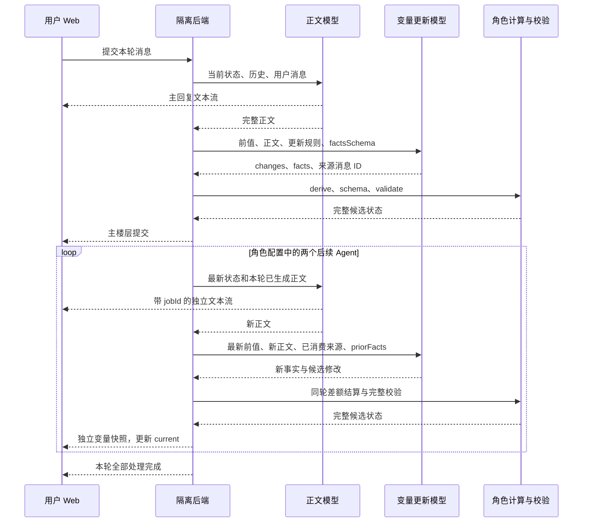

<!-- markdownlint-disable MD013 -->

# 林茜 MVU 与多次 Agent 更新验收

## 验收状态：重新核验

下文保留的是历史联调记录。审计发现，当时浏览器发送了要求指定分钟数、结束时刻和事件状态的用户消息；后续 Agent 使用了人为安排到门口和街口的提示词。正文请求也没有经过完整的提示词预设与世界书组装。上述结果只证明局部传输、计算和渲染行为，不能证明原卡正常演绎通过验收。

本次重新验收要求使用绑定的预设、角色世界书、正则、演绎者及模型配置，通过后端组装实际请求；用户输入只包含演绎者的对白和行动。原始规则与角色指令的修正须保留来源对照。新的正常演绎证据写入 `evidence/linqian-live/normal-roleplay/`，与历史记录分开。

已按用户新增授权绑定「夏瑾 天琴座 Beta 3.9（泛国模）」进行真实联调，梦鲸配置另行记录。资源组装结果与预设脚本缺项见[演绎资源绑定检查](../character-authoring/linqian-prompt-binding.md)。当前资源绑定检查通过，完整角色演绎验收尚未通过。

## 思考预算修正后的连续两轮检查

`apps/web/prototypes/characters/linqian/live-model.json` 将 `narratorReasoning.effort` 与 `updaterReasoning.effort` 明确设为 `none`。模型公开元数据表明该模型默认使用 `high`，并支持 `none`。正文总上限继续读取预设的 65535，变量更新上限保持 4096；传输层将各槽位配置写入请求的 `reasoning` 字段。

43875 隔离服务重启后，使用相同的正常演绎输入完成连续两轮真实请求。两轮均收到流式正文结束事件，各提交一次变量快照，状态栏分别显示 12:27 和 12:29，历史选择保持稳定，浏览器没有运行异常。两轮均未返回 `length`。证据位于 `evidence/linqian-live/normal-roleplay/opening/browser-result.json` 和 `evidence/linqian-live/normal-roleplay/continuation/browser-result.json`。

本次结果证明上述预算配置下连续两轮技术流程通过；完整角色语义、其他开场、分支与跨日规则仍按各自清单验收。原失败证据保留在下节列出的独立目录。

## 天琴座真实联调结果

当前绑定「夏瑾 天琴座 Beta 3.9（泛国模）」，固定模型为 `nex-agi/nex-n2.5-mini:free`。公共导入、固定版本、27 个世界书激活条目、角色 8 条与预设 11 条正则加载、实际请求中的宏残留检查均通过。结构证据见 `evidence/linqian-live/prompt-bundle-check.json`。

| 实际检查 | 结果 | 证据 |
| --- | --- | --- |
| 原输出上限 4096 的首轮 | 流式正文、一次状态提交、历史查看保持及状态栏联动通过；正文开头含模型自身说明，角色演绎语义未通过 | `evidence/linqian-live/normal-roleplay-output-limit-4096/opening/browser-result.json`、`messages.json` 和完成截图 |
| 原输出上限 4096 的续轮 | 模型回复未完成，变量未提交；该轮连续演绎未通过 | 同目录 `continuation/browser-attempt.json` 与 `live-evidence.json` |
| 改为预设输出上限 65535 后重跑 | 模型返回 `finish_reason: length`，结束事件与变量提交均未完成；整轮验收失败 | `evidence/linqian-live/normal-roleplay-default-reasoning-1789818868/opening/browser-attempt.json` 与 `live-evidence.json` |

以上真实请求使用演绎者对白和行动。资源格式转换只处理身份字段、空白和注释；原卡指令与预设正文保留。正文模型与状态更新 Agent 分别使用预设输出上限和更新器输出上限。当前错误记录尚无提供方 token 用量，能够确认返回的结束原因，尚不能据此确定提供方内部限制的来源。

当前隔离服务地址为 `http://127.0.0.1:43875`。该服务使用内存数据库；新一轮服务启动会重新导入固定资源。旧的 43873 服务与上述证据使用的配置不同。

## 验收对象

本次验收位于独立 worktree 的隔离后端。`apps/web/prototypes/characters/linqian/live-model.json` 通过通用加载器注册角色更新器，后端执行 `derive.js`、状态 schema 和 `validate.js`，前端读取提交后的快照。正式后端数据库事务、RuntimeWorker 和管理 Web 编辑器按[双端实施计划](role-app-dual-web-plan.md)接入。

## 原规则转换

| 产物 | 内容与核对方式 |
| --- | --- |
| `state.schema.json` | 完整变量结构、枚举、数值范围和四项行动选项 |
| `opening-states.json` | 两个开场的初始变量；逐项对照已有开场配置 |
| `update-rules.json` | 57 个来源条目、36 个一次性事件、D001–D003 及终局规则的原文和索引 |
| `conversion-map.json` | 变量脚本、110、112–115 及关联条目的目标位置 |
| `derive.js` | 日期和时间推进、A1 按日计数、事件顺序、关系和数值结算、终局状态计算 |
| `validate.js` | 跨字段一致性、四项选项、终局锁定及同轮累计限制 |
| `rules.constants.json` | 计算、校验共用的常量与错误码文案 |

以上路径均位于 `apps/web/prototypes/characters/linqian/`。`checks/linqian-state-unit.mjs` 对照源卡原文、配置枚举和计算结果，覆盖两个开场、跨日、数值字符串、截断、缺失拒绝、重复事件计数、一次性事件顺序、未完成事件、终局限制和同轮多次结算。语义规则由更新模型判断，后端按事实计算数值并验证候选状态。

## 一轮内的执行顺序

`priorFacts` 只包含本楼层已成功提交的事实，`floorBefore` 固定为本楼层开始前的状态。后续 Agent 读取先前正文以衔接剧情，更新器只对新正文结算。查看历史时，`view` 保留所选快照，后台更新继续推进 `current`。

## 失败与恢复

| 情况 | 已实现行为 |
| --- | --- |
| 正文完成，变量更新失败 | 后端保留正文和原前值；页面显示正文与“重试变量更新”按钮 |
| 后续 Agent 变量更新失败 | 保留该 Agent 正文和成功提交的快照；“重试后续处理”从失败任务继续 |
| 页面刷新 | 会话接口返回待处理主正文和后续任务状态，恢复对应重试入口 |
| 重试后续处理时输入框有草稿 | 保留草稿，完成后可继续发送 |
| 提交成功后传输中断 | 已提交任务保持 committed；再次请求跳过已提交任务 |
| 旧前值、失效尝试、未绑定 Agent | 拒绝更新；当前状态保持不变 |

## 实际联调发现与修正

- OpenRouter 免费模型供应商曾返回 429；联调将变量更新槽位指定为可用的 `nex-agi/nex-n2.5-mini:free`，原凭证文件保持不变。
- 供应商拒绝 Draft-07 的 tuple `items` 数组。传输层把它等价转换为 `prefixItems`，保留数量、元素和额外项约束；后端仍按原 schema 验证。
- 原型曾把不同基础行为共用次数、逐批截断感情，并丢失延迟结算标记。现在按行为分别累计，从 `floorBefore` 统一计算，保留结算点之前的全部事实；独立审阅通过了 363 组行为组合和 30 组感情边界组合。
- 实际模型曾把日常互动误归入亲密行为档位。字段 description 现在明确两类事实的区别；修正后第一轮三批均返回 `intimacyTier: none`。
- 更新模型曾返回错误的事实结构。请求正文现在显式包含 `factsSchema`，并与结构化输出参数使用同一来源。格式错误会保留校验位置并拒绝提交。

OpenRouter 的结构化输出能力取决于实际提供者；本次同时验证模型请求与本地候选状态校验。[官方结构化输出文档](https://openrouter.ai/docs/guides/features/structured-outputs)。

## 真实结果

第一轮通过六次真实模型调用：主正文、两段后续正文，以及各自的变量更新请求。两类槽位均使用 `nex-agi/nex-n2.5-mini:free`。

| 提交 | 时间 | 更新来源 |
| --- | --- | --- |
| 初始 | 2025-03-10 12:24 | 所选开场 |
| 主回复 | 12:29 | 整理书籍，经过五分钟 |
| 后续 Agent 1 | 12:30 | 走到门口，经过一分钟 |
| 后续 Agent 2 | 12:31 | 走到街口，再经过一分钟 |

页面收到 391 次文本更新、3 次文本结束、1 次主楼层提交和 2 次后续变量更新。浏览器验证历史选择保持不变，返回当前状态后显示最终地点和时间；感情值按角色布局既有规则取整显示为 505，后端原值为 504.85。实际新正文未出现亲密行为或事件完成，各批对应事实保持为空。

证据见[浏览器与模型记录](evidence/linqian-live/browser-result.json)和[完成后的页面](evidence/linqian-live/linqian-completed.png)。

### 跨日与失败重试

重启后的跨日用例从原开场推进 698 分钟，主回复提交到 2025-03-11 00:02；两次后续 Agent 分别提交 00:03 和 00:04。星期变为周二，`状态_A1_日期` 变为 2025-03-11，`状态_A1_计数` 从 1 重置为 0；本轮未完成的事件保持原值。

后续处理遇到一次输出长度限制，浏览器点击“重试后续处理”后完成。页面收到 4 次正文结束通知，但只产生 1 次主提交和 2 次后续快照，复用正文的重试没有额外增加楼层或重复结算。证据见[跨日浏览器记录](evidence/linqian-live/crossday/browser-result.json)及[跨日页面](evidence/linqian-live/crossday/linqian-completed.png)。

原型角色 profile 的 `maxTokens` 控制每次正文和变量调用的输出上限，本次为 4096。输出截断会返回失败并保留对应重试入口；完整候选状态通过校验后才提交。较早一次跨日请求遇到供应商断流，重启后的上述用例已完整通过。

### 连续下一轮

同一会话继续一轮整理书籍对话。新主楼层的 `beforeSnapshotId` 指向上一轮最后一个后续 Agent 的快照，时间由 00:04 变为 00:09；第一个后续正文明确经过一分钟，提交 00:10。第二个后续正文没有写明经过时间，更新器返回 0 分钟，只将地点更新到街口，因此最终仍为 00:10。页面与这份实际提案一致，时间推进准确性仍取决于正文对经过时间的表达。

两轮共保存六次状态提交，前一轮快照未变化；再次请求已完成的后续处理返回原快照。结果见[续轮浏览器记录](evidence/linqian-live/continuation/browser-result.json)、[实际正文](evidence/linqian-live/continuation/messages.json)和[快照关联检查](evidence/linqian-live/continuation/lineage-check.json)。
