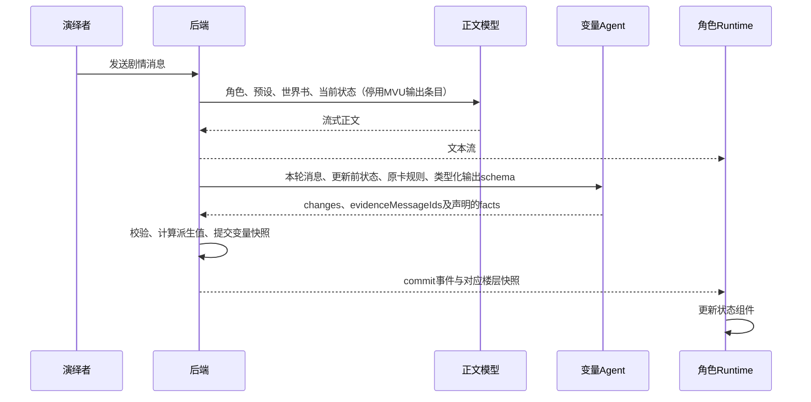

# MVU 到变量 Agent 的迁移

本文记录 MVU 迁移验收。当时通过前端显示正则恢复正文的临时实现已由[后端正文交付](preset-output-responsibilities.md)取代，当前职责和接口以该文档为准。

## 必须要实现的目标

迁移脚本必须把原角色卡的变量更新业务规则交给独立 Agent，同时停用正文请求中的 MVU 更新指令和旧 XML 输出协议。角色正文、Agent 结构化更新和 Runtime 显示分别沿现有后端接口执行。

## 已完成的迁移

`apps/web/prototypes/checks/mvu-agent-migration.json` 按原条目 ID 记录迁移决定。`apps/web/prototypes/checks/mvu-agent-migration.mjs` 校验该配置，并逐字提取原规则正文到角色版本的 `stateUpdate.files["migrated-variable-rules.json"]`，将文件加入 Agent 的 `ruleFiles`。原世界书中的条目保留内容，设置为停用。

| 角色 | 正文请求停用条目 | Agent 接收业务规则 |
| --- | --- | --- |
| 林茜 | 113、114、115 | 115，继续使用既有 facts、derive 和 validate 配置 |
| 顾声慢 | 9、11 | 9 |

顾声慢 Agent 提示词删除了此前手写的“情感增加 1～3”规则，改为读取原卡的 1～2 范围；迁移配置将 `/世界/事件状态` 移出 writablePaths，与原卡禁止 AI 修改该字段的要求一致。

`apps/web/prototypes/checks/serve-published-prototype.mjs` 在完整角色导入前执行上述迁移。`apps/web/prototypes/checks/migrate-published-mvu.mjs` 通过正式角色、世界书、正则和发布接口修复已有发布，保留旧版本。两个角色的新执行配置均移除全部 8 条旧 MVU 正则，保留原预设中的 10 条规则及其启用状态。

## 实际测试中修复的问题

林茜变量 Agent 对同一路径重复提交，触发已有 `STATE_PATH_OVERLAP` 校验。`apps/api/src/routes/role-view.mjs` 的 `buildRestrictedOutputSchema` 现在按 writablePaths 从 stateSchema 提取每个字段的顶层类型及数组长度，限制 changes 数量，并在系统输出协议中明确每个路径只写一次、数组一次完整替换。数组明确声明 `items: {}`，避免供应商将省略 items 解释为禁止数组元素。冲突校验继续保留。字段路径缺少 schema 时，后端拒绝构造模型请求。模型输出 schema 约束提案形状，后端继续使用完整 stateSchema 校验数组各位置及所有业务约束。

上一轮顾声慢验收发现正文前的格式片段影响角色解析，曾在前端临时接入预设显示正则。本轮已移除该接线及浏览器正则生成模块，改由[后端正文交付](preset-output-responsibilities.md)处理预设输出。数据库原文保持原样。

## 验收清单

- 已通过：迁移单元检查覆盖原规则逐字保留、正文条目停用、源对象不变、只读字段、旧正则移除、缺失来源拒绝及重复迁移结果一致。
- 已通过：role-view 接口 9 项测试，包括类型化字段、缺失字段 schema、空可写字段、证据约束、提交结果和失败不写状态。
- 已通过：顾声慢使用真实模型连续演绎两轮，正文未输出 MVU 块，Agent 分别提交新的变量快照。
- 已通过：林茜正文生成后，变量提交先经历路径冲突、供应商 schema 拒绝及非法 JSON；修正提案 schema 后，使用 `nex-agi/nex-n2.5-pro:free` 重试同一楼层成功，快照为 `2bc30542-3d28-44b0-b504-68ce943196cf`，行动选项为 4 项。该测试会话通过正式模型绑定接口覆盖 verifier 槽位，既有发布版本的模型配置保持原样。
- 已通过：林茜页面显示重试后正文、12:25 的状态与 4 个行动选项，变量更新失败提示已消失。
- 已通过：浏览器显示顾声慢第二轮 42 段正文，翻页正常。切换第一轮与当前状态，情感分别为 1、3，创作分别为 10、14，时间分别为 17:30、17:40。

本次验收确认正文、变量 Agent、快照和页面显示链路。顾声慢正文仍出现活动室与走廊场景衔接不一致，本次未修改角色剧情指令；后续剧情质量验收须单独核对场景连续性。

真实请求证据保存在 `docs/plans/evidence/published-backend/mvu-live-gushengman.json` 和 `mvu-live-linqian.json`；发布记录保存在同目录的 `mvu-agent-migration.json`。

## 非本次目标

历史会话沿用原发布配置，原卡剧情和预设写作风格保持原状。

## 已获得的授权

用户要求将 MVU 到 Agent 的处理纳入迁移脚本，并通过实际模型演绎验证迁移效果。测试使用已配置模型及正常演绎者消息。
