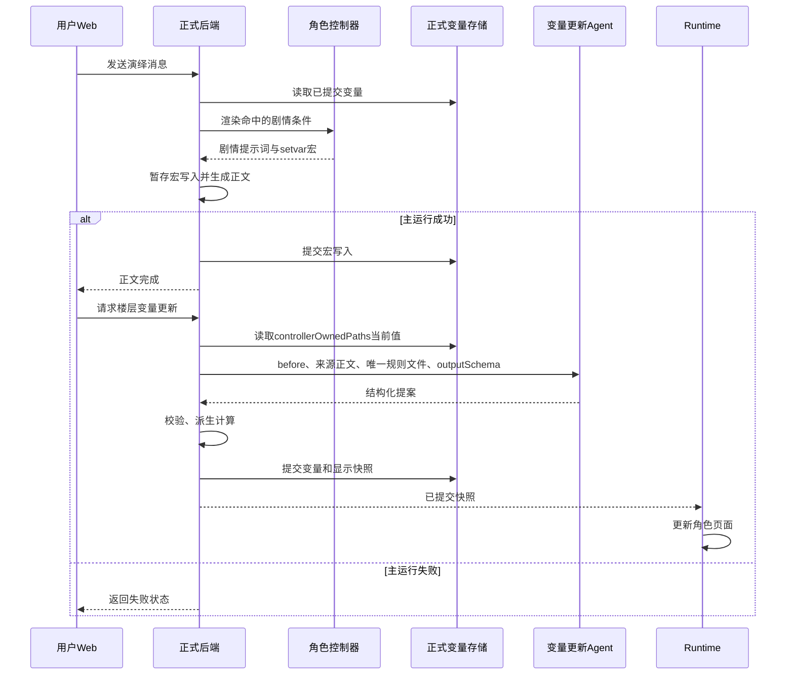

# MVU 迁移执行与验收

## 必须要实现的目标

后端按角色发布版本加载变量规则，正文生成使用剧情世界书，变量更新 Agent 使用独立规则和结构化输出契约，Runtime 读取提交后的状态。本文记录 [MVU 迁移方案](../mvu-worldbook-responsibilities.md) 的实际实施结果。

## 已完成的实现

- 迁移脚本从林茜 `update-rules.json` 移出原条目 113、114、115，规则 115 由 `migrated-variable-rules.json` 单独提供。来源副本保存在 [迁移原始记录](../evidence/published-backend/mvu-source-entries.json)，后端 Agent 只加载 profile.ruleFiles 指定的执行文件。
- 两张卡的默认初值直接从原世界书 initvar 读取，再由 `importOpenings` 应用各开场的初值覆盖和补丁。顾声慢创作完成度恢复为原值 0，初始心声恢复原文。四个开场均通过正式创建会话接口核对快照。
- 世界书条目通过 `extensions.tavern_headlessMigration` 保存用途与目标配置。发布接口检查旧条目再次启用、规则文件缺失、重复来源及旧输出协议，并返回条目或文件位置。
- 管理端角色编辑页提供 Agent 配置、规则与计算文件、各开场初值的编辑入口。世界书条目显示迁移用途，并提供跳转到绑定角色变量配置的按钮。保存继续使用正式角色版本接口。
- 管理端通过 `GET /characters/:id/versions/:versionId/state-contract` 读取已保存版本实际组装的 Agent 系统指令与输出契约。预览中的 evidenceMessageIds 为字符串数组；真正执行时，后端把可用 ID 收紧到本批 sources 的 messageId。

## 事件控制器与变量提交

`mvu-controller-migration.mjs` 将顾声慢已审阅的 8、15、16、17、20 条 EJS 条目转换为角色附带的后端 JavaScript 控制器，使用现有 `promptController` 入口。角色业务条件和剧情文本来自原条目；服务器运行转换后的控制器模块。此转换器仅覆盖这组条目用到的模板语法与调用。

控制器读取已提交的 stat_data，通过 getwi 取得原世界书对应阶段文本；setvar 转成现有后端宏，沿用提示词组装的暂存与成功提交路径。原脚本的 toastr 调用在转换适配中忽略，事件状态通过变量快照显示。

角色变量配置新增 `controllerOwnedPaths`，定义由后端控制器写入、变量更新 Agent 只读取的路径。顾声慢的 `/世界/事件状态` 属于此集合。变量更新入口从正式变量解析接口读取这些已提交值，合并到 Agent 的 before，然后应用 Agent 提案，避免旧显示快照覆盖控制器刚提交的事件状态。字段结构见 `state-update.schema.json`；合并与元数据校验位于 `apps/api/src/services/role-mvu-migration.mjs`。

## 验收清单

- 已通过：规则迁移的来源保持、旧协议移除、重复执行一致性、缺失来源错误，以及发布冲突检查的正常、异常分支。
- 已通过：阶段数值边界、普通与完美事件条件、重复触发约束、控制器自有字段合并及缺失路径错误。
- 已通过：管理端字段序列化、原值保持、非法 JSON；浏览器已核对用途标记、编辑跳转和后端 Agent 契约读取，当前林茜契约中没有旧 MVU 输出标签。
- 已通过：四个开场的初始变量与原卡及开场补丁逐字段一致，正式正文预览中没有旧 MVU 输出块及 EJS 标签，见 [发布版本验收](../evidence/published-backend/mvu-published-acceptance.json)。
- 后端接口测试覆盖控制器状态保留、Agent 失败、重复提交、输出契约读取和初始状态校验。33 项后端测试已通过。
- 真实模型结果单独记录：Nex 返回思考标记的轮次未通过正文验收；Gemma 免费服务返回上游 429；Qwen 免费模型连续重试后仍返回供应商错误，两张卡均未完成有效正文生成；本轮真实演绎验收尚未通过。接口提交成功与正文语义验收分别记录。

## 非本次目标

既有发布版本和旧会话保持固定绑定。通用 EJS 兼容层、任意第三方脚本执行及游戏指令系统属于其他任务。

## 已获得的授权

用户明确要求按方案清理旧指令、合并重复规则、重新发布并验收；已授权使用 OpenRouter 免费模型及调整测试模型。
