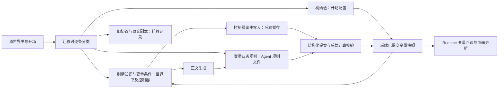

# MVU 世界书条目的职责与迁移修正方案

## 必须要实现的目标

迁移负责人必须把原卡的变量业务规则、初始值、旧 MVU 输出协议和剧情控制条目分别交给对应模块。后端负责人必须保证正文生成、变量更新 Agent 与确定性计算各自读取其所需输入；管理端必须展示每条规则的实际用途和迁移来源。

本次调研读取了隔离后端的已发布角色快照与固定世界书版本，核对结果保存在[发布资源审计](evidence/published-backend/mvu-entry-responsibility-audit.json)。方案已开始执行；当前实现和验收结果见[执行记录](mvu-execution/results.md)。本节发布版本记录保留调研时的事实。

## 当前发布版本的实际情况

林茜发布版本为 `mehRRY_c4V89ErC5ESiFH`，顾声慢发布版本为 `9K4D6JlZBWHD69dnhzNqA`。资源 ID、固定版本和逐条状态见审计文件。

| 原条目 | 当前用途与位置 | 是否还需要 |
| --- | --- | --- |
| 林茜 115、顾声慢 9：变量更新规则 | 世界书中的原条目已停用；内容复制到角色版本 `extensions.tavern_headless.stateUpdate.files["migrated-variable-rules.json"]`，由 `profile.ruleFiles` 引用，进入变量更新 Agent 的系统指令。 | 业务规则必须保留；运行时保留一份 Agent 规则即可。 |
| 林茜 113、114，顾声慢 11：变量输出格式及强调 | 世界书中的原条目已停用。林茜的 `stateUpdate.files["update-rules.json"]` 却仍包含 113、114 的完整副本，并标为 enabled。 | 旧协议已由后端 `outputSchema` 取代，应从 Agent 的执行输入清除。 |
| 林茜 2、顾声慢 0：初始变量 | 世界书条目停用。当前创建会话读取角色版本 `extensions.tavern_headless.openings.items[].variables`，展开宏后保存初始快照。 | 初始值必须保留在开场配置；世界书中的旧副本仅有来源核对价值。 |
| 使用 `getvar`、`stat_data` 的剧情条目与控制器 | 仍参与剧情选择或提示词组装，例如林茜 127、109、111，顾声慢 15、20。 | 读取变量决定剧情的功能仍然需要；它们不等于旧 MVU 更新协议。 |
| 顾声慢 8、16、17、15 中的变量写入 | 条目含 `setvar`，涉及事件状态；当前 Agent 的 writablePaths 排除了 `/世界/事件状态`。 | 后端负责人必须保留满足原触发条件的事件写入路径，统一纳入后端提交，并验收对应读取结果。 |

初始化的具体来源也需要分清：`importOpenings` 读取开场元数据的 variables 或迁移目录的 `scenario.json.initial`，并处理开场正文中的 initvar 和 JSONPatch。它没有直接读取世界书中的 `[initvar]` 条目。因此，当前存在可用初始快照，并不能单独证明所有开场初始值都与原世界书一致。

来源：[`mvu-agent-migration.mjs`](../../apps/web/prototypes/checks/mvu-agent-migration.mjs:30)、[`import-openings.js`](../../apps/web/prototypes/shared/import-openings.js)、[`serve-published-prototype.mjs`](../../apps/web/prototypes/checks/serve-published-prototype.mjs)、[`role-view.mjs`](../../apps/api/src/routes/role-view.mjs:189)。

## 已确认的迁移缺陷

1. **林茜 Agent 仍收到旧输出协议。** `buildStateUpdateSystemPrompt` 将 `profile.ruleFiles` 引用的整个文件字符串拼入系统指令，并不按文件内 entries 的 enabled 字段筛选。因此 113、114 的旧 Analysis、UpdateVariable、JSONPatch 指令仍进入 Agent 请求，与后端要求返回结构化 JSON 的协议冲突。拼接位置为 [`buildStateUpdateSystemPrompt`](../../apps/api/src/routes/role-view.mjs:678)。这证明迁移输入存在冲突；尚不能据此认定此前某次非法 JSON 的唯一原因。
2. **林茜规则 115 重复注入。** `update-rules.json` 和 `migrated-variable-rules.json` 各含一份完全相同的规则 115，两个文件又同时列入 ruleFiles。
3. **来源副本与执行规则混在同一个文件。** 原条目全文适合留作迁移证据，当前却直接成为 Agent 提示词。需要把执行规则与审计副本分别保存。
4. **管理端缺少迁移用途展示。** 世界书中的旧条目仍然可见，页面应明确区分“用于正文”“已迁移到变量规则”“原始导入记录”，并链接到真正生效的配置。发布服务必须检查再次启用旧副本是否引入旧输出协议或重复规则；发现冲突时返回具体条目及目标配置，管理员修正后才能发布。

## 修正步骤与纵向验收

| 步骤 | 执行主体、对象与动作 | 产物与完成条件 |
| --- | --- | --- |
| 1. 整理执行输入 | 迁移负责人逐条审阅 `stateUpdate.files`，提取变量判断规则和必要事件依据，移出 113、114 旧协议，并合并重复的 115。原始条目存入 `docs/plans/evidence/published-backend/mvu-source-entries.json`，供来源核对。 | 后端实际组装的 Agent 系统指令仅含一份规则 115，使用唯一 outputSchema 输出协议；管理端可查看最终请求。 |
| 2. 核对初始化 | 迁移负责人对照原 initvar、各备用开场的覆盖与补丁，生成角色版本的 `extensions.tavern_headless.openings.items[].variables`。后端负责人按 stateSchema 验证各开场初值。 | 管理端选择不同开场，用户端首屏状态与后端初始快照、来源初值逐字段一致。 |
| 3. 核对剧情读写 | 后端负责人逐条检查世界书和控制器的变量读取、条件触发及写入时点。读操作使用当前已提交变量；写操作使用后端暂存、校验和提交路径。变量更新 Agent 继续只写获准字段。 | 使用实际触发场景核对世界书命中记录、暂存写入、最终快照；失败、重试和历史重载均能解释事件状态的来源，事件更新无重复提交。 |
| 4. 补管理界面 | 管理端负责人增加变量规则、初始值、Agent 输出契约、计算规则及迁移来源的编辑或查看入口。界面通过正式资源接口保存角色版本。 | 保存后重读值一致；再次启用旧副本的验收用例必须在发布前定位并阻止旧协议冲突或重复规则；用户端取得已发布版本的完整配置。 |
| 5. 重新发布验收 | 验收负责人通过正式发布接口创建新版本，以普通演绎消息验证连续两轮及后续 Agent 更新。 | 原始响应、交付正文、Agent 请求、变量提交、Runtime 状态栏逐项对应；正文无需附带旧 MVU 更新块。旧会话继续使用其固定版本。 |

## 验收清单

- 已核对：两个发布版本中，原 MVU 输出格式条目及更新规则条目均已在世界书停用。
- 已核对：Agent 从角色版本中的 stateUpdate 读取迁移规则；林茜存在旧协议残留和规则 115 重复。
- 待修正验收：执行规则与来源副本分离，实际 Agent 请求清除旧协议及重复内容。
- 待验收：每个开场的初值、变量驱动剧情触发、事件写入失败与重试、多轮 Agent 更新和前端状态一致。

## 非本次目标

本方案保留原卡剧情、变量含义及事件条件。角色模板、背景、立绘和状态栏继续遵循[正文交付与角色渲染职责](preset-output-responsibilities.md)。通用游戏指令系统和任意第三方脚本兼容属于其他任务。

## 已获得的授权

用户授权调研世界书 MVU 条目的用途、必要性和迁移去向，并提出方案。本轮进行资源读取、源码核对和文档编写；执行资源清理及重新发布为本方案后续步骤。
