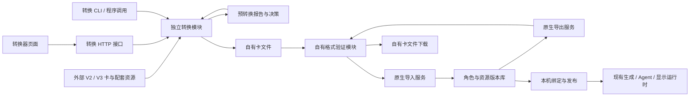
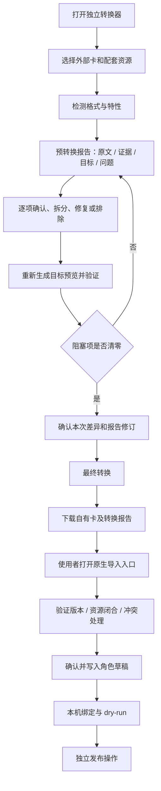
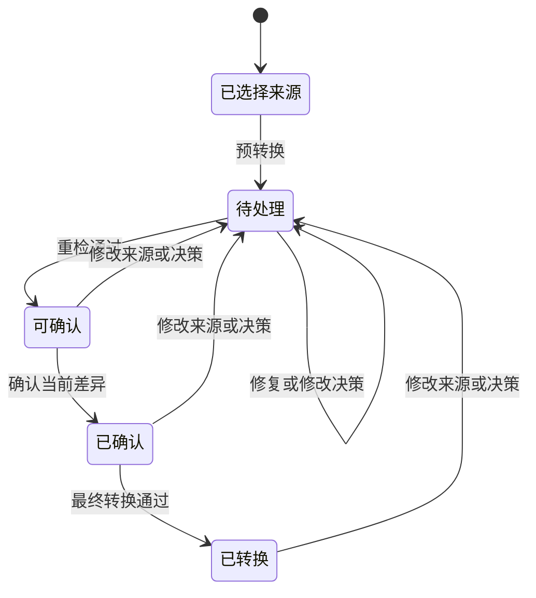

# 自有角色卡格式与独立转换器方案

状态：待用户批准。代码核对基线：`9acccbb`。本文件定义产品、架构和实施目标；同目录的 schema 与示例属于契约草案，尚未接入正式服务。

## 必须要实现的目标

1. 格式负责人定义 TavernHeadless 自有角色卡格式，使一张卡的角色资料、世界书、开场、变量结构、Agent 规则、剧情控制器、显示模板、媒体、预设与正则可以完整导出并重新导入。
2. 转换器负责人独立实现酒馆 Character Card V2/V3 的检测、预转换、人工处理、最终转换及结果下载。转换器在没有数据库、资源库和模型服务的条件下仍可调用。
3. 导入负责人让自有卡导入只验证和保存自有格式；导出负责人从固定资源版本生成同一种格式。转换、导入、发布分别由使用者操作。
4. 管理端负责人提供逐项来源、支持程度、处理理由和目标位置，让使用者在转换前确认内容如何保留、拆分、迁移或排除。

## 1. 现状与术语

现有 `packages/adapters-sillytavern/src/role-migrations/` 提供转换函数，`apps/api/src/services/role-runtime/role-import-service.ts` 由 `/import/character` 的 `role_migration` 分支调用。`apps/api/src/routes/exports.ts` 仍把角色快照导出为 ST JSON；它没有收集发布配置所绑定的全部版本与媒体文件。`role-assets.ts` 定义版本文件集，`role-state.ts` 定义变量更新配置，两者尚无统一交付协议。

| 名称       | 本方案含义                                                       |
| ---------- | ---------------------------------------------------------------- |
| 外部卡     | Character Card V2/V3 文档及用户一并提供的外部资源。              |
| 自有角色卡 | 遵循本方案格式的、具有独立版本号的角色交付包；以下简称自有卡。   |
| 预转换报告 | 针对固定源文档修订、规则版本和目标格式生成的逐项检测与目标草稿。 |
| 转换决策   | 使用者对报告项的保留、迁移、拆分、修复或排除选择，以及理由。     |
| 原生导入   | 验证自有卡并创建本机角色及其资源版本。                           |
| 本机绑定   | 导入之后在本机选择的模型配置、演绎人设与发布设置。               |

这些术语为提案术语。用户批准后，领域文档负责人将其登记到 `CONTEXT-MAP.md` 对应的角色交付领域；现有领域定义保持有效。

## 2. 架构与职责

拟新增 `packages/character-card-format/`，负责自有格式解析、版本能力、引用检查、序列化和反序列化。拟新增 `packages/character-card-converter/`，负责外部格式适配、检测器、转换规则和报告；它依赖自有格式模块，通过适配层复用现有 ST 解析器和已验证迁移函数。自有格式模块的依赖指向共享契约，自有格式模块可以在没有 ST 适配器的环境使用。

后端的原生导入服务只调用自有格式模块。转换 HTTP 接口只调用转换模块，结果写入临时转换工作区；该工作区的生命周期独立于角色数据库。CLI 调用相同模块。发布和生成服务继续读取固定版本，由自有卡映射模块写入其需要的内部结构；内部存储可以暂时使用现有 `extensions.tavern_headless`，文件协议使用独立的原生字段。

转换模块外部接口保持四个动作：`inspect(sourceSet, target, capabilities)`、`preview(sourceSet, decisions, revision)`、`convert(preview, approval)`、`validateResult(card)`。它们返回结构化结果；资源写入、下载和临时文件管理由调用方负责。编译过程中使用确定性规则；自然语言职责分类由使用者或审阅 Agent 判断，并以决策输入提交。

## 3. 自有格式与版本

建议首版标识为 `spec: "tavern_headless_card"`、`specVersion: "1.0.0"`，完整单文件扩展名为 `.thcard.json`。这些名称等待本方案批准。自有格式的版本独立于酒馆的 `spec_version`，也独立于作者填写的作品版本 `cardVersion` 和本机数据库资源修订号。

首版文件采用 UTF-8 JSON；媒体文件使用带 MIME、用途、包内路径的 base64 字节表示，文本文件使用 UTF-8 文本。该设计复用已有资源上传表示，避免为首版增加压缩库。性能验收负责人必须按 `design-validation.json` 的提案配置检查最大输入样本：转换时间及进程峰值内存均须在预算内，超限时服务返回配置限额和修复操作。实际测量不达标时，负责人须提交实现优化或限额调整供批准。文件大小、总字节数、资源数、目录深度和临时空间限额由 `native-card-limits.json` 配置，并通过 schema 校验；实施负责人按现有配置覆盖顺序加载这些值。

格式模块依据明确的版本支持表读取文件。未知主版本返回具体版本错误；未来小版本的必需能力不受支持时也阻止导入。扩展区可以保存可选未知数据，并标记为非执行资料；未知内容声明为执行必需时必须阻塞。格式升级是独立显式操作，生成新文件、差异和报告；导入器按原文件版本处理。自有卡携带 `kind: "complete"`；转换草稿使用 `spec: "tavern_headless_conversion_draft"`，并由转换工作区独立保存。自有格式验证器检查实际内容及引用，文件自行声明 complete 只作为类型标识。扩展区的每个命名空间使用 `{purpose: "metadata", data: ...}`；执行需求写入 requirements.runtime，并用 usedBy 指向使用该能力的资源。首版只承诺读取 1.0.0，后续版本发布时同时提交迁移器和往返测试。

### 3.1 文件结构

同目录 `native-card-v1.schema.json` 和 `example.thcard.json` 给出可检查的草案。实施负责人将最终批准的字段迁入唯一共享 schema，再生成客户端与服务端类型。

| 顶层对象       | 保存内容与执行归属                                                                                                                                                                                                                                        |
| -------------- | --------------------------------------------------------------------------------------------------------------------------------------------------------------------------------------------------------------------------------------------------------- |
| `identity`     | 包内卡 ID、作者作品版本、创建和修改时间；包内 ID 用于引用，不等于数据库 ID。                                                                                                                                                                              |
| `character`    | 姓名、提示词使用的称呼、描述、性格、场景、对话示例、作者说明、标签与来源。叙述人称由 `prompting` 定义，演绎者姓名和完整描述由本机绑定或可选人设模板提供。                                                                                                 |
| `worldbooks`   | 用于正文的知识与剧情条目、触发条件、插入位置、顺序、预算及启停状态；每条具有包内稳定 ID。                                                                                                                                                                 |
| `openings`     | 开场 ID、标题、正文、类型、默认项和完整初始变量；开场初值按同一状态 schema 校验。                                                                                                                                                                         |
| `state`        | 状态 schema 文件引用、变量写入归属，以及派生和校验模块引用。初始值由 `openings` 定义。                                                                                                                                                                    |
| `agents`       | 按职责保存变量更新、Director（规划剧情并向叙述者提供指令）、Verifier（检查角色行为与设定的一致性）、记忆等 Agent 的提示词文件、规则文件、输入/输出契约、模型能力需求和启用状态；只有已实现的能力可以启用。变量更新 Agent 读取业务规则并输出当前后端契约。 |
| `controllers`  | 确定性剧情控制模块、事件条件、读写变量路径、触发阶段、绑定的世界书条目 ID，以及模块依赖。                                                                                                                                                                 |
| `prompting`    | 正文预设、消息顺序、宏策略、叙述人称、输入/输出正则、正文交付契约的资源引用。                                                                                                                                                                             |
| `presentation` | 显示模板 manifest、HTML/CSS/脚本入口、消息布局及媒体别名引用。文件内容统一由 `files` 保存。                                                                                                                                                               |
| `files`        | 包内文本、脚本、JSON 数据及媒体字节；按路径和用途索引。每个路径唯一，所有执行引用均指向这里或其它明确的包内资源 ID。                                                                                                                                      |
| `requirements` | 运行时能力与版本要求，以及尚待本机配置的模型槽和演绎人设；本机模型地址、密钥和资源数据库 ID 由导入后的绑定保存。                                                                                                                                          |
| `provenance`   | 来源、检测规则版本、处理理由、源项到目标的多对多映射、被排除内容的只读来源记录和转换损失列表。执行组装器只读取执行字段。                                                                                                                                  |
| `extensions`   | 使用命名空间保存的可选作者扩展资料；执行能力通过 `requirements` 和对应资源字段声明。                                                                                                                                                                      |

### 3.2 引用与导出闭合

普通文字卡可以显式设置 `state: null` 和 `presentation: null`，由正式用户端的基础聊天显示承载；此时开场初值必须为空对象，启用的变量 Agent 与控制器必须为空。带变量或自定义显示的卡分别提供完整配置。来源没有预设时，预转换页面要求使用者选择转换器内置且版本固定的原生基础预设，或随源文件补充实际预设；页面将选定预设纳入最终自有卡，并显示实际组装顺序；转换器必须将使用者选定的预设及其与来源的差异写入报告。

当前草案 schema 定义外层文件结构。`files` 中的预设、正则、显示 manifest、生成参数和 Agent 契约还须按内容类型分别验证：实施阶段 A 必须给这些资源建立版本化子契约，并从现有字段表逐项迁移，覆盖世界书的八种插入位置、辅助关键词逻辑、递归设置，角色 system prompt/post-history 指令，Agent 输出上限与 reasoning 参数，以及控制器变量根和宏映射。`metadata` 只保留非执行资料；当前运行时需要但未映射的字段会阻塞旧资源打包。示例中的内嵌文本用于说明资源去向，不代表可直接在现有运行时执行。

包内使用逻辑 ID 和相对文件路径。导入服务建立包内 ID 到本机资源 ID 的映射，并保存角色绑定关系；它使用显式 ID 检测重复。导出服务从选定的草稿修订或发布版本获取同一组固定版本，遍历世界书、预设、正则、Agent、控制器和显示模板的依赖，生成完整文件集。导出过程中资源被删除或版本改变时返回具体错误，使用者重新选择可读取的版本。

媒体和脚本声明中的静态引用必须闭合；动态拼接的路径需要作者列出依赖声明，检测报告必须标明动态依赖尚待验证的范围。远程媒体先显示为待补资源，由使用者提供文件并确认映射后生成完整卡。本方案首版的完整导出要求包内资源齐全；使用者可以保存未完成转换草稿，但草稿标识与自有卡不同，原生导入器拒绝它。

导出范围为角色定义与配套资源。会话历史、当前变量快照、运行日志、模型调用原始记录、账号和供应商凭据属于本机运行数据。可选演绎人设模板只包含作者明确随卡提供的姓名与描述；实际使用者的会话人设由本机设置。

往返保证为：导出 → 新空库导入 → 再导出后，执行资源、文本、媒体字节、逻辑引用、开场初值和作者扩展等价。本机 ID、导入时间和转换工作区 ID 可以不同。验收程序按字段及文件字节比较，语义影响由审阅 Agent 结合 dry-run 阅读判断。

## 4. 世界书、变量 Agent 与其它内容的去向

| 外部内容                            | 自有卡目标                            | 必须展示的处理依据                                           |
| ----------------------------------- | ------------------------------------- | ------------------------------------------------------------ |
| 人物、地点、剧情知识                | `worldbooks[].entries`                | 原文、触发与插入语义的对应关系。                             |
| 初始变量与开场补丁                  | `openings[].initialState`             | 基础初值、该开场覆盖与补丁的顺序，以及最终完整初值差异。     |
| 自然语言变量更新业务规则            | `agents[kind=state_update].ruleFiles` | 适用变量、读写归属、原文段落与目标文件。                     |
| 旧 MVU 输出标签、更新协议、重复强调 | `provenance` 的只读来源记录           | 系统统一输出契约替代了哪部分；使用者确认从执行输入排除。     |
| 条件剧情读取与确定性事件写入        | `controllers` 与保留的剧情条目        | 支持的语法、触发阶段、读写路径和世界书引用。                 |
| 派生计算与校验                      | `state` 引用的模块                    | 输入字段、产出字段、执行顺序；与 Agent 可写字段的冲突。      |
| 显示 HTML/CSS、状态栏与交互脚本     | `presentation` 与 `files`             | 已支持显示能力、依赖资源及需要人工改写的宿主调用。           |
| 正则、预设和宏                      | `prompting` 引用的文件                | 输入处理、正文交付或显示处理的执行阶段及已支持语义。         |
| 未知插件、未知扩展                  | `provenance`，或人工完成的原生目标    | 检测到的字段路径、已知依赖、支持缺口；必需功能未完成时阻塞。 |

世界书中的已迁移规则从目标正文世界书移出，来源全文保存在只读来源记录。排除仅改变新产物，源卡保持不变。一个条目同时包含剧情知识和变量指令时，使用者按段落拆分，报告记录每个源范围到目标的映射；有效排除决策必须包含原文审阅结果、明确源范围和被影响的功能。

变量字段的 Agent、控制器与派生计算拥有明确写入归属。同一变量路径必须明确唯一写入者；父子路径覆盖也按冲突处理。现有角色若依赖多方写入，负责人必须先提出保留行为的职责调整并取得该卡转换决策，冲突清除后才能最终转换。转换检测阶段读取脚本作为文本并分析已支持语法，执行验收使用隔离的现有运行环境。

## 5. 预转换报告与支持判定

转换器分别报告四层能力：容器可读取、字段可解析、特性有映射、行为已验证。文件成功解析只证明前两项中的相应结果。

每个报告项包括 `itemId`、来源文件及 JSON Pointer、可选文本范围、检测器 ID/版本、证据、内容类别、支持状态、目标引用、依赖项、处理动作、理由、决定者与报告修订。支持状态为“直接保留”“规则可转换”“需人工确认”“当前不支持”“缺少依赖”；阻塞严重程度独立保存。报告统计从条目状态计算，界面同时显示受影响的开场、Agent、条目及显示功能。

检测器使用字段结构、明确插件标识和支持语法产生证据。语义分类仅产生待审建议，使用者或审阅 Agent 阅读后确认。转换器必须以结构证据和人工语义决策确定 MVU 内容职责，并将仅完成存档的未知功能保持为未验证状态。

每个源节点必须出现在覆盖清单中：保留、转换、拆分、明确排除或未解决。遗漏的节点进入未解决状态。源节点到目标是多对多映射，迁移重复规则时记录多个来源与一个执行目标；只有来源与语义审阅都明确一致时才允许合并。

覆盖统计以叶子字段、资源文件和人工拆分后的文本范围为原子项，父对象只汇总其子项状态。源项标识由来源文件 ID、JSON Pointer 和源修订共同组成；重复的作者条目 ID 由独立包内 ID 区分，报告保留对应关系。重新上传或修改来源后，旧决策作为历史建议保留，使用者重新确认受影响项后才计入当前覆盖结果。

转换通过条件：所有必需功能有有效目标、所有目标引用闭合、所有初值通过状态 schema、写入归属无未解决冲突、所有排除或语义改写获得本次报告确认。可选内容允许使用者明确排除并填写理由，最终产物标记“有已确认差异”。必需依赖只有修复或连同受影响功能整体排除并确认损失后才能解除阻塞；残留引用继续阻塞。

### 5.1 V2/V3 与插件覆盖

转换负责人按照 [V2 规范](https://github.com/malfoyslastname/character-card-spec-v2/blob/main/spec_v2.md)和 [V3 规范](https://github.com/kwaroran/character-card-spec-v3/blob/main/SPEC_V3.md)建立字段清单。V2/V3 使用各自格式标识；V3 还具有资产、称呼、多语言作者说明、群聊开场及世界书装饰器等内容，转换负责人必须分别验收这些字段的实际映射结果。

首批支持矩阵写入 `conversion-capabilities.json`：V2/V3 JSON 的基础资料和普通世界书进入确定性映射；V3 称呼要保留宏绑定语义。群聊专用开场和未实现装饰器显示为当前不支持或需处理项。`{{original}}` 等依赖外部预设的内容进入缺少依赖状态，使用者提供实际预设后重检。MVU、EJS 和正则只承诺矩阵列明并经样本验收的子集。未知作者插件与未识别脚本依赖进入报告，使用者修复后重检。

JSON 是首批可实施的输入容器。PNG/APNG、CHARX 和压缩资源包由独立容器适配阶段实现；在该阶段通过前，页面必须明确提示当前输入类型尚未支持，并指导使用者提供 JSON 与资源文件。容器支持与 V2/V3 字段支持使用不同能力记录。完整容器阶段需要先提交准确依赖版本及安全审计，再取得安装授权；本提案没有授权安装新库。

## 6. 操作流程与界面

管理端设三个明确入口：“转换外部角色卡”“导入自有角色卡”“导出自有角色卡”。转换器使用独立页面，左侧显示步骤与统计，中间显示可筛选问题清单，右侧显示原文与目标差异；手机端切换清单/详情标签。问题筛选保持已选择项，键盘可以进入源文、处理动作和下一问题。最终转换按钮附近直接列出剩余阻塞项及修复入口。

预览包含目标文件树、最终世界书、变量规则、各开场初值、显示资源和损失摘要。使用者返回修改时，页面保留决策但将旧预览和确认标记为失效；只允许确认当前报告。后端以工作区修订号进行条件更新，过期确认返回冲突；CLI 读取同一组源文件一次生成固定内存快照，转换必须使用该固定快照。

转换完成页提供“下载自有卡”“下载报告”“前往导入”。“前往导入”只把文件交给导入预览，使用者仍需确认资源冲突和写入。导入完成显示角色草稿，并列出待绑定的本机设置。导出界面选择草稿修订或发布版本，显示实际包含资源及缺项；自有格式完成校验后提供文件下载。

交互原型位于 `apps/web/prototypes/native-card-converter.prototype.html`，使用内置示例，展示正常转换、未知必需脚本、缺少媒体、过期确认以及独立导入导出。原型的检测和数据使用演示状态，正式实施必须以转换模块返回的报告替换示例。

## 7. 服务、CLI 与错误契约

| 拟定入口                                          | 输入与结果                                                                                                |
| ------------------------------------------------- | --------------------------------------------------------------------------------------------------------- |
| `POST /card-conversions`                          | 创建临时来源工作区，返回 `conversionId`、`sourceRevision`。                                               |
| `PUT /card-conversions/:id/sources`               | 提交新增、替换或删除的来源及资源文件和预期修订号，返回新 sourceRevision；旧报告、目标预览和确认同时失效。 |
| `POST /card-conversions/:id/inspect`              | 按目标格式和当前来源检查，返回结构化报告。                                                                |
| `PUT /card-conversions/:id/decisions`             | 提交完整决策及预期修订号，返回新修订并使旧预览失效。                                                      |
| `POST /card-conversions/:id/preview`              | 返回目标草稿、引用问题、执行内容差异及 `reportRevision`。                                                 |
| `POST /card-conversions/:id/convert`              | 提交已确认的报告修订，返回最终产物标识；资源创建由独立原生导入请求执行。                                  |
| `GET /card-conversions/:id/artifacts/:artifactId` | 下载生成的自有卡或报告。                                                                                  |
| `DELETE /card-conversions/:id`                    | 清理临时工作区；确认前可下载决策草稿。                                                                    |
| `POST /native-cards/inspect`                      | 只检查自有卡版本、能力与冲突，返回导入预览。                                                              |
| `POST /native-cards/import`                       | 提交自有卡、冲突策略及目标资源预期修订，返回本机资源映射和草稿 ID。                                       |
| `POST /native-cards/export`                       | 提交固定草稿或发布版本，返回完整文件与资源清单。                                                          |

拟定 CLI 为 `card-convert inspect`、`card-convert preview`、`card-convert convert`；输入卡、资源目录、决策 JSON 和输出路径全部显式传入。模块调用、CLI 和 HTTP 必须对同一输入返回相同报告与执行内容。CLI 自身退出码区分输入非法、存在阻塞、确认过期与输出失败。

接口 schema 统一定义状态和错误结构。共享错误码对照表至少覆盖：外部格式送入原生导入、版本不支持、必需功能不支持、资源缺失、决策过期、变量写入冲突、包内路径冲突、资源版本冲突、文件过大和写入失败。每个错误带源项或目标路径、原因和可执行修复动作；前端读取唯一文案配置，展示后端定位字段。上传、转换和保存分别显示进度与失败阶段。

临时目录、保留时长和空间上限从配置读取。文件完成前先写入临时位置，成功后返回产物；失败时保留可诊断的报告，恢复和清理按配置执行。原生导入沿用版本文件存储的分步提交规则，任何失败均保持原资源可读取，新增不完整资源不可见。新版本冲突通过显式版本比较处理。使用者可选择创建副本或给指定角色导入新版本；运行中的会话继续引用原版本。

## 8. 现有数据和接口的迁移

现有数据库角色的转换由独立“现有角色打包”适配器完成：它从固定快照读取全部依赖，生成自有卡草稿，显示缺失内容，用户确认后才创建自有格式资源版本。现有角色、已发布配置和会话在迁移前继续读取当前固定版本。

正式切换时，前端角色导入入口改接 `/native-cards/import`，角色导出入口改接 `/native-cards/export`。旧 `/import/character` 的角色写入和 `role_migration` 路径同时退出正式能力；旧 `/export/character/:id` 的 ST 输出退出默认角色导出。后端必须在旧导入请求中返回“该入口已停止导入酒馆角色卡，请先使用转换器生成自有卡，再调用 /native-cards/import”；旧导出请求返回“该入口已停止导出酒馆角色卡，请选择固定版本并调用 /native-cards/export”，并同步更新 OpenAPI、SDK、脚本和文档，接口负责人同步关闭其余以 ST 卡为输入的角色导入写入入口。其它独立预设、世界书和正则资源管理继续使用各自资源接口。

内部旧存储格式的过渡由显式适配器处理，原生导入器只接受自有卡。旧数据迁移是否批量执行由用户另行选择；实施阶段先在复制数据库验证并提交迁移报告。

## 9. 分阶段实施方案

每阶段先提交具体差异与验收证据；最终完成条件覆盖下面全部核心阶段，容器扩展单独列示。

| 阶段           | 执行主体与对象                                                                   | 产物及完成条件                                                                                                             |
| -------------- | -------------------------------------------------------------------------------- | -------------------------------------------------------------------------------------------------------------------------- |
| A 自有契约     | 格式负责人实现格式模块、共享 schema、版本表、引用检查与完整样本                  | 纯文本卡和含显示/Agent/媒体的完整卡均可验证；未知版本、缺文件和重复逻辑 ID 明确失败。                                      |
| B 独立转换核心 | 转换负责人拆出 ST 适配调用链，实现检测器注册、支持矩阵、覆盖清单、决策及结果验证 | V2/V3 JSON、已知 MVU/EJS 子集和未知插件样本产生可解释报告；纯模块/CLI 可在无 API/DB/模型情况下转换。                       |
| C 原生导入导出 | 后端负责人实现版本映射、完整导出与现有数据打包适配器                             | 固定版本导出到空库再导出逐字段/逐文件等价；中途失败、冲突和并发修改无半成品资源。                                          |
| D 正式界面     | 前端负责人按批准原型实现转换、原生导入、原生导出及来源/目标查看                  | 全部按钮调用正式接口；阻塞项、过期报告、取消、重试、下载与待绑定状态有联调证据；桌面与手机通过对照。                       |
| E 迁移与切换   | 接口负责人更新旧入口、SDK、初始化脚本和用户文档                                  | 正式角色导入只能接受自有格式；旧调用得到明确迁移错误；已有会话固定版本读取不受新草稿影响。                                 |
| F 综合验收     | 验收 Agent 在隔离库检查往返、dry-run、显示、Agent职责与文件部署                  | 达到下节验收清单；形成已支持/需处理/不支持矩阵和剩余项，用户批准后才能发布正式能力。                                       |
| G 容器扩展     | 容器负责人实施 PNG/APNG/CHARX 与资源归集                                         | 先提交选定库名、准确版本、用途、安全审计和安装申请；再实现解包、错误定位与同一转换核心调用。未通过前在能力表中保持不支持。 |

本轮方案与原型使用现有工具和原生浏览器能力，安装清单为空。A–F 优先复用仓库已有、锁定版本的 JSON/schema/YAML 依赖；实施前复核现有审计。若需新增 AST 或归档解析库，负责人必须先补准确版本、用途、安全审计和批准记录，安装执行者必须取得针对该依赖与版本的显式安装授权。

## 验收清单

- 模块边界：转换器可以只生成文件；原生导入仅执行自有格式验证与保存；原生导出仅调用自有格式序列化器。
- 格式：自有标识和版本必填；核心、扩展和执行必需能力的未知值各有明确结果；作品版本与格式版本分别测试。
- 来源覆盖：V2、V3、空世界书、重复条目 ID、数字与字符串条目 ID、混合条目、多个开场、未知插件、失效正则、动态依赖及未知装饰器均有正常/异常/边界样本。
- 职责迁移：正文只收到剧情知识；变量 Agent 只收到确认后的业务规则；旧协议和来源副本只进入来源记录。Agent 逐项阅读 dry-run 的正文和 Agent 组装证据，判断重复、人称和职责。
- 数据闭合：含媒体、模板、预设、正则、变量 schema、规则及模块的卡在空库往返；所有逻辑引用重映射成功，文件字节保持一致。
- 冲突与失败：必需脚本不支持、未知必需字段、缺资源、同路径重复、超限、过期确认、并发版本变更、写入中断、磁盘空间不足都产生具体错误；错误后重试只完成一次资源创建。
- 浏览器联调：导入外部卡进入转换入口；逐项处理后才能转换；改变来源使确认失效；成功转换只生成文件；单独确认导入才产生草稿；发布由使用者另行操作。
- 交互：桌面与 390px 手机检查溢出、长报告滚动、焦点循环、文件选择取消、按钮状态、错误定位、下载失败重试；按批准原型保存同状态对照截图。
- 回归：实施负责人执行全仓测试、类型检查、SDK 生成/一致性、构建与文档检查；记录失败与修复复测，对未运行项目必须单独标记待验收。
- 真实模型：组装和文件流程优先离线；仅在实际输出语义或供应商行为需要验证时申请/沿用明确模型、供应商及预算授权。

## 非本次目标

本轮交付为方案和交互原型，正式代码与现有数据迁移等待用户批准。通用任意插件运行、自动重写未知脚本、模型代替使用者静默决定删改、重新实现登录会员体系、跨平台反向生成 ST 卡属于其它任务。群聊、尚未实现的 Agent 能力及 PNG/CHARX 容器以能力表与阶段 G 状态为准。

## 已获得的授权

用户授权架构调研、自有格式设计、转换流程与架构图、界面原型及实施方案编写。用户要求方案批准后再实施。当前分支仅保存设计、草案 schema、示例与独立原型；既有数据库、正式接口和生产界面保持现状。

## 待批准的具体决策

1. 是否采用第 3 节的格式标识、版本与单文件交付方案。
2. 是否采用第 6 节的操作流程和第 8 节的旧入口切换方式。
3. 是否按第 9 节划分首批实施和容器扩展阶段。
4. 是否采用第 4–5 节的来源记录、逐项确认与差异保存方式。
