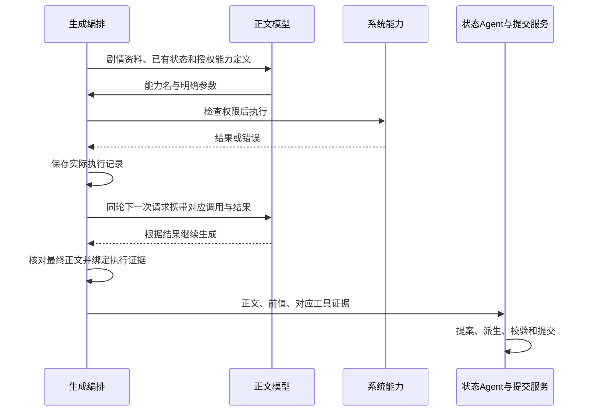

<!-- markdownlint-disable MD013 -->

# 原生角色使用系统能力的架构方案

本文供用户审定扩充范围、供实施者开发和验收。能力指系统能够完成的一类操作；模型工具是将能力提供给模型主动调用的入口。本文新增契约为已批准的实施目标，当前转换继续使用 Skill内置的已实现 API。

## 1. 必须要实现的目标

实施者按消费者和执行时点复用已有系统能力，给正文模型提供统一的随机采样与受限数值计算入口，并完成授权、同轮结果回传和状态证据接入。角色名称、变量、公式及业务规则来自源卡；系统能力保持通用。

转换 Agent首先识别内容由谁消费、参数何时确定、结果何时需要，然后选择前端 API、提示组装、状态派生或模型工具。主代理用实际请求核对各消费者取得的数据，再判断存在什么缺口。

## 2. 能力由哪些入口提供

本章规定能力与消费者的对应关系。源卡函数名仅用于定位行为，目标入口按本表选择。

| 能力及实际需求                         | 消费者和时点                                           | 目标入口                                                                                                    |
| -------------------------------------- | ------------------------------------------------------ | ----------------------------------------------------------------------------------------------------------- |
| 读取当前或历史楼层状态，用于显示和回看 | 角色前端，页面渲染或用户操作时                         | 复用 `api.variables.getSnapshot`、`api.history.listSnapshots` 等正式前端 API。历史选择只改变回看画面。      |
| 按已有状态选择本轮剧情规则             | 正文模型，生成开始前                                   | 复用提示组装和 `renderController(context)` 的 `variables` 输入；所需值和适用规则进入实际模型请求。          |
| 按确切条目选择世界书内容               | 提示控制器，组装开始时                                 | 复用 `characterBook.entries` 和既有世界书激活、注入流程。单次控制器只读取其当前书，跨书按正式配置分别处理。 |
| 根据剧情提出变量变化                   | 状态 Agent，正文保存后                                 | 复用固定前值、来源正文、规则和状态schema输入。                                                              |
| 根据已有输入计算派生值                 | 后端，提示组装时或状态提案应用后                       | 组装所需结果由提示控制器计算；保存所需结果由 `derive(context)` 计算。                                       |
| 从明确范围或候选中随机采样             | 前端表单、后端模块或正文模型，取决于参数和结果所在阶段 | 表单局部操作由前端执行；固定后台时点由后端执行；生成中才确定参数并需要结果时调用第3章的随机能力。           |
| 根据明确数值计算结果                   | 后端或正文模型，取决于结果是否参与随后剧情             | 已知输入的固定计算留在后端；生成中才确定操作数、结果决定随后剧情时调用第3章的计算能力。                     |

前端、正文模型和状态 Agent各有数据入口。前端取得一个楼层快照，只证明页面取得数据；正文所需数据必须出现在实际组装请求中。状态保存以正式当前分支前值为依据。

C011的状态分支、USER001/USER002的确切规则选择先按上述已有入口转换。输入缺失时，主代理沿状态取得、控制器选择、条目激活和请求组装定位原因；只有具体证据证明这些入口不足时，才提出对应扩充。

前端和后端 API依据分别为 `docs/character-authoring/script-api.md` 第5、9章，以及 `docs/character-authoring/backend-api.md` 第2、5、7、8章。只读源行为证据见 `.planning/native-card-maintenance/iteration-20/model-tool-source-evidence.json`。

## 3. 正文模型需要的两种系统能力

本章定义本轮开放给正文模型的入口。选择条件是：参数在正文生成中才确定，而且执行结果决定同轮后续剧情。

### 3.1 随机采样：`random`

系统以一个入口完成从指定分布中采样。骰子、候选抽取和区间随机数使用不同参数描述同一种能力。模型提交下表的四个必填字段；结构定义见[参数 schema 草案](model-tool-contract.schema.json)的 `randomArguments`。

| 参数           | 类型与合法取值                         | 作用                                                                    |
| -------------- | -------------------------------------- | ----------------------------------------------------------------------- |
| `domain`       | 下述 `integer_range` 或 `choices` 对象 | 定义可采样的总体。                                                      |
| `distribution` | 下述 `uniform` 或 `weighted` 对象      | 定义总体成员的抽取概率。                                                |
| `count`        | 正的安全整数，执行额度见第5章          | 指定返回样本数。                                                        |
| `replacement`  | 布尔值                                 | `true` 表示每次独立抽取；`false` 表示已抽中的总体成员退出本次后续抽取。 |

`domain` 使用以下一种格式：

- 整数区间：`{"kind":"integer_range","min":1,"max":6}`。`min`、`max` 必须为安全整数，满足 `min <= max`，闭区间成员数 `max - min + 1` 也必须为安全整数。
- 候选列表：`{"kind":"choices","values":["A","B","C"]}`。`values` 为非空 JSON 值列表；每个位置是独立候选，重复值保留为不同位置。候选内容只作为数据保存与返回。

`distribution` 使用以下一种格式：

- 均匀分布：`{"kind":"uniform"}`。区间中的每个整数、列表中的每个位置等概率。
- 加权分布：`{"kind":"weighted","weights":[0,3,1]}`。它只用于候选列表；权重与 `values` 等长，均为有限非负数，总和必须为正的有限数。系统以权重除以剩余权重总和计算概率，零权重候选不参加抽取。

无放回时，`count` 必须不超过区间成员数或列表可选位置数；加权列表只计正权重位置。每次抽取后移除该位置及其权重，再对剩余成员抽取。结果按实际抽取顺序返回；该顺序不保证排序。

两枚六面骰的参数和一次可能结果如下。真实样本由工具执行产生，例子中的点数仅用于说明格式。

```json
{
  "domain": { "kind": "integer_range", "min": 1, "max": 6 },
  "distribution": { "kind": "uniform" },
  "count": 2,
  "replacement": true
}
```

```json
{ "ok": true, "data": { "samples": [2, 5], "indices": null } }
```

候选列表使用同一个入口，例如将 `domain` 改为上述列表、`distribution` 改为上述权重、`count` 设为2、`replacement` 设为false。一次可能结果是 `{"ok":true,"data":{"samples":["B","C"],"indices":[1,2]}}`。

`samples` 长度等于 `count`。区间结果的 `indices` 固定为 `null`；列表结果的 `indices` 是与样本一一对应的原列表零基下标，`samples[i]` 等于 `values[indices[i]]`。无放回约束针对下标，所以列表 `["A","A"]` 可以返回两个相同值及两个不同下标。

骰子点数之和按第3.2节计算。实施者整合现有 `roll_dice` 和 `random_choice` 的采样实现，以 `random` 统一发布系统模型工具目录，并按变更清单迁移既有提示、工具权限和测试中的旧名称。

### 3.2 数值计算：`calculate`

系统以一个入口执行受限数值运算。模型提交唯一必填字段 `expression`；结构定义见参数 schema 草案的 `calculateArguments`。表达式是一个有限数值，或下表的运算对象。每个操作数 `args[i]` 可以是数值或嵌套的数值运算对象；数值比较仅作为最外层表达式。

| 运算对象                                       | 参数数量 | 返回含义                                       |
| ---------------------------------------------- | -------- | ---------------------------------------------- |
| `{"op":"add","args":[...]}`                    | 至少2个  | 从左到右相加。                                 |
| `{"op":"mul","args":[...]}`                    | 至少2个  | 从左到右相乘。                                 |
| `{"op":"min","args":[...]}`、`max`             | 至少2个  | 返回最小或最大数值。                           |
| `{"op":"sub","args":[a,b]}`                    | 恰好2个  | 返回 `a - b`。                                 |
| `{"op":"div","args":[a,b]}`                    | 恰好2个  | 返回 `a / b`，要求 `b != 0`。                  |
| `{"op":"floor","args":[a]}`                    | 恰好1个  | 向负无穷方向取整。                             |
| `{"op":"ceil","args":[a]}`                     | 恰好1个  | 向正无穷方向取整。                             |
| `{"op":"trunc","args":[a]}`                    | 恰好1个  | 向零方向取整。                                 |
| `{"op":"eq","args":[a,b]}`、`ne`               | 恰好2个  | 返回数值相等或不相等的布尔结果。               |
| `{"op":"lt","args":[a,b]}`、`lte`、`gt`、`gte` | 恰好2个  | 返回小于、小于等于、大于、大于等于的布尔结果。 |

运算采用 IEEE 754 binary64 数值语义。系统按 `args` 顺序先求出各操作数，再执行当前运算；每个中间结果必须有限。比较使用实际计算值，零的正负符号不影响相等判断，最终数值 `-0` 返回为0。除显式取整运算外，结果保留计算值。需要其他舍入方式时，转换 Agent依据源规则用上述运算表达；源规则缺失时按第3.3节记录。

正文模型依据已取得的剧情资料选择人物、对象、公式及具体操作数，再提交表达式。状态值通过第2章已有输入取得。计算的执行位置按第2章选择；公式固定而操作数在生成中才确定时，仍按本章条件调用。

例如，攻击为28、防御为10、伤害最低为0时：

```json
{
  "expression": { "op": "max", "args": [0, { "op": "sub", "args": [28, 10] }] }
}
```

```json
{ "ok": true, "data": { "type": "number", "value": 18 } }
```

随后检查血量12减伤害18是否归零：

```json
{
  "expression": { "op": "lte", "args": [{ "op": "sub", "args": [12, 18] }, 0] }
}
```

```json
{ "ok": true, "data": { "type": "boolean", "value": true } }
```

数值与布尔返回由 `data.type` 区分。表达式只含明确数值和规定的运算对象；角色名称、状态路径、公式字符串和 JavaScript 代码继续由对应资料或模块承载。

### 3.3 源卡验证能力划分

C023先由正文模型按场景确定主体等级，再抽等级差，取得结果后检查上下边界并决定是否抽方向。等级确定后，再按源规则确定评分及钱包区间。战斗中，模型先判断情境与目标，计算伤害及剩余血量，取得结果后续写死亡、反击或行动能力。

源规则要求“根据剧情程度”选择消耗值时，由正文模型判断程度，再做数值计算。C058开局表单随机成员留在前端；C087按日期派生天气等值留在后端。

C023未完整规定的评分精度、权重、舍入和重叠区间端点，转换 Agent记录源缺失并给出判断依据。系统执行明确参数，主代理分别验收运算正确及参数选择符合源语义。

### 3.4 参数校验、结果与错误

本节统一规定两项工具的调用与返回。正文模型只填写第3.1、3.2节的参数；调用ID、执行ID、账号、会话和生成身份由协议与服务提供。工具先核对权限，再检查参数结构、跨字段约束和执行额度，全部通过后执行。校验失败保持总体及状态原样。

schema 根对象 `invocation` 是契约测试使用的工具名与参数包装；模型填写的参数分别采用 `randomArguments` 或 `calculateArguments`。所有控制对象采用严格字段集合，字段均按 schema 的 `required` 提交。系统按原类型校验，缺少字段、额外字段、字符串代替数值等情况返回参数错误。结构校验失败统一返回 `INVALID_ARGUMENT`，包括负权重、字符串权重及空权重数组；结构通过后再检查权重长度和总和，对应 `INVALID_WEIGHTS`。候选 JSON 对象的键是候选数据，不受控制对象字段集合限制。候选 JSON 的对象及数组嵌套深度按第5章额度检查，根候选的容器深度为1。

工具返回 `{"ok":true,"data":...}` 或 `{"ok":false,"error":{"code":"...","message":"..."}}`。成功数据见第3.1、3.2节；错误码见下表。固定错误文案由第5章的系统配置文件保存，服务按错误码读取对应文案，使用固定参数名称和错误条件写明问题及可采取的动作；完整错误对象最多1024字节。例如 `{"ok":false,"error":{"code":"DIVISION_BY_ZERO","message":"除数为0，请修改expression中的除数。"}}`。

| 错误码                    | 条件及调用方动作                                                        |
| ------------------------- | ----------------------------------------------------------------------- |
| `INVALID_ARGUMENT`        | 参数结构、类型、字段、值域或运算参数数量错误；按该工具 schema 修正。    |
| `INVALID_RANGE`           | 区间顺序或成员数不满足第3.1节；修正边界。                               |
| `INVALID_WEIGHTS`         | 权重长度或总和不满足第3.1节；修正权重。                                 |
| `INSUFFICIENT_POPULATION` | 无放回数量超过可选成员数；减少数量或按源规则选择有放回。                |
| `LIMIT_EXCEEDED`          | 参数或结果超过第5章有效额度；减少输入规模，结果超额时重新提交较小调用。 |
| `DIVISION_BY_ZERO`        | 除数为0；修正表达式的除数。                                             |
| `NUMERIC_OVERFLOW`        | 中间运算得到非有限值；缩小操作数或按源规则拆解表达式。                  |
| `CAPABILITY_DENIED`       | 系统许可关闭或当前角色、槽位、会话授权不足；由管理员检查系统许可与发布配置。              |
| `EXECUTION_FAILED`        | 执行服务发生内部错误；保留调用记录并由管理员检查服务日志。              |

单次工具输入、结果及规模额度按本节错误返回；本轮调用和模型步骤耗尽按第4章结束生成。一次调用按一个终态返回；错误返回保持 `data` 缺省，成功返回保持 `error` 缺省。执行记录同时保存已有 `ToolCallResult` 的 `executionStatus`、`executionReasonCode` 和原参数。角色能力的协议适配器从同一记录构造上述模型结果，原生与文本协议均保留错误码；实施前原生路径只回传错误字符串；实施者按[正式契约](../../character-authoring/model-capabilities.md)回传完整模型结果。

实施者以 schema 草案生成工具定义和服务校验输入；`packages/core/src/tools/types.ts` 的参数类型及 `tool-executor.ts` 的 SDK 接入须完整承载 JSON Schema draft-07 的 `oneOf`、递归引用与严格字段约束。供应商无法接收该结构时，按第4章协议不匹配处理。

[契约例子](model-tool-contract.examples.json)供实施者和验收者读取，包含正常、异常及边界输入与预期结构结论。schema 检查只证明结构合法；区间顺序、权重总和、可选数量、执行额度及运算结果由执行器测试按本章规则验证。

## 4. 同轮调用、返回和状态保存

本章定义结果怎样回到消费者，并与最终正文关联。



普通角色的原生function calling已有SDK续步，可复用。实施前的普通文本协议在生成结束后执行工具并保存结果块；本次在编排器增加有界“执行、回传、续写”流程。后续参数依赖上一步结果时，正文模型收到该结果后才提出下一次调用。

| 消费者               | 获取方式                                                                                                     | 使用结果                                         |
| -------------------- | ------------------------------------------------------------------------------------------------------------ | ------------------------------------------------ |
| 同轮正文模型         | 编排器把已校验的结果送入同一生成尝试的下一次模型请求；原生传输用结构化工具消息，文本传输按调用ID关联结果消息 | 根据实际样本及计算结果续写。                     |
| 状态 Agent及派生模块 | 状态更新服务从最终正文关联的执行集合构建只读 `toolEvidence`                                                  | 按源规则判断哪些已发生事实和结果应成为状态。     |
| 验收调用方           | 通过已有 `GET /floors/:id/tool-executions`、`GET /tool-executions` 查询                                      | 核对参数、实际结果、终态和正文归属。             |
| 用户端               | 正式正文接口和已提交状态接口、事件                                                                           | 展示剧情正文和状态快照；工具消息单独保存为证据。 |

每次执行记录参数、结果、调用ID、运行、正文生成尝试、模型步骤和消息页。现有记录的 `attemptNo` 属于工具执行序号；正文生成尝试使用独立身份。

编排器为每个生成尝试记录实际回传给模型的执行ID。最终正文经当前配置允许提交后，编排器产生 `acceptedToolExecutionIds`：它包含该最终尝试中实际回传的成功及错误终态记录。正文提交服务核对归属并固定到正文页；其他尝试和未回传记录保留作审计。

启用正文校验组件 `Verifier` 时，`packages/core/src/orchestration/verifier.ts` 接收最终正文及剧情上下文，返回通过标志和问题列表；编排器沿用已配置的接受、提示或重试策略。正文处理和校验针对完成结果消费后的最终正文。

状态更新服务按上述集合提供 `toolEvidence`，提案通过 `evidenceExecutionIds` 引用具体执行记录。成功结果可作为数值依据，错误说明对应操作未完成。正文模型和状态 Agent仍需判断行动实际发生：计算一次伤害或抽出钱包值本身只产生执行结果。状态阶段读取原随机结果。

供应商续步传输重试使用已取得的工具往返记录；源规则明确要求重新抽样时发起新执行。生成被否决时，新的尝试另记结果；状态输入限定到最终正文的集合。

工具错误同样返回正文模型。步数或调用额度耗尽、缺少最终正文及最后一步仍为未完成调用时，服务记录生成失败及原始结果。模型配置不满足所选协议时，返回“当前正文模型不满足工具协议，请选择支持的模型或配置文本工具协议”。

## 5. 正式配置和执行边界

本章规定系统能力由谁启用、授权到什么范围。

包沿用 `1.0.0` 既有目录、人物提示、世界书、提示控制器和状态配置。调用条件与业务公式写在现有提示或规则中；系统提供工具定义和实现。本方案的启用、传输及额度放在正式发布和试聊配置中。

正式发布、发布试聊及原生卡直接试聊共用能力配置。新增配置字段 `model_capabilities`，固定 `enabled`、授权能力列表 `allowed`、正文槽位、传输协议和额度；`allowed` 只引用系统的 `random`、`calculate` 定义。会话创建时固定快照，正式发送服务据此构建能力目录，前端继续提交消息文本。

服务端只给正式角色加载固定系统提供者中的 `random` 和 `calculate`，再按授予范围筛选。现有混合目录按首次同名匹配定位提供者，因此单独的名字白名单不足以确认实现来源；角色能力目录固定系统模块来源，并由目录与执行服务共用。

模型参数为运算数据。两项能力只进行采样和数值计算，持久化仅写入本次执行证据；账号、会话、分支及运行身份由服务器提供。状态写入使用第4章的状态链路。

服务端配置定义初始上限：每轮最多16次工具调用、8次模型步骤；单次随机调用最多32个样本、1024项候选；单次计算的表达式最多256个节点、深度32，数值叶子及运算对象各计1节点，根表达式深度为1；单个候选JSON容器最多嵌套32层；每次调用的参数及模型结果按下述计量规则各最多64KiB。输入计量对象是模型填写的完整 `arguments` 对象；结果计量对象是完整的成功或错误模型结果对象。服务统一使用 `Buffer.byteLength(JSON.stringify(value), "utf8")` 计量，序列化使用JavaScript标准规则和对象现有键序，按最短数值表示及标准JSON字符串转义输出。工具名、调用身份及原生协议或XML消息包装由协议承载，不计入本项额度。有效结果额度至少1024字节，以容纳第3.4节的错误对象；各上限及该下限统一保存于下表的系统配置文件。发布授权只能收紧这些限制，客户端请求只能进一步收紧；管理员撤销能力在下一次执行检查生效。

| 契约或配置                       | 唯一来源及读取方                                                                                                                          |
| -------------------------------- | ----------------------------------------------------------------------------------------------------------------------------------------- |
| 采样和计算的输入、结果及额度结构 | 新增 `packages/shared/src/schemas/role-model-capabilities.schema.json`；提供者、工具目录和正式接口共同读取。                              |
| 授权和传输快照                   | 现有 `packages/shared/src/schemas/role-release.ts`、`native-card-api.ts` 引用同一能力配置schema；发布、原生试聊、会话创建及运行服务读取。 |
| 实际额度、系统启用许可及错误文案 | 新增 `apps/api/config/role-model-capabilities.json`，由 `apps/api/src/config.ts` 加载；有效权限和执行服务读取。                           |
| 正文执行关联、状态输入和提案证据 | 新增 `packages/shared/src/schemas/role-tool-evidence.schema.json`，由现有 `role-state.ts` 引用；编排、正文提交、状态更新及提案验证读取。  |
| 证据持久化                       | 现有 `apps/api/src/db/schema.ts` 及迁移，复用执行记录并增加正文生成归属及页面关联。                                                       |

## 6. 实施步骤和产物

本章供获批后的主代理按依赖顺序开发；转换 Agent只使用已发布的契约。

| 步骤 | 主代理的动作                                             | 产物及完成条件                                                                                                 |
| ---- | -------------------------------------------------------- | -------------------------------------------------------------------------------------------------------------- |
| 1    | 按第3章审定参数、结果及错误契约，列出旧随机工具名称引用  | 参数schema、跨字段规则、契约例子及明确迁移清单齐备；完整schema可由工具目录和协议使用。                         |
| 2    | 整合采样实现、实现受限计算，构建固定来源的角色能力目录   | 按第3章及契约例子完成结构、跨字段、分布、运算、来源和规模测试；两项能力通过。                                  |
| 3    | 接入正式发布、两类试聊及会话固定配置                     | 目录和实际执行使用同一授予快照，前端发送取得适用能力。                                                         |
| 4    | 接入普通文本协议续步、最终正文执行关联和状态证据         | 实际下一次模型请求携带结果，状态更新取得同一最终尝试的证据。                                                   |
| 5    | 同步正式API、迁移旧名称引用、同步完整Skill内置副本和例子 | 资料与实现一致，独立审阅及适用项目检查通过。                                                                   |
| 6    | 按原维护计划派发干净上下文子代理复测                     | C023验证两项模型能力；C011、USER001/USER002验证已有输入链路；C058/C087验证职责；正式导入、回读和核心结果齐备。 |

转换 Agent按第1、2章的判断程序，使用当前可访问API创建原生文件并验收。

## 7. 验收清单

主代理保存请求、响应、执行结果、模型续步输入、最终正文、状态提案及逐项语义结论。

- [ ] 随机目录只有统一的 `random` 入口，骰子、区间及候选行为均由参数表达；迁移清单中的旧名称引用已明确处理。
- [ ] 第3章契约由同一schema承载；完整工具定义通过原生与文本协议，严格类型、字段集合、必填项及运算参数数量按契约例子检查。
- [ ] 采样区间、分布、数量及无放回约束正确；重复候选按原下标处理，零权重不被抽取，样本与下标一一对应。
- [ ] 计算按第3.2节的顺序、数值及比较语义返回；负数取整、嵌套运算、除零和中间溢出均有正常或错误结果。
- [ ] 单次工具输入、结果及规模额度恰好达到上限时通过，超过上限时返回错误；字节额度按第5章同一函数验证参数和完整结果对象；参数及随机成功结果在初始配置下分别验证65536与65537字节，错误对象验证1024字节上限；schema通过但跨字段失败的输入得到第3.4节规定的错误码，模型在两种协议中都取得相同结构。
- [ ] 状态及世界书通过已有前端和请求组装入口供各消费者读取；C011及USER001/USER002的实际模型请求包含所需值及规则。
- [ ] 同名外部脚本或MCP工具无法成为正式角色的能力实现；直接越权请求按有效权限拒绝。
- [ ] 正式发布、原生卡试聊和发布试聊获得同一能力配置契约；现有ZIP按原格式导入和回读。
- [ ] 原生及文本传输均将实际结果放入同轮下一次模型请求；最终正文根据结果继续生成。
- [ ] C023先取得所需采样和运算结果，再描写其决定的后果；对象、公式及参数选择由主代理阅读判断。
- [ ] 重试记录各自可追溯；状态输入只取最终正文的执行集合，随机结果在状态阶段保持一致。
- [ ] 工具执行结果与剧情事实分别判断，状态变化仍通过提案、派生、校验和提交。
- [ ] C058表单操作在前端完成并进入实际玩家消息；C087同日期派生结果符合源规则；固定后端计算继续使用既有入口。
- [ ] 不支持协议、工具失败和额度耗尽有明确终态和操作建议。
- [ ] Skill黑盒复测、受影响卡回归、独立语义审阅、适用项目检查及code-review通过，精确选择文件提交。

## 8. 非本次目标

包内自定义工具、包格式升级、状态或世界书读取模型工具、角色专用骰子/战斗/路人工具、通用规则或脚本执行器属于本次范围之外。C083独立手机会话和C091原子恢复维持用户决定的跳过范围。

本方案使用现有依赖。出现新依赖需求时，主代理另行提交准确版本、用途和安全审计意见。本次实施进度保存于 `.planning/system-model-capabilities/`；转换 Skill 的完整卡迭代由原维护会话负责。

## 9. 已获得的授权

用户已授权现有源卡和能力调研、独立架构审查、方案改写及Skill语义经验维护，并明确要求按通用能力设计。用户随后批准本方案实施，要求独立worktree和会话完成开发、验收、创建PR并合入main；当前会话在合入后继续Skill迭代。

已批准范围是统一随机采样、受限数值计算、正式能力配置及固定来源目录、普通角色同轮回传、最终正文执行关联和状态证据入口；按第7章验收。包和角色业务规则按第2章复用现有入口。
