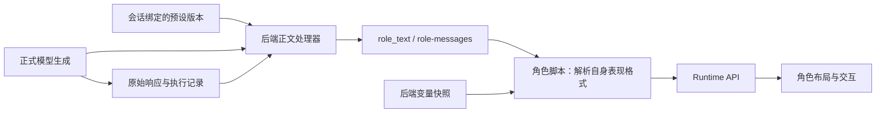
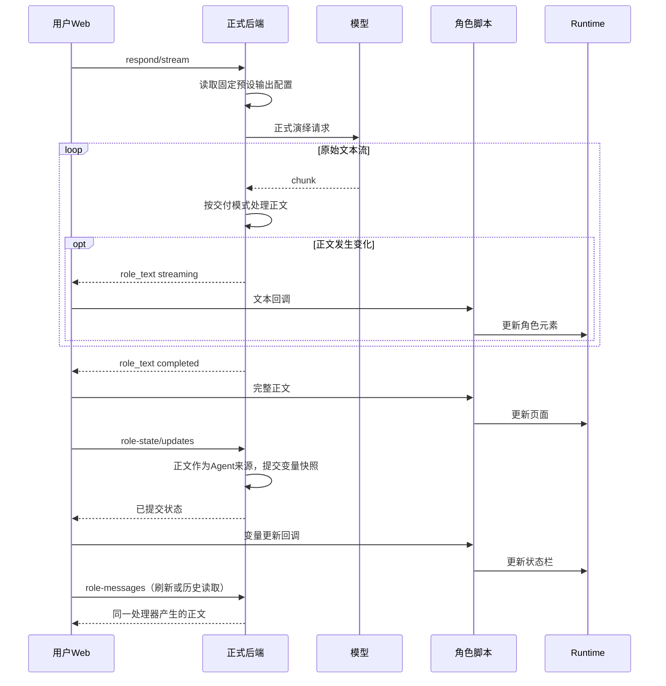

# 正文交付与角色渲染职责实施

## 必须要实现的目标

后端、角色脚本与 Runtime 的职责以[实施计划开头](role-app-dual-web-plan.md#首要职责边界后端角色卡与-runtime)为准。本次将用户端统一执行显示正则的临时接线替换为后端正文交付。

## 实现与接口

`apps/api/src/routes/schemas/preset-output.ts` 定义配置、正文事件及消息读取的 schema；`apps/api/src/services/preset-output.ts` 实现正文处理器。处理器读取会话固定预设版本的 `extensions.tavern_headless.outputProcessing`；预设未配置输出处理时，正文按原文逐块交付。

```json
{
  "version": 1,
  "delivery": "complete",
  "rules": [
    {"sourceRuleId": "原预设规则ID", "pattern": "待匹配的表达式", "flags": "g", "replacement": "替换文本"}
  ]
}
```

配置中的规则按数组顺序执行。`delivery: complete` 明确要求等待生成完成，再执行依赖整段响应的规则；此模式的流式阶段向角色提供空正文。当前天琴座预设使用这一模式，因为其原清理规则以最后的正文标记为边界，尚未完成的响应无法可靠区分格式示例和最终正文。Runtime 继续支持逐块文本回调，适用于未配置整段处理的预设。

| 接口或模块 | 实现行为 |
| --- | --- |
| 正式 `/sessions/:id/respond/stream` | 保留已有 `chunk` 和 `done` 契约，新增 `role_text` 事件，字段为 `text`、`phase: streaming / completed`。后端在正文变化时发送完整正文快照，在生成完成时发送最终正文。 |
| `GET /sessions/:id/role-messages?floor_id=…` | 校验账号、会话及楼层归属，读取活动页中可见消息，按页号和消息顺序返回 `id`、`role`、`content`、`source`。角色消息的 `content` 使用同一正文处理器；用户消息保持原文。 |
| `formal-transport.prototype.js` | 将 `role_text` 转发到 Runtime 文本回调，通过 `role-messages` 读取历史。原始 `chunk`、`done.generated_text` 留在正式生成协议中，适配层只将正文事件与正文读取接口的结果交给角色。 |
| `role-view.mjs` 的变量更新入口 | 使用相同处理器生成 Agent 的来源正文，保留原消息 ID 和修订号。 |
| 角色脚本与 Runtime | 顾声慢脚本继续解析自己的表现标签并调用 Runtime；林茜脚本继续读取变量快照更新状态栏。布局、立绘、媒体、选项与状态渲染由这两层完成。 |

原始消息与生成结果保持原样，管理端原有记录接口继续提供原始响应。本次增加的是正文读取和交付处理。





## 迁移及正式实施工作

`apps/web/prototypes/checks/preset-output-migration.mjs` 根据同目录 JSON 配置提取原预设清理规则，保存来源 ID。`migrate-published-output.mjs` 通过已有预设编辑和发布接口创建新预设版本及两个新发布版本；原发布及其会话保持固定绑定。隔离服务首次导入时执行同一迁移函数。

后端负责人必须将新增正文接口、SSE 事件和配置 schema 纳入正式 API 文档及发布配置验证。管理端负责人必须在预设编辑页提供输出处理配置，展示流式或完成后交付的行为，并使用后端处理器预览结果。当前迁移通过已有预设编辑接口保存扩展配置，专用编辑表单尚待正式实施。

## 验收清单

- 已通过：后端正文处理、非法配置、规则顺序、原文逐块交付、整段模式的分块边界，以及楼层归属校验测试；关联测试共 24 项。
- 已通过：前端适配测试确认角色文本回调消费正文事件，历史读取走正文接口。
- 已通过：顾声慢新发布版本的真实模型生成了 12 段正文。变量更新首次失败，同楼层重试后成功提交；证据保留首次失败与最终快照，见 [实际演绎记录](evidence/published-backend/preset-output-live.json)。
- 已通过：正文完成事件与历史正文接口返回内容一致；用户端通过正文接口读取消息，请求记录中没有正则资源读取。
- 已通过：浏览器中翻页从第 1 段切到第 2 段，状态面板展示已提交变量，Skip 到第 12 段后展示三个行动选项。本轮只验证选项展示，选项提交沿用现有逻辑。
- 验收范围：本轮真实模型与浏览器交互验收使用顾声慢；林茜已发布相同预设输出配置，本轮尚未重新生成林茜后续轮次。

## 非本次目标

角色剧情、变量业务规则和既有历史响应保持原样。纯显示文本替换的可选配置与管理端专用编辑表单属于后续正式实施。

## 已获得的授权

用户要求按计划开头的职责规范重新实现，并实际验证原型。此次改动复用正式生成接口和资源发布接口，补充后端原本缺少的正文交付能力。
