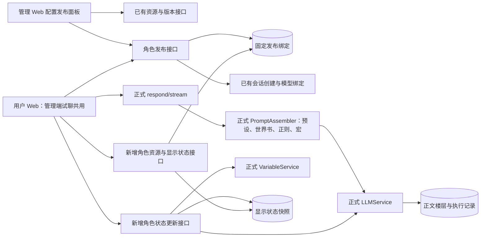
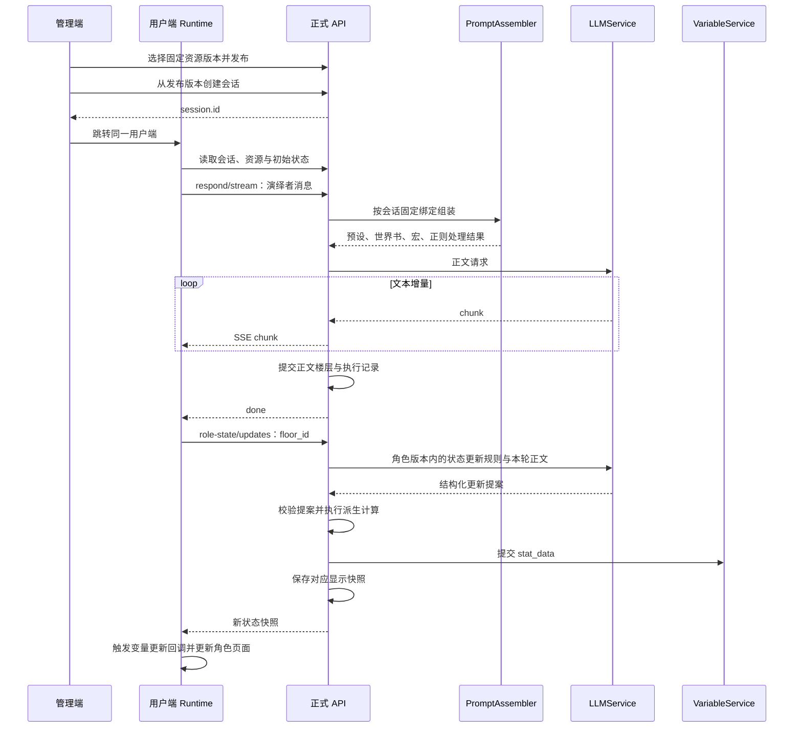

# 角色发布与正式后端重新接线

## 必须要实现的目标

本次开发将用户 Web 的资源读取、开场选择、会话创建、正文生成和变量读取接入 `apps/api`。管理端配置面板通过已有资源接口选择固定版本，再发布角色。发布记录保存角色、预设、正则、外部世界书、人设及模型槽位绑定；内嵌世界书、模板、脚本、开场和状态更新规则属于角色版本快照。

隔离服务入口为 `apps/web/prototypes/checks/serve-published-prototype.mjs`，配置为同目录的 `published-prototype.config.json`，结构由 `published-prototype.config.schema.json` 校验。该服务启动正式 `buildApp`，使用独立 SQLite 数据库，并注册本次补充的路由。导入阶段读取本地角色文件，通过正式资源接口保存；运行中的会话读取固定的后端版本。

## 接口与模块

| 功能 | 使用的接口或模块 | 本次工作 |
| --- | --- | --- |
| 角色、人设、预设、正则、世界书、模型配置 | `/characters`、`/users`、`/presets`、`/regex-profiles`、`/worldbooks`、`/llm-profiles` 及版本接口 | 前端读取已有接口；管理端配置发布面板选择资源版本 |
| 发布与开始演绎 | `/role-releases`、`/role-releases/:id/sessions` | 新增不可变发布记录；服务端复用 `/sessions`、Profile activate 和开场页 activate |
| 正则编辑预览 | `/regex-profiles/preview` | 新增无写入预览接口，复用正式正则执行模块及变量替换器 |
| 正文生成 | `/sessions/:id/respond/stream` | 复用正式 SSE、PromptAssembler、执行记录和楼层提交 |
| 对话与执行记录 | `/floors`、`/pages`、`/messages`、`/floors/:id/run` | Runtime 适配层读取真实记录及执行 ID |
| 角色页面资源 | `/role-assets/:versionId/*` | 新增与角色版本绑定的资源存储和读取 |
| 页面状态与历史状态 | `/sessions/:id/role-view` 及 `floors/:floorId`、`snapshots/:snapshotId` | 新增显示状态快照接口 |
| MVU 转换后的状态更新 | `/sessions/:id/role-state/updates` | 新增转换执行接口，复用正式 Profile、LLMService、VariableService；状态规则来自固定角色版本 |
| 宏和动态世界书 | `services/st-macros`、`role-opening-greetings.ts`、`role-prompt-controller.ts` | 复用宏引擎，补数组项读取、开场展开及角色控制器入口 |

发布记录的 `model_slots[].profile_snapshot` 固定模型名称、提供商、模型 ID 和地址，`params` 固定生成参数。正式会话绑定保存这份快照，运行时通过原 Profile ID 读取服务端凭证，因此轮换密钥仍会生效。缺少模型快照的旧发布须在管理端重新发布后才能创建会话。

`formal-transport.prototype.js` 负责将正式接口返回值转换为 Runtime API 的对象。它读取后端执行记录中的 `run_id` 和 `attempt_no`，生成同一执行的引用。前端文本回调只更新页面；变量提交由服务端执行。

状态更新失败时，Runtime 保留已提交正文并显示重试更新入口。重试请求只调用状态更新接口。服务端阻止上一轮状态未提交时继续生成；初始状态、已提交快照和重复更新请求均有一致的身份检查。进程内数据库失败会补偿变量写入；进程在变量写入和显示快照写入之间退出的恢复机制仍需正式实施。

## 验收清单

- [x] 发布绑定通过已有资源接口校验，并经数据库重开后读回。
- [x] 浏览器选择角色、人设、备用开场后创建真实会话。
- [x] 管理端配置面板实际发布，并跳转同一用户端开始试聊。
- [x] 正式 dry-run 返回正确预设轨道、世界书命中和宏展开结果。
- [x] 回归覆盖预设编辑保存保留轨道成员及启用状态。
- [x] 回归覆盖资源读取、账号归属、重复保存与错误请求。
- [x] 回归覆盖变量提案错误、更新顺序、幂等、并发和失败后不提交变量。
- [x] 真实模型完成正文；浏览器重试完成变量更新，历史状态读取与页面刷新恢复通过。
- [ ] 全部管理端页面改为正式接口并逐页验收。

真实模型验收记录写入本目录的 `evidence/published-backend/`。勾选项以实际测试结果为准。

正式后端已提交会话 `BZ9LzNQvC9xe6XWiFN17v` 的正文，并通过 SSE 返回生成结果。联调修正了消息分页超过接口上限、变量更新请求未绑定结构化输出 schema 两处接线错误。随后在浏览器点击“重试变量更新”，后端提交快照 `07b2aac1-6026-479f-8065-752d9004c8ef`；角色页面的地点和时间随快照更新，刷新后仍显示相同状态。`state-retry.json` 保存接口读取证据，`live-check-before-fix.json` 保留修正前的失败记录。修正后的另一新会话仍遇到上游流超时，记录在 `live-check.json`；当前免费模型的连续成功率尚未通过验收。这次验收覆盖技术链路；正文仍有脱离演绎的说明与重复段落，演绎质量尚未通过验收。

## 正式实施仍需完成的工作

开发者须将新增发布、资源和显示快照表纳入项目的正式迁移入口，将扩展路由纳入标准启动注册、OpenAPI、SDK 和权限配置。当前独立服务注册这些扩展；正式正文执行仍由原有 API 完成。

开发者须将角色状态更新执行纳入系统 Agent 执行记录，补充跨进程恢复、多次后续 Agent 更新与终止状态。当前扩展支持一次提案请求及角色派生计算，相关单测不能替代多次 Agent 更新的联调验收。

管理 Web 的 `source=backend` 模式使用 `formal-admin-workspace.prototype.js` 读取 `/sessions` 和“接口与模块”表中的资源接口；该模式仅加载正式工作区脚本。管理端“演绎记录”和用户端“我的演绎”均通过 `/sessions` 读取已有会话。管理端的“继续演绎”使用所选会话 ID 打开用户 Web 中对应的会话页面；正文发送和重新生成由用户 Web 完成。资源字段编辑、变量与记忆调试、工具、MCP、Agent 配置的正式接线纳入本次工作，前端开发者须保留这些页面已有的字段编辑、新建、保存、删除及调试操作，并逐页验证保存请求成功、刷新后读取到保存值。

生成详情由 `formal-generation-details.prototype.js` 读取 `/floors`、`/floors/:id/run`、`/floors/:id/result`、`/pages` 和 `/messages`，显示选中轮次的真实执行和消息记录。提示词预览独立调用 `/sessions/:id/respond/dry-run`。前端仅展示服务端已记录的阶段数据。后端开发者须将后续 Agent 的请求、响应、变量提交结果和失败原因纳入前文要求的系统 Agent 执行记录，并通过真实多次更新请求验证各阶段记录可读取。

开发者须把 Chat Completions／Responses 选择纳入正式模型配置。本次隔离服务以 `llmProfileApiMode` 指定 OpenAI-compatible Profile 的 API 类型，标准服务原有缺省行为保持不变。

## 正则预览接口

管理 Web 将编辑中的规则发送至 `POST /regex-profiles/preview`。请求包含 `text`、`scripts`、`placement`（1 用户输入、2 AI 输出）、`channel`（persist、prompt、display、edit），以及可选 `depth` 和 `variables`。请求与响应结构统一定义于 `apps/api/src/routes/schemas/regex-preview.ts`。接口返回处理后的 `text`、候选规则、命中规则和跳过原因；执行顺序与提交的规则顺序一致。

`apps/api/src/routes/regex-preview.ts` 调用正式 `executeRegexScriptsWithTrace` 和 `buildRegexSubstitutionContext`，预览请求仅计算结果。该接口是本次新增能力；后端开发者须在正式实施时将其纳入标准路由注册、OpenAPI 和 SDK，并运行通道、深度、停用规则、无效表达式及规则顺序的回归测试，全部通过后完成接口验收。

## 非本次目标

本次接线不包含新游戏指令系统、公开角色上传平台、角色脚本沙箱或自动修改原卡剧情规则。原型旧服务和用户已有会话保留；新服务使用独立数据库。

## 已获得的授权

用户已授权在独立 worktree 修改原型、复用现有后端接口、为后端缺失功能增加小接口、更新实施文档，并使用已配置的 OpenRouter 免费模型进行隔离联调。

## 正则来源与迁移实施

正则来源 schema、逐条迁移决定、当前接口验证和正式实施缺口统一见 [演绎正则迁移审查](regex-migration-review.md)。正式实施必须完成该文档“正式实施工作”中的发布编译、角色与预设规则编辑联动，以及用户端 display 通道验收。

## 独立世界书绑定

角色导入、已有数据迁移与控制器读取独立世界书的修复已完成，详见 [独立世界书绑定修复](bound-worldbook-migration.md)。正式实施必须保留该文档验收清单中的提示词等价性与资源版本绑定检查。

## MVU 职责迁移

迁移脚本必须按 [MVU 到变量 Agent 的迁移](mvu-agent-migration.md) 分离正文指令和变量更新规则。该文档记录原条目归属、Agent 输出协议修正及真实演绎验收结果。
