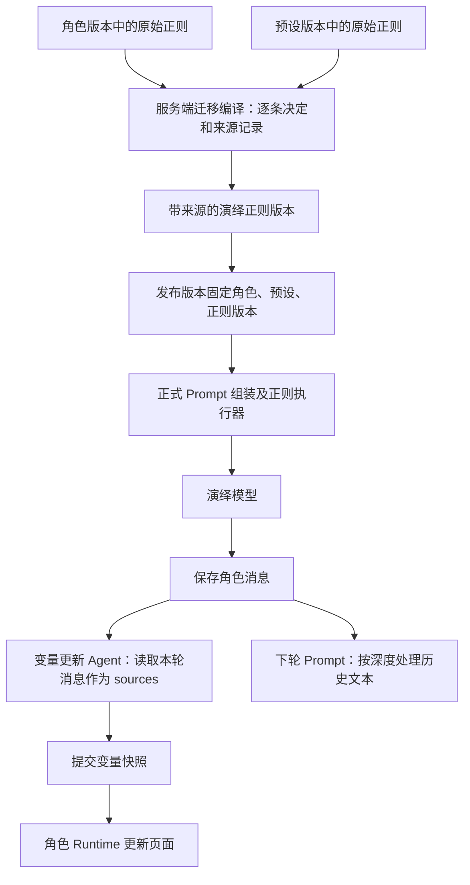

# 演绎正则迁移审查

## 必须要实现的目标

本次迁移针对林茜、顾声慢及其绑定的夏瑾天琴座预设。迁移代码必须保留每条规则的所属资源、原始规则 ID 和原顺序；管理端必须显示来源；发布版本必须固定本次选定的执行规则。原角色卡和预设保存原始规则，新执行配置按本章之后的审查表移除已被 Runtime 替代的规则。

## 执行链与数据归属

目前后端会话只绑定一个 `regex_profile_id`。迁移编译产出一个演绎正则配置，编译器保持角色规则在前、预设规则在后的来源顺序；本次两张角色卡的旧 MVU 规则全部移除，最终保留预设中的 10 条规则及其原顺序。每条保留规则的 `source` 字段记录来源，配置名称使用“角色名称 · 演绎正则”。这份配置是执行集合，预设规则的归属仍是预设。

演绎模型使用正式 Prompt 组装器。变量更新 Agent 在 `apps/api/src/routes/role-view.mjs` 中通过 `/pages` 和 `/messages` 读取本轮已保存的消息，以 `sources` 传入单独请求。该请求没有再次执行演绎正则，也没有套用演绎预设的历史裁剪规则。因此，`promptOnly` 清理历史文本与 Agent 获取本轮证据是两个不同环节。

## 逐条处理

下列序号为原始数组中从 1 开始的顺序。保留项维持原启用状态，其中预设“底部正则”原本停用，迁移后仍停用。

### 角色卡旧 MVU 正则

林茜和顾声慢各 8 条原正则均从新发布的执行配置移除。状态栏、背景和选项布局由 Runtime 处理；正文请求已停用 MVU 更新指令，变量 Agent 独立返回结构化结果。因此，新版本也移除 Analysis 清理、更新块裁剪、占位符清理以及仅用于 MVU 块的正文修复规则。

完整逐条 ID 和迁移原因仍保存在 `apps/web/prototypes/checks/regex-migration.json`。旧发布版本保留原规则。迁移步骤与真实演绎验收见 [MVU 到变量 Agent 的迁移](mvu-agent-migration.md)。

### 夏瑾天琴座预设

| 顺序 | 规则 | 处理 | 依据 |
| --- | --- | --- | --- |
| 1 | 【云瑾】包裹最新指示 | 保留 | 预设要求的近期用户输入包装。 |
| 2 | 【云瑾】移除额外tag_1.5 | 保留 | 预设输出标签的 display/prompt 清理。 |
| 3 | 【云瑾】八股抹除 - 4.24 | 保留 | 用户选定预设的文本处理。 |
| 4 | 【云瑾】切除10楼以内小总结 | 保留 | 近期提示词保留正文、移除总结。 |
| 5 | 【云瑾】切除10楼以上正文&仅保留小总结 | 保留 | 远期提示词裁剪，保持原深度 10 边界。 |
| 6 | 【夏瑾】底部正则 | 保留且停用 | 保留预设原停用设置。 |
| 7 | 【夏瑾】语气正则 | 保留 | 预设的 display/prompt 文本处理。 |
| 8 | 【夏瑾】破折号处理 | 保留 | 预设的 display/prompt 标点处理。 |
| 9 | 【夏瑾】比喻正则 | 保留 | 预设的 display/prompt 文本处理。 |
| 10 | 【夏瑾】行动选项2 | 保留 | 清理旧 SUOT 文本，不生成 UI。 |
| 11 | 【夏瑾】行动选项1 | 移除 | 生成旧 HTML 选项页面，页面交互已经由角色 Runtime 承担。 |

## API 与代码改动

`packages/adapters-sillytavern/src/schemas/regex-source.ts` 定义可选 `source` 结构：`kind` 为 character/preset，`name` 为来源名称，`ruleId` 为原规则 ID，`index` 为原数组零基序号，`resourceId`、`versionId` 为可选的来源资源和版本 ID。正式后端解析器保存这项信息，既有导入、更新、版本读取接口继续使用原路径。

`apps/web/prototypes/checks/regex-migration.json` 保存逐条决策，`apps/web/prototypes/checks/regex-migration.mjs` 编译执行数组。`apps/web/prototypes/checks/serve-published-prototype.mjs` 与 `apps/web/prototypes/checks/bound-prompt.mjs` 共用该编译器。编译器将 ST 的 null 深度转换为后端约定的 -1；此前删除 null 字段会使后端补成 0，导致有最小深度而无上限的规则无法执行。

`apps/web/prototypes/checks/migrate-published-regex.mjs` 从正式发布接口读取角色快照，从预设版本接口读取绑定的预设快照，再通过正则 PUT 和发布 POST 保存新版本。该脚本保留历史版本及旧会话绑定。

## 验收清单

- 已通过：解析器 10 项测试，包含来源保留和无效来源拒绝。
- 已通过：迁移检查覆盖所有规则的决策、来源、顺序、移除、停用状态、无限深度、未知规则、重复规则和空来源。
- 已通过：管理端来源文案及原有控制器检查。
- 历史检查已通过：第一阶段发布版本的正式正则 preview 和 Prompt dry-run 验证了原有裁剪边界。完成 MVU 职责迁移后的新版本验收以所链接的迁移文档为准。
- 已通过：相关 ESLint 和加载入口语法检查。
- 未完成：浏览器视觉复查，计算机使用服务启动失败。本次没有新增模型生成请求，不能将 dry-run 等同于完整演绎质量验收。

正式实施工作还必须通过以下可观察验收：

- 发布编译：从两个来源版本编译，响应逐条列出来源及顺序，新会话读取同一执行版本。
- 切换预设：管理端选择另一预设后重新编译，发布检查中仅包含新预设规则与选定角色规则。
- 显示接入：在真实用户页面输入含目标标记的文本，系统聊天与角色容器都展示约定的处理结果，正文、选项和状态可正常操作。

接口结果保存在 `docs/plans/evidence/published-backend/regex-migration.json` 和 `regex-migration-check.json`。临时检查会话均已删除。

## 正式实施工作

后端开发者必须将本次可选来源 schema 纳入正式 API 文档和导出测试，并实现发布时从选定角色、预设版本编译规则的入口。该入口必须使用保存的逐条迁移决策，返回可审查的执行顺序；目前原型通过迁移脚本调用既有接口完成此步骤。

管理端开发者必须让角色与预设编辑器分别维护所属规则，在发布前展示编译后的规则来源和顺序。切换预设后必须重新编译，并使用重新编译的配置发布。本次已交付正则编辑器逐条来源展示，尚未交付这两个所属资源编辑器与发布编译的自动联动。

用户端开发者必须按 `docs/character-authoring/script-api.md` 验收 display 正则与角色自定义正文渲染的衔接；本次 preview 检查验证后端显示通道的规则结果，没有证明浏览器全部自定义容器已经接入该结果。

## 非本次目标

本次不重写模型预设、不修改角色原始剧情、不重新定义 Agent 更新规则，也不替换既有正则执行引擎。

## 已获得的授权

用户要求逐条迁移审查、移除被 Runtime 替代的执行规则、保留预设来源和执行顺序，并修正原型与实施计划。本次在既有隔离服务中通过正式接口保存和发布配置。
