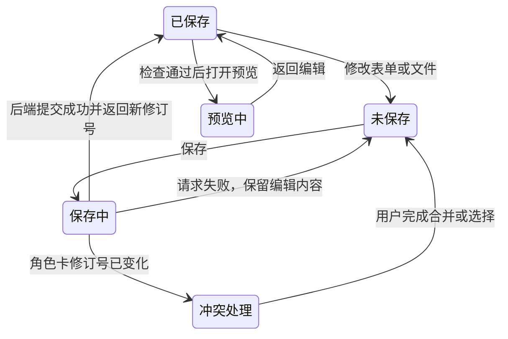

# 角色卡编辑器方案

状态：用户于 2026-09-28 批准原型及 ZIP 导入交互，授权正式实施。正式编辑器已接通 SDK、API 和持久存储，视觉与交互已对照批准基线；逐项结果见[正式验收记录](native-card-production-acceptance.md)。本阶段属于 P5。

正式管理端接入的代码核对、逐项补齐任务和联调验收见 [原生 ZIP 角色包与正式管理端联调计划](native-card-production-integration.md)。该清单作为本方案的实施与交付验收依据。

## 目录

- [1. 必须要实现的目标](#目标)
- [2. 入口与页面布局](#页面)
- [3. 编辑面板与文件对应](#面板)
- [4. 文件操作与保存交互](#保存)
- [5. 预览、检查、发布与导出](#预览)
- [6. 编辑器 API 与数据约束](#接口)
- [7. 实施步骤与产物](#步骤)
- [8. 验收清单](#验收)
- [9. 非本次目标](#范围)
- [10. 已获得的授权](#授权)

## 1. 必须要实现的目标

前后端负责人使用本系统 ZIP 角色包格式统一管理角色卡，新编辑器替换原管理端的角色卡编辑功能。用户可以从空白创建角色、导入 ZIP、继续编辑角色卡，或者从已发布版本建立新角色卡。每个编辑页面固定对应一张角色卡，并显示当前修订及来源版本。

编辑器同时提供领域表单和文件编辑：人物、世界书、开场、变量、Agent 等由专用面板编辑；JSON、文本、HTML、CSS、JavaScript 由文件编辑区编辑；图片和音频提供预览与替换。用户可以增加文件、目录和新的世界书条目，完成整张角色卡的制作、运行检查和导出。

独立转换器将旧单文件及酒馆卡转换为原生包，用户通过本编辑器导入生成的包。包的资源定位与目录规则见 [ZIP 角色包方案第 2 章](native-card-package.md#包结构)，现有单文件的字段继承见[第 3 章](native-card-package.md#迁移)，导入导出规则见[第 6 章](native-card-package.md#生命周期)。

## 2. 入口与页面布局

管理端入口替换、用户端版本关联及统一文案以[角色卡编辑入口统一](character-card-unified-entry.md)为准。该纠正保留管理端其他功能。

| 入口 | 用户动作 | 打开的结果 |
| --- | --- | --- |
| 角色目录“新建角色卡” | 填写名称并创建 | 后端按共享 schema 创建角色卡及其必需文件，打开人物面板 |
| 角色目录“导入 ZIP” | 选择 ZIP、检查资源清单并确认导入 | 后端确认提交后打开角色卡；失败显示文件和修正操作 |
| 角色详情“编辑角色卡” | 选择已有角色卡 | 恢复该角色卡文件清单与保存状态 |
| 发布版本“基于此版本编辑” | 创建新角色卡 | 复制所选版本配置和资源，页面显示来源版本 |

页面分为三个区域：顶部显示角色名称、角色卡身份、保存状态以及检查、预览、发布、导出操作；左侧提供领域导航和文件树；中央提供当前表单或文件编辑区。校验问题集中在顶部“检查”打开的结果窗口。具体尺寸、颜色、字体、折叠及窄屏布局以第 7 章记录的获批原型为像素验收基线。

用户从世界书列表选择一条条目时，中央显示正文与触发条件；选择“查看文件”后，文件树定位对应 JSON，并打开同一数据的文件视图。错误列表可以跳到具体文件与字段；文本解析错误可以跳到行列位置。

## 3. 编辑面板与文件对应

| 面板 | 可编辑内容与操作 | 保存位置 |
| --- | --- | --- |
| 人物资料 | 名称、描述、性格、场景、示例对话、作者资料及角色提示词 | `character.json` |
| 世界书 | 新建/重命名书、条目新增/复制/删除/排序，正文、关键词、启用状态、注入位置和递归设置 | `worldbooks/<bookId>/book.json` 与条目 JSON |
| 开场 | 新增/排序开场，正文、默认项、适用类型与初始变量 | `openings.json`、正文文件、`state/initial/*.json` |
| 变量 | 字段结构与约束、各开场初始值、模型可写字段和系统计算字段 | `state/schema.json`、初始值文件及变量更新 profile |
| 变量更新 Agent | 更新提示词、规则文件、计算/校验模块引用与角色参数 | `agents/state-update/` 及引用模块；运行模型由系统设置管理 |
| 提示词控制器 | 模块选择、世界书条目绑定、变量宏映射 | `backend/controllers/config.json` 及控制器模块；同时维护 `character.json.promptController` 的配置文件引用 |
| 正则规则 | 用户编辑正则规则及执行阶段 | 角色包内的 `regex/` 目录及 `character.json` 的 `regexProfiles` 字段 |
| 前端布局 | 选择入口，编辑 HTML/CSS/JS，查看渲染结果 | `frontend/` |
| 媒体与数据 | 图片/音频预览，上传、替换，编辑逻辑 ID、标签和数据 | 资源文件、包清单及前端资源索引 |
| 包配置与文件 | 格式版本、清单、文件树和通用文件编辑 | `manifest.json` 与选中文件 |

表单和文件视图使用同一份角色卡编辑数据。复杂 JSON Schema 中暂未提供表单控件的结构通过 JSON 视图完整保留和编辑；界面标明对应文件。保存表单时保留当前 schema 允许的全部字段。

## 4. 文件操作与保存交互

文件新增、替换、重命名、移动、删除及引用校验遵循 [ZIP 角色包方案第 6 章](native-card-package.md#生命周期)。本节规定用户操作时的界面状态。

- 顶部提供“新建角色卡”入口。创建前处理当前未保存修改，创建后打开独立空白角色卡；角色卡目录保留其他角色卡供用户切换。
- 包内文件的每个目录提供新增入口，内容面板的新增入口默认选中所属目录。用户选择该目录支持的内容类型并填写名称；编辑器按模板生成文件。世界书、条目和开场同时登记各自索引，内容导航与包内文件读取同一份数据。目录与模板由结构化配置统一定义。
- 上传同名文件时展示替换确认及受影响引用。
- 复制世界书条目时由后端分配该书内唯一条目标识；跨书移动时更新结构化条目引用，并展示受影响配置。
- 文本输入产生“未保存”状态。保存按钮提交全部改动文件及清单，快捷键执行同一操作。角色卡修订号只在后端完整保存成功后更新。
- 文件视图中存在解析错误时，保留当前编辑文本和错误位置，表单视图显示具体文件路径、JSON 解析错误及行列，并提供“打开文件视图”操作；用户修正后点击“返回表单”，系统重新解析该文件。
- 切换角色、角色卡或离开页面时，存在未保存修改则提供“保存后离开”“放弃修改”“继续编辑”。浏览器关闭或刷新采用浏览器提供的未保存修改提示。
- 保存失败时保留未保存内容并显示具体错误和重试操作。遇到其他窗口已保存的新修订，显示本地与已保存版本差异；用户合并或选择内容后，使用最新修订号再次提交。
- 用户点击检查、预览、发布或打包时，编辑器按第 5 章的未保存修改规则确定如何处理编辑内容及本次操作使用的修订。

## 5. 预览、检查、发布与导出

执行检查、页面预览、提示词预览、变量更新检查或发布前，编辑器先处理本地未保存修改。用户选择“保存并继续”时，编辑器等待保存成功，并使用响应返回的 `revision` 继续当前操作；用户选择“取消”时，编辑器取消当前操作并停留在编辑页面。

检查服务按 manifest 声明的包格式版本和前后端 API 版本选择对应规则。目录规则确定各目录允许的文件类型，文件 schema 校验必需字段、字段类型及约束；引用检查核对目标文件、世界书条目和模块导出函数；API 检查核对脚本调用的方法、参数、返回值以及调用发生的执行阶段是否符合该版本公开的契约。保存、预览和发布共用同一检查服务。检查面板分别列出各项的通过、失败或待检查状态。每条结果包含文件、字段或行列、具体问题和修正操作。用户修正问题后，可重新运行对应检查项。

角色卡预览分为三项操作：页面预览加载本次已保存角色卡的前端资源；提示词预览执行 dry-run，展示实际消息、世界书命中和控制器结果；变量更新检查使用固定消息和候选提案，展示更新前后差异、计算与校验结果。三项均显示使用的角色卡修订号。

试聊另有明确启动入口，使用隔离的角色卡测试会话，显示正文流、变量更新状态及调用记录。修改角色卡并保存后，用户通过“重新开始预览”建立使用新修订的测试会话。打开文件、保存文件和查看资源预览只执行相应编辑操作；实际模型请求由用户的发送或生成操作触发。

角色卡编辑器的变量更新 Agent 面板负责编辑更新提示词、规则、变量结构，以及变量派生与校验模块。系统模型配置及运行时选择规则遵循 [ZIP 角色包方案第 7 章](native-card-package.md#agent)。

发布操作显示检查结果，全部必需检查通过后生成固定角色版本，并展示版本号和运行入口。

顶部操作区提供“打包下载 ZIP”。弹窗上方选择打包来源，中间显示文件名、修订和文件清单，下方显示当前可执行操作。存在未保存修改时提供“保存并打包”“打包上次保存内容”和“取消”。用户选择“保存并打包”时，编辑器等待保存成功，再以接口响应返回的 `revision` 创建打包任务；用户选择“打包上次保存内容”时，编辑器以当前已保存的 `revision` 创建任务，并保留本地未保存修改；用户选择“取消”时，编辑器关闭弹窗并停留在编辑页面，任务列表保持不变。新建流程尚未取得服务端 `cardId` 和首个 `revision` 时，编辑器只提供“保存并打包”和“取消”；前者先完成创建与首修订保存，再以接口返回的 `revision` 创建任务。用户选择已发布版本时，编辑器按该版本 ID 创建任务，打包任务固定读取该版本绑定的修订。

打包任务窗口显示“检查文件与引用”“生成 ZIP”“准备下载”三个阶段，以及任务绑定的修订。用户可以关闭窗口继续编辑，编辑区底部保留任务入口。后续修改或保存产生新修订时，窗口说明这些修改需要另行打包。成功后提供“下载 ZIP”和“重新打包”；服务失败时显示失败阶段及接口返回的问题，并提供“重试”按钮重新打包同一修订；内容检查失败时显示具体文件问题，由用户修正、保存后发起新任务。

角色卡的浏览器编辑工作区和后端修订存储遵循 [ZIP 角色包方案第 6 章](native-card-package.md#生命周期)。导入 ZIP 时检查并解包一次；用户打包时，后端固定选定修订，在独立任务目录生成 ZIP 并返回下载地址。打包任务的临时目录和产物按服务器配置清理。保存结果与打包结果分别返回，前端根据各自接口结果更新状态。

## 6. 编辑器 API 与数据约束

后端负责人在 `native-card-io.md` 中定义以下接口的完整请求、响应、错误、并发行为及示例，前端和 SDK 据此接入。下表列出必须交付的能力，实际验收状态由正式联调计划记录。

| 能力 | 输入对象 | 返回结果与页面用途 |
| --- | --- | --- |
| 创建/读取角色卡 | 新角色资料或来源版本 ID；角色卡 ID | 角色卡身份、修订号、角色配置与文件清单 |
| 读取文件与资源 | 角色卡 ID、修订号、包内路径 | 文本或二进制内容、媒体类型、资源 URL |
| 保存一组文件操作 | 角色卡 ID、预期修订号、增加/替换/移动/删除操作及对应内容 | 完整成功后的新修订、清单及引用结果；失败时原已保存角色卡保持完整 |
| 校验角色卡 | 角色卡 ID、修订号 | 带文件、字段/行列和操作建议的问题列表 |
| 预览与 dry-run | 角色卡 ID、修订号、开场、测试人设和消息 | 预览入口、组装结果或固定提案的校验结果 |
| 建立角色卡测试会话 | 角色卡 ID、修订号、开场及人设 | 固定该修订的隔离会话，后续发送使用正式聊天调用 |
| 发布版本 | 角色卡 ID、已保存修订 | 固定版本及运行入口 |
| 创建打包任务 | 角色卡 ID、已保存修订或发布版本 ID | 任务 ID、固定来源修订和任务状态 |
| 查询或重试打包任务 | 任务 ID | 阶段、完成状态、错误及成功后的下载地址；重试保留原来源修订 |
| 下载 ZIP | 成功任务的下载地址 | 对应修订的完整 ZIP 文件 |

固定文件路径、用途、内容格式及新增、更新、保存的强制后端校验，以 [ZIP 角色包方案第 4.0 节](native-card-package.md#固定文件校验)为唯一依据。后端写入接口必须完成该节检查，前端检查用于即时反馈。

共享 schema 同时约束编辑器表单、角色卡 API 和 ZIP 文件格式。文件操作必须覆盖配置引用的相应变更；后端以一个保存结果提交整组操作。执行限额与资源根目录读取项目配置，编辑器依据后端返回的限制提示用户。

## 7. 实施步骤与产物

批准记录：2026-09-28 用户明确批准 `apps/web/prototypes/native-card-editor.prototype.html`，包括 ZIP 导入的选择、检查、确认、失败重试和成功打开流程，并要求保留该文件作为正式实现基线。原型制作说明及模拟行为的范围记录在 [原型验收文档](native-card-editor-prototype.md)。

主 Agent 保留获批原型文件、截图及用户批准记录。正式实现负责人按已有授权完成共享 schema、后端、SDK 和前端，再由验收负责人对照原型记录视觉与交互结果。用户要求调整已批准的布局或交互时，原型负责人先更新对应原型并再次提交批准。

正式实施由主 Agent 统一负责前后端交付。每项功能按下面的端到端流程实现；主 Agent 在同一验收记录中提交后端请求、持久化结果、页面结果及测试证据。

| 步骤与执行者 | 后端与接口产物 | 前端产物 | 联调完成条件 |
| --- | --- | --- | --- |
| 1 API 与格式负责人 | 在 `native-card-io.md` 定义角色卡创建、文件读取、保存、检查、预览、dry-run、测试会话、发布和导出的请求、响应、错误、并发行为及示例；在共享 schema 中定义包文件结构与目录规则 | 将获批原型的每个操作对应到接口及错误状态 | 接口文档覆盖原型中的全部操作，前后端使用同一 schema |
| 2 后端、SDK 与前端负责人 | 实现角色卡创建、列表、读取及服务器持久化；按包版本创建最小必需文件 | 实现新建入口、角色卡目录、内容导航与文件树，接入上述接口 | 在页面新建角色卡后刷新页面、重启后端，仍能从目录打开同一角色卡及其文件 |
| 3 后端、SDK 与前端负责人 | 实现文件及媒体的新增、读取、修改、移动、删除；同一次保存提交索引、清单和文件变更；返回成功修订或具体错误 | 实现按目录新增、表单与文件编辑、上传、手动保存、保存中、成功和失败状态 | 页面新增世界书、条目、开场和各类文件后保存，再通过接口读取；内容、引用和修订与页面一致，失败保存保留此前成功数据及页面未保存修改 |
| 4 后端、SDK 与前端负责人 | 按包版本和 API 版本校验目录、文件 schema、引用、模块导出及公开 API 契约；保存、预览、发布共用检查服务 | 实现检查按钮、问题列表、定位及修正后的重新检查 | 提交缺文件、错误字段、不支持的 API 调用和版本样本，后端返回具体错误，页面定位到对应文件；修正后检查通过 |
| 5 后端、Agent、SDK 与前端负责人 | 实现资源地址、模块加载、正式 dry-run、隔离测试会话及流式接口；变量更新 Agent 使用系统配置的默认模型 | 实现页面预览、组装检查、变量结果和试聊的完整状态 | 通过正式接口读取资源及组装结果；可控分段响应经真实前后端链路逐段显示，变量提交结果可追查 |
| 6 后端、SDK 与前端负责人 | 实现固定版本发布、所选版本的完整 ZIP 导出及原生 ZIP 导入 | 接入发布、版本选择、下载及导入结果 | 页面下载的 ZIP 可在隔离实例导入并重新编辑，人物、世界书、文件和引用保持一致 |
| 7 验收负责人 | 执行 API 集成测试、存储重启测试和错误分支测试，保存请求及响应 | 执行真实浏览器的接口联调、键盘、滚动和同视口原型对照 | 第 8 章逐项通过，证据包含真实接口调用、服务器重新读取结果、浏览器操作及截图 |

单项交付完成的依据是正式前端调用正式后端，并由后端保存后重新读取出相同结果。原型内存状态、模拟响应和浏览器本地存储分别仅能说明其自身行为，验收负责人必须使用上述真实接口及服务器存储证据判定正式功能完成。模型供应商可按验收目标使用可控响应；角色卡业务接口和服务器持久化使用正式实现。

API 和原型对应 ZIP 方案步骤 A/B，正式编辑器对应 C/D，验收对应 F。正式编辑器通过既有管理工作区入口打开，导航与布局沿用获批原型。

## 8. 验收清单

- [x] 每项编辑操作均由正式前端调用正式后端完成，并保存请求、响应、服务器读取结果及页面证据。
- [x] “保存”按钮等待后端成功响应后才更新保存时间和修订；接口失败、超时及并发冲突时保留未保存内容并提供对应处理操作。
- [x] 保存后刷新浏览器、重新打开角色卡及重启后端，均能读取最后成功保存的数据。

- [x] 从空白创建角色卡，保存人物资料和开场，预览并导出可再次导入的 ZIP。
- [x] 导入包含两本世界书的角色包，新增书和条目，编辑触发条件，dry-run 显示实际命中结果。
- [x] 修改一个表单后切换文件视图能看到同一修改；修改合法 JSON 后切回表单保持所有字段。
- [x] 输入无效 JSON、引用不存在的文件和同书重复条目 ID，分别显示具体位置，修正后可继续保存和检查。
- [x] 新增图片、音频、数据及前后端模块，编辑清单和引用，预览确认资源可访问、模块可调用。
- [x] 重命名、移动、替换和删除资源时，受影响引用清楚可见，保存结果保持一致。
- [x] 保存失败后重试保留内容；两个窗口修改同一角色卡时显示冲突和差异，处理后保存成功。
- [x] 离开未保存角色卡时三个选择分别生效；刷新页面后加载最后成功保存的修订。
- [x] 固定提案检查可离线展示变量变化；P5 使用可控分段响应验收正式试聊链路，页面显示中间正文、完成状态及变量更新 Agent 的提交或失败结果。
- [ ] 真实模型验收已执行但未全部通过：用户授权 OpenRouter 免费模型调用，15 次实际请求完成链路、费用和重启读回核对；人称、地点提取和部分供应商调用仍有失败，详见[外部模型验收记录](native-card-openrouter-acceptance.md)。
- [x] 新发布版本包含本次修改，已有会话继续使用旧版本；角色卡导出与版本导出内容分别可核对。
- [x] 键盘可完成文件选择、保存、关闭弹窗和错误定位；长文件、长条目及窄屏布局可滚动访问完整内容。
- [x] 在同一视口和状态下对照批准原型，保存布局、尺寸、颜色、字体、焦点及交互验收记录。

## 9. 非本次目标

多人实时协同编辑、通用 IDE 扩展市场及批量角色编辑另列任务；本编辑器以单张角色卡的完整制作、持久保存、发布运行和 ZIP 往返为范围。

## 10. 已获得的授权

用户已按第 7 章批准原型，授权正式前端、后端、SDK、共享 schema、服务器持久化、联调验收及当前分支提交。依赖安装、外部程序运行和真实模型调用的授权条件统一见 [ZIP 角色包方案第 11 章](native-card-package.md#授权)。

固定消息与变量提案的正式检查契约见[原生编辑接口](native-card-io.md#http-接口)。实现与浏览器验收状态记录在本任务 evidence/acceptance.json。
