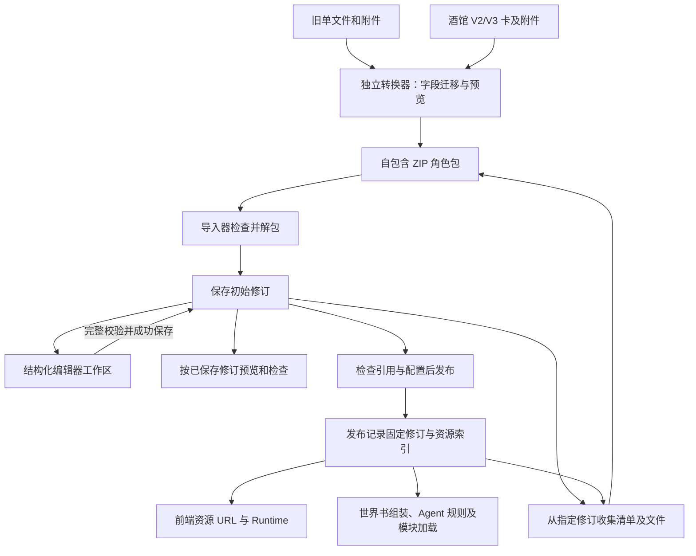

# 自包含 ZIP 角色卡与现有单文件格式迁移方案

本方案定义系统统一使用的角色包格式。管理端和用户端的替换范围见[角色卡编辑入口统一](character-card-unified-entry.md)；文中的“原生包”指本系统的 ZIP 角色包；酒馆 V2/V3 等旧单文件格式是转换器的输入。
状态：用户于 2026-09-28 批准原型及 ZIP 导入交互，授权正式实施。原生包导入、持久编辑、发布、运行与独立环境往返已实现；2026-09-29 的逐项结果见[正式验收记录](native-card-production-acceptance.md)。P6 旧格式转换器仍为后续任务。

正式管理端接入的代码核对、逐项补齐任务和联调验收见 [原生 ZIP 角色包与正式管理端联调计划](native-card-production-integration.md)。该清单作为本方案的实施与交付验收依据。

## 目录

- [1. 必须要实现的目标](#目标)
- [2. 包目录、版本与引用规则](#包结构)
- [3. 现有单文件到 ZIP 的继承关系](#迁移)
- [4. 包内 JSON 与其他文件的格式](#文件格式)
  - [4.0 固定文件名与格式校验登记](#固定文件校验)
- [5. 世界书、变量规则与 Agent 的归属](#世界书)
- [6. 解包、编辑、发布、运行与导出](#生命周期)
- [7. 变量更新 Agent 与 API 文档同步](#agent)
- [8. 实施步骤与可见交付](#步骤)
- [9. 验收清单](#验收)
- [10. 非本次目标](#范围)
- [11. 已获得的授权](#授权)

<a id="目标"></a>

## 1. 必须要实现的目标

本轮原生角色包、编辑器与运行联调阶段称为 P5。格式负责人交付一个自包含 ZIP 角色包：角色资料、世界书、开场、初始变量、更新规则、前端页面、后端模块和使用的资源均包含在包内。包中引用的角色专属正则与数据也必须收齐。导入另一个空实例后，用户配置实际模型服务即可运行角色。P5 按第 9 章验收。

编辑器在浏览器工作区修改已导入的包文件。用户成功保存后，后端为完整文件集合创建新的正整数 `revision`，并将该修订作为不可变文件集合保存。页面预览、提示词检查、变量提案检查和发布均以已保存修订为输入；正式会话读取发布记录固定的修订。导出器以所选 `revision` 或已发布版本 ID 固定来源，再生成完整 ZIP。

后续独立旧格式转换器阶段称为 P6，其目标是继承现有单文件的资料和已支持的运行行为。转换报告逐项记录旧字段、目标文件和处理结果；无法确定语义的内容留给用户决定。角色版本中的未知扩展作为来源资料保留，运行能力按三份 API 文档登记。P6 的完成条件见第 8 章 E 步骤，本轮交付范围见第 10 章。

<a id="包结构"></a>

## 2. 包目录、版本与引用规则

本方案规定首版格式标识为 `tavern_headless_role_package`，首版 `formatVersion` 为 `1.0.0`，交付扩展名为 `.zip`。这个版本描述包格式；`character.json` 的 `characterVersion` 描述作者的作品版本；系统发布产生的版本 ID 用于固定会话，两者分别保存。

```text
role.zip
├── manifest.json
├── character.json
├── openings.json
├── openings/first.txt
├── state/initial/first.json
├── worldbooks/main/book.json
├── worldbooks/main/entries/110.json
├── agents/state-update/profile.json
├── agents/state-update/rules.json
├── state/schema.json
├── backend/controllers/config.json
├── backend/controllers/prompt.js
├── backend/variable-tools/derive.js
├── backend/validators/validate.js
├── frontend/manifest.json
├── frontend/index.html
├── frontend/main.js
├── frontend/style.css
├── regex/default.json
├── assets/images/portrait.webp
└── assets/audio/theme.mp3
```

根目录固定包含 `manifest.json`、`character.json`、`openings.json`。其他文件按功能声明提供；世界书可以有多本，每本可以有多个条目文件。纯文本、JSON、脚本与二进制资源都以实际文件保存。JSON 使用 UTF-8；PNG、WebP、音频等保留二进制内容。

所有配置中的文件引用统一使用包根相对路径，例如 `worldbooks/main/book.json`。包清单为每个普通文件登记一次路径、媒体类型和用途；清单自身由固定入口定位。文件名及大小写精确匹配。路径校验继承 `roleAssetPathSchema`，解包器同时核对 ZIP 条目均落在目标目录内、路径唯一且类型为普通文件或目录。

JavaScript 模块中的相对 import，以及 HTML/CSS 中的相对资源地址，按所在文件目录解析。编辑器移动文件时更新结构化配置中的引用；脚本和样式中的引用通过依赖检查列出，用户修正后完成预览验收。

包版本变化时必须提供明确的版本迁移程序及报告。单文件输入走第 3 章的显式转换入口，ZIP 导入器按 manifest 声明的包版本读取。

<a id="迁移"></a>

## 3. 现有单文件到 ZIP 的继承关系

当前角色快照集中保存人物字段、`characterBook` 与 `extensions`。部分资源另由角色版本资产服务保存；因此，转换器既支持用户提供的旧 JSON，也支持从现有角色版本导出。读取独立旧 JSON 时，缺少的附件列入补充文件清单；读取已存角色版本时，按该版本的资产登记收集文件。

| 当前对象或字段 | ZIP 中的目标 | 继承要求 |
| --- | --- | --- |
| `name`、`description`、`personality`、`scenario`、`exampleDialogue` | `character.json` 同名字段 | 保留完整文本和已有宏 |
| `systemPrompt`、`postHistoryInstructions` | `character.json` 同名字段 | 保留组装用途及顺序 |
| `creatorNotes`、`creator`、`characterVersion`、`tags`、`nickname`、`source`、创建与修改日期 | `character.json` 同名字段 | 保留作者资料和来源 |
| `characterBook` | `worldbooks/main/book.json` 及条目文件 | 保留条目顺序、标识、正文、开关、匹配与注入设置 |
| 已绑定的其他世界书 | 各自 `worldbooks/<bookId>/` | 将固定版本内容收进包内，并保留绑定顺序 |
| `greeting`、`primaryGreeting`、`alternateGreetings`、`groupOnlyGreetings` | `openings.json` 与正文文件 | 保留全部来源、顺序与适用范围；冲突的主开场值在报告中明确选择 |
| `extensions.tavern_headless.openings` | `openings.json`、正文文件及 `state/initial/*.json` | 已整理的开场作为运行依据；保留 ID、默认项、标题、类型和完整初始变量 |
| `stateUpdate.profile` | `agents/state-update/profile.json` 及引用文件 | 内联 schema 提取到 `state/schema.json`；保留规则、可写字段、计算与校验要求 |
| `stateUpdate.files` | 对应实际文件 | 内容写入一次，清单登记一次；与已存资产内容冲突时由用户选定来源 |
| `stateUpdate.profile.modelSlot` | 转换报告中的旧模型用途 | 运行时使用系统默认变量更新模型 |
| `promptController` | `backend/controllers/config.json` 及控制器模块；`character.json.promptController` 引用该配置文件 | 模块路径改为包路径；条目引用增加所属世界书标识 |
| 原前端 `manifest.json`、HTML/CSS/JS、媒体和 `data` | `frontend/` 及资源目录 | 保留前端 API 版本、资源逻辑 ID 和现有布局行为；重写已识别的文件引用 |
| 角色卡正则 | `regex/` | 收录使用的固定内容、处理顺序和声明的执行阶段 |
| 其他作者扩展、尚未支持的插件字段 | 转换器单独保存的来源文件与转换报告 | 保留原值及来源位置；报告说明执行支持情况 |

现有主开场和已整理开场同时存在时，转换器用 `extensions.tavern_headless.openings` 形成可执行开场列表，并将原始字段保存在来源资料中供对照。只有旧字段的输入按现有开场导入规则生成列表。正文格式、变量初始化和用户姓名宏均通过现有 dry-run 及开场展示验收。

转换器为世界书条目建立 `旧来源位置 → bookId + entryId` 映射。旧 `id`、`uid` 同时存在且不一致时，报告必须展示冲突及引用对象，用户确定后再产出可发布包。已支持字段直接继承；插件语义由独立转换阶段判断。

当前结构依据：`packages/adapters-sillytavern/src/serializers/character-serializer.ts`、`types/worldbook.ts`，`packages/shared/src/schemas/role-import.ts`、`role-assets.ts`、`role-state.ts`、`role-prompt-controller.ts`，以及 `apps/api/src/services/role-runtime/role-asset-service.ts`。实施者必须把这些结构的字段逐项纳入迁移测试。

<a id="文件格式"></a>

## 4. 包内 JSON 与其他文件的格式

下列字段定义首版格式，共享 schema 统一表达结构、必填项及约束。表中标为可选的引用按启用功能提供，已提供的引用必须能在包内找到对应文件。字段默认行为沿用被引用的现有契约；新包的字段默认值由同一份共享 schema 定义。

<a id="固定文件校验"></a>

### 4.0 固定文件名与格式校验登记

本节定义首版角色包的固定入口和后端写入规则。第 4.1—4.6 节定义各类内容字段；格式负责人必须据此交付完整 JSON Schema，后端负责人实现统一校验服务。共享 schema 和正式后端校验已进入实施，各项验收状态由正式联调计划记录。

#### 4.0.1 固定入口文件

下表的路径按大小写精确匹配。`<bookId>` 是 `character.json.worldbooks[].id` 声明的世界书标识，每本世界书拥有独立目录。schema 文件统一放在 `packages/shared/src/schemas/native-card-package/`，下表列出其文件名。

| 固定路径 | 必需条件 | 用途与内容格式 | 对应 schema 文件 |
| --- | --- | --- | --- |
| `manifest.json` | 每个角色包必需 | JSON 对象；包标识、格式版本与文件清单，字段见第 4.1 节 | `manifest.schema.json` |
| `character.json` | 每个角色包必需 | JSON 对象；人物资料、世界书和功能引用，字段见第 4.2 节 | `character.schema.json` |
| `openings.json` | 每个角色包必需 | JSON 对象；开场索引及默认开场，字段见第 4.3 节 | `openings.schema.json` |
| `worldbooks/<bookId>/book.json` | 每本已声明的世界书必需 | JSON 对象；该书名称、条目顺序及检索配置，字段见第 4.4 节 | `worldbook.schema.json` |
| `state/schema.json` | 角色包提供初始变量或启用变量更新时必需 | JSON Schema 对象；定义角色变量字段、类型及约束，采用 JSON Schema 2020-12 | `state-schema.schema.json` |
| `agents/state-update/profile.json` | 启用变量更新 Agent 时必需 | JSON 对象；提示词、规则、可写范围及模块引用，字段见第 4.5 节 | `state-update-profile.schema.json` |
| `backend/controllers/config.json` | 启用提示词控制器时必需 | JSON 对象；`modulePath`、`variableRoot`、`variableMacros`、`controllerEntries`、`updaterEntries`，字段见第 4.2 节 | `controller-config.schema.json` |
| `frontend/manifest.json` | 角色包提供自定义前端时必需 | JSON 对象；API 版本、页面入口与资源映射，字段见第 4.6 节 | `frontend-manifest.schema.json` |

`manifest.character`、`manifest.openings` 固定引用表中的人物和开场文件；提供 `manifest.frontend` 时，其值固定为 `frontend/manifest.json`。`character.stateUpdate`、`character.promptController`、每个 `worldbooks[].file` 及变量更新配置的 `stateSchemaFile` 同样引用对应固定入口。后端拒绝固定入口的改名、移动，以及启用条件仍成立时的删除。用户停用可选功能时，后端在同一批操作中校验引用移除和文件删除。

#### 4.0.2 按目录确定格式的文件

以下文件的名称由作者指定，示例中的 `first`、`default`、`derive`、`validate` 和 `prompt` 均是文件名示例。后端按目录、扩展名和引用用途选择对应校验器。

| 路径规则 | 格式与用途 | 校验依据 |
| --- | --- | --- |
| `openings/*.txt` | UTF-8 开场正文，由 `openings.json` 引用 | 开场正文格式及路径规则 |
| `state/initial/*.json` | 开场初始变量对象 | `initial-state.schema.json` 的对象约束及包内 `state/schema.json` 的字段约束 |
| `worldbooks/<bookId>/entries/*.json` | 世界书条目对象 | `worldbook-entry.schema.json`；同书 `uid` 唯一，索引引用属于该书目录 |
| `agents/state-update/*.json` 中的规则文件 | `{rules:[{id,instruction,sourceEntries?}]}` | `state-update-rules.schema.json`；`profile.json` 使用上一表的专用 schema |
| `agents/state-update/*.txt` 中的规则文件 | UTF-8 规则文本 | 第 4.5 节的文本规则格式及 `ruleFiles` 引用 |
| `backend/controllers/*.js` | 提示词控制器模块 | `renderController(context)` 导出及角色卡后端 API 契约 |
| `backend/validators/*.js` | 变量校验模块 | `validate(context)` 导出及角色卡后端 API 契约 |
| `backend/variable-tools/*.js` | 变量生成工具 | `derive(context)` 导出及角色卡后端 API 契约 |
| `frontend/*.html`、`frontend/*.css`、`frontend/*.js` | 前端页面、样式和模块 | 对应语法、资源引用及前端 manifest 声明的 API 版本 |
| `regex/*.json` | 正则规则数组 | `regex-profile.schema.json`，字段见第 4.6 节 |
| `data/*.json` | 作者定义的数据 | 共享文件规则中 `schema: "json"` 的 JSON 语法约束；首版数据文件按该通用规则校验 |
| `assets/` 中的媒体文件 | 图片、音频、字体等资源 | 清单声明的媒体类型、实际文件类型及服务器配置的资源限制 |

固定入口表优先于目录规则。例如 `backend/controllers/config.json` 使用控制器配置 schema，`backend/controllers/prompt.js` 使用控制器模块契约。目录规则、固定路径、必需条件、允许的扩展名、引用目标及 schema 标识统一登记在 `packages/shared/src/config/native-card-file-rules.json`，由同目录的 `native-card-file-rules.schema.json` 定义登记结构。前后端都读取该结构化来源。

#### 4.0.3 新增、更新与保存的后端检查

后端文件服务在每次新增文件、更新文件、替换媒体、改名、移动、删除和保存整组修改时，执行以下流程。ZIP 导入、发布和打包前也调用同一校验服务。

1. 后端核对角色卡 ID 和预期修订，读取 `manifest.formatVersion` 对应的规则登记及 schema；不支持的版本返回实际版本、受支持版本和更换为受支持格式包的操作提示。
2. 后端在待提交的文件集合上应用整组操作，检查路径大小写、固定文件名、目录归属、重名、扩展名以及条件必需文件。检查对象包含该批操作的新文件及更新后的文件。
3. 后端按登记解析内容并校验根类型、必填字段、字段类型、枚举、取值范围和扩展字段。JSON 能够解析只是其中一步；每个固定文件均须通过其专用 schema。
4. 后端检查清单与实际文件集合、功能引用、世界书索引、开场索引及模块用途的一致性。更新变量 schema 时，同时重新检查所有引用它的初始变量文件；删除和移动文件时，同时检查受影响的引用。
5. 后端检查脚本语法、模块导出和声明 API 版本对应的公开调用契约。动态调用通过受控运行环境的 API 白名单检查；运行时再次校验方法、参数和返回值。
6. 全部写入检查通过后，后端提交文件、清单、引用索引和新修订。任何检查失败时，后端保留上次成功保存的文件集合，返回错误列表；前端保留用户未保存的编辑内容。

每条错误包含操作编号、文件路径、JSON Pointer 字段位置或文本行列、错误码、预期格式、实际问题和修正操作。错误结构由共享 API schema 定义，前端通过项目统一错误文案配置呈现。新增固定入口文件的操作还须检查该入口是否已存在，避免覆盖已有配置。

格式负责人必须为上述每个 schema 明确必填项、默认值、可空字段、枚举及扩展字段策略。后端与前端负责人在这些 schema 和接口文档完成后接入正式功能；验收负责人用真实写入接口逐项验证新增、更新和保存的成功及失败结果。

### 4.1 manifest.json：包入口和文件清单

| 字段 | 类型与要求 | 用途 |
| --- | --- | --- |
| `format` | string，固定为上述格式标识 | 识别原生角色包 |
| `formatVersion` | string，首版 `1.0.0` | 选择包解析与迁移规则 |
| `packageId` | 非空 string | 保持跨导出导入的包身份；系统数据库 ID 另行分配 |
| `character` | 包路径，必填 | 定位人物配置 |
| `openings` | 包路径，必填 | 定位开场配置 |
| `frontend` | 包路径，可选 | 定位角色前端 manifest；省略时使用系统聊天界面 |
| `files` | 数组，必填 | 登记每个文件的 `path`、`mediaType`、`purpose` |

文件用途继承已有 `manifest`、`template`、`browser_script`、`server_script`、`media`、`data`。规则与 JSON 配置登记为 data。清单负责定位和用途，文件本身保存内容。

带初始变量的最小清单示例：

```json
{
  "format": "tavern_headless_role_package",
  "formatVersion": "1.0.0",
  "packageId": "garden-demo",
  "character": "character.json",
  "openings": "openings.json",
  "files": [
    {"path": "character.json", "mediaType": "application/json", "purpose": "data"},
    {"path": "openings.json", "mediaType": "application/json", "purpose": "data"},
    {"path": "openings/first.txt", "mediaType": "text/plain", "purpose": "data"},
    {"path": "state/schema.json", "mediaType": "application/json", "purpose": "data"},
    {"path": "state/initial/first.json", "mediaType": "application/json", "purpose": "data"}
  ]
}
```

### 4.2 character.json：人物与功能引用

人物字段按第 3 章同名保留。新增功能引用为：`worldbooks` 数组（每项 `id`、`file`、`enabled`），可选 `stateUpdate`（配置文件路径），可选 `promptController`（控制器配置文件路径），`regexProfiles`（按执行顺序排列的文件路径数组）。`worldbooks` 的数组顺序保留绑定顺序。`worldbooks[].id` 是 bookId 的唯一声明来源，在包内必须唯一；每个 file 必须指向不同的书配置。所有条目引用的 bookId 必须命中这个声明，导入器对重复 ID、重复书文件或无效引用返回具体配置位置。

控制器保留现有 `modulePath`、`variableRoot`、`variableMacros`；`controllerEntryIds` 和 `updaterEntryIds` 改为 `controllerEntries`、`updaterEntries`，每项为 `{bookId, entryId}`，以区分不同世界书中的相同条目编号。组装器和控制器 API 同步支持这一引用，具体改动列入第 8 章。

```json
{
  "name": "花园向导",
  "description": "熟悉花园路线的向导。",
  "characterVersion": "1.0",
  "worldbooks": [{"id": "main", "file": "worldbooks/main/book.json", "enabled": true}],
  "stateUpdate": "agents/state-update/profile.json"
}
```

这个示例启用了世界书和变量更新，其资源必须同时加入 manifest 的文件清单；第 4.1 节展示带初始变量的最小包，未包含世界书和变量更新 Agent 文件。

### 4.3 openings.json：开场列表及初始状态

根字段为 `defaultOpeningIds` 和 `items`。`defaultOpeningIds` 是按会话类型保存默认开场的对象，可包含 `individual`、`group` 两个键；每种有可选开场的会话类型必须指定一个默认 ID。每项包含现有 `id`、`title`、`summary`、`kind`，增加 `audience`（`individual`、`group` 或 `both`），用 `textFile` 引用正文、`initialStateFile` 引用完整初始变量 JSON。每个默认 ID 必须指向适用于对应会话类型的条目；`both` 条目可以被两个默认项共同引用。转换器把旧 `defaultOpeningId` 映射到适用类型，其他类型的默认项由用户在转换预览中选择。

`initialStateFile` 为可选字段：该开场提供初始变量时填写，并按第 4.0.1 节同时提供 `state/schema.json`；纯对话开场可省略该字段。无其他可选功能的纯对话包由 `manifest.json`、`character.json`、`openings.json` 和一个被引用的 `openings/*.txt` 构成，导入、保存及创建会话都须通过验收。

开场正文保留纯文本及已有显示语法。源卡初始化块由转换器提取为初始变量文件，并保留在来源资料中。运行时按现有 API 生成 `displayText`，角色包中的作者正文是唯一编辑来源。独立用户扮演人设由会话配置绑定；正文中的用户宏按绑定人设展开。

```json
{
  "defaultOpeningIds": {"individual": "first"},
  "items": [{
    "id": "first", "title": "抵达花园", "summary": "从门口开始", "kind": "story",
    "audience": "individual", "textFile": "openings/first.txt",
    "initialStateFile": "state/initial/first.json"
  }]
}
```

### 4.4 世界书文件

每本 `book.json` 保存 `name`、`entryFiles`（有序路径数组），以及已有 `scanDepth`、`caseSensitive`、`matchWholeWords`、`recursive`、`maxRecursionSteps`。`extra` 保存需要保留的扩展数据。

每个条目 JSON 采用当前标准化世界书字段：`uid`、`key`、`keysecondary`、`selective`、`selectiveLogic`、`constant`、`content`、`comment`、`position`、`order`、`depth`、`role`、`disable`、`scanDepth`、`caseSensitive`、`matchWholeWords`，以及可选递归配置 `excludeRecursion`、`preventRecursion`、`delayUntilRecursion`、`outletName` 和 `extra`。枚举含义继承 `packages/adapters-sillytavern/src/types/worldbook.ts`；实施时将原生格式所用结构提取到共享 schema，适配器和原生包共同引用。

条目正文保存在该条目的 `content`，编辑器提供正文编辑区和触发条件表单。`uid` 在一本书内唯一；跨书引用使用 `{bookId, entryId}`，其中 entryId 对应 uid。`entryFiles` 保留来源顺序，运行时继续按现有触发与注入规则处理 order、position 等字段。

例如 `worldbooks/main/book.json`：

```json
{
  "name": "花园资料",
  "entryFiles": ["worldbooks/main/entries/110.json"],
  "scanDepth": 2, "caseSensitive": false, "matchWholeWords": false,
  "recursive": false, "maxRecursionSteps": 1
}
```

对应的 `worldbooks/main/entries/110.json`：

```json
{
  "uid": 110, "comment": "花园入口", "content": "花园入口有一块路线指示牌。",
  "key": ["花园"], "keysecondary": [], "selective": false, "selectiveLogic": 0,
  "constant": false, "position": 0, "order": 100, "depth": 4, "role": 0,
  "disable": false, "scanDepth": null, "caseSensitive": null, "matchWholeWords": null
}
```

### 4.5 变量更新配置、规则与模块

`agents/state-update/profile.json` 保留当前 `updaterPrompt`、`writablePaths`、`derivedPaths`、`controllerOwnedPaths`、`factsSchema` 及计算/校验模块配置；`stateSchemaFile`、`ruleFiles`、`deriveScript`、`validateScript`、`moduleFiles` 全部使用包根相对路径。状态 schema 统一写入 `state/schema.json`，事实 schema 仍为 profile 中的内联 JSON Schema。每个开场的初始变量必须通过该状态 schema。

规则文件可以是 UTF-8 文本，也可以是 JSON。后端将每份 `.txt` 文件的完整 UTF-8 内容作为一段规则文本，保留文件内的段落和换行；空文件对应空文本段，格式校验检查 UTF-8 编码和文件大小。JSON 规则文件使用 `{rules:[{id,instruction,sourceEntries}]}`；`id` 为文件内唯一字符串，`instruction` 为完整规则文本，`sourceEntries` 为可选的 `{bookId,entryId}` 数组。后端按 `ruleFiles` 顺序读取各文件的完整内容，以换行连接后加入更新请求。

后端模块按用途分目录：`backend/controllers/` 存放提示词控制器及其配置，`backend/validators/` 存放变量校验器，`backend/variable-tools/` 存放变量生成工具，用于按规则派生变量。编辑器的模块选择器按目录和 `.js` 扩展名筛选，控制器配置 JSON 由配置编辑区处理。保存检查核对模块引用的目录用途；发现跨用途引用时，检查服务返回字段位置和修正提示。

计算模块继续导出 `derive(context)`，校验模块继续导出 `validate(context)`。JSON Pointer 变量路径、输出提案和字段用途引用[角色卡后端 API](../../character-authoring/backend-api.md)；包路径只定位文件，两者分别校验。

profile 的模型参数使用现有 `maxTokens`、`updaterReasoning`；部署绑定中的实际生成参数覆盖次序继续由后端 API 规定。模型选择由第 7 章规定的系统设置负责。资源全部归包清单管理，原 `files` 对象由迁移器拆成实际文件。

以下是只更新地点的 `profile.json`，其中各文件均须列入包清单：

```json
{
  "updaterPrompt": "依据本轮已发生的事件更新地点。",
  "writablePaths": ["/location"],
  "stateSchemaFile": "state/schema.json",
  "ruleFiles": ["agents/state-update/rules.json"]
}
```

`rules.json` 为 `{"rules":[{"id":"location","instruction":"人物明确抵达新地点时更新 location。"}]}`。`state/schema.json` 为 `{"type":"object","properties":{"location":{"type":"string"}},"required":["location"],"additionalProperties":false}`。开场初始变量文件为 `{"location":"花园入口"}`。这些 JSON 各自保存为上文指定文件，运行时按引用读取。

### 4.6 前端、正则与其他资源

`frontend/manifest.json` 继承现有 `apiVersion`、`html`、`css`、`script`、可选 `floorHtml`、`assets`、`data`。这些配置中的路径改为包根相对路径；`assets` 的逻辑 ID、kind、label、tags 保留，前端通过 `api.assets.url` 取得版本资源 URL。模块内相对引用仍遵循第 2 章规则。原生 `data` 是数据逻辑 ID 到 `data/*.json` 路径的对照表；后端从固定版本读取这些 JSON，交付给 `api.data.get(id)`。例如 `"data": {"caseFile": "data/case.json"}`。

提示词预设由系统的预设管理模块保存；提示词组装器在运行时读取系统选择的预设。

`regex/*.json` 的根值为数组，继承 `GET /export/regex/:id` 返回的规则数组，每项包含 `id`、`scriptName`、`findRegex`、`replaceString`、`trimStrings`、`placement`、`disabled`、`markdownOnly`、`promptOnly`、`runOnEdit`、`substituteRegex`、`minDepth`、`maxDepth` 及已保存扩展。当前导出实现位于 `apps/api/src/routes/exports.ts`。格式负责人必须将正则资源的完整结构纳入共享 schema，并建立字段迁移测试。包内引用固定文件内容，导入器为其分配本机资源 ID 并登记绑定；导出器再恢复为包内引用。

图片、音频、字体及脚本依赖以文件保存。编辑器新增普通数据文件时登记用途为 data；新增模块时选择前端或后端用途并检查导出函数。运行必需的远程资源必须先由用户提供本地文件，再由转换器收进包。模型服务配置由安装环境提供。

<a id="世界书"></a>

## 5. 世界书、变量规则与 Agent 的归属

| 内容实际用途 | 包内归属 | 运行执行方 |
| --- | --- | --- |
| 人物、地点、物品、剧情条件及叙事资料 | 世界书条目 | 现有触发引擎选择条目，组装器加入提示词 |
| 根据正文判断变量变化的规则 | 变量更新规则文件 | 专用变量更新 Agent |
| 星期、数值归一化等确定性计算 | 后端 derive 模块 | 后端模块运行器 |
| 业务一致性约束 | 后端 validate 模块 | 后端校验流程 |
| 展示图片、状态栏、行动选项的代码 | 前端模块与样式 | 角色 Runtime |
| 根据变量产生提示词正文 | 控制器模块和世界书条目绑定 | 提示词组装流程 |

旧 MVU 条目按实际用途转换。转换器预览逐项显示“保留为世界书”“移为更新规则”“移为模块”“需要人工处理”及目标文件。混合条目必须拆分并记录来源；用户确认后生成包。转换器单独保存已转换规则的源文本与转换报告，角色包包含转换后的目标资源。

原生包的导入器和导出器保留世界书、更新规则和模块已经确定的资源归属。世界书、更新规则和模块在编辑界面分别可见；转换器提供源条目与转换结果的对照。

<a id="生命周期"></a>

## 6. 解包、编辑、发布、运行与导出



`apps/api/config/native-card.json` 的 `storageRoot` 当前为 `native-cards`；`loadNativeCardConfig` 将其解析到配置的数据根目录下。`apps/api/src/services/native-card/native-card-service.ts` 为每张角色卡的每次成功保存生成 `<cardId>/revisions/<revision>-<uuid>` 存储键，并将该键和文件清单登记在 `native_card_revision.storage_key`。`NativeCardStore` 以该存储键在 `storageRoot` 下读写修订文件。编辑器的未保存输入保留在浏览器工作区；整组检查通过且数据库事务提交后，后端登记新修订并更新 `native_card.current_revision`。发布记录将角色版本 ID 关联到确定的角色卡和 `revision`；页面预览、运行时资源服务和打包任务按已保存修订读取包文件。

独立的[角色卡编辑器](native-card-editor.md)是本方案的必需交付。其页面、各文件对应的面板、保存与冲突处理、预览流程及验收以该编辑器方案为统一定义。

新增文件先登记清单，再供配置选择。重命名更新可解析引用；删除操作先展示引用列表，由用户解除或替换引用后完成。发布检查返回具体文件、字段位置和修正操作。发布成功固定整套文件和配置，现有会话继续读取原版本；重启服务后使用相同版本定位资源。

多本世界书的存储索引使用本机书 ID，包内引用始终使用 bookId。导入及导出维护这两种身份的映射。新增书、重排书、移动条目和控制器引用修改必须通过同一引用检查。

<a id="agent"></a>

## 7. 变量更新 Agent 与 API 文档同步

系统设置为变量更新 Agent 提供独立的默认模型配置 `state_updater`，并管理模型、供应商和凭据。角色包保存变量更新任务、提示词、规则，以及变量派生与校验模块。变量更新 Agent 执行任务时读取系统默认变量更新模型。模型配置入口位于系统设置页面。

| 文档或结构 | 必须同步的定义 |
| --- | --- |
| 角色卡 JavaScript API | 包资源如何通过 assets/data 交付、已保存修订的页面预览与固定发布版本的生命周期；保留已确定的对话/状态查询分工 |
| 角色卡后端 API | 包内规则和模块解析、世界书作用域引用、专用变量更新调用、参数及失败时序 |
| Agent 工具 API | 变量更新 Agent 的实际接入方式、工具可用情况、调用记录中的执行者身份 |
| 系统导入导出及编辑 API | ZIP 上传/下载、未保存文件操作、保存修订与冲突、资源 URL、发布与完整错误结构 |
| 共享 schema | 包清单、人物、开场、世界书、资源引用、Agent 配置及对应 HTTP 数据 |

格式 schema 计划放在 `packages/shared/src/schemas/native-card-package/`。每个包内 JSON 文件必须对应明确 schema；字段约束在该处定义一次，前端、导入器、编辑器和导出器共同使用。Markdown 说明用途和示例，程序读取 schema 与配置文件。

<a id="步骤"></a>

## 8. 实施步骤与可见交付

P5 与 P6 的目标和范围见第 1 章。A—D 属于 P5，E 属于 P6；F 分别验收两阶段的交付。P5 使用原生示例包完成验收；迁移报告与旧卡转换样本属于 P6 的完成条件。

| 步骤与执行者 | 完成任务与交付 | 规范/API 同步 | 可见完成条件 |
| --- | --- | --- | --- |
| A 格式负责人 | 根据获批原型核对字段、操作契约、逐字段迁移表和示例数据说明 | 三份角色 API；`native-card-io.md` 系统接口设计 | 原型每项操作有输入、输出、错误及示例依据 |
| B 原型负责人 | 保留已获批准的编辑器原型及交互检查；转换差异页面归入 P6 | 原型操作逐项对应编辑 API | 原型基线及已有检查结果可用于正式页面对照 |
| C 后端与 SDK 负责人 | 完成正式共享 schema 和完整示例 ZIP，实现 ZIP 导入、保存修订的文件操作、版本发布、资源解析及导出 | 完整 HTTP/SDK 文档及生成类型 | 后端及 SDK 测试验证创建、保存、重启读取、导入和导出 |
| D Agent 与前端负责人 | 交付角色卡编辑器全部面板与正式接口联调，接入专用变量更新模型、多世界书引用、模块加载 | 后端与 Agent API、配置及调用记录 | 前端通过正式接口编辑和保存角色卡，预览读取后端保存的同一修订；变量更新使用系统默认模型，页面显示状态变化并可追查调用 |
| E（P6）转换器负责人 | 实现旧原生单文件迁移和酒馆转换，各自输出 ZIP | 转换请求、报告、确认和下载接口 | 源字段与目标文件逐项对照；缺附件、冲突和未支持规则有处理入口 |
| F（P5/P6）验收负责人 | 用隔离数据完成导入编辑运行导出再导入及重启验证 | 测试、截图与文档验收记录 | 在不同资源根目录重建同一角色，正文、世界书激活、状态与资源显示一致 |

E 步骤的转换器负责人还须满足以下完成条件：旧角色的全部人物字段、世界书条目、开场、初始变量与扩展均出现在迁移报告中，源内容有明确保存位置；世界书规则转为 Agent 规则时，页面显示来源、目标和确认结果，实际请求读取已确认目标。

后端、SDK 和前端负责人按[编辑器方案第 7 章](native-card-editor.md#步骤)完成各项实现；验收负责人按[第 8 章](native-card-editor.md#验收)逐项检查并保存证据，主 Agent 核对实现结果和验收记录。

各步的实现负责人先核对对应 API 文档，再完成正式接口及前后端联调。原型批准记录见[编辑器方案第 7 章](native-card-editor.md#步骤)；D/F 对正式页面与获批原型作视觉对照。dry-run 验证提示词、世界书及人设组装；固定更新提案验证变量计算与保存；实际模型语义和供应商传输按已有授权另行验收。

<a id="验收"></a>

## 9. 验收清单

- [x] 固定文件逐项通过第 4.0 节的专用 schema；错误文件名、错误目录、缺必填字段、字段类型错误、版本错误和跨用途引用均由后端写入接口拒绝。
- [x] 新增、更新、替换、移动、删除及整组保存的正常、异常和边界用例均覆盖；失败后重新读取服务器，文件、索引及修订保持上次成功状态。

角色卡编辑器必须完成[编辑器验收清单](native-card-editor.md#验收)，包格式与运行同时完成以下项目。

- [x] ZIP 文件清单和解包结果逐项一致，全部必需引用能解析；缺文件、重复路径、无效版本和无效 JSON 显示具体位置。
- [x] 两本世界书拥有相同 uid 的条目时，编辑、控制器引用、触发追踪和导出仍能区分所属书。
- [x] 世界书的开关、关键词、顺序、位置、深度、递归和 outlet 行为经 dry-run 对照保持一致。
- [x] 发布时完整核对包清单、资源引用与指定已保存修订，发布记录及运行资源均固定到该修订。
- [x] 专用变量更新 Agent 有独立绑定和调用记录，正文校验模型配置保持自身职责。
- [x] 已有会话固定旧发布版本，新会话可选择新版本；重启后前后端仍能加载相同资源。
- [x] 导出 ZIP 在不同资源根目录、不同本机资源 ID 的实例中导入后，全部必需资源可用，固定输入的组装与更新结果一致。
- [x] 角色卡正则及其引用资源随包导出；包内引用可以完整恢复为本机绑定。
- [x] 前端/后端 API 与 Agent 工具文档中的完整角色示例均使用同一个可运行 ZIP；示例注明实际执行入口。

<a id="范围"></a>

## 10. 非本次目标

本轮交付原生 ZIP、正式编辑器及运行联调。已有数据库批量迁移、正式角色自动升级、完整插件运行环境和独立旧格式转换器另列任务。真实供应商测试按第 11 章授权条件执行。

<a id="授权"></a>

## 11. 已获得的授权

用户于 2026-09-28 明确批准 `apps/web/prototypes/native-card-editor.prototype.html` 及 ZIP 导入交互，授权正式前后端实现、真实存储、发布与运行、ZIP 往返、浏览器视觉与交互验收，以及在当前分支提交本任务修改。用户要求保留原型基线及已有工作。新增依赖和外部程序按仓库授权规则处理；真实供应商调用必须先核实适用于本任务的模型、供应商及剩余预算授权。

用户另行批准 API 将 `typescript@5.9.3` 固定为生产依赖，用于 JavaScript 语法与开放 API 校验；2026-09-29 批准生产依赖 `parse5@8.0.1`、`css-tree@3.2.1` 和开发依赖 `@types/css-tree@3.2.0`，用于 HTML/CSS 语法、引用及错误定位。锁文件固定传递依赖 `entities@8.0.0`、`mdn-data@2.27.1` 和 `source-map-js@1.2.1`。安装方案及 npm 安全公告查询保存在 `.planning/native-card-production/frontend-parser-proposal.md` 和该目录的验收证据中。

用户于 2026-09-29 选择提交范围方案 B，批准将正式运行所需的历史分页、状态回看、对应测试与契约文档纳入本次提交；其余已有修改继续保留在工作区。具体文件边界见 `.planning/native-card-production/evidence/commit-scope-analysis.json`。
