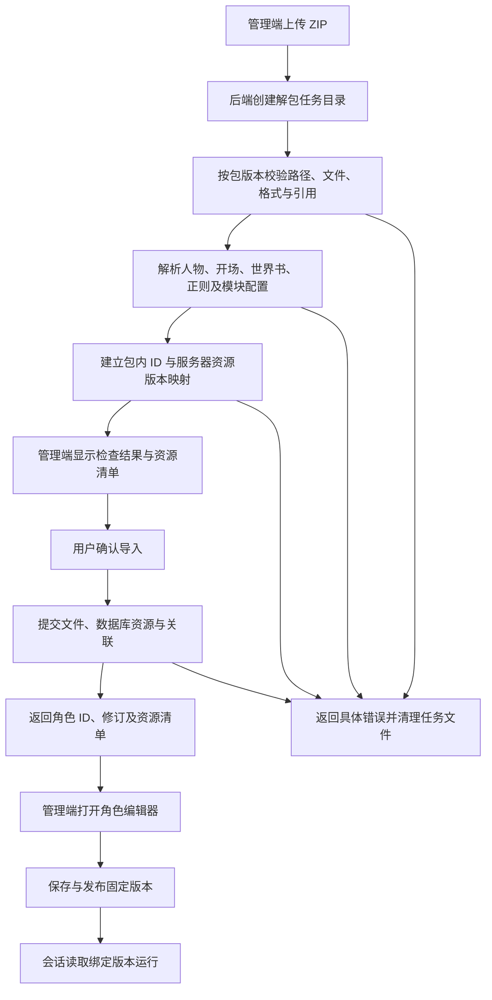

# ZIP 角色包与正式管理端联调计划

状态：用户于 2026-09-28 批准原型及 ZIP 导入交互，授权正式实施。I01–I15 的真实存储、SDK/API、受控 SSE、浏览器与 ZIP 往返验收已通过，最终项目检查结果见[正式验收记录](native-card-production-acceptance.md)。文件格式以[角色包方案第 4 章](native-card-package.md#固定文件校验)为准。

## 目录

- [1. 必须要实现的目标](#1-必须要实现的目标)
- [2. 正式代码逐项核对与补齐任务](#2-正式代码逐项核对与补齐任务)
- [3. 导入流程与提交边界](#3-导入流程与提交边界)
- [4. 实施顺序与文档产物](#4-实施顺序与文档产物)
- [5. 验收清单](#5-验收清单)
- [6. 非本次目标](#6-非本次目标)
- [7. 已获得的授权](#7-已获得的授权)

## 1. 必须要实现的目标

2026-09-29 用户明确统一角色卡格式，管理端旧角色编辑功能由新版编辑器替换，用户端消费同一固定发布版本。入口及产品文案的纠正验收见[角色卡编辑入口统一](character-card-unified-entry.md)。

第 1–5 章规定正式实施目标与验收；第 6–7 章界定范围与授权。保存修订是编辑目录一次完整保存后的编号，打包任务固定读取该编号对应的全部文件；发布从保存修订创建角色版本，并固定关联的资源版本。

前后端负责人打通正式管理端“上传原生 ZIP → 后端解包校验 → 保存角色及资源 → 编辑 → 发布 → 创建会话 → 运行 → 导出 ZIP → 再导入”的完整流程。后端负责把包文件解析为运行时实际消费的数据，并建立角色版本、资源版本和文件之间的关联。前端通过正式 SDK 调用接口，显示每一步的结果和具体错误。

## 2. 正式代码逐项核对与补齐任务

下表路径均相对于仓库根目录。“实施前基线”描述开始本任务时的正式实现；“补齐”是实施要求。当前新增的接口、解析器、存储和运行消费者映射见[原生角色卡接口](native-card-io.md#包文件到运行消费者的映射)。验收结果按第 5 章记录。

| 编号及对象 | 实施前基线 | 补齐任务及责任 | 联调验收 |
| --- | --- | --- | --- |
| I01 管理端上传 | `apps/web/src/components/workspace/RoleResourceLibrary.vue` 的 `importFile` 使用 `file.text()` 和 `JSON.parse`，文件选择器接受 JSON；`apps/web/src/lib/role-resources.ts` 的角色导入调用 `client.imports.character` | Web 负责人把角色卡上传接入原生 ZIP 接口，展示上传、检查、导入结果，成功打开后端返回的角色；其他资源的 JSON 导入按各自用途保留 | 在正式管理端选择 ZIP，网络请求传递文件，成功后刷新仍显示同一角色和文件；错误显示包内路径、原因和修改操作 |
| I02 ZIP 接收与解包 | `apps/api/src/routes/imports.ts` 的 `/import/character` 调用 `parseCharacterCard` 解析酒馆卡；`role-import-service.ts` 执行 MVU 转换；这些流程承担旧格式转换 | API 负责人新增原生包接收、解包和编排服务；原生导入直接读取原生 schema，独立转换器负责旧格式；上传大小、解压总量、文件数和任务目录由配置确定 | 原生 ZIP 可导入；损坏包、超限包、重复路径、越界路径和链接条目得到具体错误；失败后角色列表和资源库保持提交前状态 |
| I03 根清单与前端清单 | `role-asset-service.ts`、`role-view-service.ts` 都把根 `manifest.json` 解析为显示模板清单，并读取 `html/css/script`；新格式根清单是角色包入口 | API/共享模块负责人分开解析根包清单和 `frontend/manifest.json`；按声明判断是否启用自定义前端，更新资源完整性检查和视图加载器 | 纯对话包使用系统聊天界面；自定义前端包加载指定布局；根清单与前端清单互不误读 |
| I04 人物资料 | `imports.ts` 将标准化人物写入 `characters`、`characterVersions`，快照转换在 `apps/api/src/lib/character-snapshot.ts` | API 负责人将 `character.json` 映射到现有角色/版本存储；维护 packageId、服务器角色 ID 和版本 ID 的对应关系，并保存原生文件用于编辑导出 | 名称、描述等字段在管理端读回一致；dry-run 实际消息包含该版本的人物资料 |
| I05 开场及初始变量 | `role-import-service.ts` 生成 `extensions.tavern_headless.openings`；`role-release-service.ts` 固定开场快照 | API 负责人解析 `openings.json`、正文文件和初始变量文件，接入现有开场与初始状态链路；补齐按会话类型选择默认开场的映射 | 选择不同开场后，首次正文与初始状态分别一致；默认开场、缺失文件、初始值不满足 schema 均有覆盖 |
| I06 多世界书 | `imports.ts` 抽取内嵌世界书为独立资源；`role-release-service.ts` 的发布记录使用单个 `worldbook_id/worldbook_version_id` | API/共享模块负责人把包内多书及有序条目映射到世界书资源版本；扩充发布与会话固定绑定，保留书序、条目序及启停设置 | 两本书具有相同 uid 时仍分别激活和引用；dry-run 展示实际注入内容与所属书；重复导入不改变旧会话绑定 |
| I07 提示控制器 | `apps/api/src/services/role-prompt-controller.ts` 按 `modulePath` 加载，按 `controllerEntryIds` 匹配条目 | API 负责人读取 `backend/controllers/config.json` 及对应模块，将 `{bookId,entryId}` 贯穿配置、组装与追踪；绑定数据引用包内资源映射 | 两本书同编号条目仅目标条目被控制器生成；dry-run 可核对展开结果；错误定位到配置或模块 |
| I08 变量更新 Agent | `state-update-service.ts` 已读取规则文件、变量 schema，加载 derive/validate 并生成提案；`role-state.ts` 仍含模型槽，`config/role-state.json` 默认槽为 `verifier` | API/共享模块负责人从包内 profile、规则和 schema 构造现有更新上下文；系统增加变量更新 Agent 专用模型配置并由运行时读取，角色包保存更新行为 | 使用受控模型响应完成真实后端变量提交，管理端和用户端读到相同状态；实际请求使用系统专用模型配置，角色包导出保持内容配置边界 |
| I09 校验器与变量工具 | `state-update-service.ts` 已分别加载 `derive`、`validate`；`role-asset-service.ts` 校验 server_script 用途 | API 负责人按 `backend/validators/`、`backend/variable-tools/` 登记模块，执行对应导出契约和开放 API 校验；编辑器选择器与后端采用同一目录规则 | 正常工具生成变量，校验器拒绝错误提案；错目录、错导出和未开放 API 返回文件级错误；变量提交保持完整性 |
| I10 前端文件、媒体与数据 | `role-file-store.ts` 已支持暂存与按 accountId/versionId 落盘；`role-view-service.ts` 生成 `/role-assets/...` URL，读取模板和脚本；资源服务区分文件用途 | API/Web 负责人复用版本文件存储和 URL 服务，按原生目录接入 HTML/CSS/JS、assets、data，保留相对引用；后端模块继续通过服务端加载器读取 | 浏览器实际显示图片、布局并执行角色交互，数据文件可读取；刷新和服务重启后 URL 可用；服务端模块按既有访问边界处理 |
| I11 正则 | `role-resources.ts` 提供正则独立导入；发布服务使用单个 `regex_profile_id/regex_profile_version_id` | API/共享模块负责人将包内有序 `regexProfiles` 接入运行时，扩充发布固定资源关系并保留执行顺序 | 两个规则的输出依赖顺序时，导入、发布、生成、再导入结果一致 |
| I12 系统预设和模型 | 发布服务保存预设、模型槽等系统运行配置 | Web/API 负责人保持角色包内容与角色应用系统绑定的边界；导入后管理端继续从系统选择预设与运行配置 | 导出的 ZIP 只含角色内容资源，系统预设、模型和凭据保留在服务器系统配置中；导入新角色后，由管理端明确选择运行配置或按系统默认设置，dry-run 能核对所选预设 |
| I13 编辑保存与版本 | `RoleAssetService.import` 对已有版本返回 `ROLE_ASSETS_ALREADY_SAVED`，现有资源包按版本一次性写入 | API/Web 负责人增加持久编辑目录、文件 CRUD、批量保存和修订控制；发布时生成固定版本，运行会话固定读取该版本 | 修改、新增、移动、删除后保存并刷新，内容一致；并发旧修订保存显示冲突；编辑期间旧会话仍读取原版本 |
| I14 全包校验和一致提交 | 资源服务已有 manifest、文件用途、引用与落盘检查；当前人物导入与资源导入是不同调用 | API 负责人采用角色包方案第 4.0 节统一校验登记，统一编排人物、世界书、正则、文件和绑定关系的提交与失败清理 | 任一文件失败时整包导入失败；注入文件写入和数据库失败后，重启读取仍保持完整角色集合 |
| I15 ZIP 导出 | `apps/api/src/routes/exports.ts` 的角色导出提供酒馆 V2/V3 JSON；管理端下载名为 `.json` | API/Web 负责人增加按固定保存修订打包、任务状态及 ZIP 下载；编辑器显示打包来源与新改动提示 | 下载后在独立数据库重新导入，全部声明文件、引用、开场、世界书、变量行为和页面资源一致 |

## 3. 导入流程与提交边界

API 负责人必须在第 4 章第一步写清文件提交、数据库提交和异常恢复的顺序，覆盖进程在各阶段退出的情况。导入成功响应以角色及其全部资源可读为条件；资源映射随提交保存。实现必须让运行时从固定角色版本读取对应文件和资源版本，编辑目录服务于保存和后续发布。

## 4. 实施顺序与文档产物

1. **接口与映射定稿。** API、SDK、Web 负责人共同完成 ZIP 上传、导入结果、文件 CRUD、保存冲突、检查、发布、打包和下载的接口文档，逐一规定输入、输出、状态、错误及示例；补齐 I01–I15 的资源映射和 schema。交付可对照的接口文档、共享 schema 和前端页面操作表，评审通过后实施。
2. **导入和编辑链路。** API 负责人完成解包、校验、存储、映射和保存；SDK 负责人提供正式方法；Web 负责人接通实际角色上传、文件编辑和错误定位。交付正式页面操作录像、请求响应、重启读回结果，覆盖 I01–I05、I10、I13–I14。
3. **运行链路。** API 负责人接通多世界书、控制器、变量 Agent、工具、正则及发布绑定；Web 负责人接通预览和会话入口。交付 dry-run 实际消息、运行追踪、变量提交和浏览器显示结果，覆盖 I06–I12。
4. **完整交付。** 前后端负责人完成 ZIP 打包下载及独立环境再导入，覆盖 I15 和第 5 章全部项目。同步更新`docs/character-authoring/script-api.md`、`docs/character-authoring/backend-api.md`、`docs/character-authoring/agent-tools-api.md`，以及 OpenAPI、官方 SDK 和生成物；各文档写清本阶段实际支持的方法、字段、回调、错误和示例。

## 5. 验收清单

验收负责人逐项记录 I01–I15 的“通过/失败/未执行”，附正式页面截图、对应请求响应和后端持久化证据。全部通过后才能交付此项集成。

- [x] 正式管理端上传最小纯对话 ZIP 和包含全部支持资源的 ZIP，成功打开编辑器，刷新及重启后可读。
- [x] 对[角色包方案第 4.0 节](native-card-package.md#固定文件校验)每类固定文件和可变文件执行正常、错误格式、缺失引用及边界输入；前端能定位具体文件和字段。
- [x] 上传失败、落盘失败、数据库失败、进程中断、并发保存冲突均保持已提交数据完整，上传错误显示具体文件及重新选择入口；落盘和数据库错误显示失败阶段、已提交内容保留情况及重试入口；进程中断后显示恢复结果，任务文件完整时提供重试入口，任务文件缺失时提示重新选择 ZIP 并提供重新导入入口；修订冲突提示重新读取服务器内容，界面保留用户修改供对照。
- [x] 多书同 uid、多个开场、多个正则、控制器、变量工具和校验器分别通过 I05–I11 的实际链路断言。
- [x] dry-run 验收人物资料、系统预设、开场、世界书、控制器展开和历史组装；验收负责人阅读实际消息判断含义与归属。
- [x] 正式浏览器通过真实 API 发送消息并立即上屏；受控模型响应经过后端 SSE 到前端逐段显示；变量更新完成后状态区更新。记录受控响应测试和真实供应商测试各自覆盖范围。
- [x] 自定义布局、媒体、数据读取、操作控件、键盘操作和错误跳转按批准原型逐项对照，保存相同视口截图。
- [x] 编辑并保存后打包固定修订；打包过程中继续编辑，下载内容仍对应所选修订；下载 ZIP 在独立环境重新导入并完成运行验收。
- [x] OpenAPI、SDK 及三份角色作者 API 文档与上述正式链路一致；运行项目规定的相关测试、生成物检查及文档构建。

## 6. 非本次目标

独立旧格式转换器、既有数据批量迁移、多人实时协同编辑和通用插件平台另列任务。模型供应商测试按已有授权范围与预算执行。

## 7. 已获得的授权

用户于 2026-09-28 批准编辑器及 ZIP 导入原型，授权实施本表 I01–I15、执行真实前后端联调与视觉验收、更新文档及生成物，并仅提交本任务修改到当前分支。原型批准记录见 [编辑器方案第 7 章](native-card-editor.md#步骤)，外部程序、依赖及模型调用条件见 [ZIP 角色包方案第 11 章](native-card-package.md#授权)。
