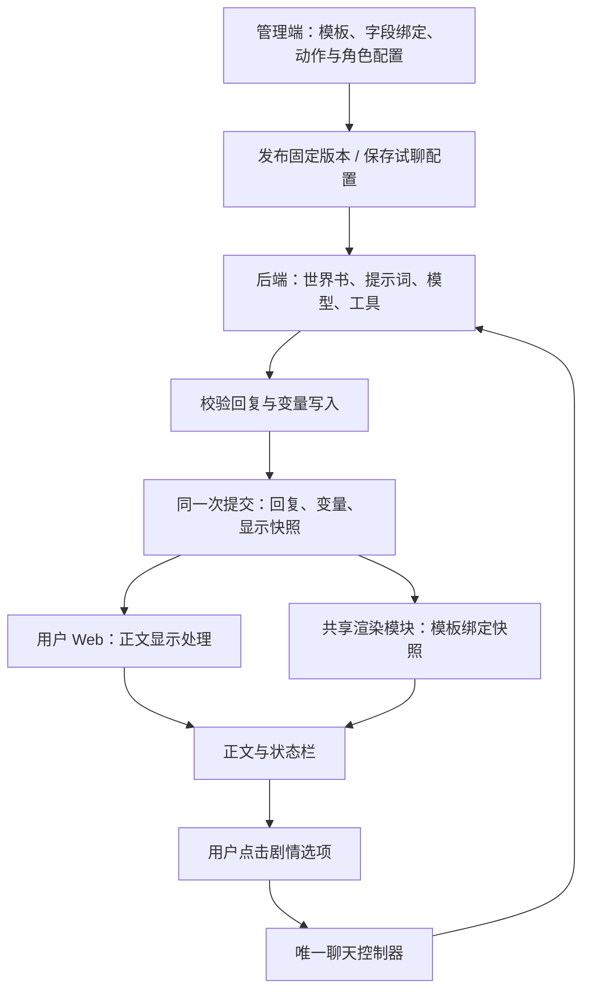

<!-- markdownlint-disable MD013 -->

# 角色状态栏与前端渲染架构

## 必须要实现的目标

本方案设计 TavernHeadless 自己的前端渲染架构。角色可以定义消息内状态栏，也可以定义整屏演绎页面中的背景、人物立绘、对话区、状态区和操作区；管理员配置与试聊后发布，用户无需配置即可使用。管理端试聊和正式会话共用用户 Web 的聊天实现，管理端编辑预览共用同一显示模块。

本方案状态为待用户评审、正式接口待实施。系统与角色布局的逐项归属、现有原型能力和验证范围见[布局边界方案](role-layout-boundary.md)。现有原型已补充消息内状态卡、整屏演绎布局、模板编辑预览和剧情选项交互；这些内存交互用于设计验收，正式后端接入仍待实施。SillyTavern 仅作为设计参考，源码事实见[本地调研](rich-status-rendering-research.md)。

## 参考架构的取舍

| SillyTavern 的做法                 | 优点                                   | 本地实现暴露的代价                                           | 我们的设计                                                          |
| ---------------------------------- | -------------------------------------- | ------------------------------------------------------------ | ------------------------------------------------------------------- |
| 正则替换生成 HTML/CSS              | 改卡即可改变外观，模型无需生成完整页面 | 数据捕获、布局与代码常混在同一字符串，格式变化可破坏整个面板 | 状态数据、HTML/CSS 模板、按钮动作分别保存；显示正则用于消息内容处理 |
| 显示和 prompt 正则分开             | 用户看到的美化内容无需进入模型上下文   | 多通道、深度与顺序使实际文本难以追踪                         | 保留通道与排序，为每条消息提供完整显示执行记录                      |
| 卡内脚本调用宿主 API               | 作者自由度高，可以扩展复杂交互         | 依赖宿主 DOM、命令语法、插件版本与事件先后，移植成本高       | 模板声明动作，由唯一聊天控制器执行；渲染使用应用内实现的控件        |
| 插件将整页 HTML 放进 iframe        | 隔离文档样式，可运行整页程序           | 每条消息多一个文档环境，需要同步高度、主题、事件和生命周期   | 原生模板采用 Shadow DOM 承载，应用统一管理布局、事件和销毁          |
| 消息捕获值或插件消息变量驱动状态栏 | 适配多种角色内容                       | 展示来源不统一，插件刷新与变量更新可能依赖事件顺序           | 后端提交一份关联具体回复的显示快照，前端读取明确版本                |

这些代价指本地核对到的实现路径，不代表所有 SillyTavern 卡都存在同样问题。我们的取舍也有成本：需要维护模板契约、编辑预览和历史显示快照；任意 JavaScript 插件不能直接执行。截图所需的布局和操作均在本方案范围内。

## 数据、模板和动作的归属

本方案使用的“显示模板”“显示快照”“剧情选项”定义于 `packages/shared/CONTEXT.md`。以下资源、字段和模块为拟新增设计；已有接口仍按当前 schema 执行。

| 对象         | 唯一来源                           | 内容与责任                                                                                               |
| ------------ | ---------------------------------- | -------------------------------------------------------------------------------------------------------- |
| 演绎变量     | 后端现有变量系统                   | 保存时间、地点、人物状态等事实；现有暂存、校验、提交链路决定何时生效                                     |
| 显示模板     | 角色应用绑定的版本化显示资源       | 使用位置、HTML、CSS、控件挂载位置、字段绑定、显示条件、资源引用及允许动作；由管理端编辑                  |
| 显示快照     | 会话创建或具体回复提交时生成的记录 | 已获准显示的变量值、来源、模板版本、动作参数；按来源关联会话或对应回复的分支、楼层、页面、执行和消息标识 |
| 当前可用操作 | 后端当前会话能力结果               | 判断本轮是否仍为当前回复、是否正在生成、当前使用者是否可发送；读取时计算                                 |
| 前端临时状态 | 用户 Web                           | 输入框内容、折叠状态、滚动位置；同样的快照重新渲染时仍对应同一演绎事实                                   |

显示快照包含会话初始记录或回复提交记录，保存业务显示值与固定动作参数，当前操作能力单独读取。旧消息的地点和数值保持原值；旧消息的按钮是否能发送由当前会话状态决定。模板版本随发布和会话绑定固定；管理员已获准的会话配置调整从后续轮次生效，历史记录保留原模板。

## 消息内布局与整屏演绎布局

显示模板的 schema 明确定义两种使用位置：消息内布局随具体回复展示，整屏演绎布局占用用户 Web 的演绎内容区。角色配置可以绑定其中一种，也可以组合使用。整屏布局支持背景、分层立绘、侧栏、浮动状态面板、标签页和可展开对话区，桌面与手机断点由模板 CSS 定义；浏览器全屏模式与整屏页面布局分别处理，前者由用户主动开启。

整屏模板通过命名插槽安排角色展示区和系统聊天区的位置及主题。角色通过通用节点树安排消息历史、输入区、阅读正文与当前选项；作者契约以[附加模板规范](../character-authoring/template-api.md)和[交互 API](../character-authoring/interaction-api.md)为准。对话区与输入区以应用维护的控件嵌入模板，控件内部继续使用同一聊天控制器。系统提供对话历史折叠控件；用户 Web 外层保留返回角色列表和打开会话操作的入口。完整历史、输入、失败重试及分支操作始终有可达入口，实施者按既有功能保留清单验收。

整屏数据来源和历史回看行为统一按[布局边界方案的数据时序](role-layout-boundary.md#数据时序与渲染顺序)执行。消息内布局始终使用所属消息的快照。新会话在首轮回复前使用会话创建时提交的初始显示快照，其数据来自角色已保存的初始变量配置；初始记录与回复记录由 schema 区分来源。

渲染模块为整屏布局维护一个随会话切换销毁的实例，为消息内布局维护随消息挂载销毁的实例。整屏模板更新绑定值时保留输入草稿、控件展开状态及滚动位置；模板版本或会话切换才重建相应布局。模板负责展示位置与主题，应用控件负责数据加载和操作。这使角色能改变整个页面外观，同时保持唯一聊天实现。

## 后端执行与前端显示顺序

后端实施负责人复用 `packages/core/src/tools/builtin-provider.ts` 的 `set_variable`、`apps/api/src/services/variables/` 和 `turn-commit-service.ts`。角色所需状态通过已有变量写入流程产生，前端重绘只读取状态。第一版采用现有工具写入路径，启用范围按主计划“发布与会话规则”第五项执行；模型能力、工具启用和角色必需变量在配置及试聊时一起验证。仅在正文中生成状态文字的角色，需要管理员调整其输出配置；自动把任意正文变成业务变量不属于该路径。

角色发布配置显式声明显示字段和允许动作，后端仅向用户响应投影这些字段；模型凭据和内部提示词保留在后端。后端在现有变量校验与提交流程中应用角色显示字段约束，读取本次接受写入后的有效值，并在提交回复的同一事务保存显示快照。模板中标为必需的字段必须通过类型与范围校验；可选字段按配置隐藏对应区域。缺字段或错误类型进入已有校验失败流程并形成具体字段记录，实施者按主计划的失败处理验收，保持回复、变量和快照的提交结果一致。

现有 `/variables/resolve` 读取当前作用域值；`branch-local-variable-snapshot-service.ts` 的快照按 floorId 更新，不能直接承担全部历史回复显示。后端负责人新增按提交身份保留的显示快照，使用页面、执行和消息身份区分结果。重新生成产生新的显示记录，旧记录保持可读；分支选择返回该分支对应的回复与快照。编辑正文只修改正文及其显示结果，状态重算通过重新生成进入后端提交链路。响应通过共享 schema 明确已提交记录与正在生成记录，前端按提交标识关联流式事件与最终结果。生成中展示逐步到达的正文，状态栏随最终提交结果更新。

当前提示词流程对用户消息执行 prompt 正则，对 AI 回复执行 persist 正则；后者使用组装提示词时的变量。这个顺序保持后端现有含义。显示流程读取提交后的显示快照，分别处理两个输出：正文执行 display 正则再做 Markdown 渲染；状态栏直接绑定模板与快照。显示正则的深度按当前分支消息位置计算，调整规则顺序可改变正文显示，但状态数据仍来自对应快照。世界书负责模型上下文；其正则位置目前是 reserved，`applyWorldInfoRegexRules` 仍返回原结果，实施者必须单独补齐后再声明支持。

## 模板与浏览器渲染

### 节点树与 CSS 的自定义能力

当前附加模板由结构化节点树、CSS 和字段绑定组成。节点树定义布局结构，CSS 定义角色视觉风格，绑定为指定节点设置文本、图片、数值、显示条件及选项列表，并声明应用控件的挂载位置。前一轮原型中的 HTML 模板仅作为历史验证保留。管理员能编辑模板代码、字段和条件，并即时预览；字段表提供常见绑定操作。首版交付这些编辑能力，完整拖拽页面搭建器留作独立需求。

绑定使用明确的变量键，与现有后端裸变量键语义一致。结构化对象的字段路径单独声明，避免将 `scene.location` 同时解释为完整键名和对象路径。变量值通过 DOM 文本与属性赋值进入模板；HTML 结构由已校验模板提供。人物图片使用发布资源引用；后端发布流程提供用户可读取的媒体地址并保护被引用资源的生命周期，现有资产版本接口的名称本身不能证明已有媒体托管能力。

进度条、折叠、标签页、列表及聊天区域使用应用维护的控件。字段配置声明进度条的上下限，控件按该范围计算显示比例；演绎变量的范围由后端 schema 校验。条件立绘按字段条件选择已绑定图片。第一版的表达能力限定为字段读取、明确比较、条件选择、列表遍历和这些控件所需计算，由结构化配置定义；扩充运算时同时扩充 schema、编辑器和验收用例。

### 采用单一原生渲染方式

前端负责人在 Shadow DOM 内挂载校验后的模板，并设置局部基础样式、与模板使用位置匹配的宿主尺寸约束及主题变量。Shadow DOM 用于样式封装，其本身不提供脚本安全隔离。模板编译器允许声明式布局和绑定，脚本、内联事件与不受支持的 CSS 或 URL 在编辑校验中明确报出；行为由应用控件实现。CSS 校验规则、允许的元素属性与 URL 类型由同一结构化配置维护，发布端和前端读取同一份定义。[Shadow DOM 文档](https://developer.mozilla.org/en-US/docs/Web/API/Web_components/Using_shadow_DOM)

同一模板版本只编译一次，整屏实例和每条可见消息按各自的数据来源绑定显示快照。用户端沿用时间线分页，切换和卸载消息时统一销毁控件事件；验收涵盖长消息、长列表、整屏布局与图片加载后的高度变化。该方式减少了每条消息的独立文档及跨窗口通信成本，但需要我们维护受支持控件和模板规范。

显示正则仍支持对正文进行替换与 HTML 美化。正则生成的 HTML 同样经过模板元素、属性与样式规则校验，在相同显示模块中呈现；其生成内容限定为获准的声明式展示，聊天动作按下一节的动作契约执行。正则编辑器展示每条规则的处理文本、过滤情况及最终视觉结果。当前原型中的正则状态表格保留为旧原型场景，后续状态栏原型转为独立模板绑定，已有普通正则功能继续保留。

## 剧情选项如何产生真实交互

模板为按钮声明动作标识及参数来源，应用只提供两种聊天动作：填写输入框、发送消息。用户端模板中的折叠、标签页切换与展开历史属于展示操作。用户端按照角色发布配置或管理员试聊配置，展示消息内布局或整屏布局。发布配置定义按钮使用哪种聊天动作，前端显示名称与动作对应。

初始画面可以提供发布配置中声明的剧情选项，通过初始显示快照关联会话，在首轮生成前按当前能力结果开放；首轮提交后按历史选项处理。固定选项来自发布资源；模型生成的选项经已声明的变量字段进入提交校验，写入该回复显示快照。按钮点击后只向聊天控制器提交快照和动作标识，发送动作由后端解析权威快照中的参数，复用现有会话生成入口。后端验证会话归属、当前分支和回复、生成状态及该动作是否仍可用；前端按能力结果启用按钮。历史选项可以复制到输入框，直接发送操作仅对仍有效的当前回复开放。

用户点击“增加感情”时，系统发送该选项绑定的剧情指令，按正常模型与工具链生成下一轮。数值按后端变量写入规则提交。输入框发送与选项发送共用同一个生成状态及重复请求处理，避免形成两套会话行为。发送失败、重试与重新生成全部沿用唯一聊天控制器。

## 模块、接口与管理端

| 实施对象                              | 职责及完成产物                                                                                                                         |
| ------------------------------------- | -------------------------------------------------------------------------------------------------------------------------------------- |
| `packages/shared` 的拟新增显示 schema | 唯一定义模板资源、绑定、快照、动作请求及校验诊断；实现时同步 OpenAPI 和 SDK，样例数据从该 schema 校验                                  |
| `apps/api` 的角色发布与轮次提交模块   | 保存模板版本；校验绑定与必需状态；在事务中保存显示快照；提供媒体引用和动作解析                                                         |
| 拟新增 `packages/role-view`           | 对外提供模板校验、消息显示准备和挂载更新/销毁三个用途的接口；内部复用现有纯正则引擎、Markdown 与 HTML 处理能力，管理端和用户端共用实现 |
| `apps/user-web`                       | 读取显示快照与当前操作能力，调用共享渲染模块，唯一聊天控制器执行动作                                                                   |
| `apps/web`                            | 模板与字段编辑、渲染预览、资源绑定、发布和逐轮显示诊断；试聊跳转用户 Web                                                               |

读取响应在现有 timeline/message 契约上增加显示记录关联，加载模板按固定版本取得。动作请求携带会话、分支、显示快照和动作标识，来源按初始记录或回复记录区分，回复来源额外携带对应回复标识；数据结构以共享 schema 为准。具体路由与错误码在实施时随 OpenAPI 交付，本方案不把拟定字段当作现有接口事实。

管理员在角色配置中选择显示模板、映射变量、选择图片、配置选项并发布。模板与绑定内容复杂且需要反复试聊，因此通过管理 Web 编辑；部署地址等低频环境配置保留为文件配置。

生成详情按“保存的正文 → 后端变量写入及提交结果 → 显示快照 → 正文正则逐条结果 → 模板绑定与最终布局 → 按钮产生的下一轮记录”展示证据。后端记录与前端派生记录明确分开。预览允许使用未保存模板，正式试聊和发布使用已保存版本；预览输入与实际消息来源分别标记在管理端调试工具中。

显示模块将绑定失败、规则错误、资源加载失败定位到模板版本、字段或资源。用户页面按具体故障提供对应操作，详细诊断归管理端记录。接口错误文案从唯一的结构化错误码映射读取，实施时按当前仓库约定维护。

## 验收清单

当前任务的完成条件是：参考架构的利弊有源码依据，自有架构明确数据和动作责任，旧方案冲突已修正，实施步骤可以逐步视觉验收。下表第一步原型已交付、待用户验收；第二步至第四步正式实现待实施。

| 步骤                    | 执行主体与产物                                                                                                                            | 纵向可视验收                                                                                                                                                                 |
| ----------------------- | ----------------------------------------------------------------------------------------------------------------------------------------- | ---------------------------------------------------------------------------------------------------------------------------------------------------------------------------- |
| 1. 修订两端原型         | 设计 Agent 使用 prototype 技能修订现有两端原型，新增模板编辑、消息内状态栏、整屏演绎与选项布局；拟新增响应先以共享 schema 定义后构造 mock | 管理员编辑模板进入同一用户端试聊，展示截图所需图片、日期、数值、进度条、文本和四个选项；切换消息内与整屏两套模板，核对背景、立绘、可展开对话区和手机布局，数据与外观分别变化 |
| 2. 单角色真实数据与渲染 | 后端、前端实施者交付最小模板版本、提交快照、资源引用和共享渲染模块                                                                        | 管理员保存模板，用户完成真实一轮，字段与后端提交记录一致；刷新仍得到相同显示值；新会话初始画面和首轮提交后的整屏更新各有对应快照                                             |
| 3. 动作与历史           | 后端、前端实施者接通选项请求、唯一聊天控制器、历史快照与版本绑定                                                                          | 点击选项产生真实下一轮；失败重试、重新生成、分支切换后数据正确；旧回复保持旧数值，失效动作不能直接发送；重复点击只产生一次发送                                               |
| 4. 编辑与调试闭环       | 管理端、后端实施者交付完整字段编辑、正则预览、发布校验和关联记录                                                                          | 调整规则排序/深度/启用状态，核对正文结果；调整模板与变量绑定，核对状态栏；发布后新会话使用新版本，旧会话固定；必需字段缺失、错误类型、资源加载失败和窄屏布局均能定位与处理   |

这些步骤细化[主计划](role-app-dual-web-plan.md)第一步和第三步，并沿用第二步的真实聊天与发布基础。世界书的常驻、关键词、辅助词、递归、深度、Outlet、停用和未命中场景仍按既有引擎及接口验收；状态栏方案的变化保持这些验收范围。

测试负责人通过共享渲染接口验证规则顺序、空列表、数值范围、绑定缺失、模板错误与动作分支；通过 API 集成验证提交原子性、历史选择、版本引用和动作权限；通过浏览器核对图片、折叠、按钮、滚动与管理端往返。原型截图用于设计验收，正式接口测试和浏览器结果用于功能验收。

## 非本次目标

本次交付架构方案及两端原型修改，正式业务代码在后续实施步骤完成。SillyTavern 插件运行环境、任意角色 JavaScript、MVU/STscript 兼容层、完整拖拽页面搭建器及通用插件平台均作为独立需求评估。现有管理端功能和正则操作继续按已确认恢复清单保留。

## 已获得的授权

用户要求依据原型与讨论完善方案，并明确管理端试聊使用唯一用户 Web。用户授权参考本地 SillyTavern 的源码、插件和角色卡进行分析，并要求设计适合本项目、能避免参考架构缺点的前端渲染架构。本次在已有独立 worktree 修订方案；本次未安装依赖、执行角色脚本或修改业务实现。布局边界的 mock 验证和有条件隔离后端授权见[布局边界方案](role-layout-boundary.md)。

## 本轮原型交付记录

原型实现位于 `apps/web/prototypes/shared/role-view.prototype.js`、同名 CSS 和 `role-view-data.prototype.js`，由管理端及用户端两个原型页面共同加载。新增显示配置使用 `role-view-config.schema.prototype.json` 定义的拟议契约；该文件不代表现有后端已提供模板接口。原有 HTTP fixture 保持原样，逐轮状态由其变量记录转换为显示数据，初始状态和选项来自独立的角色显示配置。原型的显示快照属于内存派生记录。

用户端历史回看行为按[布局边界方案的数据时序](role-layout-boundary.md#数据时序与渲染顺序)执行。用户端提供完整对话记录展开和剧情选项。管理端“配置 → 演绎界面”提供布局、标题、颜色、字段绑定、进度条范围、选项显示及 HTML/CSS 编辑预览；应用后仍按原流程保存角色配置，再新建试聊或发布。生成详情的“正则与显示结果”增加模板与变量对应及视觉结果。背景和人物插画为本地 SVG 资源。

浏览器已核对桌面 1247 × 884 和手机 390 × 844 的布局，确认手机无页面横向溢出，窄屏会话操作可展开。已操作失败重试、当前选项发送、历史选项填入输入框、历史回看与当前选项隔离、配置保存和新试聊跳转；第 1 轮信任值（`relationship.trust`）保持 20，第 4 轮失败重试成功后信任值为 55，当前选项发送新增一轮。正式服务请求、后端持久化和任意角色模板能力按后续实施清单验收。

## 原型角色展示区标题的数据来源

`apps/web/prototypes/shared/role-view.prototype.js` 按所选轮次读取以下数据；初始画面使用会话配置。

| 显示内容 | 原型取值                                    | 数据所属模块                             |
| -------- | ------------------------------------------- | ---------------------------------------- |
| 角色名   | 轮次显示配置 `presentation.characterName`   | 角色资源名称的发布副本；原型初始值为林岚 |
| 页面标题 | 轮次显示配置 `presentation.title`           | 管理端“演绎界面”配置；当前值为灯塔来信   |
| 地点     | `presentation.bindings.location` 指定的变量 | 轮次变量（当前绑定 `scene.location`）    |
| 时间     | `presentation.bindings.time` 指定的变量     | 轮次变量（当前绑定 `scene.time`）        |

地点和时间来自该轮 `/variables/resolve` 响应的 `data.resolved`，原型将其转换为 `floor.debug.variables`，再保存到该轮显示记录。初始画面的变量来自 `role-view-data.prototype.js` 的 `initial`。`presentation` 是本方案提出的显示配置，正式后端接口仍按实施清单接入。

## 用户端状态栏与消息操作

用户端状态栏在桌面和手机上默认展开；用户可以主动收起。消息操作采用图标按钮，鼠标悬停或键盘聚焦时展示原操作名称，按钮保留同名的无障碍标签。
